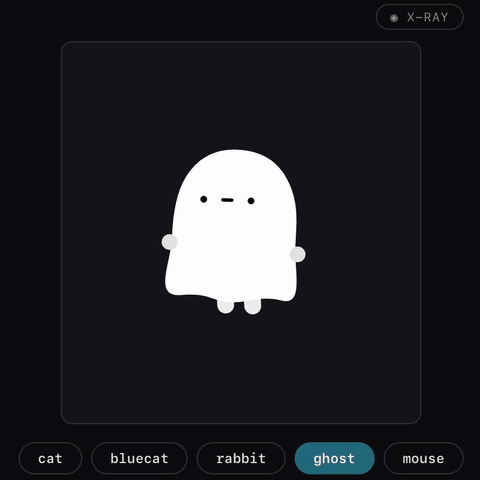
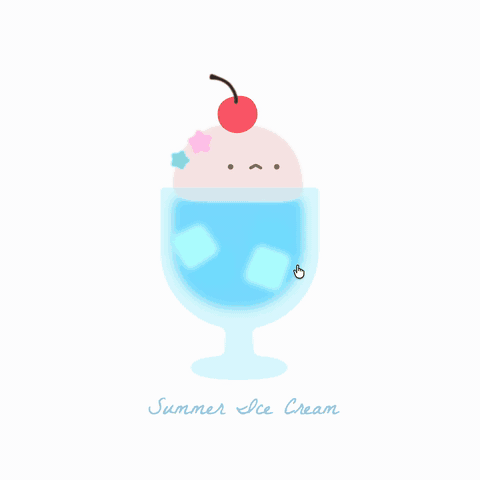
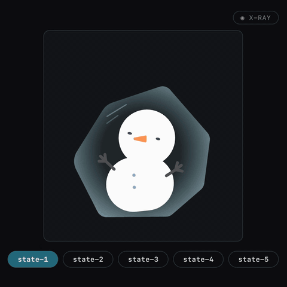
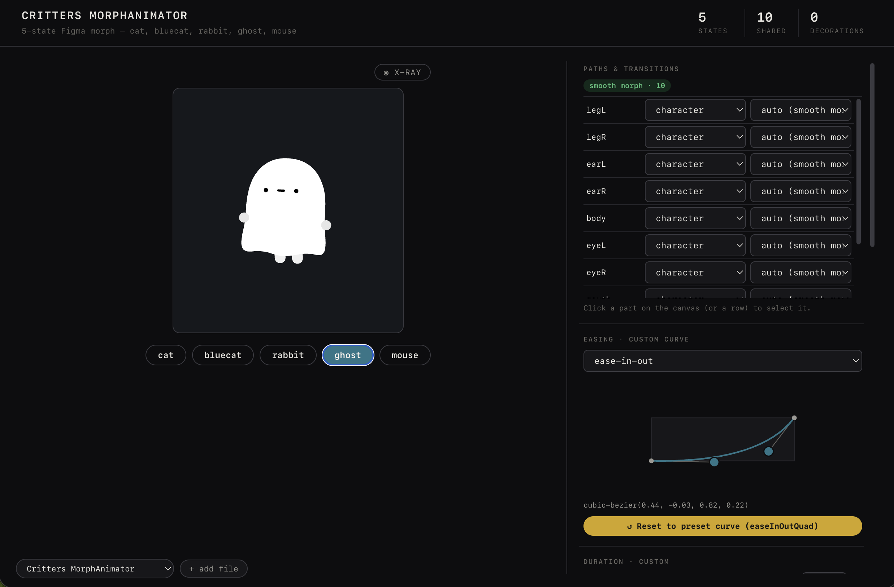

# SVG Character Animator

[](LICENSE)
[](https://agentskills.io)
[](https://github.com/molauu/svg-character-animator/stargazers)

**Turn 2–10 static SVG poses into a living character — smooth state morphs, breathing, blinking, swaying, and Web or SwiftUI export.**

Give your coding agent a set of SVG states and one prompt. The skill teaches it how to build a production-ready React state machine, while the included Animator Studio lets you preview, tune, debug, and export the result without installing an app.

[Open Animator Studio](https://molauu.github.io/svg-character-animator/animator-studio-en.html) · [Install the skill](#install) · [See examples](#examples) · [How it works](#why-the-morphs-stay-clean) · [中文说明](#中文说明)

<p align="center">
  
  
  
</p>

## What you get

| Part | What it does |
|---|---|
| **Agent Skill** | Teaches Claude Code, Codex, Cursor, and other compatible agents to turn 2–10 SVG states into a runnable React animation. |
| **Animator Studio** | A standalone browser editor for live preview, easing curves, idle presets, per-path debugging, and export. No app install required. |
| **Exporters** | Export a self-contained Web player, transparent PNG sequence, or native SwiftUI view. |

This is useful for mascots, onboarding characters, empty states, interactive menus, icon transitions, game UI, and any illustration that needs to feel alive.

## Install

### Codex

Install for your user account:

```bash
git clone https://github.com/molauu/svg-character-animator.git ~/.agents/skills/svg-character-animator
```

Codex detects skills in `~/.agents/skills`. If it does not appear immediately, restart Codex, then invoke it with `$svg-character-animator` or describe an SVG character animation task normally.

For a repository-scoped install, clone or add this repository at:

```text
<your-project>/.agents/skills/svg-character-animator/
```

### Claude Code

```bash
git clone https://github.com/molauu/svg-character-animator.git ~/.claude/skills/svg-character-animator
```

Then mention the skill in your request or ask Claude Code to read its `SKILL.md` first.

### Cursor and other coding agents

Clone the repository anywhere your agent can read it, then attach or reference `SKILL.md` in the task. The skill follows the open [Agent Skills](https://agentskills.io) format.

## Make your first animation

### 1. Prepare 2–10 SVG states

Use one SVG per pose, expression, or character state. Matching parts should use the same element `id` in every file — for example, `left-eye`, `mouth`, and `body`.

For the cleanest result:

- Keep every state on the same canvas and `viewBox`.
- Reuse IDs for parts that correspond across states.
- Give unique IDs to decorations that only appear in one state.
- Preserve editable paths instead of flattening the whole character into one compound path.

### 2. Prompt your agent

```text
Here are four SVG states of my mascot: happy, sleepy, excited, and sad.
Use the svg-character-animator skill to build a clickable React state machine.
Add subtle breathing while idle, blink every few seconds, and keep the feet
anchored during transitions. Also create a states file I can tune in Animator Studio.
```

### 3. Tune and export

Open Animator Studio, drop in the generated `*.states.js` file, adjust the easing and per-path behavior, then export for Web, PNG, or SwiftUI.

## Animator Studio

Animator Studio is a self-contained HTML editor. Open it in your browser with two ready-to-use examples already loaded:

- [Open Animator Studio](https://molauu.github.io/svg-character-animator/animator-studio-en.html)
- [打开中文版 Animator Studio](https://molauu.github.io/svg-character-animator/animator-studio-cn.html)

<p align="center">
  
</p>

Prefer to work offline? Download one file and open it locally:

- [Download the English Studio](animator-studio-en.html?raw=1)
- [下载中文版 Studio](animator-studio-cn.html?raw=1)

The bundled library starts with these examples, and you can add your own `*.states.js` files at any time:

- [`examples/critters.states.js`](examples/critters.states.js)
- [`examples/snowman.states.js`](examples/snowman.states.js)

The Studio includes:

- Live state switching and rapid-interruption testing
- Easing curve editor with presets
- Breathing, blinking, swaying, gaze, and other idle presets
- Per-path strategy, anchor, role, and timing controls
- Path/debug mode for inspecting mismatched artwork
- Web player, PNG sequence, and SwiftUI export

The first launch needs an internet connection because React and Babel are loaded from a CDN.

## Why the morphs stay clean

Naive SVG morphing sends every shape through a polygon-based morph library. That often makes circles collapse, curves wobble, stroke caps flatten, and face parts drift apart.

SVG Character Animator chooses a strategy **for each path**:

| Strategy | Used when | Result |
|---|---|---|
| **Exact interpolation** | Matching paths have the same normalized command structure | Original Bézier curves and stroke geometry stay intact. |
| **Morph fallback** | A shape genuinely changes topology | A morph library handles only the paths that actually need it. |
| **Fade in/out** | A decoration exists in only some states | The decoration appears cleanly instead of morphing from nothing. |

It also normalizes equivalent path commands, interpolates transforms and flat colors, splits multi-subpaths safely, and blends transition motion with idle motion instead of letting the two fight.

Read the deeper implementation notes in [`references/`](references/).

## Exports

| Export | Output |
|---|---|
| **Web player** | One self-contained `.html` file for direct use or embedding with an `<iframe>`. |
| **PNG sequence** | A `.zip` of frames at 12–60 fps, 1–3× scale, with optional transparency. |
| **SwiftUI** | One self-contained `.swift` file carrying the states, easing, and idle motion. |

You can also export SwiftUI from the command line:

```bash
node scripts/export-swift.js character.states.js CharacterView.swift
```

## Examples

### Critters

A multi-character morph demo with source artwork available on [Figma Community](https://www.figma.com/community/file/1659319721901348257/svg-skill-demo).

- States: [`examples/critters.states.js`](examples/critters.states.js)

### Snowman

A five-state character used to test path normalization, expression changes, idle motion, and fast state switching.

- States: [`examples/snowman.states.js`](examples/snowman.states.js)

## Repository map

```text
SKILL.md                    Instructions the coding agent reads
references/                 Strategy, normalization, idle, and iOS guides
templates/                  Production React component and preview source
scripts/                    Studio build, Figma conversion, SwiftUI export
assets/preset-library.json  Easing and idle presets
examples/                   Ready-to-open example state files
evals/                      Skill evaluation prompts
animator-studio-en.html     Standalone English editor
animator-studio-cn.html     Standalone Chinese editor
```

The Studio HTML files are generated artifacts. Edit `templates/preview/*`, then rebuild:

```bash
node scripts/build-standalone.js
node scripts/build-standalone.js --lang cn
```

## Feedback and contributions

If an SVG produces a broken transition, open an issue with:

- The smallest SVG pair that reproduces the problem
- The expected behavior and a screen recording of the result
- The browser and coding agent you used

Bug reports, example characters, exporter improvements, and documentation fixes are welcome.

## License

**Code is MIT. Example artwork is CC BY-NC 4.0.**

- Everything except the example artwork is covered by [`LICENSE`](LICENSE) and may be used commercially.
- Artwork under `examples/` is © molauu and covered by [`examples/LICENSE.md`](examples/LICENSE.md). It may be shared and adapted with attribution for non-commercial use.
- Use your own artwork for commercial characters and products.

---

# 中文说明

[English](#svg-character-animator) | **中文**

**把 2–10 个静态 SVG 状态变成会呼吸、眨眼、摇摆并能丝滑切换状态的角色，还可以导出为网页、PNG 序列帧或原生 SwiftUI。**

这个仓库包含两部分：

1. **Agent Skill**：教 Claude Code、Codex、Cursor 等编程智能体生成可运行的 React 角色状态机。
2. **Animator Studio**：无需安装的浏览器编辑器，可以实时预览、修改缓动曲线、设置待机动画、逐路径调试并导出。

## 安装 Skill

### Codex

安装到用户级 Skill 目录：

```bash
git clone https://github.com/molauu/svg-character-animator.git ~/.agents/skills/svg-character-animator
```

如果没有立即显示，重启 Codex。之后可以输入 `$svg-character-animator` 显式调用，也可以直接描述 SVG 角色动画任务。

### Claude Code

```bash
git clone https://github.com/molauu/svg-character-animator.git ~/.claude/skills/svg-character-animator
```

### 其他编程智能体

把仓库克隆到智能体能够读取的位置，在任务中附加或引用 `SKILL.md`。本项目遵循开放的 [Agent Skills](https://agentskills.io) 格式。

## 快速开始

1. 为同一个角色准备 2–10 个 SVG 状态。
2. 对应的部件在每个 SVG 中使用相同的 `id`，例如 `left-eye`、`mouth`、`body`。
3. 让智能体读取本 Skill，生成 React 状态机和 `*.states.js` 文件。
4. 打开[在线中文版 Animator Studio](https://molauu.github.io/svg-character-animator/animator-studio-cn.html)，或[下载离线版](animator-studio-cn.html?raw=1)，切换内置示例或载入自己的 states 文件进行调试和导出。

示例 Prompt：

```text
这是我的角色的四个 SVG 状态：开心、困倦、兴奋和难过。
使用 svg-character-animator skill 制作一个点击切换的 React 状态机。
待机时添加轻微呼吸和间歇眨眼，切换时让脚底保持固定，
并生成一个可以在 Animator Studio 里继续调整的 states 文件。
```

## 核心能力

- 逐路径判断应该精确插值、真实变形，还是淡入淡出
- 自动规范化等价但写法不同的 SVG 路径
- 变形动画与呼吸、眨眼、摇摆等待机动画融合
- 快速连续切换时仍保持动画稳定
- 可视化修改 easing、anchor、路径策略和动画属性
- 导出独立网页、透明 PNG 序列帧和原生 SwiftUI

## 导出

| 格式 | 输出内容 |
|---|---|
| **Web player** | 一个自包含 `.html`，可以直接打开或用 `<iframe>` 嵌入。 |
| **PNG sequence** | 12–60 fps、1–3 倍分辨率、可选透明背景的序列帧 `.zip`。 |
| **SwiftUI** | 包含状态、缓动和待机动画的单个 `.swift` 文件。 |

## 许可

代码采用 MIT 协议；`examples/` 中的示例美术由 molauu 创作，采用 CC BY-NC 4.0。商业项目请使用自己的角色美术素材。
