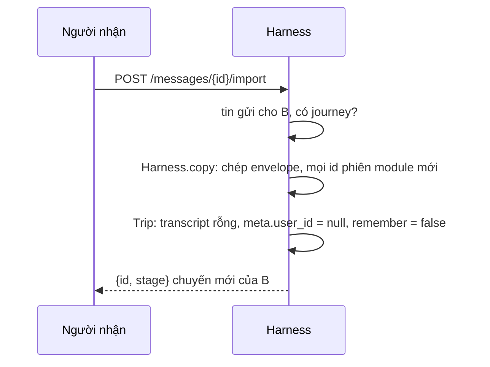

# Tài khoản

Đăng nhập (Google, email + mật khẩu), phiên, khách, hồ sơ, avatar, xóa tài khoản và liên kết Google Calendar. Code: `src/accounts/` (public API ở `__init__.py`), HTTP ở `src/harness/server.py`, Postgres ở `src/db/` + `migrations/`. Web: `web/src/user/account.ts`, `screens/Auth.tsx`, `screens/Account.tsx`.

## 1. Quy tắc

- `/app` cần một phiên: tài khoản (Google, hoặc email + mật khẩu §2b) hoặc phiên khách (§7); landing `/` vẫn public.
- Hồ sơ là **prior**, không phải fact: chuyến hiện tại luôn thắng (`docs/TRIP_UNDERSTANDING.md` §17).
- Chỉ lưu hash SHA-256 của token phiên; refresh token Google mã hóa bằng Fernet (`TOKEN_ENC_KEY`).
- Admin xem được mọi dữ liệu người dùng; không ai gõ fact địa điểm qua tài khoản.

## 2. Đăng nhập

```text
GET /api/auth/google/start?next=/app/...      → 302 Google (code + PKCE S256, scope openid email profile)
GET /api/auth/google/callback?state&code     → kiểm state, đổi code, verify id_token (google-auth)
                                              → upsert users theo google_sub → auth_sessions → cookie → 302 next
POST /api/auth/logout                         → xóa phiên, xóa cookie
```

- `state` lưu ở bảng `oauth_states` (10 phút, dùng một lần) và trong cookie `tg_oauth` (`Path=/api/auth`); callback chỉ nhận khi hai cái khớp. Callback duy nhất là `GOOGLE_REDIRECT_URI`, dùng chung cho đăng nhập và Calendar (`purpose: login | calendar`).
- `next` chỉ nhận đường dẫn trên site (bắt đầu bằng `/`, không `//`, không `\`); sai thì về `/app`.
- Cookie `tg_session`: `HttpOnly; SameSite=Lax; Path=/`, `Secure` khi `APP_BASE_URL` là https, 30 ngày; dùng lại sau hơn 1 giờ thì gia hạn 30 ngày và gửi lại cookie.
- Lỗi đăng nhập về `/app/login?error=denied|state|failed`; tài khoản `status ≠ active` không đăng nhập được.
- Lần đầu: màn đồng ý điều khoản và chính sách dữ liệu (bắt buộc tích), ghi `profiles.consents.{terms,privacy} = {version, at}`. Phiên bản hiện tại là `TERMS_VERSION` trong `src/accounts/service.py`; đổi phiên bản thì mọi người được hỏi lại.
- Walk-through không có Google: `TG_TEST_LOGIN=1` bật `GET /api/auth/test/login?email=&name=&next=`; route tự tắt khi `APP_BASE_URL` là https.

## 2b. Đăng ký và đăng nhập bằng email

```text
POST /api/auth/register {email, password, name?}  → users(email, password_hash) + profiles → cookie → {signed_in}
POST /api/auth/login    {email, password}         → kiểm hash → cookie → {signed_in}
```

- Mật khẩu 8–128 ký tự, lưu **scrypt** (`n=2^14, r=8, p=1`, salt 16 byte, dạng `scrypt$n$r$p$salt$hash`; `users.password_hash`, `migrations/005_password.sql`). Không bao giờ log hay trả lại. Email chuẩn hóa chữ thường, duy nhất (cũng với email của tài khoản Google): trùng thì 409.
- Đăng nhập sai luôn trả một câu `401 wrong email or password` (email lạ, sai mật khẩu, tài khoản Google không có mật khẩu: như nhau, và email lạ vẫn tốn thời gian băm như email có thật).
- Chống dò: cùng origin (403 nếu khác); một địa chỉ tối đa 20 lần đăng ký + đăng nhập mỗi 15 phút (`AUTH_PER_IP_15MIN`); một email sai mật khẩu 8 lần trong 15 phút thì chờ (`AUTH_FAILS_15MIN`); quá thì 429.
- Email **chưa được xác nhận** bằng thư (chưa có kênh gửi thư) và **chưa có quên mật khẩu**. Vì thế khi chính email đó đăng nhập bằng Google (Google đã xác nhận), Google nhận lại tài khoản: gỡ mật khẩu, kết thúc mọi phiên cũ, giữ chuyến và hồ sơ.
- Như Google: lần đầu có màn đồng ý điều khoản; khách đang mở được chuyển chuyến sang tài khoản (`auth.guest_adopted`); sự kiện `auth.register` / `auth.login`. Xóa tài khoản xóa luôn `password_hash`.
- Web: `registerWithEmail` / `loginWithEmail` ở `account.ts`, form hai tab "Đăng nhập" · "Tạo tài khoản" dưới nút Google ở `screens/Auth.tsx`.

Web: `account.ts` đọc `GET /api/harness/me`; mọi lời gọi `/api/harness/*` trả 401 đưa về màn đăng nhập rồi Google trả về đúng trang đang mở.

## 3. Hồ sơ và avatar

| API | Việc |
|---|---|
| `GET /api/harness/me` | `{id, email, name, nickname, bio, avatar, role, home_city, usual_mobility, usual_companions, consents, needs_consent, calendar, terms_version}`; mở app cũng kết thúc trạng thái tạm im thông báo |
| `POST /api/harness/me/consent` | `{version}` = phiên bản hiện tại |
| `PATCH /api/harness/me` | `display_name` ≤ 60, `nickname` (3–24 ký tự `a-z 0-9 . _`, `@` đầu và chữ hoa được chuẩn hóa, duy nhất; trùng → 400 `nickname is taken`), `bio` ≤ 160, `home_city` ≤ 80, `usual_mobility ∈ {motorbike, car, walk}` (`walk` = không dùng xe riêng; hệ thống không đặt xe công nghệ), `usual_companions ∈ {solo, partner, friends, kids, parents}`; `null` / `""` xóa trường |
| `POST /api/harness/me/avatar` | Body là file ảnh, tối đa 5 MB, JPEG / PNG / WebP mà Pillow mở được; cắt vuông, 256 px, bỏ EXIF, lưu `data/accounts/avatars/<uuid>.webp`; file gốc không giữ |
| `GET /api/harness/avatars/<key>` | Ảnh WebP; chưa có avatar riêng thì `avatar` là ảnh Google |
| `DELETE /api/harness/me` | `{confirm: true}`; web hỏi hai bước |

Prior cho Trip: khi tạo hành trình, `usual_mobility` / `usual_companions` vào Trip State với `source = profile` (hiện ✎ "từ hồ sơ"); lời người dùng trong chuyến ghi đè. `home_city` chưa vào Trip: điểm xuất phát của Trip là một điểm có tọa độ chọn từ ô tìm kiếm.

## 4. Xóa tài khoản

Thu hồi token Google trước, rồi xóa `profiles`, `calendar_links`, `push_subscriptions`, `notification_prefs`, `auth_sessions`, `oauth_states`, `saved_items`, mọi `friendships` và `messages` có người này (cả hai phía), file avatar và mẫu dài hạn của Trip. `users` giữ dòng với `deleted_at`, `status = deleted`, email / tên / nickname / giới thiệu / `google_sub` bị xóa. `journeys`, `events`, `feedback`, `trips`, `notifications` giữ lại với `user_id = NULL`. Đăng nhập lại bằng cùng Google tạo tài khoản mới.

## 5. Liên kết Google Calendar

`GET /api/auth/google/start?purpose=calendar&next=` (cần đang đăng nhập) xin thêm scope `calendar.app.created` với `access_type=offline`, `prompt=consent`, `include_granted_scopes=true`; chỉ gọi khi người dùng bấm "Thêm vào Google Calendar". Callback chỉ nhận khi Google trả refresh token, có đúng scope, và cùng tài khoản Google đã đăng nhập; xong về `next?calendar=connected`, lỗi về `next?calendar=failed`. Ngắt kết nối thu hồi token (`docs/COMPANION.md` §Calendar).

## 6. Postgres

Container `tripguardian-pg` (`postgres:16`, `127.0.0.1:5433`, volume `tripguardian-pgdata`). `./run.sh db` tạo / khởi động container, tạo role và database (`python -m db bootstrap`, cần `POSTGRES_PASSWORD`) rồi `python -m db migrate`. `./run.sh db-backup` → `data/backup/pg/<ngày>.sql.gz`, giữ 14 bản. Cổng 5432 trên máy là Postgres khác, không dùng.

- `tg_app` (`DATABASE_URL`) ghi; `tg_analytics` (`DATABASE_URL_READONLY`) chỉ `SELECT`, không đọc `auth_sessions`, `oauth_states`, `calendar_links`, `push_subscriptions`.
- Migration là file SQL đánh số trong `migrations/`, áp một lần mỗi file trong transaction, ghi vào `schema_migrations`; chạy lại không làm gì.
- Test đánh dấu `pg` chỉ chạy khi có `TEST_DATABASE_URL`; mỗi test dùng một schema tạm.

## 7. Khách

Vào `/app` không cần đăng nhập: nút `Lên lịch chuyến của bạn` ở landing (hoặc `Dùng thử, không cần tài khoản` ở `/app/login`) gọi `POST /api/auth/guest` (cùng origin). Server tạo một dòng `users` với `kind = 'guest'` (không email, không Google) cùng `profiles`, và cookie `tg_session` là cookie phiên, phiên phía server hết hạn **24 giờ** trượt: cùng cookie, cùng kiểm tra chủ sở hữu như tài khoản. Luôn tạo khách **mới, hồ sơ trống như người mới**: phiên đang mở trong trình duyệt (tài khoản hay khách cũ) kết thúc trước (`Accounts.logout`; khách cũ bị xóa cùng chuyến), cookie mới thay cookie cũ, và web xóa trạng thái cục bộ của chuyến trước (`forgetLocalState` ở `account.ts`: chuyến đang lập, danh sách chuyến, câu trả lời Tìm hiểu, Đã lưu cục bộ). Khách không giữ gì ngoài phiên, và **phiên khách chết cùng trang**: cookie khách là cookie phiên (không `Max-Age`, mất khi tắt trình duyệt); khách có thể mở ở nhiều tab và sống chừng nào còn một tab mở. Mỗi tab ghi tên mình vào `localStorage` (`tg.guest.live`, nhịp 20 giây) và vào `sessionStorage` (`tg.guest.tab`, sống qua tải lại). Tab **khách cuối cùng** đóng (`pagehide`, không còn tab nào khác nhịp trong 10 phút) mới gửi `POST /api/auth/guest/leave` (sendBeacon); server đánh dấu `auth_sessions.leaving_at` (`migrations/006_guest_leaving.sql`) và `Accounts.purge_leavers()` (luồng nền, 15 giây một lần) xóa khách cùng chuyến sau `LEAVE_GRACE_S` = 45 giây, trừ khi chính khách đó quay lại trong lúc chờ (tải lại trang: mọi lời gọi hoặc `POST /api/auth/guest/alive` xóa dấu). Đóng một tab trong khi tab khác của khách còn mở thì khách không bị đăng xuất. Đi sang Google để đăng nhập không tính là đóng trang (`holdGuest`). Phiên khách **không được nối lại sau khi đã đóng hết**: cookie khách gặp ở tab không có dấu và không có tab khách nào khác đang mở (mở lại trình duyệt) bị kết thúc và xóa ngay. **Tài khoản (Google hoặc email) không bị ảnh hưởng gì**: `leave` chỉ đánh dấu phiên khách, phiên tài khoản vẫn 30 ngày trượt như thường. Trình duyệt chết đột ngột không kịp báo thì dọn theo hạn 24 giờ ở dưới. Người đang đăng nhập cũng chọn được khách ở landing ("Dùng thử khách" trên thanh trên và dưới cùng): dữ liệu của tài khoản trên server không bị đụng tới, trạng thái cục bộ của họ được cất theo id (`tg.stash.<id>`) và trả lại khi họ đăng nhập lại. Không giới hạn số khách theo địa chỉ (bỏ ngày 2026-10-15: nhiều máy chung một mạng trường hoặc sự kiện có chung một địa chỉ); vẫn áp kiểm tra cùng origin và giới hạn request của `config/security.yaml`.

| | Tài khoản | Khách |
|---|---|---|
| Lập chuyến (hiểu → chọn → lịch), phản hồi | có | có, như nhau |
| Số chuyến | không giới hạn, giữ lâu dài | không giới hạn, xóa khi hết phiên |
| Hồ sơ làm prior, học qua các chuyến (`remember`) | có (học theo đồng ý) | không: không prior, `remember = false` |
| Chuyến của tôi | mọi chuyến | các chuyến của phiên này |
| Hôm nay, thông báo, Google Calendar, avatar, sửa hồ sơ, bạn bè, tin nhắn | có | không: server trả `403 {"error": "guest"}`, web hiện "cần đăng nhập Google" |
| Đã lưu, Đã xem gần đây (§9) | có | có, mất cùng khách |
| Điều khoản | màn đồng ý lần đầu | không chặn (`needs_consent = false`) |

- **Dọn:** `Accounts.purge_guests()` xóa khách mà mọi phiên đã hết hạn, khi có khách mới và mỗi giờ bằng luồng nền của `run()`. Xóa `trips` (kéo theo điểm dừng, check-in) rồi dòng `users`; `journeys`, `events`, `feedback` ở lại với `user_id = NULL`, như khi xóa tài khoản (§4). Đăng xuất hoặc `DELETE /api/harness/me` của khách xóa ngay (`drop_guest`).
- **Khách đăng nhập Google:** callback chuyển các hành trình của khách sang tài khoản (`Harness.adopt`) rồi xóa dòng khách; sự kiện `auth.guest_adopted`.
- `GET /api/harness/me` có `guest`; `new_users` của analytics chỉ đếm `kind = 'user'`.
- Web: `startGuest()` ở `account.ts` (xóa trạng thái cục bộ rồi đọc lại `/me`); `screens/Guest.tsx` (ghi chú khách ở Chuyến của tôi và Phản hồi, trang Hôm nay / Thông báo cần đăng nhập, trang Khách thay Hồ sơ); thanh bên ẩn Thông báo; cột Bạn bè mời đăng nhập Google.

## 8. Bạn bè

Chỉ tài khoản Google (khách không có nickname). Module `src/social/` (`Social`), bảng `friendships`, `messages`, cột `users.nickname`, `bio`, `last_active_at` (`migrations/004_social.sql`).

- **Kết bạn:** tìm theo tiền tố nickname (≥ 2 ký tự, tối đa 8 kết quả, không gồm khách, tài khoản đã xóa, chính mình). Người gửi phải có nickname. Lời mời là `pending`; người nhận chấp nhận thì `accepted`. Hai người mời nhau thì lời mời sau tự chấp nhận lời mời trước. Từ chối, hủy lời mời, hủy kết bạn đều xóa dòng; tin nhắn cũ vẫn giữ.
- **Online:** `last_active_at` ghi khi gọi `GET /friends`, tối đa mỗi 60 giây; online = trong 180 giây gần nhất. Chỉ bạn bè đã chấp nhận thấy online, người lạ và lời mời luôn `online = false`. Web hỏi danh sách mỗi 30 giây khi tab đang hiện. Không có trạng thái hoạt động nào khác.
- **Tin nhắn:** chỉ giữa bạn bè; ≤ 2000 ký tự; mở hội thoại là đánh dấu đã đọc tin nhận được. Web hỏi tin mới mỗi 4 giây khi khung chat mở.
- **Gửi lịch trình:** tin nhắn kèm `journey` là một hành trình **của người gửi** (server kiểm `Harness.owns`, sai → 400). Người nhận bấm "Lấy về":



Bản sao độc lập: sửa bản sao không đổi chuyến gốc và ngược lại. Lấy lại lần nữa trả `{id, already: true}` của bản đã lấy (`messages.imported_journey_id`). Sự kiện `journey.copy` (`source` = hành trình gốc).

| API (`/api/harness/…`) | Việc |
|---|---|
| `GET users?q=` | `[{id, nickname, name, bio, avatar, online, relation: none\|friend\|sent\|received}]` |
| `GET friends` | `{friends: [… unread], incoming, outgoing}` |
| `POST friends` `{to}` | mời (hoặc chấp nhận lời mời ngược) |
| `POST friends/{id}/accept`, `DELETE friends/{id}` | chấp nhận; từ chối / hủy / hủy kết bạn |
| `GET messages/{friend}?after=` | ≤ 200 tin, cũ trước |
| `POST messages/{friend}` `{text, journey?}` | gửi |
| `POST messages/{id}/import` | lấy về bản sao chuyến |

## 9. Đã lưu và Đã xem gần đây

`accounts.Library`, bảng `saved_items (user_id, kind, item_id)`; `kind ∈ {place, theme}` (nơi trong corpus hoặc chủ đề ở trang chủ), tối đa 500 mục. Đã xem gần đây không có bảng riêng: đọc 12 mục mới nhất từ `events` của chính tài khoản (`detail_open` → nơi, `theme_open` → chủ đề).

| API | Việc |
|---|---|
| `GET /api/harness/me/library` | `{saved: [{kind, id, at}], recent: [{kind, id, at}]}` |
| `POST /api/harness/me/library` `{kind, id, on}` | lưu / bỏ lưu, trả lại cả thư viện |

Lần đầu web đọc thư viện, các nơi đã lưu ở trình duyệt từ trước (`tg.saved.v1`) được gửi lên rồi xóa khỏi trình duyệt.
