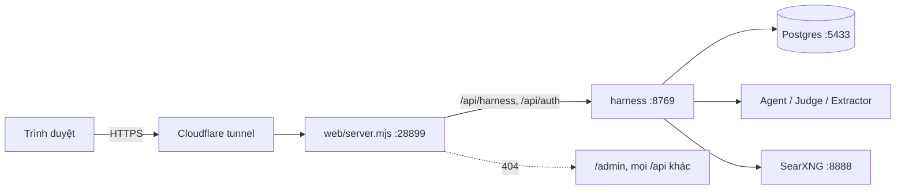
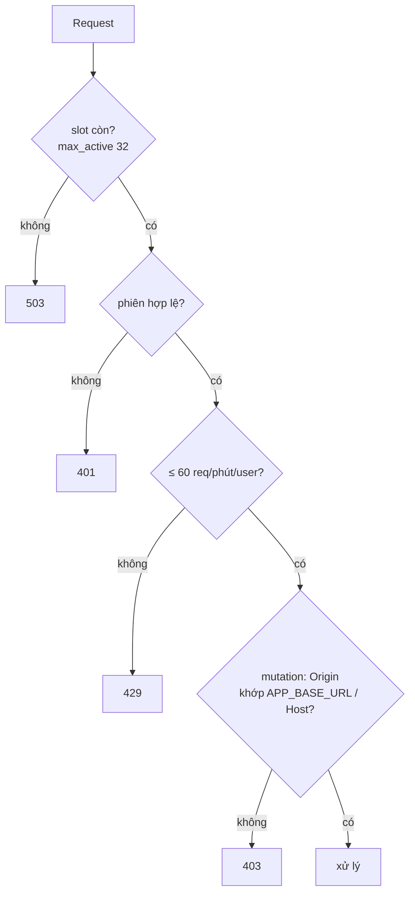

# Bảo mật

Tổng hợp các lớp bảo vệ **đang có trong code** và khoảng trống còn lại. Chi tiết từng cơ chế nằm ở tài liệu chuyên biệt; file này chỉ trỏ tới.

## 1. Ranh giới tin cậy

- Mọi tiến trình nghe `127.0.0.1`; chỉ tunnel Cloudflare ra internet. Chỉ `web/server.mjs` được tunnel trỏ tới.
- Công khai: landing, `/app`, `/assets`, `/img`, `/data`, ảnh `/media/*` (jpg / webp / png) và clip `/media/tiktok/<id>/video.mp4`.
- Riêng tư (public trả 404): `/admin`, review server `:8765`, analytics `:8770`, API độc lập của Trip / Decision / Planning (`:8766–8768`).
- `web/server.mjs` từ chối đường dẫn có thành phần bắt đầu bằng `.`, file `.map`, đường dẫn thoát khỏi thư mục gốc hoặc symlink ra ngoài (`inside()`), mọi method khác GET / HEAD ngoài proxy.

## 2. Xác thực và phiên

Chi tiết: `docs/ACCOUNTS.md` §2, §2b, §7.

| Việc | Cách làm |
|---|---|
| Đăng nhập Google | code + PKCE S256; `state` ở bảng `oauth_states` (10 phút, một lần) và cookie `tg_oauth`; `id_token` verify bằng `google-auth` |
| Email + mật khẩu | scrypt (`n=2^14, r=8, p=1`, salt 16 byte), `hmac.compare_digest`; sai luôn một câu `401`, email lạ vẫn tốn thời gian băm |
| Token phiên | `secrets.token_urlsafe(32)`; DB chỉ lưu SHA-256 |
| Cookie `tg_session` | `HttpOnly; SameSite=Lax; Path=/`, thêm `Secure` khi `APP_BASE_URL` là https; tài khoản 30 ngày trượt, khách là cookie phiên + hạn 24 giờ |
| Refresh token Google | mã hóa Fernet (`TOKEN_ENC_KEY`); xóa tài khoản thu hồi token trước |
| `next` sau đăng nhập | chỉ đường dẫn trên site (`safe_next`) |
| Đăng nhập thử | `GET /api/auth/test/login` chỉ bật khi `TG_TEST_LOGIN=1` và `APP_BASE_URL` không phải https; `./run.sh prod` bỏ cả hai biến khỏi môi trường |

Chống dò mật khẩu: một email sai 8 lần trong 15 phút thì `429` (`AUTH_FAILS_15MIN`).

## 3. Phân quyền dữ liệu

- Mọi `/api/harness/*` cần phiên; ngoại lệ duy nhất là `POST /api/harness/events` cho `page_view` / `landing_cta` ở landing.
- Hành trình của người khác trả `404` như không tồn tại (`Harness.owns`). ID phiên module do harness lấy từ hành trình đã xác thực, model không cung cấp.
- Khách bị chặn `403 guest` ở hồ sơ, thông báo, push, bạn bè, tin nhắn, Calendar.
- Gửi lịch trình cho bạn: chỉ hành trình **của người gửi**; người nhận lấy bản sao độc lập, không chia sẻ trạng thái.
- Xóa tài khoản: xóa hồ sơ, token, phiên, tin nhắn, file avatar; `journeys` / `events` / `feedback` giữ lại với `user_id = NULL` (`docs/ACCOUNTS.md` §4).
- Postgres có hai role: `tg_app` ghi; `tg_analytics` chỉ `SELECT` và bị `REVOKE` trên `auth_sessions`, `oauth_states`, `calendar_links`, `push_subscriptions` (`migrations/001_init.sql`). SQL dùng tham số `%s`; ba chỗ nội suy tên cột / bảng chỉ lấy từ danh sách cố định (`PROFILE_FIELDS`, bảng xóa tài khoản).

## 4. Chống CSRF và lạm dụng request

- Mutation (POST / PATCH / DELETE) và các route `/api/auth/*` ghi phải có header `Origin` cùng origin; thiếu `Origin` cũng bị từ chối.
- Body JSON ≤ 64 KB; từ chối `Transfer-Encoding`, `Content-Encoding` ≠ identity, nhiều `Content-Length`, JSON lồng quá sâu. Avatar ≤ 5 MB.
- `config/security.yaml`: 32 request đang xử lý, 128 socket (`ProtectedHTTPServer`), timeout đọc 15 giây, bộ đếm tối đa 10.000 khóa (hết thì từ chối khóa mới).
- `web/server.mjs`: tối đa 64 socket tới harness, `headersTimeout` 15 giây, `requestTimeout` 30 giây, 100 request mỗi socket.
- Quota nằm trong một tiến trình; lưu lượng lớn phải chặn ở Cloudflare (`docs/AGENT_HARNESS.md` §5).

## 5. Chat, model, nội dung không tin cậy

Chi tiết: `docs/AGENT_HARNESS.md` §5, `docs/TRIP_UNDERSTANDING.md` §18.

- **Cổng vào:** `agents.screen_input` chuẩn hóa Unicode / URL encoding, bắt mẫu ghi đè hướng dẫn, dò bí mật, shell / SQL / script, Base64 rõ ràng; độ dài 1–4.000 ký tự, cấm ký tự điều khiển. Mã chỉ được đọc như chữ, không chạy. Cổng này duyệt cả `text`, chữ ở thẻ tự do và giá trị trong payload có cấu trúc.
- **Phạm vi:** Agent quyết định theo `CHAT_POLICY` (tin nhắn, lịch sử, ảnh, trang web, kết quả tool đều là dữ liệu không tin cậy). Không có classifier model đứng trước.
- **Quyền Agent:** chỉ tool du lịch đã khai báo; không có tool chạy lệnh, sửa cấu hình, ghi corpus hay chọn phiên khác. `ProcessLimiter` giới hạn 2 lượt song song, hàng chờ 16.
- **Đọc web (SSRF):** `web_read` chỉ nhận URL do `web_search` trả trong lượt; chỉ http(s) cổng 80 / 443, không credential, IP public; kiểm mọi kết quả DNS rồi pin IP khi kết nối; kiểm lại mỗi redirect (≤ 3); không dùng proxy môi trường; giới hạn byte và thời gian; không chạy JavaScript. Trang hoặc snippet có mẫu injection rõ ràng không đưa cho Agent.
- **Ảnh người dùng:** chỉ JPEG / PNG / WebP, ≤ 2 MB, ≤ 16 triệu pixel, một khung; `verify()` rồi mã hóa lại, bỏ EXIF, cạnh ≤ 2048; ảnh không lưu, request chỉ giữ hash. Prompt đọc ảnh coi chữ / QR trong ảnh là dữ liệu.
- **Avatar:** giải mã và lưu lại WebP 256 px, bỏ EXIF, không giữ file gốc, tên file là UUID.
- **Không bịa fact:** model ngoài chỉ qua schema; không có bằng chứng thì `unknown`; hard constraint fail-closed (`AGENTS.md`).

Bộ lọc heuristic và prompt phạm vi giảm rủi ro, không chứng minh chặn mọi prompt injection. Ranh giới chính là schema, quyền tool, xác thực phiên và không thực thi dữ liệu.

## 6. Bí mật và dữ liệu

- Khóa nằm trong `.env` (gitignored cùng `.env.*`, chỉ `.env.example` được commit): `LLM_API_KEY`, `UIT_API_KEY`, `AGENT_API_KEY`, `GOOGLE_CLIENT_SECRET`, `TOKEN_ENC_KEY`, `VAPID_PRIVATE_KEY`, `POSTGRES_PASSWORD`, `DATABASE_URL*`. Gọi model theo vai trò, model cụ thể ở config (`docs/LLM_PROVIDER.md`).
- `SEARXNG_SECRET` truyền bằng biến môi trường khi `docker run`, không nằm trong `docker/searxng/settings.yml`; SearXNG nghe `127.0.0.1`, `public_instance: false`.
- Token tunnel Cloudflare nằm ngoài repo (`~/.cloudflared/tripguardian.token`).
- Gitignored: `/data/`, `.browser/` (profile trình duyệt crawl, có phiên đăng nhập Google), `logs/`, `tests/fixtures/gmaps/`, `tests/fixtures/tiktok/` (trang thật có người dùng thật), `certs/uit-ca-bundle.pem`.
- Event không mang email, tên hay chữ người dùng gõ; client chỉ gửi được tên sự kiện và khóa thuộc allowlist (`src/harness/events.py`). Health / thể chất chỉ ở phiên, không lưu dài hạn (`docs/TRIP_UNDERSTANDING.md` §17).
- `log_message` của harness tắt, nên log truy cập không ghi URL hay cookie.
- Mỗi nguồn ngoài (TikTok, Google) có module và thư mục dữ liệu riêng; captcha do người giải, hệ thống không vượt.

## 7. Kiểm thử

| Phạm vi | File |
|---|---|
| Lọc input, URL, tấn công | `tests/agents/test_input_guard.py`, `test_chat_safety.py`, `tests/harness/test_harness_chat_safety.py` |
| Hạn mức | `tests/agents/test_limits.py`, `tests/harness/test_http_protection.py` |
| Phiên, origin, quyền | `tests/harness/test_harness_server.py`, `tests/accounts/test_accounts.py` |
| Server public | `web/scripts/test_server_security.mjs` |

## 8. Khoảng trống hiện tại

Các điểm dưới đây đúng với code hiện tại, chưa có biện pháp trong repo:

1. **Không giới hạn theo địa chỉ IP trong harness.** `per_ip_minute` (`config/security.yaml`) và `AUTH_PER_IP_15MIN` (`src/harness/server.py`) được khai báo nhưng không dùng; harness không đọc header `x-tg-client-ip` mà `web/server.mjs` gửi. Hệ quả: `/api/auth/*` chưa có phiên nên không bị giới hạn 60 req/phút; `POST /api/auth/guest` tạo khách mới không hạn chế nên né được giới hạn theo user; `register` / `login` tốn CPU scrypt và chỉ bị chặn theo email sai mật khẩu, không theo nguồn. Chặn thật sự hiện chỉ ở slot toàn cục (`max_active`, `max_connections`) và Cloudflare.
2. **Chưa có header bảo vệ trình duyệt.** `web/server.mjs` và harness không gửi CSP, `X-Frame-Options` / `frame-ancestors`, HSTS, `Referrer-Policy` (chỉ có `X-Content-Type-Options: nosniff` ở file tĩnh). Nếu Cloudflare thêm thì cấu hình đó nằm ngoài repo.
3. **Email chưa xác nhận, chưa có quên mật khẩu.** Đăng ký bằng email người khác chiếm trước được tài khoản email đó cho tới khi chủ thật đăng nhập Google (Google nhận lại, gỡ mật khẩu, kết thúc phiên cũ).
4. **Analytics (`:8770`), review (`:8765`) và API module độc lập không có xác thực**, chỉ dựa vào `127.0.0.1` và việc `web/server.mjs` không proxy chúng. Role `admin` có trong DB nhưng không có route admin nào trên harness public.
5. **Sao lưu Postgres không mã hóa** (`data/backup/pg/<ngày>.sql.gz`, chứa hash phiên và token Google đã mã hóa). Thư mục gốc còn các bản `.env.bak_*` chứa bí mật (gitignored, vẫn nằm trên đĩa).
6. **Clip và ảnh của bên thứ ba được phục vụ công khai** (`/media/tiktok`, `/media/gmaps`), gồm nội dung của người dùng TikTok / Google.
7. **CI chỉ chạy `pytest`** (`.github/workflows/test.yml`): không quét phụ thuộc, không quét bí mật, không kiểm header.
8. **Chặn prompt injection là heuristic**; một câu mới vẫn có thể tới Agent, lúc đó chỉ còn schema và quyền tool chặn hậu quả (§5).
