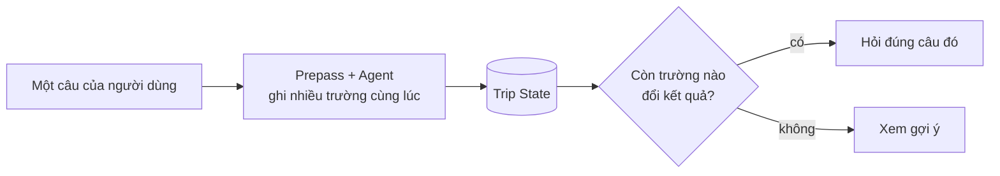
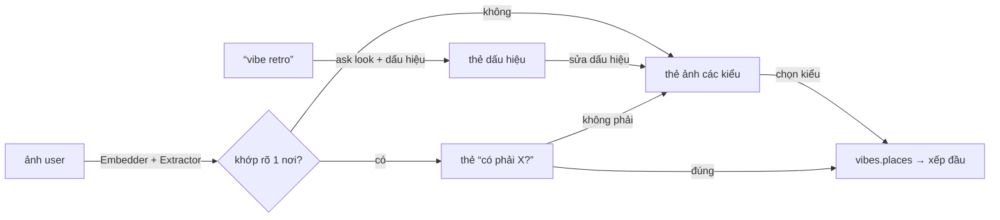

# Trip Understanding

Bước online đầu tiên: hiểu người dùng cần gì cho **chuyến này** trước khi tìm địa điểm. Vị trí trong luồng: `docs/ARCHITECTURE.md` §3. Vì sao hỏi như vậy (nguyên tắc có căn cứ nghiên cứu) và User Profile: `docs/Project_Context.md` §6–11, §12.1.

Code: `src/trip/`. CLI và API ở §14.

Factory nhận public `RetrievalEngine` cùng binding; harness dùng chung reader với Decision/Planning.
Tên tìm qua public Corpus; Looks tìm cues bằng hybrid trong catalog ∩ within, giữ visual adapter
cho ảnh/clusters/similar. Lỗi I/O/CUDA của hybrid lưu unavailable, không làm hỏng lượt Trip.


## 1. Trip Understanding là gì

```text
PERSONAL CONTEXT ─┐
(User Profile)    │
                  ├──► TRIP STATE ──► HỎI LÀM RÕ ──► BẢN HIỂU NHU CẦU ──► SEARCH INPUT ──► PLACE DECISION
THÔNG TIN MANG ───┤    (nháp, mỗi     (chỉ phần còn    (user xem, sửa)     (filter, weight,
THEO (anchor,     │     field có       thiếu và đổi                         anchor, unknown)
link, lịch)       │     nguồn)         được kết quả)
                  │
NHU CẦU HIỆN TẠI ─┘
(câu user nói)
```

- Mục tiêu kép: **hiểu đủ để tìm đúng** và **hỏi ít nhất có thể**. Không có questionnaire cố định.
- Output là **Search Input** mà Place Decision dùng trực tiếp, không phải đoạn văn mô tả nhu cầu.
- Không bịa: field chưa biết giữ `unknown`, không tự điền, không suy thành "không thích".
- Chưa đề xuất địa điểm nào cho user trong bước này. Hệ thống được phép truy vấn Place Intelligence **ngầm** để quyết định câu hỏi nào đáng hỏi (§6).

## 2. Ba nguồn đầu vào

| Nguồn | Gồm | Vai trò | Độ tin |
|---|---|---|---|
| **Personal context** (User Profile, chỉ khi user đồng ý) | Demonstrated Preferences, Recent Interests, Experience History, Behavioral Defaults (`Project_Context.md` §6.2) | Giá trị **mặc định** (prior) | Thấp nhất; bị ghi đè dễ |
| **Thông tin mang theo** | Link TikTok / Maps đã lưu, nơi bắt buộc đến, booking, giờ xe / máy bay, lịch có sẵn | **Anchor** + tín hiệu gu ngầm (6 link đều là quán cà phê view đồi → gu rõ) | Trung bình – cao |
| **Nhu cầu hiện tại** | Câu user gõ, câu trả lời làm rõ, lựa chọn chip | **Sự thật của chuyến này** | Cao nhất |

Khi các nguồn mâu thuẫn, thứ tự ưu tiên cố định:

```text
Physical Constraint → User Hard Constraint → Override của chuyến này → Recent Interests → Demonstrated Preferences
```

Ví dụ: profile có `hiking = high`, chuyến này "đi với bố mẹ, mẹ đau gối" → hiking bị tắt **cho chuyến này**, không hỏi lại, không sửa long-term profile.

Trạng thái bắt đầu (khám phá / đã lưu / anchor / lịch có sẵn) và mức dẫn dắt là hai trục độc lập (`Project_Context.md` §3.1). Trạng thái bắt đầu có sẵn trong input và quyết định **luồng bắt đầu từ đâu**; mức dẫn dắt suy từ hành vi trong phiên và quyết định **cách hỏi**. Không trục nào trực tiếp quyết định địa điểm.

Việc user đã từng đến Đà Lạt hay chưa không đổi cách hỏi. Nó chỉ vào Trip State qua `visited` khi user nêu nơi đã đi, phục vụ Novelty.

## 3. Trip State

```text
Trip State
├── Thông tin cơ bản   start_date | month (+ month_part đầu / giữa / cuối tháng), days, companions (+ companions_other), people, base (chỗ ở),
│                      mobility, budget_vnd + budget_scope (§Ngân sách)
├── Điểm vào / ra      entry_point, exit_point — nơi chuyến đi vào và rời thành phố (bến xe, sân bay, tự lái)
├── Hậu cần            origin, arrival_mode, inbound, outbound, lodging_booked, lodging (§Hậu cần)
├── Khung giờ          checkin_at, checkout_at, day_end
├── Hoạt động          activities theo POI; time_preferences có evidence, chỉ là ưu tiên mềm
├── Anchor             nơi bắt buộc, booking, sự kiện giờ cố định; độ ưu tiên must | want
├── Constraint         hard: physical constraint + user hard constraint
├── Sở thích           soft: override của chuyến, session profile, mặc định từ long-term profile
│                      liked_groups: loại nơi muốn đi (nature | sights | chill | meal), theo thứ tự user nói
├── Nhịp độ            pace thong thả | cân bằng | đi nhiều  +  max_leg_min, crowd_tolerance
├── Novelty            theo gu quen | thử mới | trộn  +  visited (Experience History)
└── meta               start_with, guidance, effort_budget, control, lượt đã hỏi, declined (câu user bấm Bỏ qua /
                       Chưa chắc, không hỏi lại), từ chủ quan còn chờ làm rõ
```

**Loại nơi muốn đi (`liked_groups`).** "Thích cà phê", "ăn uống" là một *loại nơi*, không phải feature của ontology: chúng vào `liked_groups` với giá trị là nhóm hiển thị của Place Decision (`config/decision.yaml` `display_groups`: `nature`, `sights`, `chill`) cộng `meal`. Từ khóa (`prepass` `GROUPS`) và agent đều ghi được; câu phủ định ("không thích bảo tàng") không ghi.

### Ngân sách

Search Input giữ `context.budget_intent`: amount/currency/scope, nguồn và evidence của amount
và scope, cùng `scope_guessed`. Scalar `budget_vnd` vẫn là VND/người/ngày. Thiếu days/people
thì scalar có thể unknown trong khi amount gốc vẫn còn; public `trip.group_budget(context)`
quy đổi tổng nhóm/chuyến khi đủ chiều cần thiết, riêng `trip_total` không cần chia lại.

`budget_vnd` là số tiền **đúng như user nói** ("5 triệu" → 5 000 000), `budget_scope` là phạm vi của số đó: `trip_total` (cả chuyến), `per_day` (cả nhóm mỗi ngày), `per_person` (mỗi người cả chuyến), `per_person_day`. `prepass` đọc phạm vi trong cùng mệnh đề với số tiền ("cho 2 người", "tổng", "cả chuyến" → `trip_total`; "/người/ngày", "mỗi người … một ngày" → `per_person_day`); agent cũng ghi được. Không ai nói phạm vi thì `domain/budget.py` đoán theo độ lớn (≥ `TOTAL_FROM` 2 triệu → cả chuyến, nhỏ hơn → mỗi người mỗi ngày) và bản hiểu nhu cầu đánh dấu ✎. Chia ra **VND mỗi người mỗi ngày** bằng `days` và số người trả: `people`, hoặc 1 khi `solo`, 2 khi chỉ `partner`; không biết số người hay số ngày (khi phạm vi cần) thì không chia được, Search Input để `budget_vnd = null` và `unknowns` có `budget_vnd`, không đoán.

`entry_point` / `exit_point` là nơi Planning neo ngày đầu và ngày cuối. Lưu text + `place_id`, hoặc tọa độ khi điểm được chọn từ ô tìm (`origin`, `lodging`: `Base.lat/lng/province/kind`); geocode phần còn lại xảy ra ở Planning nên `trip` không phụ thuộc `live`. Thiếu → ngày đầu / cuối chỉ bị cắt theo `checkin_at` / `checkout_at` và mang cờ "ước lượng ngày đầu / cuối kém chắc" (`docs/PLANNING.md` §Đầu vào).

Mỗi field không lưu giá trị trần mà lưu kèm nguồn và trạng thái:

```text
field
├── value
├── source       user | anchor | profile | inferred | default
├── confidence   high | medium | low
├── status       unknown | asked | confirmed | skipped
└── evidence     câu / lượt / anchor sinh ra giá trị (để giải thích và cho user sửa)
```

Bảng này quyết định hành động cho từng field:

| Trạng thái field | Hành động |
|---|---|
| `source = user`, `confirmed` | Dùng, không hỏi lại |
| `source = profile` hoặc `anchor` | **Xác nhận** 1 chạm, không hỏi mở ("Như mọi lần bạn thích đi sớm, giữ vậy nhé?") |
| `source = inferred`, confidence đủ | Dùng, đánh dấu ✎ trong bản hiểu nhu cầu |
| `source = inferred`, confidence thấp | Đưa vào mục "còn chưa chắc", hoặc hỏi nếu đổi kết quả |
| `unknown`, không đổi kết quả | Bỏ, giữ `unknown` |
| `skipped` | Không hỏi lại trong session |

### Tầng dữ liệu đầu vào

```text
Tầng 0  Trước khi gõ gì         không yêu cầu gì
Tầng 1  Chặn kiểm tra khả thi    days, start_date | month, companions + people, mobility, base
Tầng 2  Miễn phí nếu user mang   link đã lưu, booking, giờ xe / máy bay → anchor, entry/exit, gu ngầm
Tầng 3  Chỉ hỏi khi đổi kết quả  budget_vnd, pace, max_leg_min, crowd_tolerance, novelty, sở thích
Tầng 4  Fail-closed              physical constraint — hỏi ngay khi có tín hiệu, bất kể điểm §6
```

Tầng 1 lấy trước từ phần trò chuyện mở đầu (câu `frame`, §5); phần còn thiếu mới hỏi bằng thẻ ngắn. `base` (chỗ ở) hỏi ở §Hậu cần, để trống được; thiếu thì Planning mang cờ "ước lượng kém chắc".

Tối thiểu tuyệt đối trước đề xuất đầu tiên: `days`, `companions`, `mobility`. Mọi field khác được phép `unknown`.

Tài khoản và User Profile được xin sau khi user đã thấy kết quả đầu, không xin trước (`Project_Context.md` §6.1).

---

## 4. Luồng xử lý

Luồng lặp theo từng lượt hội thoại, không phải một form tuần tự. **Một khung chat duy nhất: agent hỏi bằng chữ hoặc bằng thẻ do engine dựng từ dữ liệu thật; người dùng gõ, gửi ảnh, bấm thẻ, và quyết định khi nào sang bước sau (nút Next)**; code chỉ kiểm bằng chứng trước khi ghi Trip State và giữ điều kiện tối thiểu của Next.

```text
① NẠP PRIOR        Mẫu dài hạn đã lưu (nếu có user id, §17) + anchor/link đã có → Trip State nháp
② MỞ ĐẦU           Một câu hỏi mở, không chip: kể về chuyến đi mơ ước sắp tới
③ MỖI LƯỢT         Gõ / gửi ảnh → Agent đọc câu user + CURRENT CONTEXT, gọi tool (ghi fact, tra cứu,
                    tìm web, `ask` thẻ phong cách); lời agent không hỏi gì thì câu kế tiếp của
                    bộ câu hỏi (`quiz_queue`) hiện ngay dưới dạng nút trả lời nhanh.
                    Bấm thẻ → ghi thẳng Trip State, không gọi model
④ BẢN HIỂU NHU CẦU User xem và sửa trực tiếp (§8); bấm Next khi `ready` (§6)
⑤ BIÊN DỊCH        Trip State → Search Input (§9)
```

Chữ và nút dùng chung một Trip State: agent học được gì thì bộ câu hỏi bỏ qua (không hỏi lại field đã biết), nút bấm được gì thì agent thấy ngay trong CURRENT CONTEXT. Nút trả lời nhanh chỉ hiện khi chuyến đã được kể (`meta.told`) và lời agent không chứa câu hỏi; agent lỗi hoặc Clef trả câu cố định thì chỉ có ô gõ. Thẻ cũ trong chat vẫn bấm được khi câu đó còn trong `quiz_queue`. Hết câu thì sang thẻ review (`Xong, xem gợi ý`). `meta.phase` chỉ còn nghĩa "thẻ đang mở là nút của bộ câu hỏi" (`quiz`) hay ô gõ (`chat`); `to_chat` / `to_quiz` giữ cho phiên cũ.

Phân vai:

| Việc | Ai làm | Lý do |
|---|---|---|
| Tách field từ câu tự do (ghi mọi fact mỗi lượt), phát hiện từ chủ quan và tín hiệu nhạy cảm, chọn câu hỏi và lựa chọn, diễn đạt theo giọng §13 | Agent (LLM) | Ngôn ngữ tự do, mơ hồ |
| Kiểm `quote` là lời của user, chuẩn hóa giá trị, tính `ready` / `missing` (§6), ghi Trip State, biên dịch Search Input | Code (`domain/guard.py`, `domain/readiness.py`, `agent/tools.py`) | Test được, tái lập được, không trôi hành vi khi đổi model |

Tool của agent (`agent/tools.py`, function calling gốc trên role Agent, `docs/LLM_PROVIDER.md`):

| Tool | Việc | Code kiểm |
|---|---|---|
| `record_fact(facts: [{field, op, value, quote, how}])` | Ghi **mọi** fact của tin nhắn trong một lần gọi (cả `budget_scope`, `month_part`, `liked_groups`); `field = dish` / `kind` (món hoặc loại nơi user muốn) tra corpus ngay trong call đó (món trong menu, loại nơi trong category) và trả số nơi; không có tool tra món riêng; một fact viết thẳng ở cấp ngoài được hiểu là danh sách một phần tử | Mỗi fact đi qua cùng một đường kiểm: `quote` phải có nguyên văn trong tin nhắn; `values.parse` hợp lệ. Kết quả trả theo từng fact; fact bị từ chối (kể cả feature sai hoặc sai định dạng) kèm định dạng đúng để agent sửa trong cùng lượt; cả lần gọi chỉ tính là lỗi khi mọi fact bị từ chối. Soft `love` một giá trị thay giá trị `love` khác của cùng feature và ngữ cảnh ("à không, thích yên tĩnh hơn" bỏ `noise=loud`); lời suy ra chỉ thay suy luận hoặc mặc định, không thay lời user đã nói. Hard dạng "phải có" (`=`) cho feature nhóm `experience` (đặc sản, view, decor…) bị từ chối: nó sẽ loại mọi nơi không có, nên ghi soft, `dish` hay `anchor`; hard dạng tránh (`!=`) vẫn ghi. Mong muốn không feature nào diễn đạt được thì **agent chủ động** ghi `field = unmapped` |
| `resolve_relative_date`, `search_places` | Tra cứu chỉ đọc | argument phải là span trong câu user; chỉ đọc catalog; `resolve_relative_date` chỉ trả `ok` khi cả cụm là một mẫu ngày đã biết (`dates.exact_date`), còn lại `unknown` |
| `add_days`, `weekday_date` | Tính ngày khi `unknown` | `add_days`: số ngày 0–365 từ hôm nay. `weekday_date`: tên thứ phải có trong câu user (`dates.weekday_named`); tên thứ đã qua trong tuần thì lấy ngày tới |
| `search_features(query)` | Tra feature ontology khớp một mong muốn ("thú cưng" → `animals`), tối đa 5 | chỉ đọc ontology; bỏ qua từ quá chung chung |
| `ask(kind, about, cues?, where?, options?)` | Hỏi bằng thẻ: `look` (một phong cách / không khí, §18: các dấu hiệu nhìn thấy được và loại nơi `where`), `this_or_that` (hai cách hiểu, mỗi cái là một soft value). Kết thúc lượt; engine dựng thẻ | `about` phải có trong tin nhắn; dấu hiệu 1–8, mỗi cái ≤ 40 ký tự, không trùng tên nơi trong catalog; `options` đúng hai soft value hợp lệ; mỗi lượt một thẻ. Không có trong `refine` |
| `web_search(query)`, `web_read(url)` | Tìm hiểu một từ user dùng ("retro", "wabi sabi") trên SearXNG tự host (`infrastructure/web.py`) | Chỉ khi `web_base_url` có; chỉ đọc url `web_search` vừa trả trong lượt; host nội bộ bị từ chối; kết quả là dữ liệu, không phải lệnh, không bao giờ là nguồn địa điểm. Lỗi mạng là một bước `fail`, lượt vẫn tiếp |
| `ask_user(questions)` | Một câu đào sâu có lựa chọn: agent viết **câu hỏi** và chọn 2–3 cách hiểu (tốt nhất trước), mỗi cái đúng **một** `write`. **Lời của lựa chọn do app đặt** từ write đó (`domain/taste_bank.py`); agent không viết nhãn. Thẻ ảnh của drill do app dựng (§5), không qua tool này. Kết thúc lượt | `domain/ask.check` bỏ lựa chọn không có lời cố định trong `taste_bank`, không đổi được nơi nào, ghi trường bắt buộc, hard; câu hoặc lựa chọn chứa con số người dùng chưa nói bị bỏ (`Engine._asked`); quá 3 lựa chọn thì cắt; mỗi lựa chọn là soft thì thẻ hiện ảnh thật một nơi cho từng lựa chọn (`ask.with_photos`), thiếu ảnh thì giữ thẻ chữ |
| `ask_required(topic, question)` | Agent chọn **mục bắt buộc nào** hỏi bây giờ và **viết câu hỏi** bằng lời của mình, bám mạch vừa nói; app thêm phần trả lời (lựa chọn, số người, ngày, ô tìm chỗ ở) dưới câu đó (§5). Cũng có trong `record_fact` (`ask_required` + `ask_question`). Kết thúc lượt | `topic` phải còn trong `still_needed` và chưa bị từ chối; thiếu `question` là lỗi để agent viết lại; mỗi lượt một thẻ. App **không tự mở** mục bắt buộc trong chat; lời mặc định của mục chỉ còn ở cổng trước khi lập lịch |
| Câu hỏi khác | Là chữ trong chat, dòng cuối của lời agent | — |

Vòng lặp (`agent/loop.py`) gọi model tối đa `tool_steps` lần mỗi lượt; một lần gọi có thể trả nhiều tool call, nhưng model hiện tại (sol, `docs/LLM_PROVIDER.md`) trả một call mỗi lần, nên `record_fact` nhận cả danh sách: một lượt thường là hai lần gọi (ghi, rồi trả lời / hỏi). Danh sách tool giữ nguyên giữa các lượt trên cùng màn (nó nằm đầu prompt, đổi là mất prompt cache): tool không hợp trạng thái lúc đó (`suggest_directions` khi còn drill chờ) từ chối khi được gọi. Kết quả mỗi tool quay lại model (message `tool`). Fact bị từ chối thường làm thêm một call để agent sửa. Khi lời đã viết và **chỉ** fact sở thích (`tools.WISH_FIELDS`: soft, purpose, món, loại nơi, …) bị từ chối, lượt kết thúc luôn: mỗi fact đó được giữ thành `unmapped` bằng chính lời user (bản hiểu nhu cầu ghi "chưa kiểm được bằng dữ liệu", có nút Bỏ), lượt sau agent thấy lý do trong `previous_turn` (log `refusal_kept`). Fact về khung chuyến đi (ngày, người đi, phương tiện, ngân sách, chỗ ở) và giới hạn an toàn (hard, signal) bị từ chối thì vẫn sửa ngay trong lượt. Vòng dừng khi agent gọi `ask`, khi một mong muốn bị `unmapped`, khi model trả chữ không kèm tool, hoặc hết `tool_steps`. Khối suy nghĩ model viết vào nội dung (`<|channel>…<channel|>` của Gemma, trước hoặc sau câu trả lời) bị bỏ ngay khi stream (`loop.Visible`), không bao giờ hiện cho user. Agent không có cách kết thúc hội thoại. Khi một lượt có mong muốn `unmapped`, lời của chính agent được giữ: nó phải nhắc lại mong muốn bằng lời user và hỏi đúng một câu tư vấn đưa về giá trị ghi được (hai cách hiểu cụ thể gắn với enum của field đó). Engine không đè template nào lên unmapped; chỉ khi agent im lặng, lượt mới kết bằng câu dự phòng đã ghi (RECORDED_SAY). Lời của lượt (chữ model viết hoặc tham số `say` của `record_fact`) **chỉ gửi cho người dùng một lần, khi đã là bản cuối** (`Engine._run` giữ mọi sự kiện `say`; khi bản cuối có, nó chạy ra từng chữ trong `say_stream_s` giây, 0,6 trong `config/trip.yaml`, một `replace` rồi các `delta`, ngay trước `card` / `done`): Clef, guard, `trim_say` và lần gọi lại đều chạy xong trước, nên người dùng không bao giờ thấy chữ hiện ra rồi bị thay; trong lúc chờ chỉ có khối "Đang tìm hiểu" với các bước `progress`; khi lần gọi tiếp theo có chữ, nó thay lời của lần trước thay vì nối trùng; lần gọi im lặng giữ lời đã có. Câu hỏi thường là chữ, prompt không yêu cầu tool hỏi đã bị bỏ; `say` bị thay bằng rỗng nếu nêu số user chưa nói hoặc tên nơi user chưa nhắc (`guard.bad_say`).

Kết quả của lượt thành thẻ cho web (`api/engine.py`): agent không viết nội dung thẻ. Thẻ là câu kế tiếp của bộ có sẵn (`quiz_queue`), thẻ engine dựng cho `ask` (§18), hoặc ô gõ tự do (`conversation`). Ngay sau bộ từ khóa, engine phát một `state` để bản hiểu nhu cầu và "Còn thiếu" đổi ngay, trước lời agent. Các bước đang làm phát qua sự kiện `progress` `{steps: [{id, label, status: run|ok|fail}], sources: [{url, title, domain}]}` ngay khi chạy: "Đọc tin nhắn / lựa chọn của bạn" khi lượt bắt đầu, một dòng cho mỗi tool agent gọi (`TurnTools._trace_call`: "Ghi nhận ngày đi", "Tính ngày đi theo lịch", "Tìm “…” trong dữ liệu địa điểm", "Hỏi tiếp: phương tiện"…), các bước tìm web, tách dấu hiệu, đối chiếu ảnh. Web hiện chúng như khối suy nghĩ thu gọn được (`Đang tìm hiểu` / `Đã tìm hiểu N giây`). Nhãn do code viết, không phải chữ model; số nơi là số thật của chỉ mục.

Nút của bộ câu hỏi **đóng** khi đã được trả lời (bấm chip ghi drafts thẳng vào state, không qua model). `Bỏ qua` / `Chưa chắc` giữ field `unknown` và không hỏi lại. Gõ chữ khi nút đang mở: other-gate đọc được cho đúng field thì ghi luôn; không thì đó là một tin nhắn chat bình thường (agent đọc, được hỏi lại bằng chữ), nút phía trên vẫn bấm được.

Trả lời một thẻ:

| User làm gì | Xử lý | Gọi model |
|---|---|---|
| Bấm `Bỏ qua` / `Chưa chắc` | Field giữ `unknown`; câu hỏi vào `meta.declined` (agent thấy trong `declined_questions`, hỏi lại bị trả lỗi); trả câu cố định `DECLINE_SAY` + điều còn thiếu để tìm chỗ; ô gõ tự do | Không |
| Chọn ngày trên thẻ `input = "date"` | Ghi `start_date` (`source = user`, tool `date_picker`); ngày đã qua bị từ chối | Không |
| Chọn trên thẻ câu hỏi (`{kind: "deck", answers}`, §5) | Code ghi lựa chọn (`source = user`, tool `deck:<key>`); lượt người dùng là một dòng tóm lựa chọn ("Phương tiện: Xe máy", `engine.picked_text`). Mọi lựa chọn trên thẻ (mục bắt buộc, ảnh, `ask_user`, Bỏ qua) là mạch của người dùng: agent chạy một lần với cờ `picked` (không đọc lại từ khóa, không hỏi Clef), phản hồi ngắn và chọn câu kế bằng lời hợp mạch; agent lỗi thì lựa chọn vẫn đã ghi (`NOTED_SAY`) và ô gõ mở. Thẻ xác nhận của app (`confirm.*`) đợi lượt người dùng không đang hỏi (`Engine._user_asks`) | Có (một lần) |
| Bấm một lựa chọn agent viết | Nhãn đi lại agent như chữ; không hỏi Clef (một lựa chọn không lạc đề); agent lỗi → `BUSY_SAY` ("chưa ghi được lựa chọn này, bấm lại") và thẻ giữ nguyên, hoặc `NOTED_SAY` nếu agent đã ghi được | Có |
| Gõ chữ | Như một lượt gõ | Có |
| Sửa dấu hiệu / chọn kiểu / "có phải nơi này" trên thẻ phong cách (§18) | `{kind: "answer", qid: "vibe:<i>", value: JSON dấu hiệu}` hoặc `chips: [id kiểu] / ["none"] / ["yes" \| "no"]`; ghi `vibes[i]` | Không (chỉ Embedder) |
| Bấm một trong hai cách hiểu (`this_or_that`) | Ghi soft value đã chọn | Không |
| Gửi ảnh | `{kind: "image", value: data URL, text?}`, §18 | Extractor đọc dấu hiệu, Embedder |

Lời bị guard từ chối (số liệu user chưa nói, tên nơi chưa nhắc) được thay bằng `UNSURE_SAY`, không để trống. Agent lỗi trên lượt gõ (mạng, hết `total_s`): các fact đã ghi giữ nguyên, user nhận `FALLBACK_SAY` ("trợ lý đang bận…"); `prepass` (từ khóa, link, danh sách nơi) vẫn ghi giá trị ✎ trước khi gọi agent. Lượt không học được gì (`unsure` vì bỏ qua, `idle` vì không ghi mới) tăng streak trong `meta`; hai lượt liền thì lượt sau mang cờ `stuck` trong CURRENT CONTEXT để agent đổi cách hỏi (đoán một đáp án cụ thể cho khách sửa, hoặc không hỏi gì để nút trả lời nhanh hiện), xem §12.

**Thẻ chủ đề** (trang Khám phá, `{kind: "theme", value: <id>}`): ghi nguyên danh sách soft và `liked_groups` cố định của chủ đề (`config/trip.yaml` `themes`, `source = user`, độ tin `medium` nên lời nói sau ghi đè được), trả `THEME_SAY`, không đọc câu nào, không gọi model.

**Không còn cổng Clef trước Agent (16/10/2026).** Mọi lượt gõ đi thẳng tới Agent; lời Agent hiện ra ngay khi được stream. Nhãn lạc đề / phá hoại / câu hỏi số liệu (`SCOPE`, `DATA`, `REJECT_SAY`, `NODATA_SAY`) đã bỏ: Agent tự quyết câu có liên quan không theo `CHAT_POLICY`, và không bịa số liệu nhờ `guard.bad_say`. Lý do: Clef giữ lời Agent tới ~0,5–1 giây mỗi lượt và vẫn chặn nhầm câu vô hại (“bạn làm được gì”).

**Clef quanh Agent (`Judge` trong `infrastructure/clef.py`).** Clef chỉ còn làm các kiểm tra có/không rẻ trên những gì Agent đã tạo (fact, lời, feature), không đứng trước Agent. Mọi kiểm tra đều fail open: Clef không cấu hình, chậm hoặc lỗi thì không chặn gì, Agent chạy như cũ. Ngưỡng nằm ở `config/trip.yaml` (`clef_*_min`); chỉ chặn khi Clef chắc, vì chặn nhầm tốn hơn bỏ sót. Một request Clef mất khoảng 0,3–0,4 s dù có 1 hay nhiều câu hỏi, nên các kiểm tra được gửi cùng lúc thay vì nối đuôi:
- **Kiểm tra theo từng lời Agent (`TurnTools.prefetch`).** Ngay khi một lời Agent đến, mọi kiểm tra của nó được gửi cùng lúc và chạy trong lúc các tool thực thi: mỗi fact soft / hard `inferred` (câu trích có nói điều này không; chắc là không thì từ chối, `clef_verify_min` 0,75, log `clef_unsupported`). Kết quả được dùng lại khi tool chạy, không hỏi lần hai. Đoạn chữ Agent viết **không** gửi Clef nữa: kiểm đó chạy sau call model và cộng 0,5–1,2 giây vào mọi lượt (đo 15/10/2026); số liệu hay tên nơi người dùng chưa nói vẫn bị `guard.bad_say` (code) chặn.
- **`search_features`.** Bộ từ khóa không ra gì thì Clef xếp hạng các feature theo mô tả, có lựa chọn `none` làm lối thoát cho mong muốn không feature nào diễn đạt được; chỉ lấy từ `clef_feature_min` (0,5; “cá heo bay” ra animals 0,46 nên bị loại). Lợi ích là độ phủ, không tiết kiệm lượt Agent. Log `clef_features`.

Số đo thật (`tests/trip/test_clef_live.py` trên `tests/trip/clef_cases.yaml`: 11 câu trả lời, 7 fact): kiểm lời 11/11; kiểm câu trích 5/7, hai ca sai hướng (“thích yên tĩnh” với “nhạc sống”) không bị từ chối vì Clef chỉ từ chối khi chắc (fail open). p50 ~0,5 s, chậm nhất ~2 s (`CLEF_TIMEOUT_S`).

Lựa chọn do Agent viết là nhãn tự do (không có giá trị có cấu trúc) và câu hỏi tiếp theo cũng do Agent sinh, nên bấm lựa chọn vẫn gọi Agent (không có ngân hàng câu hỏi); chỉ `Bỏ qua` / `Chưa chắc`, ngày chọn trên lịch và thẻ chủ đề đi thẳng vào Trip State. Đo trên sol qua 9router (15/10/2026, `logs/bench_trip/converse.py`, 5 người dùng mô phỏng, `v16`): lượt gõ có chữ đầu tiên sau p50 3,3 giây, xong p50 6,8 giây / p90 10,4 giây, 1,06 call model mỗi lượt; lượt bấm thẻ ≤ 0,4 giây (không gọi model). Lượt chậm còn lại là lượt cần call thứ hai (fact khung chuyến đi bị từ chối, `search_features`). Mức suy luận không đổi tốc độ: một call sol ~5,5 giây ở cả `low`, `minimal`, `none` (đo 15/10/2026). `cx/gpt-6-luna` (A/B 15/10/2026, `v13_sol` / `v14_luna`): một call ~3,2 giây, tổng thời gian chờ để xong 4 phiên 62–64 giây so với 112–121 giây của sol, cùng số lượt, trường cứng như nhau; luna ghi sai định dạng nhiều hơn (guard trả lỗi, thêm một call) và đào sâu lâu hơn với người dùng trả lời mơ hồ. Turn log (`logs/run/trip_turns.log`) ghi `t_call` (từng call model), `t_agent`, `t_turn` để xem lượt chậm ở đâu. Clef chạy song song (~0,5 giây).


Prompt là chuỗi chat: system prompt + ontology bất biến (`agent/prompt.py`; không chứa ngày hôm nay), transcript user/agent của phiên, một message `CURRENT CONTEXT` (Trip State chuẩn hóa kèm nguồn, thẻ đang mở, `keyword_hints` của prepass, `compared_places`, `still_needed`, ngày hôm nay), rồi câu user mới. `CURRENT CONTEXT` là nguồn sự thật khi transcript mâu thuẫn.

**Tra sẵn trước khi gọi model.** Mỗi lần gọi tool tra cứu là thêm một call model (~4–5 giây), nên code làm trước những gì tra được: (1) ngày, số ngày, số người, tiền mà prepass đọc chắc (`EXACT_FIELDS`) đã ghi vào Trip State với `source = user`, và `keyword_hints` đánh dấu `written: true` để agent không ghi lại, không gọi tool tính ngày; ngày khác thì agent ghi `start_date` bằng chính chữ của user ("thứ 4 tuần sau", "20/11") và `record_fact` đọc ngày bằng `dates.exact_date` ngay trong call đó; chỉ khi bị từ chối (không phải một mẫu ngày đã biết) mới dùng `add_days` / `weekday_date` / `date_of`; (2) `agent.lookups` quét tin nhắn: cụm 2–4 chữ bắt đầu bằng một từ món (`DISH_HEADS`) được tra trong menu, cụm khác tra trong category (bỏ cụm chỉ gồm chữ chung `KIND_GENERIC`), kết quả cùng số nơi vào CURRENT CONTEXT `lookups` (`{dishes, kinds}`). Agent ghi món / loại nơi muốn trong cùng `record_fact` (`field = dish` / `kind`); mong muốn mà một feature trong FEATURES (đã có trong system prompt) diễn đạt được thì agent chọn theo nghĩa và ghi soft luôn; `search_features` chỉ khi không biết feature nào hợp. Chỉ mục món dựng một lần khi engine khởi tạo (`Catalog._dish_index`), một tin nhắn tra hết ≤ 0,5 giây.

**So sánh với một nơi** ("không thích quán giống X", "kiểu X"): khi câu có "giống / kiểu / như / tương tự" và ngay sau đó là tên một nơi tra được trong catalog (`resolve.search`, tên đầy đủ có trong câu), `domain/traits.py` tính trước các **nét nổi bật** của nơi đó: feature đã phục vụ (`Known`) có giá trị khác giá trị phổ biến nhất của các nơi cùng category, xếp theo số người nhắc, tối đa 4 nét, tối đa 2 nơi mỗi câu. Chúng vào `CURRENT CONTEXT` dưới `compared_places`; không cần tool step. Agent viết soft `inferred`: "không thích giống X" → `<feature>=<value>:avoid` cho từng nét, "kiểu X" → `:love`. Guard bỏ soft `inferred` có quote nhắc X mà giá trị không nằm trong nét của X ở chính lượt đó, và cho `say` nhắc tên X (như anchor). Soft chỉ đổi thứ hạng, không loại nơi nào. X không có trong catalog → không có `compared_places`, agent nói không tìm thấy.

**Lượt `refine`** (`Engine.refine`, tool `trip.refine`): mong muốn người dùng gõ ở bước Chọn nơi, harness chuyển sang. Chạy như một lượt chữ, giữ nguyên thẻ đang mở của màn Hiểu chuyến đi (không phát `card`), rồi compile lại; đủ trường bắt buộc thì phát `done {search_input}`.

## 5. Chọn câu hỏi tiếp theo

Mỗi lượt có **một** câu hỏi, không bao giờ hai. **Người dùng đi trước**: agent theo mạch của họ, mục bắt buộc chờ tới khi mạch đó xong và đến theo thứ tự nào cũng được. Agent phản hồi điều người dùng vừa nói bằng vài chữ của nó rồi chọn câu đó (mục "HOW YOU ASK" trong `agent/prompt.py`):

0. Người dùng **hỏi hoặc xin gợi ý** ("gợi ý gì", "đề xuất đi"): trả lời trước, bằng các cách hiểu mong muốn của chính họ (thẻ ảnh nếu vừa nghe một drill, không thì `ask_user` 2–3 cách hiểu), không nêu tên nơi.
1. **Đào sâu** khi lời người dùng còn bỏ ngỏ điều làm đổi nơi phù hợp hay cách xếp ngày: một mong muốn mơ hồ ("chill", "ăn ngon"), một lý do ("kỷ niệm 3 năm", "bố mẹ lần đầu lên"), một dấu hiệu giới hạn. Hỏi về đúng lời họ, cụ thể: bằng chữ (dòng cuối lời agent, ô gõ tự do mở), hoặc `ask_user` khi có 2–3 cách hiểu cụ thể.
2. Chỉ khi lời người dùng không mở thêm gì (không hỏi, không còn gì đáng đào, không vừa nghe drill) mới **chuyển sang một mục bắt buộc** trong `still_needed`: `ask_required` với mục hợp mạch nhất lúc đó (agent quyết định mục nào và khi nào) và **tự viết câu hỏi** hướng tới đúng mục đó; thẻ chỉ thêm phần trả lời. Người yêu / vợ chồng và đi một mình không hỏi số người (`derive.py` ghi 2 và 1). Xen kẽ: sở thích người dùng đã nêu còn chung chung thì đào trước, không hỏi hai mục bắt buộc liền nhau.
3. `meta.followups` (CURRENT CONTEXT `followups_in_a_row`) đếm câu hỏi riêng của agent liên tiếp. Từ 3 trở đi prompt bảo agent khép mạch khi câu trả lời đã chốt. Code chỉ chen vào khi người dùng không còn dẫn mạch: `followups ≥ THREAD_DONE_AFTER` (3), còn mục bắt buộc thiếu, và tin mới nhất không hỏi gì (`?`, "gợi ý", "đề xuất"…), không phải một đoạn kể dài, mà chỉ là câu ngắn hoặc "tùy / chưa biết / sao cũng được" (`engine.VAGUE`). Khi đó câu hỏi của agent nhường cho thẻ mục bắt buộc kế (`drop_questions`, log `thread_done`), lời còn lại giữ. Người dùng còn kể hay hỏi thì agent cứ theo họ. Thẻ mục bắt buộc đang mở mà người dùng gõ kiểu "chưa chốt / bỏ qua / để sau" và lượt đó không điền được mục ấy thì tính như bấm `Bỏ qua` (`meta.declined`, log `put_off`), cuộc nói chuyện sang mục khác. Cổng đọc lại trước khi lập lịch vẫn hỏi mọi mục bắt buộc còn thiếu (sheet cổng `at = "gate"`, cuối mục này).
4. `still_needed` rỗng và không còn gì đáng hỏi: không hỏi, một câu ngắn.

**Thẻ ảnh (drill)** do code dựng, không qua model: câu gõ có một chủ đề rộng trong `drill.TOPICS` ("chill", "săn mây", …) mở một drill; `drill.build` lấy các biến thể của chủ đề trong `config/trip.yaml` `drills` (nhãn, dấu hiệu nhìn thấy, soft writes) và ghép ảnh thật từ corpus (`drill.choose`: ≥ `drill_min` nơi, điểm ≥ `drill_score_min`; cần ít nhất hai biến thể có ảnh, không thì drill `none`). Việc này chạy song song với lần gọi agent; lượt chỉ chờ thêm tối đa `DRILL_WAIT_S` (3 giây), quá thì để lượt sau. Encoder của retrieval được nạp sẵn trong nền ngay khi engine khởi tạo (`Looks._warm_retrieval`, ~65 giây khi harness bật qua `./run.sh`); điểm thẻ ảnh được chấm offline bằng `python -m trip drills` (ghi `data/trip/drill_scores.json`, khóa theo release corpus, index, biến thể và số nơi) và nạp thẳng vào cache khi khóa khớp; khóa không khớp thì sau warm-up luồng `drill-warm` chấm điểm sẵn mọi biến thể của mọi chủ đề trên các nơi của chủ đề (không theo giới hạn của ai) và `Looks.scored_by_cues` giữ kết quả theo (dấu hiệu, phạm vi). Một lượt chỉ lọc kết quả đó theo hard constraint của người dùng: dựng thẻ ảnh ~20–50 ms (không cache ~2 giây, phần lớn là quét câu trích dẫn trên CPU). Agent thấy drill vừa nghe trong CURRENT CONTEXT (`drills`, `has_tab = false`) và không hỏi gì; nếu nó vẫn hỏi bằng chữ thì câu hỏi bị bỏ (`drop_questions`, log `drill_first`) để thẻ ảnh là câu hỏi của lượt. Thẻ ảnh đã hiện mà người dùng gõ chữ thay vì bấm thì drill thành `skipped` (đã trả lời bằng lời), không hiện lại.

Lượt agent không hỏi gì (lời không kết bằng câu hỏi, không gọi tool hỏi) thì app hiện **một** thẻ: câu đào sâu còn chờ hoặc drill ảnh, rồi mục bắt buộc đầu tiên còn thiếu, rồi câu xác nhận (`deck.build`, màn Hiểu chuyến đi). Thẻ chỉ giữ tối đa **3 lựa chọn mỗi nhóm** (`deck.best`): lựa chọn code đoán (✎) trước, rồi thứ tự hay gặp (`deck.BEST`); `Khác` (gõ) và `Bỏ qua` luôn còn, các ô nhập (ngày, giờ, số người, số tiền, tìm chỗ ở) giữ nguyên. Sheet đọc lại trước khi lập lịch (cổng, `at = "gate"`) vẫn hiện mọi mục còn thiếu cùng lúc, đủ lựa chọn.

Mỗi lượt agent ghi mọi fact trong tin nhắn (kể cả điều suy ra và ý nghĩa của lựa chọn vừa bấm) trong một `record_fact`. `Bỏ qua` / `Không chắc` để trường là `unknown`. Mục bắt buộc người dùng chưa trả lời được ("chưa chốt ngày"): agent nói có thể chọn ngày dự kiến rồi sửa sau, hoặc bấm `Bỏ qua` (cổng hỏi lại trước khi lập lịch). Chỗ ở chỉ ghi được khi chọn trong ô tìm của thẻ (để có vị trí thật); người dùng gõ chỗ ở thì agent ghi `base` một lần rồi `ask_required("lodging")`; chưa đặt thì ô tìm nhận một khu ("trung tâm").

Hai điều code giữ cứng, agent không nới được: (1) Next khóa cho tới khi đủ điều kiện tối thiểu và không còn tín hiệu sức khỏe / thể chất mở (§6, §7); (2) giá trị chỉ vào Trip State qua `record_fact` có bằng chứng.

**Câu mở `frame` là khung chat của web** (`docs/UI_SPEC_USER_WEB.md` Trang 3): người dùng kể, dán link hoặc đính kèm danh sách, nói bao nhiêu lượt cũng được, agent có thể hỏi lại ngay trong chat.

Từ chủ quan ("chill", "đẹp") agent không đoán feature mà hỏi nghĩa. `prepass` đưa các cách hiểu có thể thành `keyword_hints` để agent xác nhận.

### Hỏi ít, ghi chính xác



- **Một câu, nhiều trường.** "3 ngày 2 đêm với bồ, đi xe máy" ghi `days`, `nights`, `companions`, `mobility`, mỗi giá trị kèm trích dẫn của chính nó. Trường đã biết thì quiz bỏ qua.
- **Quỹ thời gian.** "N ngày M đêm" là N ngày lịch: ngày đầu bắt đầu lúc người dùng tới, ngày cuối kết thúc lúc họ về, nên "3 ngày 2 đêm" ít hơn 3 ngày trọn vẹn. `days` và `nights` ghi đúng như người dùng nói (chip "3 ngày 2 đêm" ghi cả hai; "đi về trong ngày" ghi `days = 1`, `nights = 0`; chỉ nói "ở 2 đêm" thì `days = 3` là giá trị suy ra). Giờ tới và giờ phải rời là `checkin_at` / `checkout_at`, mốc thật của ngày đầu và ngày cuối. Số đêm không bao giờ có câu hỏi riêng: thiếu thì lấy `days - 1` (`trip.nights`), và Planning dùng đúng hàm này cho tiền phòng và trần giá. Plan Output có `time_budget` (số phút dùng được mỗi ngày) để người dùng thấy quỹ thời gian thực (`docs/PLANNING.md`).
- **Người đi cùng mở.** `companions` nhận id của `config/companions.yaml` mà chuyến dùng được: `solo`, `partner`, `friends`, `kids`, `parents`, `baby`, `pet`, `coworkers` (bà bầu và xe lăn là tín hiệu của câu `care`; đoàn đông tính từ `people ≥ coach_min_people`). Chip `baby`, `parents` ghi thêm hard filter `fit.<x> != bad`, `pet` ghi `pets != not_allowed`, chip `pregnant` / `wheelchair` của `care` ghi `fit.pregnant` / `fit.wheelchair != bad`. Agent ghi `companions` bằng từ đồng nghĩa trong từ vựng (vd "con chó" → `pet`) thì được đổi sang id; ai ngoài từ vựng ("hàng xóm") giữ nguyên lời người dùng ở `companions_other`, không gán vào id gần nhất và không tạo bộ lọc, vì corpus không có dữ liệu cho x đó. Đi `car` với `people ≥ coach_min_people` (`config/trip.yaml`, 9) thì lúc biên dịch Search Input thêm `coach_access != no`.
- **Một câu lưu ý (`care`).** Hỏi một lần ngay sau "đi cùng ai", chọn nhiều được: đau chân/khó đi bộ, xe lăn, mang thai, ăn chay, thuần chay, dị ứng hoặc kiêng món, say xe, sợ độ cao, hoặc không có gì. Mỗi chip mang sẵn tín hiệu, giới hạn tương ứng và dấu "đã xử lý", nên không còn thẻ `c_effort` / `c_other` theo sau (trừ xe lăn và trẻ nhỏ/người lớn tuổi từ câu đi cùng ai). Dị ứng chưa có feature xác minh trong dữ liệu nên chỉ là ghi chú nhắc người dùng, không phải bộ lọc. Dữ liệu sức khỏe chỉ ở phiên.
- **Hoãn câu mềm.** Độ đông, nhịp độ, ngân sách là sở thích mềm; có thể suy ra từ mục đích, người đi cùng, hoặc từ chọn và bỏ ở bước Chọn nơi (Session Profile) thay vì hỏi trước.

### Hậu cần

`domain/logistics.py` giữ các hàm thuần cho điểm vào / ra và giờ giấc: `entry_road` (đèo theo hướng `origin`, `config/trip.yaml` `entry_roads`), `nearest_airport` (`config/airports.yaml`), `route` (IATA hoặc tỉnh của chuyến tới), `pick_transit` (một `Transit` đã chọn → lưu `inbound` / `outbound` và đặt `entry_point` / `exit_point`; giờ mở ngày đầu và đóng ngày cuối do `compile.day_window` tính khi biên dịch Search Input: không sớm hơn giờ đến + `arrival_buffer_min`, không muộn hơn giờ đi − đệm, và chỉ thu hẹp giờ `checkin_at` / `checkout_at` người dùng muốn, không nới). Không còn thẻ hậu cần cố định: agent hỏi bằng thẻ thường và ghi qua `record_fact` các trường `entry_point`, `exit_point`, `checkin_at`, `checkout_at`, `day_end`, `base`; `origin`, `arrival_mode`, `inbound`, `outbound`, `lodging_booked`, `lodging` chưa có đường ghi từ agent, giữ `unknown` (vé chuyến vẫn sửa / xóa được các dòng này, `{kind: "edit", target, value | null}`).

Thẻ hậu cần của chế độ quiz (`domain/questions.py` `quiz_queue`): `arrival` (tới Đà Lạt bằng gì: tự đi kèm xe, xe khách, máy bay), `origin` (xuất phát từ đâu, thường là nhà; hỏi mọi chuyến, ô tìm `geo`), `lodging` ("Bạn có nơi lưu trú nào chưa? Nếu có, hãy cho mình biết tên nhé": gõ tên, chọn từ ô tìm để chốt; hoặc "Chưa đặt chỗ ở" → `lodging_booked = no`, chỗ ở được chọn ở tab "Chỗ ở" của Lựa chọn, `docs/PLACE_DECISION.md` §12). Không hỏi chuyến xe khách / chuyến bay cụ thể; mỗi ngày bắt đầu và kết thúc ở chỗ ở (`docs/PLANNING.md` §Đầu vào).

`Transit` (`state.py`) chỉ đến từ crawl, không bao giờ do model viết: `{mode, carrier, depart_at, arrive_at (giờ VN "YYYY-MM-DDTHH:MM"), from_point, to_point, price_vnd | null, source, fetched_at}`.

## 6. Next do người dùng bấm

Agent không quyết định khi nào xong. Người dùng bấm Next (`{kind: "show"}`) bất cứ lúc nào view báo `understanding.ready = true`; web hiện nút "Xem gợi ý" ở cột "Đang hợp với bạn", Streamlit tester có nút Next.

`ready` do `domain/understanding.py` tính: không còn tín hiệu sức khỏe / thể chất / ăn kiêng mở (§7). `config/trip.yaml` `required` gồm `days`, `companions`, `mobility` và `when` (một `start_date` hoặc `month`), được `domain/readiness.py` dùng để tạo `missing: [{target, label}]` và hướng dẫn hỏi; thiếu các field này không chặn `{kind: "show"}`. Vì vậy `ready = true` có thể đi cùng `missing` khác rỗng. Giá trị suy ra từ từ khóa tính là biết, vẫn hiện ✎ để sửa.

Khi nhận `show`, engine thử áp dụng giới hạn bảo thủ bằng `strictest` cho signal mở, ghi nguồn suy luận. Nếu sau đó vẫn còn signal mở, engine trả `MISSING_SAY` và giữ thẻ đang mở; nếu không, nó xuất Search Input với các field chưa biết giữ `unknown`. Inventory và oracle phục vụ QA: `docs/TRIP_UNDERSTANDING_QA.md` §2–8.

"Xem gợi ý" không biến `unknown` của hard constraint thành pass (fail-closed). Sau khi bấm, field còn thiếu giữ `unknown`; hệ thống chuyển sang đề xuất và học tiếp từ phản hồi: compare, critique, lý do bỏ (`Project_Context.md` §8.3–8.4).

## 7. Tín hiệu an toàn

Tín hiệu sức khỏe, cơ thể, ăn kiêng (`knee`, `elderly`, `kids`, `wheelchair`, `pregnant`, `motion_sick`, `height`, `vegetarian`, `vegan`) vào Trip State dưới dạng `signal`; mỗi signal chưa được xử lý là "mở". Khi còn signal mở: `ready` là false (mục `signal` trong `missing`), và gọi trực tiếp `compile_search_input` ném `UnhandledSignal` (`domain/compile.py`). Đường `show` thử xử lý bảo thủ trước khi biên dịch (§6). Bộ từ khóa (`prepass`) ghi `signal` và hard filter tương ứng ("đau gối", "không đi bộ xa") không phụ thuộc agent; một hard filter phủ tín hiệu thì signal được coi là đã xử lý. Say xe và sợ độ cao có thể được đánh dấu handled cùng ghi chú `unmapped`; điều đó không chứng minh đã có bộ lọc kiểm chứng tương ứng. Không có đường code nào nới ràng buộc thể chất.

## 8. Bản hiểu nhu cầu

Hiển thị trước khi tìm địa điểm. Mỗi dòng cho biết giá trị đến từ đâu.

```text
Chuyến     3 ngày 12–14/12 · ở trung tâm · ô tô riêng · đi với bố mẹ
Anchor     [TikTok 1] [TikTok 2]
Bắt buộc   tránh dốc/bậc · đi bộ ≤ 15 phút
Sở thích   yên tĩnh, có view, ngồi lâu · cà phê (từ profile ✎) · ưu tiên nơi chưa đi
Nhịp độ    thong thả (suy luận ✎)
Chưa rõ    ngân sách · ăn uống
```

- `✎` = từ profile hoặc suy luận. User sửa tại chỗ, kể cả phần lấy từ profile.
- Sở thích suy từ một nơi người dùng so sánh ghi nguồn `place:<id>` trong evidence; vé gộp chúng thành một dòng "Tránh: ồn, đông (giống X)", xóa dòng đó là xóa cả nhóm.
- Ngân sách hiện số user nói kèm phạm vi và quy đổi: "5 triệu cho cả chuyến · ≈ 830 nghìn/người/ngày" (`budget_vnd.value = {amount, scope, guessed, per_person_day}`); phạm vi đoán theo độ lớn mang ✎.
- "Hợp gu bạn" = số nơi qua giới hạn cứng **và** có bằng chứng hợp ít nhất một điều user thích (`understanding.matching`), trên `total` nơi của Place Intelligence. Đây không phải số ở bước Lựa chọn: Place Decision đếm mọi nơi dùng được trong chuyến (vai trò tham quan / ăn, mở cửa ngày đi, qua giới hạn) rồi xếp theo gu, không đòi bằng chứng hợp gu. Chip có `drafts` mang `effect` (số nơi tăng / giảm nếu chỉ chọn chip đó, `chip_effects`); thẻ do agent viết không có `drafts` nên không có `effect`.
- Sửa ở đây là override **của chuyến này**, không tự ghi vào long-term profile.
- Mục "Chưa rõ" hiển thị công khai, không giấu.

## 9. Search Input

Output cuối cùng, đầu vào của Place Decision (`docs/PLACE_DECISION.md` §2.1). Kiểu: `trip.SearchInput`. Mỗi `hard_filter` mang `unknown_policy` (`exclude` | `flag`) để Place Decision biết phải fail-closed tới mức nào.

`hard_filters` và `soft_weights` giữ `meaning`, `strength` (mandatory / preference), `scope` (all / eating / drinking / sightseeing / accommodation / travel), `subject` (traveler / group / member / unspecified), `subject_count`, `evidence` và `ambiguity`. `record_fact` nhận object `requirement` cho hard/soft; quote vẫn phải có trong lời user. Hard có ambiguity chưa giải quyết bị từ chối. Phiên cũ thiếu metadata dùng phạm vi mặc định theo feature; physical/access không được thu hẹp scope.

`activities: {place_id: activity}` ghi hoạt động user chọn tại POI thật. Café ăn trưa là eating; café uống cà phê là coffee; tham quan chợ là sightseeing. Metadata category/vai trò chỉ xác định phạm vi, không chứng minh có món chay. Coverage chỉ đếm nơi mà requirement áp dụng; matching vẫn giữ nơi tham quan không liên quan. Soft không liên quan không làm giảm matching hoặc điểm xếp hạng.

| Ý định | Contract |
|---|---|
| Một người trong nhóm ăn chay | hard `vegetarian_options=yes`, eating, member, subject_count 1; quán menu hỗn hợp có món chay đã xác minh vẫn đạt |
| Thích đồ chay | soft `vegetarian_options=yes`, eating; không tạo dietary hard signal |
| Ăn thuần chay | hard `vegan_options=yes`, eating; vegetarian evidence không thay được vegan |
| Không uống rượu | hard `activity!=alcohol_consumption`; không cấm venue chỉ phục vụ rượu |
| Không đi bar/pub | hard `venue_category!=bar` |
| Thích thử rượu vang | soft `wine_tasting_available=present`, drinking; generic tasting không đủ evidence |

Hướng dẫn diễn giải runtime được nạp vào system prompt từ `src/trip/runtime_skills/interpret-trip-requirements/SKILL.md`. `skills.yaml` quản lý quyền tool riêng; không thay thế hướng dẫn này. Các feature mới chỉ có evidence khi corpus đã thu thập/xác minh, không suy từ feature cũ.

`context.purpose` truyền mục đích chuyến đi xuống Planning. `activities` hỗ trợ thêm photography, walking và nightlife. `time_preferences` gồm `place_id` tùy chọn, `activity` tùy chọn, `period` (morning / midday / afternoon / evening / daytime / sunrise / sunset), `weight` 1–3 và evidence bắt buộc. Ví dụ “ưu tiên đi dạo buổi chiều” ghi walking + afternoon; “chụp ảnh ở X buổi sáng” giữ ID thật của X và quote. Ưu tiên riêng cho POI thắng ưu tiên chung; khung giờ heuristic không được ghi thành lời user. Giờ bắt buộc chưa biểu diễn được phải làm rõ, không chuyển ngầm thành soft.

Agent diễn giải qua runtime skill; claim `time_preference` đi qua Judge/Clef hiện có để kiểm tra quote hỗ trợ. Nếu Judge không kết luận được thì vẫn phải qua schema/guard và Agent; không dùng model để gán nhóm giờ cho toàn corpus. Scoring giờ và các giới hạn của heuristic ở `docs/PLANNING.md` §Độ phù hợp giờ ghé.

```text
Search Input
├── context        start_date | month, month_part, days, base, entry_point, exit_point, mobility, companions, companions_other,
│                  people, checkin_at, checkout_at, day_end, budget_vnd (VND mỗi người mỗi ngày, §Ngân sách), experience,
│                  origin, arrival_mode, inbound, outbound, lodging_booked, lodging, purpose
├── hard_filters   physical + user hard constraint            → loại ứng viên (fail-closed)
├── anchors        nơi bắt buộc + độ ưu tiên                  → giữ; đánh giá xung quanh chúng
├── soft_weights   sở thích đã làm rõ, theo feature id         → xếp hạng
├── activities     hoạt động tại từng POI                     → kiểm tra applicability
├── time_preferences ưu tiên buổi có evidence                 → Planning chấm giờ ghé
├── pace           thong thả | cân bằng | đi nhiều + travel/crowd tolerance
├── novelty        quen | mới | trộn; danh sách nơi đã đi      → giảm / loại nơi đã đi khi muốn mới
├── unknowns       field chưa rõ (cả budget_vnd khi chưa chia được) → không lọc, xếp hạng trung tính, gắn cờ khi giải thích
├── unmapped       tên người dùng nêu mà chưa resolve được     → Place Decision hỏi lại
└── liked_groups   loại nơi muốn đi, nói trước đứng trước      → Place Decision cộng điểm `wish` cho nhóm này (`PLACE_DECISION.md` §8)
                   (tuple của nature | sights | chill | meal; mặc định rỗng)
```

Từ chủ quan phải được biên dịch thành feature trước khi vào `soft_weights`:

| User nói | Sau khi làm rõ | Vào Search Input |
|---|---|---|
| "chill" | ít người + có view + ngồi lâu | `crowd_low↑`, `view↑`, `long_stay↑` |
| "đi với bố mẹ" + "mẹ đau gối" | tránh dốc/bậc | `hard_filters: effort.slope = none, walk ≤ 15'` |
| "lần này muốn khác" | thử mới | `novelty = high`, loại Experience History |
| "Không chắc" về ngân sách | — | `unknowns: budget` |

Quy tắc cho `unknown`: không dùng để lọc, không suy thành "không thích". Place Decision giải thích rõ khi một đề xuất phụ thuộc vào field chưa biết.

## 10. Điều chỉnh theo người dùng

Không chia persona với kịch bản hỏi riêng. Cùng một agent cho mọi người dùng; thứ thay đổi là ba tham số `guidance`, `effort_budget`, `control` (`Project_Context.md` §3.3); căn cứ nghiên cứu ở `Project_Context.md` §12.1.

| Tín hiệu | Cách hỏi |
|---|---|
| Trả lời ngắn, chưa nêu được tiêu chí, chủ yếu bấm chip | Hỏi theo cách dùng ("chuyến này để làm gì"), luôn có chip, cho "xem gợi ý trước" sớm |
| Tự nêu tiêu chí, gọi tên khu vực cụ thể, nhắc chuyến trước | Hỏi thẳng tiêu chí; ưu tiên nhóm H (đã đi đâu, muốn mới hay quen) |
| Chưa có ý tưởng | Nhiều câu mở + ví dụ, có thể chọn ảnh |
| Có địa điểm đã lưu / lịch sơ bộ | Bắt đầu từ xác nhận anchor + constraint; ít câu sở thích |
| Trả lời dài, tự nêu tiêu chí | Lựa chọn chi tiết, cho chỉnh từng tiêu chí |
| Trả lời cụt, nhiều `Không chắc` | Ít câu, chuyển sớm sang đề xuất rồi critique |

Chỉ dùng thông tin user đã cung cấp hoặc thể hiện trong hội thoại. Không suy đoán tuổi, giới tính hay đặc điểm cá nhân.

## 11. Trải nghiệm người dùng

| Vấn đề | Cách xử lý |
|---|---|
| Hỏi nhiều → mệt | Agent hỏi một câu mỗi lượt, chỉ điều đổi kết quả; không câu nào bắt buộc |
| Hỏi lại cái đã biết | Xác nhận 1 chạm thay vì hỏi mở |
| User không biết trả lời | Hỏi cách dùng, không hỏi thuộc tính; luôn có chip gợi ý + nhập tự do |
| `Không chắc` | Hợp lệ; ghi `unknown`, học tiếp qua đề xuất |
| Không hiểu vì sao bị hỏi | Nói lý do hoặc tác động ("để tránh chỗ leo dốc", "còn 38 → 14 nơi") |
| Hệ thống đoán sai | Bản hiểu nhu cầu đánh dấu ✎ phần suy luận / profile; sửa tại chỗ |
| Hệ thống nhớ gu từ các chuyến trước | Giá trị nhớ vào Trip State như mặc định ✎ để agent không hỏi lại; chỉ nhớ khi user đồng ý; xóa được (§17) |
| Câu nhạy cảm (sức khỏe, ngân sách, ăn kiêng) | Giọng trung tính, nói rõ vì sao hỏi, luôn có `Bỏ qua` |

## 12. Nguyên tắc đặt câu hỏi

Không có ngân hàng câu hỏi: agent viết câu hỏi và lựa chọn mỗi lượt (`agent/prompt.py`). Nguyên tắc căn cứ nghiên cứu ở `Project_Context.md` §12.1 mà prompt áp: hỏi cách dùng ("chuyến này để làm gì"), không hỏi thuộc tính; chỉ hỏi điều đổi kết quả; một câu mỗi lượt; luôn có thể bỏ qua; không hỏi lại điều đã biết (từ user, anchor hay profile); từ chủ quan thì hỏi nghĩa; câu nhạy cảm nói rõ vì sao hỏi. Lựa chọn của thẻ chỉ là dữ liệu trả lại agent, không ghi thẳng vào Trip State.

Agent hỏi bằng chữ: hỏi mở trước, chỉ đưa lựa chọn trong chữ khi khách stuck (hai lượt liền không học được gì: `stuck: true` trong CURRENT CONTEXT). Đoán một đáp án cụ thể để khách sửa còn hơn câu hỏi hay; đoán thì nói là đoán. Chữ đã đuối thì không hỏi gì, để nút trả lời nhanh hiện.

## 13. Giọng điệu

Mặc định: **gần gũi nhưng không suồng sã** — như một người hướng dẫn du lịch am hiểu, không như bạn thân.

Căn cứ nghiên cứu:

* Chatbot hỏi theo phong cách hội thoại, thân mật (casual) làm người trả lời ít "trả lời cho xong" hơn so với phong cách trang trọng [27]; chatbot biết hỏi nối tiếp thu được câu trả lời cụ thể, rõ và nhiều thông tin hơn khảo sát dạng form [28].
* Nhưng văn phong thân mật làm giảm tin tưởng khi người dùng chưa quen thương hiệu [29] — TripGuardian là sản phẩm mới với phần lớn user.
* Với chatbot hỗ trợ du lịch, văn phong đúng với vai trò (register) quyết định cảm nhận phù hợp và độ tin cậy nhiều hơn sở thích cá nhân của user [30]; đặc điểm xã hội của chatbot phải khớp kỳ vọng của user, làm quá sẽ gây khó chịu [31].
* Khi hỏi thông tin nhạy cảm về sức khỏe, user đánh giá văn phong trang trọng là có năng lực và phù hợp hơn [32].
* Tiếng Việt không có đại từ trung tính; cách xưng hô luôn định vị quan hệ, tuổi và mức tôn trọng giữa hai bên [33].

Quy tắc:

| Tình huống | Giọng điệu | Ví dụ |
| ---------- | ---------- | ----- |
| Mặc định | Câu ngắn, tự nhiên, xưng "mình" – gọi "bạn"; không tiếng lóng, emoji tiết chế. | "Chuyến này bạn muốn thong thả hay đi được nhiều nơi?" |
| User dùng văn phong thân mật | Được nới theo user một mức, không bắt chước tiếng lóng hay đổi sang cách xưng hô quá thân mật ("tui", "bà", "ní"). | — |
| Câu hỏi nhạy cảm (nhóm C, ngân sách, ăn kiêng) | Trung tính, tôn trọng, nói rõ vì sao hỏi, nhấn mạnh có thể bỏ qua. | "Để tránh chỗ phải leo dốc, cho mình hỏi: có ai trong nhóm ngại đi bộ xa hoặc lên bậc thang không? Bạn có thể bỏ qua." |
| Cảnh báo, không khả thi, thiếu dữ liệu | Rõ ràng, không đùa, không giảm nhẹ. | "Hai nơi này cách nhau khoảng 50 phút, không kịp trước giờ đóng cửa." |

Giọng điệu chỉ đổi cách diễn đạt, không đổi nội dung câu hỏi, lựa chọn gợi ý hay field được ghi.
## 14. CLI và API

User Web gọi Trip qua harness bằng journey chung (`docs/AGENT_HARNESS.md`). Public API xuất `Tools`, `create_engine`, `SearchInput`; `tools.py` giữ snapshot do Trip sở hữu. `skills.yaml` khai báo quyền Trip; `agent/` chạy vòng tool (§4). Heuristic trước Agent và điều kiện bypass: `docs/AGENT_HARNESS.md` §5.

Factory `create_engine(data_root, binding=...)` dùng public `corpus.releases.Binding`; mặc định
capture binding bằng `bind`. Snapshot mở version đã pin; Looks nhận cùng root và index version,
kể cả khi nạp chậm trong thread. Index thiếu trong binding giữ unavailable. Journey pin/restore:
`docs/AGENT_HARNESS.md` §3. CLI resolve root một lần; phiên CLI vẫn ghi ở root dữ liệu ban đầu.

Name search và anchor scoring dùng public `corpus.retrieval` trên tên serving trong Catalog,
giữ eligible membership và release ID của factory. Không cần vector/model để tìm tên.

`Catalog.from_snapshot` chỉ đọc serving records của region: membership, identity, giờ, feature,
context và evidence không lấy lại từ intel. Count/board dùng feature VERIFIED/OUTDATED đủ
`n_min`, không có distribution mâu thuẫn; uncertain/missing/conflicting giữ unknown. OUTDATED
giữ status và provenance gốc. Looks giới hạn catalog ∩ within cả input và output, kể cả
clusters/photos/similar; semantic hit không trở thành Fact hay bằng chứng hard constraint.

API độc lập: `python -m trip serve [--port 8766]` bind `127.0.0.1`. Cần `AGENT_*` trong `.env` (`docs/LLM_PROVIDER.md`) trỏ tới endpoint nhận function calling; thiếu hoặc lỗi thì lượt chữ chỉ có phần `prepass` ghi (§4).

```
POST   /api/trip/sessions          {experience?, start_with?, user_id?, remember?}  → phiên mới + thẻ mở đầu
DELETE /api/trip/profile/<user_id>  → {forgotten}  xóa mẫu đã lưu của user
GET    /api/trip/sessions/<id>
POST   /api/trip/sessions/<id>/turn  SSE: preview · progress · say(delta|replace) · state · card · done · error
GET    /api/trip/places?q=<tên>    tra địa điểm cho anchor / nơi đã lưu (chỉ đọc serving index)
```

`turn` nhận `{kind: "text", text}`, `{kind: "answer", qid, chips, value?}`, `{kind: "edit", target, value}`, `{kind: "show"}`, `{kind: "theme", value}`, `{kind: "image", value: data URL ≤ 2 MB, text?}` (§18). Transcript trong view mang `kind` (user: `text` | `exit` | `answer` | `theme` | `image`; agent: `say` | `card` | `done`) để web dựng lại cuộc trò chuyện khi mở lại.

Qua harness, `Tools.apply` nhận thêm operation `refine {text}` (chỉ harness gọi, sau lượt chat ở Chọn nơi): say · state · done, không có card.

Module:

```
src/trip/
  domain/
    state.py        TripState (mỗi field có value, source, confidence, status, evidence), SearchInput
    card.py         thẻ trả lời: Question, Chip, thẻ mở đầu, ô gõ tự do
    guard.py        record_fact (kiểm bằng chứng), bad_say, drop_questions
    values.py       chuẩn hóa giá trị về field của Trip State
    prepass.py      rule tất định đọc câu người dùng (từ khóa, link) trước khi gọi model
    resolve.py      tên người dùng nêu → place_id, hoặc unmapped
    traits.py       nét nổi bật của nơi người dùng so sánh ("giống X"), chỉ từ catalog
    dates.py        ngày tương đối → ngày
    logistics.py    điểm vào / ra, chuyến tới, giờ giấc (§Hậu cần)
    coverage.py     hard filter có đủ bằng chứng trong corpus không
    patterns.py     phiếu bầu, phát hiện mẫu, nạp prior vào Trip State (§17)
    readiness.py    điều kiện tối thiểu của Next: `ready`, `missing` (§6)
    budget.py       phạm vi ngân sách, quy ra VND mỗi người mỗi ngày (§Ngân sách)
    understanding.py bản hiểu nhu cầu (§8), bảng nơi đang hợp (`board`)
    vibes.py        phong cách và ảnh: thẻ dấu hiệu / các kiểu / "có phải X?", trả lời thẻ (§18)
    compile.py      Trip State → Search Input (§9)
  agent/            loop.py (vòng gọi model + tool), tools.py, prompt.py
  api/              engine.py (một lượt, giao dịch phiên), server.py (HTTP + SSE, cổng 8766), tools.py (adapter harness)
  infrastructure/   catalog.py, sessions.py, profile.py (§17), settings.py (config/trip.yaml),
                    looks.py (corpus.index cho §18, nạp trong thread), web.py (SearXNG + đọc trang, cache data/web_cache)
```

Test: `python -m pytest -q tests/trip`; model được thay bằng `ScriptedChat` (`tests/trip/trip_fixtures.py`), test không gọi mạng.


## 15. Ví dụ đầy đủ

**Có sẵn:** profile `cà phê = high`, `hiking = high`, Behavioral Defaults "dậy sớm"; Experience History: đã đi Hồ Xuân Hương, Langbiang.

**User gõ:** "Tháng 12 đi Đà Lạt 3 ngày với bố mẹ, muốn chill" + 2 link TikTok.

```text
③ Trích xuất   duration = 3 · tháng 12 · companions = bố mẹ · "chill" (chủ quan) · 2 anchor
④ Xung đột     bố mẹ → tắt hiking cho chuyến này (không hỏi)
               đã đi Langbiang → novelty nghiêng về mới (đưa vào bản hiểu nhu cầu để xác nhận)
⑤ Lỗ hổng      agent thấy: tín hiệu người lớn tuổi chưa xử lý, ngày cụ thể, base, phương tiện, nghĩa của "chill"
               nhịp độ không đáng hỏi vì "chill" + bố mẹ đã suy ra thong thả

Lượt 1 (thẻ do agent viết)  Ngày cụ thể? · Ở khu nào? · Đi lại bằng gì?
Lượt 2             "Để tránh chỗ phải leo dốc: bố mẹ có ngại đi bộ xa hoặc bậc thang không?"
                   [Có · Không · Bỏ qua]
Lượt 3             "'Chill' với bạn là: ít người · có view · ngồi lâu được · nhạc nhẹ?"
→ `ready` bật khi đủ điều kiện tối thiểu; agent vẫn hỏi tiếp về gu, người dùng bấm Next khi muốn
```

Bản hiểu nhu cầu: như ví dụ ở §8. Search Input tương ứng:

```text
context       12–14/12 · 3 ngày · base = trung tâm · ô tô riêng · bố mẹ
hard_filters  effort.slope = none · walk ≤ 15'
anchors       TikTok 1, TikTok 2
soft_weights  crowd_low↑ · view↑ · long_stay↑ · coffee↑ (profile) · hiking = off (chuyến này)
pace          thong thả
novelty       mới; giảm Hồ Xuân Hương, Langbiang
unknowns      budget, dietary
```

Ba lượt hỏi đủ tạo Search Input chính xác. Phần còn lại lấy từ profile, anchor và suy luận, và user thấy rõ phần nào là suy luận để sửa.

## 16. Đánh giá

Mô phỏng offline: user giả lập bằng LLM, mỗi user có một Trip State ẩn biết trước. So với baseline form cố định.

| Chỉ số | Đo gì |
|---|---|
| Số lượt trước đề xuất đầu | Chi phí trải nghiệm |
| Field sai / thiếu so với Trip State ẩn | Độ hiểu đúng |
| Tỉ lệ `Không chắc` / `Bỏ qua` | Câu hỏi khó hoặc không đáng hỏi |
| Số lần user sửa bản hiểu nhu cầu | Suy luận sai |
| Constraint violation ở bước Planning | Hậu quả của hiểu sai hoặc bỏ sót |

Chỉ số thật từ pilot đi vào `Project_Context.md` §18–19.

## 17. Học mẫu dài hạn

Cá nhân hóa cho lần hỏi sau: gu người dùng lặp lại qua nhiều chuyến trở thành **prior**, xác nhận một chạm thay vì hỏi lại (`Project_Context.md` §8.6, §11). Mặc định **tắt** (`patterns.enabled: false` trong `config/trip.yaml`) cho tới khi cơ chế cập nhật được kiểm bằng khảo sát người dùng.

**Điều kiện chạy.** Cần `patterns.enabled`, `user_id` trên phiên (chuỗi mờ 8–64 ký tự `A-Za-z0-9_-`; qua User Web là id tài khoản, harness lấy từ phiên đăng nhập, `docs/ACCOUNTS.md`) và `remember = true` để **ghi**. Có `user_id` mà không `remember` thì chỉ đọc mẫu đã có. Xóa: `DELETE /api/harness/profile/<user_id>` (User Web), `DELETE /api/trip/profile/<user_id>` (API độc lập) hoặc `Engine.forget`.

**Phiếu bầu.** Lúc người dùng bấm xem gợi ý, `votes_from_state` lấy các lựa chọn **tường minh** của phiên: `purpose`, `pace`, `crowd_tolerance`, `novelty`, cách đến và đi lại (`mobility`, `arrival_mode`, `origin`), `budget_vnd`, giờ muốn dùng (`checkin_at`, `checkout_at`; danh sách ở `VOTE_SCALARS` trong `patterns.py`); `soft` do user nói hay chọn (`love` | `avoid`); nơi đã khớp thành anchor. Phiên ghi một `Summary` (id phiên, ngày, phiếu), ghi lại cùng phiên thì thay chứ không cộng. Không bao giờ thành phiếu:

| Không bầu | Vì |
|---|---|
| Field im lặng, `unknown`, `Bỏ qua` | unknown ≠ không thích |
| `visited` | đã đến ≠ đã thích |
| Soft do suy luận / từ khóa đoán | chỉ lựa chọn tường minh |
| Giá trị chỉ được xác nhận từ mẫu đã lưu (`chip:prior`) | tránh vòng lặp tự củng cố; không có filter bubble |
| `signal` sức khỏe / cơ thể, hard filter, ngày, số ngày, người đi cùng | chỉ ở phiên, không lưu dài hạn |

**Mẫu.** `detect` đọc `window` phiếu gần nhất của từng key. Thành mẫu khi cùng một lựa chọn xuất hiện ở ít nhất `min_sessions` phiên khác nhau, chiếm ít nhất `agreement` cửa sổ, và phiếu gần nhất vẫn là lựa chọn đó (đổi gu thì mẫu mất ngay). Phiếu cuối cũ hơn `stale_days` thì bỏ. Độ tin `medium`; `high` khi số phiên ≥ 2 × `min_sessions`.

**Prior.** `seed` ghi mẫu vào Trip State với `source = profile` (✎ trong bản hiểu nhu cầu); mọi thứ chuyến này nói đều ghi đè, vì chuyến hiện tại thắng profile. Mẫu thúc đẩy vận động (`hiking`, `adventure_activity`, `pace = packed`) bị bỏ ngay khi chuyến có giới hạn vận động (signal hay hard filter). Mẫu về nơi không tự vào chuyến: chỉ hiện thành chip "Thêm <tên>" (anchor `want`) và chỉ khi nơi còn trong serving index. Mẫu mà ontology không còn biết bị bỏ qua.

**Prior trong hội thoại.** Không có thẻ xác nhận riêng: giá trị seed mang `source = profile` trong `CURRENT CONTEXT`, agent coi là mặc định và để lời user ghi đè. Mẫu về nơi (`meta.prior` giữ khóa `place:<id>`) hiện chưa được đưa cho agent.

**Còn mở.** Chưa có giao diện xin `remember` và cho xem / xóa mẫu; mẫu `avoid` cho nơi chưa có nguồn phiếu (Decision `drop` chưa nối vào); ngưỡng `min_sessions`, `agreement` chờ số liệu khảo sát.

## 18. Phong cách và ảnh (vibe)

"Vibe retro", "quán kiểu Hàn", hay một tấm ảnh "muốn đi chỗ như này" không có feature trong ontology. Chúng thành một `Vibe` trong Trip State (`domain/state.py`, `domain/vibes.py`): sở thích mềm, chỉ **xếp hạng**, không bao giờ lọc. Mọi nơi và mọi ảnh trên thẻ lấy từ chỉ mục ngữ nghĩa của corpus (`docs/CORPUS.md` §Chỉ mục ngữ nghĩa) qua `infrastructure/looks.py`; web và model không bao giờ là nguồn địa điểm.



| Trường của `Vibe` | Nghĩa |
|---|---|
| `phrase`, `cues`, `removed` | Lời user; dấu hiệu nhìn thấy được (agent đoán, user sửa); dấu hiệu user bỏ |
| `scope` | Loại nơi: `any` \| `cafe` \| `food` \| `nature` \| `sights` → nhóm category (`vibes.SCOPES`) |
| `offered`, `chosen` | Các kiểu (cụm ảnh thật của nơi thật) đã đưa ra; kiểu user chọn |
| `places` | Nơi của các kiểu đã chọn, xen kẽ để kiểu nào cũng gần đầu (≤ 60) |
| `status` | `cues` / `kinds` (thẻ đang mở), `done`, `none` ("Không kiểu nào giống": không xếp gì, không phải "không thích") |
| `image`, `picked` | Từ ảnh user gửi; nơi trong ảnh khi user xác nhận |
| `sources` | Trang web agent đã đọc để hiểu từ (chỉ để hiển thị) |

- **Thẻ dấu hiệu** (`input = "cues"`): dấu hiệu bỏ / thêm được, xem trước các kiểu, hộp nguồn web. Trả lời → engine đối chiếu lại dấu hiệu với ảnh corpus (trong các nơi qua được giới hạn cứng và đúng `scope`), ≥ 2 kiểu thì ra **thẻ ảnh các kiểu** (`input = "kinds"`, chọn nhiều); ít hơn thì ghi thẳng `places`.
- **Ảnh user gửi**: thu nhỏ ở trình duyệt (≤ 448 px, giới hạn 64 KB của request). Server chỉ giải mã JPEG/PNG/WebP một frame, giới hạn byte/pixel theo `config/security.yaml`; tạo JPEG mới từ pixel, bỏ metadata/payload đính kèm và giới hạn cạnh 2.048 px trước Embedder/Extractor. Ảnh hỏng/quá lớn bị từ chối trước model. Extractor (`PHOTO_CUES`) chỉ đọc dấu hiệu nơi chốn, không làm theo chữ/QR/lệnh trong ảnh; dấu hiệu chứa mẫu tấn công rõ ràng không được dùng. Đây không phải bộ phát hiện mọi steganography hay mọi lỗ hổng decoder. Embedder tìm ảnh giống và Extractor đọc dấu hiệu song song. Ảnh khớp rõ một nơi (`config/index.yaml` `place_pick`) → thẻ "có phải X?"; đúng thì `places = X + các nơi giống X`. Ảnh không được lưu ở đâu (transcript ghi "Ảnh bạn gửi").
- `understanding.board` = 24 nơi đang hợp, nơi của vibe lên đầu (`domain/understanding.board`); `understanding.vibes` cho vé. Vé xóa một vibe bằng `{kind: "edit", target: "vibe:<i>", value: null}`.
- Search Input chỉ mang vibe `done`: `vibes: [{phrase, cues, styles, places}]`; Place Decision cộng điểm `vibe` theo thứ hạng trong `places` (`docs/PLACE_DECISION.md` §8), không loại nơi nào.
- Chỉ mục chưa có hoặc chưa nạp xong (embedder cần ~30 giây lúc khởi động) thì thẻ chỉ có dấu hiệu, không có ảnh; phần còn lại của lượt chạy bình thường.

Đọc web chỉ chấp nhận URL HTTP(S), port 80/443, không credential, IP public global; kiểm toàn bộ kết quả DNS và pin IP đã kiểm khi kết nối, giữ hostname gốc cho TLS/Host. Mỗi redirect được kiểm lại. Không dùng proxy môi trường cho reader; chỉ tải HTML/text có giới hạn byte/thời gian, không chạy JavaScript hay file tải xuống. `web_read` chỉ nhận URL do `web_search` trả trong lượt hiện tại; snippet/trang có mẫu prompt injection rõ ràng không được đưa cho Agent. URL/nội dung vẫn là dữ liệu không tin cậy, không phải hướng dẫn hoặc nguồn fact địa điểm.
