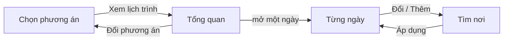

# TripGuardian — Đặc tả UI/UX: User Web (bản người dùng dùng hằng ngày)

Dành cho designer / Figma. Tài liệu này trả lời **cần thiết kế mấy trang, mỗi trang phải có mục gì, mỗi trang có mấy trạng thái phải vẽ**. Bố cục từng màn và luồng chuyển màn: `docs/UI_SPEC_FLOW_LAYOUT.md`. Phong cách hình ảnh, chi tiết grid và vi tương tác: **designer toàn quyền**. Mục tiêu là giao diện đẹp trên máy tính. Web không có bản điện thoại: điện thoại mở bất kỳ trang nào cũng thấy trang tải ứng dụng (`docs/UI_SPEC_LANDING.md` §5); ứng dụng làm sau.

Đọc kèm:
- `docs/UX_Design_Brief.md` — thiết kế cho ai, nguyên tắc, cách hiển thị chất lượng dữ liệu (§4), hệ thị giác đang dùng (§7).
- `docs/Role_Web_Functional_Design.md` §2 — chức năng đầy đủ từng màn (nguồn sự thật về chức năng).
- Bản đang chạy: `web/src/user/` (React). Dùng để đối chiếu nội dung thật, **không phải để copy layout** — layout chính là phần cần designer làm lại cho đẹp.

---

## 1. Phạm vi

Chỉ **User Web** — phần người dùng mở hằng ngày, tất cả nằm dưới `/app`. Ngoài phạm vi: landing `/` (`docs/UI_SPEC_LANDING.md`), Admin Web `/admin`.

- **Chỉ làm máy tính (desktop 1440).** Bề mặt rộng đủ chỗ đặt cạnh nhau "lý do phù hợp", "đánh đổi" và bằng chứng. Cửa sổ máy tính hẹp vẫn phải dùng được (khối xếp chồng, không cuộn ngang), nhưng không thiết kế riêng cho điện thoại — điện thoại dùng ứng dụng (làm sau).
- **Toàn bộ nội dung tiếng Việt**, từ ngữ đời thường, không thuật ngữ hệ thống.
- MVP một thành phố: **Đà Lạt**, chuyến 2–4 ngày, cặp đôi / nhóm bạn / gia đình nhỏ; xe máy, ô tô hoặc xe công nghệ.

## 2. Designer được tự do gì, phải giữ gì

| Toàn quyền sáng tạo | Phải giữ |
|---|---|
| Grid, khoảng trắng, cỡ chữ, tỉ lệ thẻ, bo góc, bóng, màu bổ sung | Danh sách trang và **mục bắt buộc** của mỗi trang ở §4 |
| Cách gom nhóm, thứ tự khối trong một trang, dùng tab / accordion / sheet / carousel | Thứ bậc quyết định: lý do phù hợp và đánh đổi luôn đi **cùng nhau**, không tách trang |
| Chuyển động, vi tương tác, cảm giác "sống" khi danh sách thay đổi | Quy tắc hiển thị dữ liệu ở §6 (fact / signal / estimate / độ tin cậy / chưa biết) |
| Thay hệ thị giác hiện tại bằng hướng mạnh hơn, nếu giữ được "poster du lịch Đà Lạt" và đọc tốt ngoài nắng | Mỗi trạng thái liệt kê ở §4 phải có một frame — kể cả trạng thái rỗng và lỗi |
| Icon set, minh họa, cách dùng ảnh poster | Tiếng Việt, giọng điệu ở §7 |

Không được làm: dùng số sao / phần trăm trần làm tín hiệu chính; trình bày ước lượng như sự thật đã xác nhận; gợi ý chỗ ở; thay bản đồ Google bằng nhà cung cấp khác; hiện transcript video.

## 3. Bản đồ trang

| Route `/app/…` | Tên trang | Người dùng làm gì ở đây | Khung |
|---|---|---|---|
| `login` (hoặc `/app` lần đầu, chưa có phiên) | Vào ứng dụng | Tiếp tục với Google, hoặc dùng thử không cần tài khoản (khách) | BARE |
| `` (gốc) | **Khám phá** | Gõ một câu / chủ đề (dán link, đính kèm file ở khung chat của Hiểu chuyến đi); người quay lại thấy chuyến đang lập | NAV |
| `understand` | Hiểu chuyến đi | Trả lời từng lượt hỏi của agent; soát và sửa vé | FLOW 1 |
| `explore` | **Chọn nơi** | Đọc tập nhỏ có lý do + đánh đổi; thêm / bỏ / khóa / so sánh; hỏi trợ lý; thanh "Đã chọn" báo khả thi và lịch ngầm | FLOW 2 |
| `explore/place/:id` | Chi tiết địa điểm | Thông tin thực tế ⟂ bằng chứng trải nghiệm; báo thông tin sai | FLOW 2 |
| `explore/compare/:ids` | So sánh | 2–3 nơi cạnh nhau, chỉ điểm khác nhau | FLOW 2 |
| `plan` | Lịch trình | Chọn hành trình, đọc từng ngày, chỗ nghỉ, dự phòng, Tối ưu, chốt | FLOW 3 |
| `done` | Phản hồi | Vài câu ngắn sau khi chốt | FLOW (3 bước xong) |
| `trips` | Chuyến của tôi | Đang lập · sắp tới · đã đi; đi tiếp hoặc mở lại lịch | NAV |
| `saved` | Đã lưu | Nơi đã thả tim; thêm vào chuyến khi nơi đó nằm trong gợi ý | NAV |
| `profile` | Hồ sơ | Tài khoản, sở thích của chuyến hiện tại, nguồn kết nối (sắp có) | NAV |

**Không có trang Khả thi riêng.** Khả thi được Decision kiểm sau mỗi thao tác và lịch được dựng ngầm; kết quả nằm trên thanh "Đã chọn" (§4).

**Khung — hai chế độ, không bao giờ hiện cả hai:**

```text
NAV   rail trái: logo · Khám phá · Chuyến của tôi · Đã lưu · Hồ sơ · avatar
FLOW  Chọn nơi / Lịch trình: thanh trên logo · stepper 3 bước · avatar
CHAT  Hiểu chuyến đi: rail homepage + lịch sử | chat | tiến độ (Trang 3)
```

Bước đã xong trên stepper bấm được để quay lại; hành trình trên máy chủ lùi theo (`back`), không bao giờ tiến hộ. Vé đầy đủ của Hiểu chuyến đi mở từ `Sửa` / `Xem đầy đủ`; tiến độ tám nhóm nằm cố định ở cột phải.

---

## 4. Từng trang: mục bắt buộc và trạng thái phải vẽ

### Vào ứng dụng (`/app/login`)

Hai lối: `Tiếp tục với Google` (nút chính) và `Dùng thử, không cần tài khoản` (khách: không lưu lịch sử, chuyến xóa sau 24 giờ không hoạt động; `docs/ACCOUNTS.md` §7). Khách đang dùng mở lại trang này thì chỉ còn đường đăng nhập Google để giữ chuyến.

### Khám phá (`/app`)

Hero ảnh Đà Lạt + **một ô nhập tự do** (Enter để bắt đầu; câu gõ thành lượt đầu của Hiểu chuyến đi) + chip gợi ý · ba thẻ chủ đề (*theo khu · theo thời tiết · theo giờ trong ngày*), mỗi thẻ là **một câu mở đầu**, không phải bài đọc.
- Người quay lại (đã có chuyến): thẻ **Chuyến đang lập** — ảnh nơi đã chọn, ngày, số nơi, tiến độ 3 đoạn, cảnh báo nếu còn chỗ cần chú ý, **Đi tiếp**; lối tắt *Theo gu quen thuộc / Lần này khác*; dải *Chuyến mới*.
- Không hỏi "đã đến Đà Lạt chưa"; không feed, không danh sách vô tận.

### Trang 3 — Hiểu chuyến đi (`/app/understand`) — trang khó nhất

Không gian trò chuyện theo mẫu người dùng duyệt ngày 15/10/2026, dùng font Be Vietnam Pro, nền sáng trắng/xám, thẻ kính và nút đen đồng nhất homepage. Hành vi phía máy chủ: `docs/TRIP_UNDERSTANDING.md` §4, §18.

```text
┌──────┬─────────────────┬───────────────────────────┬────────────────────┐
│ logo │ Lịch sử chat  + │ Lời chào + 4 thẻ gợi ý    │ Những nơi đang hợp │
│      │ tìm kiếm        │ (nền xám sáng) hoặc hội  │ N địa điểm         │
│ nav  │ các chuyến thật │ thoại có thẻ chọn         │ Vé: vòng N/8 +     │
│      │                 │                           │ 8 mục timeline     │
│      │                 │ nhắn…                     │ [Tiếp tục chọn nơi]│
│ thoát│                 │ [file][ảnh]         [gửi] │ lời giải thích     │
└──────┴─────────────────┴───────────────────────────┴────────────────────┘
```

- Thanh điều hướng icon dùng chung `Sidebar` của homepage. Lịch sử là một menu nền gradient nhạt như thanh điều hướng của các trang khác (mỗi chuyến một hàng icon + tên + dòng phụ, chuyến đang mở là hàng trắng nổi). Dữ liệu dùng `GET /api/harness/trips`, hiển thị ngày/số người/số nơi và stage có thật; không thêm thời gian hay số tin nhắn giả. Tìm theo nội dung thẻ, mở chuyến ở đúng stage; nút `+` tạo chuyến riêng, giữ chuyến cũ trên server. Có trạng thái đang tải, rỗng, không tìm thấy và lỗi/thử lại.
- **Chat:** chưa có hội thoại thì hiện lời chào theo tên tài khoản (khách dùng lời chào chung) và bốn thẻ gợi ý xếp lệch (Săn mây, Sống chậm, Cả nhà cùng đi, Ăn cho đã): bấm thẻ chỉ điền câu mở đầu vào ô nhắn, người dùng vẫn tự gửi. Khung chat nền xám sáng phẳng (không lưới). Khi bắt đầu kể thì hiện hội thoại, có khung avatar tròn trống (không hình) cạnh lời bot và lời người dùng (không còn thanh tóm tắt `Sửa` phía trên; sửa thông tin ở cột phải). Mục lịch sử không hiện dòng trạng thái khi chuyến còn ở bước tìm hiểu. Phiên mở lại dựng chat từ transcript; thẻ cũ thành chữ. Không đổi SSE, trả lời nhanh, chỉnh vé hay handoff.
- **Khối "đang tìm hiểu"** (sự kiện `progress`, như khối suy nghĩ của Claude): mỗi việc agent làm là một dòng do code viết ("Đọc tin nhắn của bạn", "Ghi nhận ngày đi", "Hỏi tiếp: phương tiện", tìm web kèm tên miền nguồn); chấm quay khi chạy, ✓ khi xong, hổ phách khi lỗi. Xong lượt thì co lại thành `Đã tìm hiểu N giây ▸`, bấm mở lại được.
- **Mỗi lượt một câu hỏi** (`docs/TRIP_UNDERSTANDING.md` §5). Câu hỏi bằng chữ của agent là dòng cuối lời nó, ô nhắn mở. Câu hỏi có lựa chọn hiện như một dòng chat đậm (kèm dòng `vì sao` nhạt), dưới là một thẻ (`screens/understand/Ask.tsx`); không còn chồng thẻ nhiều tab. Luôn có lối ra (`Khác` để gõ, `Bỏ qua`). Chọn xong, thẻ co thành `✓ lựa chọn`, rồi agent phản hồi và hỏi câu kế:

| Thẻ | Khi nào | Hình dạng |
|---|---|---|
| Câu hỏi (`AskCard`) | Câu đào sâu của agent (`ask_user`), mục bắt buộc agent chọn (`ask_required`), hoặc câu app chọn khi lời agent không hỏi gì | Thẻ trắng viền mảnh: đầu thẻ icon + tên mục + `Chọn một` / `Chọn một hoặc nhiều`; tối đa 3 lựa chọn đánh số 1–3 (nhãn + mô tả một dòng, ✎ cho lựa chọn code đoán), dòng 4 là ô `Khác: gõ câu trả lời…` gửi bằng Enter (đi vào chat như lời người dùng); phím 1–4 chọn. Chọn một và không có ô nhập thì gửi ngay (dòng được chọn sáng lên ~180 ms, các dòng khác mờ đi); chọn nhiều hoặc có ô nhập (ngày, giờ, số người, số tiền, tìm chỗ ở: mỗi ô một hàng) thì `Gửi`; `Bỏ qua` ở chân thẻ. Thẻ vào bằng trượt nhẹ, các dòng xuất hiện so le 45 ms |
| Khung chọn ảnh (`PhotoStage`) | Drill ảnh (`visual`) | Mở trên toàn màn, nền phía sau mờ (blur 14 px, phủ tối 34%) để người dùng chỉ nhìn các nơi; tiêu đề + `vì sao` chữ trắng; **mọi kiểu có ảnh thật** (tối đa 6, không cắt còn 3) xếp hàng ngang, thẻ giữa nổi lên, thẻ hai bên nhỏ dần, xoay nhẹ và mờ hơn, thẻ xa hơn hai bước ẩn (chuyển 560 ms); mỗi thẻ gọn: ảnh thật, tên kiểu, một dòng `N nơi · tên nơi trong ảnh`, nút tròn `+` / `✓` để chọn; **lăn chuột để xoay** (một nấc một thẻ, nghỉ 260 ms giữa hai lần), mũi tên ‹ › và phím ← →, Space chọn, Esc để sau (khung co thành một dòng trong chat có ảnh thu nhỏ, bấm mở lại); dưới hàng thẻ là chấm vị trí và dòng hướng dẫn có biểu tượng chuột `Lăn chuột hoặc dùng ← → để xoay · bấm thẻ giữa để chọn · 3/5`; thanh dưới: `Khác: tả kiểu bạn thích…`, `Bỏ qua`, `Chọn N kiểu`. Ra nhanh hơn vào (220 ms) |
| Dấu hiệu (`cues`) | Agent đoán một phong cách | `DẤU HIỆU MÌNH SẼ TÌM`: chip có ×, chip đã bỏ gạch ngang (bấm + để thêm lại), `+ thêm dấu hiệu`; `CÓ VÀI KIỂU … KHÁC NHAU`: mỗi kiểu một ảnh thật + tên + số nơi; `Đúng rồi, xem ảnh các kiểu` · `Gửi ảnh mẫu thay vì chọn`; hộp `Nguồn mình đã đọc` (gập) kèm câu cố định "Nguồn web chỉ dùng để hiểu từ … Nơi được gợi ý luôn lấy từ dữ liệu đã kiểm chứng." |
| Các kiểu (`kinds`) | Sau thẻ dấu hiệu, hoặc ảnh user gửi | Lưới thẻ: một ảnh lớn + hai ảnh nhỏ của các nơi thật, vòng tích khi chọn, tên kiểu, tên vài nơi, số nơi; ô `Gửi ảnh kiểu bạn thích`; `Xong (N)` · `Không kiểu nào giống`. Bấm ảnh mở chi tiết nơi đó |
| Có phải nơi này? (`photo_pick`) | Ảnh user gửi khớp rõ một nơi | Ảnh + tên nơi (mở chi tiết); `Đúng nơi này` · `Không phải` |

- **Ô nhắn** là một thẻ trắng cố định cuối cột: chữ nhắn ở trên, hàng nút bên dưới (kẹp giấy, ảnh ở trái, gửi ở phải); kẹp giấy (danh sách nơi dạng file, đọc ở trình duyệt), ảnh, kéo-thả, dán; Enter gửi. Dòng nhỏ dưới ô: "Ảnh bạn gửi chỉ dùng trong chuyến này."

**Cột phải: những nơi đang hợp** (`screens/understand/Board.tsx`)
- Đầu cột: `Những nơi đang hợp` và số địa điểm lấy từ `understanding.matching`. Tiêu đề và số địa điểm dùng Fraunces đậm (SOFT 100) làm bản gần nhất của kiểu retro Ragile mà người dùng chọn; font Ragile thật chưa có file nên chưa nhúng được. Cả màn này cỡ chữ lớn hơn 10% so với trước (15/10/2026). Màn này dùng bảng Yale Blue #0f3b59 / Cool Steel #7d929e / Dust Grey #dbd4cc / Goldenrod #dba12c / Dark Coffee #3e251e: lời bot nền trắng viền mảnh chữ gần đen, lời người dùng nền Dust Grey chữ Dark Coffee, nền khung chat là Dust Grey rất nhạt, nút hành động (nút gửi, `Tiếp tục đến chọn nơi`, `Tạo chuyến đi`, nút tháng sau và ngày đầu cuối trên lịch) là nâu `--tg-brown` #2b2720, cùng nâu với nút `Bắt đầu với ý tưởng này`, vòng cung tiến độ Goldenrod.
- Vé xám `Chuyến của bạn`: tám nhóm ở trên, tổng quan ở cuối vé. Tổng quan là vòng cung mảnh hiện `N/8 thông tin` (không hiện phần trăm; progressbar vẫn có giá trị cho trình đọc màn hình) cạnh `Chuyến của bạn` và tiêu đề `Kể mình nghe chuyến đi` (đổi thành `Chuyến Đà Lạt của bạn` khi đã ghi ít nhất một mục). Tỷ lệ tính theo nhóm có thông tin, **không phải số câu hỏi hoặc mức khả thi**; đủ 8 nhóm không thay quyết định readiness của server. Màu icon và đường nối dùng bảng ở trên (khai báo `--pl-*` trong `workspace.css`, chỉ áp cho màn này).
- Đầu vé: nhãn `Thông tin chuyến` (viền đứt) — đường đứt — nhãn trạng thái (`Đang ghi nhận` / `Đang cập nhật` / `Đã đủ thông tin`). Dưới là tám nhóm cố định dạng timeline: icon tròn viền đứt (Ngày đi, Đi với, Phương tiện, Nơi lưu trú, Giờ giấc, Mục đích, Nhịp độ, Mới hay quen) nối nhau bằng đường dọc; bên phải là tên nhóm, trạng thái xám (`Đã ghi nhận` / `Đang ghi nhận…` / `Chưa điền`) và dòng mô tả (giá trị đã ghi, hoặc câu "Mình sẽ hỏi …"). Chữ phụ đạt tương phản ≥ 4,5:1; nhóm đã ghi hiện giá trị đậm, nhãn `Đã ghi nhận` dạng chip tô màu, dấu ✓ đen ở góc icon; nhóm đang ghi có viền đen, chip đen và nhịp sáng nhẹ (tắt khi giảm chuyển động). Nhóm đã ghi: icon tròn nền tô màu bảng (Goldenrod / Cool Steel / Yale Blue / Dust Grey / Dark Coffee theo thứ tự) và đường nối cùng màu. `lodging`, `base`, `lodging_booked` cùng một nhóm, không đếm trùng; nhóm đã có giá trị có nút `Sửa` mở vé vào đúng trường.
- Câu hỏi nơi lưu trú (chat, sheet đọc lại trước lịch trình, vé): người dùng hỏi tới đây là vì chưa có khách sạn, nên **không bắt gõ**. Hiện dải thẻ chỗ ở cùng kiểu thẻ địa điểm (ảnh, loại, tên, khu · điểm, giá/đêm hoặc *Chưa có giá*, lý do hợp), khung xương trong lúc chờ; *Chọn chỗ này* ghi chỗ ở và đi tiếp ngay, *Cứ xếp giúp* để app tự chọn, liên kết *Mình đã có chỗ ở rồi* mới mở ô gõ tên. Thẻ chỉ lấy từ corpus; không tải được danh sách thì hiện ô gõ. Cài ở `user/screens/understand/LodgingCards.tsx`.
- Giá trị mỗi nhóm nằm trên một dòng (dài thì cắt bằng `…`, đủ nội dung trong `title`), chữ `Sửa` có chỗ riêng nên không bị chèn; `Ngày đi` chỉ ghi ngày (`21–22/10 · 2 ngày`), giờ bắt đầu / kết thúc nằm trong vé và bản đọc lại.
- Dưới vé chỉ còn nút đen `Tiếp tục đến chọn nơi`, dùng handoff hiện có, không yêu cầu hoàn tất cả tám nhóm.
- Các cột cuộn độc lập; ô nhập giữ trong khung ở desktop. Màn hình desktop hẹp xếp lại cột; thiết bị điện thoại vẫn theo trang Dùng ứng dụng chung của dự án.

Trạng thái: chưa nối được máy chủ (`Thử lại`) · đang chuyển sang Chọn nơi · chỉ mục ảnh chưa sẵn (thẻ dấu hiệu không có ảnh kiểu) · tìm web lỗi (bước hổ phách, lượt vẫn tiếp) · ảnh hỏng hoặc quá lớn (báo trong chat, không gửi).

### Chọn nơi (`/app/explore`)

Tiêu đề: *"Gợi ý cho chuyến của bạn"*, dưới là *"N nơi hợp với chuyến của bạn, xếp từ hợp nhất. Chat để thu hẹp"*; số này đổi sau một lượt chat thì hiện "−12 nơi" / "+5 nơi" ngay cạnh.

Mục bắt buộc:
1. **Nơi bắt buộc đến** (nhóm `anchors` của Decision) lên trên cùng.
2. **Tab nhóm** theo nhóm của Decision, mỗi tab có tổng số nơi của nhóm (`total`); mũi tên trái / phải đổi tab. Nhóm khác vừa đổi sau một lượt lọc lại thì tab hiện "+N mới" tới khi mở. Lưới tự tải thêm khi cuộn gần cuối (3 thẻ khung), hết thì một dòng "Đã xem hết N nơi ở nhóm này". Chỗ ở **không** nằm trong danh sách.
3. **Thẻ địa điểm**: ảnh thật (ghi nguồn) · nhãn "Hợp nhất" cho nơi `top` · tên · loại · khu · *Vì sao phù hợp* (≤3 ✓) · *Đánh đổi* (hổ phách, ngay dưới) · thời gian (khoảng) · giá hoặc "Chưa có giá" · khoảng cách ước tính · độ tin cậy · `Thêm · Khóa · So sánh · Bỏ` + trái tim lưu. Hàng thao tác phụ hiện rõ hơn khi hover/focus nhưng luôn bấm được.
4. **Cách xem Đĩa xoay**: nửa đĩa ở mép trái, các nơi là cánh quạt hình mảnh vành khuyên (cạnh trong, cạnh ngoài cong theo cùng một vòng tròn, khe đều 8px) khép thành một vòng liền trên 180°; nơi đang xem nằm ngang ở giữa, viền xanh. Đĩa là vòng lặp, không có điểm đầu. Tối đa 7 cánh (3 trên, 1 giữa, 3 dưới) để ảnh trên cánh to và rõ; ít nơi hơn thì góc mỗi cánh = 180° / số nơi (tối đa 45°). Lăn chuột hay kéo trên đĩa thì xoay đĩa; phần còn lại cuộn như trang, không cắt chữ, đĩa nằm trên thanh "Đã chọn". Nhóm nơi là hàng tab có chữ và số ở đầu cột nội dung; không có hàng "Nơi trước / Nơi sau". ↑ ↓ đổi nơi, ← → xem ảnh; cùng thao tác như thẻ. Màn hẹp (≤ 900px): đĩa thành dải cánh cuộn ngang.
5. **Câu hỏi làm hẹp** (`pending`) chen trong lưới, một câu, bỏ qua được. So sánh mở từ nút nổi "So sánh N nơi".
6. **Tab "Chỗ ở"** (luôn có; nhãn *cần chọn* khi chưa có chỗ ở, ✓ khi đã có; cả chuyến một chỗ ở, đổi chỗ ở đã đặt hoặc đã chọn thì hỏi *"Đổi chỗ ở? … Giữ chỗ cũ / Xác nhận đổi"*, bỏ lựa chọn cũng hỏi): thẻ chỗ ở **cùng kiểu thẻ địa điểm** (ảnh, nhãn *Chỗ ở*, *Hợp nhất* khi hợp gu nhất, tên, điểm, giá/đêm + *"giá tham khảo trên Maps ngày dd/mm; kiểm lại khi đặt"* hoặc *"chưa có giá"*, *"Hợp vì: …"*, số phút trung bình tới các nơi đã chọn; thẻ đầu *"Hợp gu bạn nhất"* khi có bằng chứng gu; bấm ảnh mở `PlaceSheet`; nút *Thêm* khi chưa có chỗ ở; đã có thì thẻ đang chọn là *Đã chọn* và các thẻ còn lại hiện *Đổi sang chỗ này* (không phải thêm), bấm thì hỏi xác nhận; *Tìm chỗ ở khác*; dải *"Bạn ở X · giá/đêm. Mọi ngày bắt đầu và kết thúc ở đây."* + *Đổi*. Danh sách luôn hiện: chưa chọn nơi nào thì xếp theo gu, chọn rồi thì xếp thêm theo độ gần các nơi đó. Chỗ ở đang chọn là một dòng đầu trong giỏ (*Chỗ ở · mọi ngày bắt đầu và kết thúc ở đây*, nút *Đổi*).
7. **Không chặn**: quá tải, vướng điều kiện, chưa có chỗ ở chỉ hiện thông báo; *Lập lịch* luôn bấm được khi đã chọn ít nhất một nơi, chưa có chỗ ở thì cạnh nút có *Chưa chọn chỗ ở*.
6. **Giới hạn đã loại N nơi** — mở ra theo từng giới hạn, `Nới giới hạn` đưa về Hiểu chuyến đi.
7. **Chưa xác minh được điều kiện của bạn** gập lại.
8. **Trợ lý "Hỏi TripGuardian"**: tab nhỏ mép phải (phím `/`), mở thành ngăn 380px không phủ mờ, ghim được (lưới còn 2 cột). Gõ tự do đi qua lượt chat của Decision; thay đổi hiện ngay trên lưới và thanh "Đã chọn", kèm chip tối đa 6 nơi mới vào và hoàn tác (không có hoàn tác cho lần lọc lại theo mong muốn: câu trả lời kết bằng "Giữ N nơi, thay M nơi hợp hơn"). *"Vì sao không gợi ý X?"* được trả lời từ dữ liệu (`why-not`), không qua agent. Không tự mở; chỉ hiện một chấm + dòng gợi ý tắt được.

Trạng thái: bình thường · quá ít kết quả · mọi nơi bị giới hạn loại (rỗng) · sheet lý do bỏ (*Quá xa / Quá đông / Quá đắt / Không thích / Đã đi rồi*, không bắt buộc) · nút nổi "So sánh N nơi" · đang tải (khung xương) · lỗi tải (thử lại).
Frame: 5.

### Chi tiết địa điểm (`/app/explore/place/:id`)

Nguyên tắc: **mọi nhận định cách bằng chứng một chạm**.

Mục bắt buộc:
1. **Thông tin thực tế** — giờ, giá, đặt chỗ: giá trị + nguồn (chính thức / Google) + ngày kiểm tra. Xung đột thì hiện **cả hai giá trị**, đánh dấu chưa xác nhận.
2. **Trải nghiệm** — mỗi nhận định mở ra bằng chứng: clip TikTok phát **đúng đoạn**, và xu hướng comment kèm **cỡ mẫu**: *"62% trong 123 comment về độ đông, từ 30 creator"*, cùng 2–3 comment gốc có link về video.
3. **Mức vận động** — đi bộ, dốc, đường vào.
4. **Hợp với ai** — cặp đôi, trẻ em, người lớn tuổi.
5. **Bản đồ Google** khi dữ liệu đến từ Google.
6. Nút **Báo thông tin sai** — nhẹ, không phải nút chính; gửi `POST /api/harness/reports` kèm mã ẩn danh của trình duyệt. Chỉ khi đủ nhiều người khác nhau cùng báo một điều thì corpus mới đổi (`docs/CORPUS.md`).
7. Thao tác dính dưới: Thêm vào danh sách chọn · Bỏ · Khóa.

Thông tin thực tế và bằng chứng trải nghiệm **phải tách rõ về mặt hình ảnh** — hai loại sự thật khác nhau.

Frame: (1) trang chi tiết · (2) bằng chứng mở (clip + comment) · (3) có xung đột giá trị + báo sai.

### So sánh (`/app/explore/compare/:ids`)

Mục: 2 (tối đa 3) nơi cạnh nhau; **chỉ hiện thuộc tính khác nhau** (trải nghiệm, di chuyển, độ đông, chi phí, thời điểm đẹp nhất) · một câu hỏi chốt (*"Ưu tiên ít di chuyển hay chỗ yên tĩnh hơn?"*) · chọn xong cập nhật chuyến đi ngay, hệ thống không chọn thay.

Frame: (1) 2 nơi · (2) 3 nơi.

### Thanh "Đã chọn" (dính đáy Chọn nơi, Chi tiết, So sánh) — thay trang Khả thi

Luôn hiện: số nơi · tổng giờ tham quan · di chuyển ước tính · chi phí (khi lịch ngầm có) · nút **Xem lịch trình →**. Mỗi thay đổi hiện **dòng chênh lệch** (*"+1 nơi, +90 phút tham quan, +24 phút đi lại"*) kèm **Hoàn tác**; không chặn thao tác.

Bốn trạng thái:

| Trạng thái | Nguồn | Hiện |
|---|---|---|
| **Đang xếp lịch** | lịch ngầm đang dựng (`preview`, debounce 350 ms) | khung xương mảnh |
| **Lịch N ngày sẵn sàng** | `preview` = `ready` | số liệu của phương án ít di chuyển nhất |
| **Cần chú ý** | Decision `partial`, hoặc `preview` = `failed` | dải hổ phách nổi lên: mỗi xung đột = *tên nơi + quy tắc + các cách sửa*, mỗi cách sửa một hàng bấm được kèm cái giá; nút Xem lịch trình khóa đến khi sửa |
| **Chưa đi được** | Decision `infeasible` | dải mận đậm mở sẵn: *"Cần ~X, chuyến đi có Y"* + cách sửa; vẫn chọn tiếp được |

Xung đột với giới hạn người dùng có hàng *nới* đưa về vé chuyến; xung đột vật lý **không** có hàng nới. Cuối danh sách: *"Để dành cho dịp khác"*. Bấm thân thanh mở danh sách đã chọn (khóa / bỏ từng nơi, cảnh báo cần kiểm tra trước khi đi). Thông báo là vùng `aria-live="polite"`.

### Trước khi lập lịch (hộp thoại khi bấm *Lập lịch*, `ui/ReadbackSheet.tsx`)

Hộp thoại sáng màu kem trên nền mờ (`css/gate.css`, `ui/Gate.tsx`). Đầu hộp: *Trước khi lên lịch*, tiêu đề *Còn N câu hỏi nữa thôi!*, dòng *Cho mình biết thêm một chút để lên lịch trình thật hợp ý bạn nhé.* và viên *Còn x/y*. Giữa hộp là **chồng thẻ câu hỏi xòe quạt**: mỗi câu một thẻ, màu lấy từ bảng *Petal Ritual* (hồng cánh hoa `#F2D4D6`, xanh sương `#C9D8E5`, cam quýt `#F4CB82`, kem ô-liu `#D8D1BE`, trắng sữa `#FDFBF9`) cùng hai màu pha (tím nhạt, đào), xếp sao cho hai thẻ kề nhau không giống màu. Thẻ đang trả lời nằm trước (icon + tên chủ đề + số câu, **câu hỏi làm tiêu đề** — câu đầu đứng, phần sau nghiêng — rồi đáp án là các ô lớn, ô đã chọn đen có dấu ✓; chủ đề Ngày đi dùng **lịch chọn khoảng ngày** và **bộ chỉnh giờ ±30 phút**, không dùng ô ngày giờ gốc của trình duyệt). Các thẻ khác lấp ló hai bên (tối đa 3 mỗi bên, nghiêng và nhỏ dần), chỉ lộ dải mép có icon, tên, số câu hoặc ✓ khi đã trả lời. **Lướt qua các thẻ**: vị trí cả chồng là một số liên tục chạy theo lò xo (`useFan` trong `ui/Gate.tsx`), thẻ kế tiếp nổi lên và trượt đè qua thẻ cũ rồi lắng lại (hơi vọt một nhịp), thẻ cũ giữ chữ của nó mờ dần khi trượt đi. Đổi thẻ bằng: bấm một dải mép, **kéo / vuốt ngang** (thả theo đà), lăn chuột ngang, phím ←/→ khi focus ở thẻ, `Tiếp`, `Bỏ qua`. Giảm chuyển động thì thẻ đổi ngay, không trượt. **Thanh ghi nhận nằm ngang ngay dưới các thẻ**, chỉ có icon: mỗi điều đã ghi nhận một vòng icon nối nhau bằng đường mảnh (đặc = bạn nói, viền đứt = mình đoán kèm `×` khi rê vào để bỏ, nhạt = mặc định, vàng = cần xem lại); rê chuột hoặc focus thì hiện chữ của điều đó, bấm để sửa trong Tìm hiểu. Chân hộp: *Sửa trong Tìm hiểu*, `Tiếp` / `Xong`. Hết câu hỏi thì cùng khung ấy thành **trang đọc lại**: nửa trái đếm *N điều đã ghi nhận* và nói *Mình sẽ xếp lịch theo những điều này*; nửa phải có hàng chú giải đếm theo nguồn (*Bạn nói / Mình đoán / Mặc định / Cần xem lại*), khối vàng **Cần bạn xem lại** nằm trên cùng, rồi mỗi điều một hàng lớn (vòng icon đặc = bạn nói, viền đứt = mình đoán, kèm `×` để bỏ; nhạt = mặc định; bấm một hàng để sửa trong Tìm hiểu), nút **Đúng rồi, xếp lịch**. Sau một câu trả lời bắt buộc còn dở, hộp đọc lại cổng còn mở qua `GET …/read/trip/readback`.

### Lịch trình (`/app/plan`)

Bố cục theo mẫu `ui_mock_for_design/designs/itinerary/`, tràn hết bề ngang màn hình (tối đa 1840 px), chữ và ảnh lớn. Bốn màn trong một route, đổi bằng trạng thái (không đổi URL):



- **Chọn phương án**: lần đầu vào, các thẻ nằm **mờ** phía sau một tấm bưu thiếp giải thích *vì sao có N phương án* (quá tải thì nêu số nơi / số ngày; mỗi phương án một dòng: tên, ý, bao nhiêu nơi giữ hay bỏ); bấm *Xem N phương án* thì nền rõ lên và ba thẻ hiện ra (đổi phương án đã chọn thì vào thẳng các thẻ). Thẻ trắng theo mẫu `ui_mock_for_design`: ảnh đại diện có nhãn *Tạm bỏ N nơi* / *Giữ đủ các nơi*, tên + ý, ba số (nơi ghé, đi lại, chi phí), các nơi tạm bỏ kèm lý do (xem thêm khi quá 3), nút nâu *Chọn phương án này*; chọn một thẻ rồi mới bấm *Xem lịch trình* (khóa tới lúc chọn). *So sánh chi tiết* mở bảng đánh đổi.
- **Tổng quan**: bản đồ cả chuyến, rồi đến / chỗ nghỉ / thẻ từng ngày / về; thanh dưới có chi phí đã biết, *Chốt kế hoạch*, *Xem lịch từng ngày*.
- **Từng ngày**: danh sách trái (thanh ngày cố định, cuộn riêng), bản đồ phải. Kéo thẻ hoặc ảnh (giữ ~150 ms), tay nắm, hoặc nút lên / xuống để đổi thứ tự (`reorder`); Esc hủy kéo; giảm chuyển động thì bỏ animation. Nơi bắt buộc không có Đổi / Bỏ nhưng vẫn đổi được thứ tự.
- **Tìm nơi**: ô tìm, bộ lọc trái, kết quả phải; chỉ gồm nơi trong lựa chọn hoặc nơi dự phòng đã kiểm tra; chọn → xem trước thay đổi → áp dụng.

Các mục dưới đây vẫn đúng; "tab phương án / tab ngày / hai cách xem" nay là các màn trên (sơ đồ *Hành trình* mở từ Tổng quan).

Mục bắt buộc:
1. **Tab phương án** + **bảng đánh đổi** giữa các phương án (mỗi phương án tối ưu một mục tiêu khác: ít di chuyển / nhiều trải nghiệm / rẻ hơn…), có cột chi phí (*"Một phần chưa có giá"* khi thiếu).
2. **Tab ngày** (Ngày 1, Ngày 2… kèm thứ + ngày).
3. **Dòng thời gian một ngày**: giờ đến, thời gian ở lại, di chuyển giữa các điểm, cùng các khối *Ăn (tự chọn) · Nghỉ · Chờ · Đệm*. **Cảnh báo nằm tại đúng điểm dừng**, không dồn xuống cuối.
4. **Bản đồ lộ trình** (Google) + tổng di chuyển ước tính của ngày.
5. **Panel chỗ nghỉ đêm** — chỗ ở đã đặt, hoặc các chỗ ở gợi ý, giá/đêm nếu có, đổi được; đổi thì giờ di chuyển tính lại.
6. **Nhãn độ vững mỗi ngày**: Vững / Khả thi / Mong manh + lý do một câu.
7. **Phương án dự phòng** gắn với điểm nhạy cảm: *"Nếu mưa: A → B trong nhà"*, *"Bị trễ: bỏ C trước"* — chỉ thay khi người dùng chọn.
8. **Không có ô nhắn** — màn này chỉ nhận thao tác (chọn phương án, đổi chỗ nghỉ, dùng dự phòng, `+ Thêm nơi`); mỗi thao tác kèm dòng báo đã làm gì (*"Đã xếp lại một vài ngày bị ảnh hưởng"*).
9. Thông tin chưa xác nhận vẫn đánh dấu tại chỗ: *"Giờ mở cửa chưa xác nhận — kiểm tra trước khi đi"*.
10. **Hai cách xem**: *Theo giờ* (tab ngày + timeline + bản đồ Google + cột bên) và *Hành trình* (sơ đồ thẻ ảnh theo thứ tự đi, từng ngày hoặc cả chuyến).
11. **Tối ưu**: khi vào Lịch trình, Planning Agent đề xuất một lần (`recommend`); máy chủ chỉ giữ đề xuất qua kiểm tra tất định và không kém lịch cũ (`docs/PLANNING.md`). Có cải thiện thì hiện biểu ngữ *"Mình đã tìm được cách xếp tốt hơn"*; ngăn Tối ưu cho xem trước → sau (phút di chuyển), *Vì sao*, dòng *"Mình không đổi chỗ ở, nhịp độ, nơi đã khóa"*, **Giữ lịch cũ** (= hoàn tác) · **Giữ cách xếp mới**. Không tốt hơn / bị chặn thì nói rõ và giữ lịch.
12. Thanh đáy: dòng báo đã làm gì + **Hoàn tác** · **Chốt kế hoạch này**. `+ Thêm nơi` quay về Chọn nơi (hành trình lùi về `decision`, giữ lựa chọn).

Luôn ghi rõ: *"Giờ giấc và đường đi là ước tính."*

Trạng thái: chưa có chỗ ở (dải *"Chưa chọn chỗ ở: lịch chưa tính đường đi từ chỗ ở…"* + *Chọn chỗ ở* về tab "Chỗ ở" của Chọn nơi; lịch vẫn hiện) · chọn hành trình (thẻ ảnh lớn, hover xem trước theo ngày + bảng đánh đổi; chỉ hiện khi có ≥2 phương án và chưa chọn) · lịch một ngày · chỗ nghỉ đang tra · "Chưa xếp được lịch" (có lối quay lại) · sau một thao tác · ngăn Tối ưu (tốt hơn / không / bị chặn).

### Chuyến của tôi (`/app/trips`)

Các hành trình trình duyệt này đã bắt đầu (`GET /api/harness/trips`): ảnh bìa (nơi đã chọn đầu tiên), ngày, số người, số nơi, trạng thái *Đang lập · Đã chốt · Đã đi* (đã chốt và ngày cuối đã qua), tiến độ 3 đoạn cho chuyến đang lập. Đang lập → **Đi tiếp** (đúng bước); đã chốt → **Xem lịch** / **Sửa lại**; đã đi → **Xem lại lịch** / **Phản hồi**. *Ẩn khỏi danh sách* chỉ xóa khỏi trình duyệt. Rỗng dẫn về Khám phá.

### Đã lưu (`/app/saved`)

Nơi đã thả tim, lưu trong trình duyệt; lọc theo nhóm. Nơi đã lưu **không tự vào lịch**: *Thêm vào chuyến* chỉ bật khi nơi đó nằm trong gợi ý của chuyến hiện tại.

### Hồ sơ (`/app/profile`)

Tài khoản (hoặc "đang dùng thử") · **Sở thích của chuyến hiện tại** kèm nguồn (*từ lời bạn / từ hồ sơ*), sửa ở vé · nguồn kết nối TikTok / Google `sắp có` · chuyến đang lập. Ghi rõ: hồ sơ dài hạn gắn với tài khoản (sắp có); tín hiệu sức khỏe chỉ dùng trong phiên.

### Phản hồi (`/app/done`)

Tiêu đề *"Kế hoạch đã chốt."* → *"Cảm ơn bạn."* · bốn thang 1–5 (đúng gu, lý do dễ hiểu, lịch thực tế, tự tin hơn) · *còn phải tìm chỗ khác?* · góp ý · bỏ qua được. Gửi `POST /api/harness/sessions/<id>/feedback`.

---

## 5. Thành phần dùng chung (thiết kế một lần, dùng mọi nơi)

| Thành phần | Trạng thái cần có |
|---|---|
| Thẻ địa điểm | mặc định · đã chọn · đã khóa · đang so sánh · chưa xác minh · độ tin cậy thấp |
| Nhãn độ tin cậy | Cao / Trung bình / Thấp + chạm mở lý do một dòng (*"3 nguồn độc lập, kiểm tra tháng này"*) |
| Dấu "chưa xác nhận" | trên một giá trị, chạm mở lý do |
| Dấu "quá hạn" | *"có thể đã thay đổi — kiểm tra lần cuối <ngày>"* |
| Chip giới hạn cứng | nền đặc + khóa; đang áp dụng / vừa nới |
| Chip sở thích mềm | viền đứt; từ hồ sơ / người dùng tự nói · bỏ được |
| Khối bằng chứng | clip (ảnh bìa + @creator + link gốc) · comment gốc · trích đoạn nguồn chính thức |
| Trình phát clip | phát từ đúng đoạn; dọc, không transcript |
| Xu hướng comment | bản gọn cho thẻ nhỏ và bản đầy cho trang chi tiết, luôn có cỡ mẫu |
| Dòng chênh lệch | tăng / giảm / cảnh báo |
| Cảnh báo tại điểm dừng | nhẹ / nặng |
| Bong bóng hội thoại + chip trả lời | câu hỏi · đang nghĩ · đã trả lời (sửa được) |
| Bottom sheet | nhiều độ cao; dùng cho panel hiểu chuyến đi, lý do bỏ, danh sách đã chọn |
| Stepper 3 bước | bước hiện tại · đã xong (bấm để quay lại) · chưa tới |
| Trạng thái rỗng | mỗi loại một câu dẫn hành động, có minh họa |
| Đang tải | dữ liệu địa điểm · một lượt hỏi · đang xếp lịch |
| Lỗi | lỗi tải dữ liệu · lỗi một hành động (thử lại được) |

## 6. Quy tắc hiển thị dữ liệu (áp dụng mọi trang, không thương lượng)

| Trạng thái | Người dùng thấy |
|---|---|
| Đã xác minh | Giá trị, bình thường |
| Chưa chắc chắn | Giá trị + dấu "chưa xác nhận"; chạm xem lý do |
| Quá hạn | Giá trị + "có thể đã thay đổi — kiểm tra lần cuối <ngày>" |
| Chưa biết | **"Chưa có thông tin"** — không bao giờ là giá trị mặc định, không bao giờ là "không" |

| Loại giá trị | Cách trình bày |
|---|---|
| **Fact** (giờ, giá) | Giá trị chính xác + nguồn + ngày |
| **Signal** (độ đông, yên tĩnh) | Xu hướng + bối cảnh + cỡ mẫu: *"sáng cuối tuần: đông · 123 comment, 30 creator"* |
| **Estimate** (thời gian tham quan, di chuyển) | **Luôn là khoảng**: "60–90 phút", "≈35 phút" |
| **Độ tin cậy** | Cao / Trung bình / Thấp + lý do một dòng |

Thông tin thực tế (chính thức / Google) và bằng chứng trải nghiệm (TikTok) phải **tách rõ về mặt hình ảnh**.

## 7. Giọng điệu nội dung

- Câu ngắn, như một người bạn hiểu Đà Lạt nói. Không "hệ thống đã xử lý", không "vui lòng".
- Mọi gợi ý có **cả hai phía**: vì sao phù hợp *và* đánh đổi.
- Mọi xung đột nêu **tên địa điểm + quy tắc bị vi phạm + cách khắc phục**.
- Không bao giờ lặng lẽ bỏ nơi người dùng đã chọn; nới giới hạn phải do người dùng xác nhận.
- Câu hỏi nào cũng bỏ qua được và có "Chưa chắc".

## 8. Hệ thị giác — nền giấy, Thông / Nắng

Hướng **editorial dẫn bằng ảnh thật**, nền sáng. Tông **trắng–đen cơ bản** (2026-10-14, thẻ trắng, nút đen, viền xám nhạt) cho mọi trang, kể cả landing (bỏ tông hồng mận 2026-10-15). Màu và khoảng cách là biến CSS trong `web/src/user/css/tokens.css`; component không hard-code màu.

**Màu thương hiệu** (2026-10-15): đất nung hoàng hôn, màu của logo và linh vật (`web/public/img/brand/`). Chỉ là điểm nhấn nhỏ, không làm nền mảng lớn; nút và chữ giữ `--tg-brown` / `--tg-ink`.

| Token | Giá trị | Dùng cho |
|---|---|---|
| `--tg-brand` | `#b4532a` (5,0:1 trên trắng) | logo, linh vật, chấm bước đang chọn, số trên ghim, tuyến chấm, giờ đang tới |
| `--tg-brand-soft` | `#f4c9ae` | má linh vật, quầng quanh chấm brand; nền nhạt rất ít chỗ |

| Vai trò | Giá trị | Tương phản |
|---|---|---|
| Nền / bề mặt / hairline | `#FAF7F2` / `#FFFFFF` / `#E7E1D6` | — |
| Mực / mực phụ / chú thích | `#1B2A2F` / `#4A5A60` / `#6B787D` | 13,9 · 6,7 · 4,56 |
| **Thông** (nút chính, tab chọn, tuyến, focus) | `#0F5F5A`, nhạt `#E3F1EE` | chữ trắng 7,5 |
| **Nắng** (ghim, trái tim, tiến độ — nét, không chữ nhỏ) | `#E8590C`; chữ `#B8420A` | nét 3,6 · chữ 5,5 |
| Hổ phách (đánh đổi, cảnh báo) | chữ `#8A5A00` trên `#FFF4DC` | 5,4 |
| Nguy hiểm | `#B42318` | 6,6 |

- Chữ: tiêu đề **Playfair Display**, nội dung **Inter**, số / giờ / giá / cỡ mẫu **JetBrains Mono**. Nội dung ≥16px, chú thích ≥12px.
- Bo 16–20px, bóng rất nhẹ, icon SVG nét mảnh tự vẽ (`user/ui/icons.tsx`), không emoji. Cảnh báo / đánh đổi luôn có icon và chữ, không chỉ dựa vào màu.
- Ảnh bìa và gallery (≤ 12 ảnh, tab Hình ảnh của `PlaceSheet`) là **ảnh thật của chính nơi đó** (Google Maps hoặc frame clip, chọn offline bằng `web/scripts/pick_covers.py`: không người chiếm khung, bỏ ảnh gần trùng, Gemma xếp ảnh đẹp và thể hiện đúng nơi lên trước), luôn ghi nguồn. Ảnh sinh (`web/scripts/gen_ui_images.py`, `web/public/img/gen/`) chỉ dùng cho không khí và minh họa (hero, bìa hành trình), không bao giờ làm ảnh của một nơi có tên, không ghi nhãn trên giao diện; nguồn gốc nằm trong `manifest.json`.
- Chuyển cảnh: sang bước mờ + dịch 24px 280ms · chờ máy dùng khung xương và chữ nói đúng việc đang làm (không % giả) · lớp phủ 240ms · cập nhật tại chỗ nháy nền nhạt 600ms. `prefers-reduced-motion` tắt hết.

## 9. Khung và kích thước

| Bề mặt | Khung | Vòng này |
|---|---|---|
| **Desktop** | **1920 × 1080** (mốc tối ưu), co giãn 1024–2560 | Cột nội dung co giãn ≈84% bề rộng, tối đa 1760; lưới thêm cột từ 1600 (`docs/UI_SPEC_FLOW_LAYOUT.md` §4) |
| Laptop nhỏ | 1024–1180 | Rớt từ 3 cột xuống 2; thanh bước gọn lại |
| Điện thoại | — | Không có bản web: trang tải ứng dụng (`docs/UI_SPEC_LANDING.md` §5) |

Sáng / tối: không bắt buộc cho MVP. Làm thì làm đủ, không nửa vời.

### 9.1 Những thứ chỉ desktop mới có — phải dùng

| | Yêu cầu |
|---|---|
| Nhiều cột | Shortlist 3 cột thẻ · Chi tiết địa điểm **chia đôi**: thông tin thực tế bên trái, bằng chứng trải nghiệm bên phải · Lịch trình 3 cột: dòng thời gian, bản đồ, chỗ nghỉ + dự phòng · Hiểu chuyến đi: hội thoại bên trái, panel "Mình đang hiểu" dính bên phải |
| Panel dính | Panel "Mình đang hiểu" và thanh "Đã chọn" không bị cuộn mất; trên desktop thanh "Đã chọn" là thanh dính dưới full width, **không** phải bottom sheet |
| Hover | Thẻ địa điểm hover hiện đủ thao tác (Thêm / Bỏ / Khóa / So sánh); dấu "chưa xác nhận", nhãn độ tin cậy và cỡ mẫu comment mở bằng hover tooltip **ngoài ra vẫn phải mở được bằng click** (mobile không có hover) |
| So sánh | 3 nơi cạnh nhau thoải mái, cột thuộc tính bên trái dính khi cuộn ngang |
| Thanh trên | Hai chế độ (§3): trong luồng là stepper, ngoài luồng là nav ngang. Không bao giờ hiện cả hai |
| Bàn phím | Tab đi đúng thứ tự đọc; `Enter` chọn; `Esc` đóng sheet; mũi tên đổi tab nhóm / tab ngày. Vẽ rõ **focus ring** — đây là bề mặt có bàn phím |
| Mật độ | Dày hơn mobile nhưng **không dày như Admin Web**: đây vẫn là sản phẩm người dùng, không phải phòng điều khiển |
| Chiều cao | Trang dài cuộn được là bình thường; đừng nhồi mọi thứ vào một màn 900px |

## 10. Cần giao gì

1. **Một Figma page cho mỗi trang ở §3** (11 page), đặt tên theo route: `explore — /app/explore`.
2. Trong mỗi page: các frame trạng thái liệt kê ở §4 ở khung 1440, mỗi frame có nhãn trạng thái + một dòng "khi hẹp lại: …".
3. **Một page thành phần** (§5) với variant đầy đủ.
4. **Một page nền tảng**: màu, chữ, khoảng cách, icon, bo góc, bóng.
5. Luồng chính nối bằng prototype: Bắt đầu → Hiểu chuyến đi → Gợi ý → Chi tiết → So sánh → Khả thi → Lịch trình → Chốt.
6. Ghi chú ngắn cạnh frame cho mỗi quyết định khác đặc tả này, kèm lý do.

Dùng **nội dung tiếng Việt thật** (tên địa điểm Đà Lạt thật, câu lý do thật như trong tài liệu này). Không lorem ipsum, không "Place Name 1".

## 11. Năm câu hỏi mở — designer trả lời bằng thiết kế

1. Thanh "Đã chọn" dính đáy trên desktop: đặt bao nhiêu thông tin là đủ mà không thành thanh trạng thái của Admin?
2. Đánh dấu sở thích "từ hồ sơ của bạn" thế nào để đọc như **suy đoán sửa được**, không phải cài đặt?
3. Cách nhẹ nhất để hiện xu hướng comment **kèm cỡ mẫu** trên một thẻ nhỏ?
4. Người dùng đi từ một xung đột đến cách sửa của nó trong **một bước** thế nào?
5. Panel "Mình đang hiểu" ở cột bên: làm sao thấy **nó vừa hiểu thêm** sau mỗi câu trả lời, mà không nhảy giật khi cuộn?
