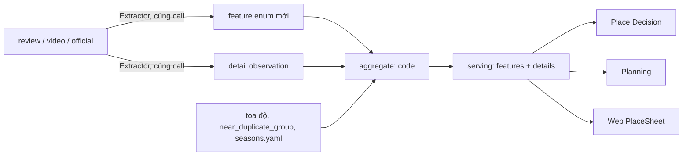

# Spec: chi tiết địa điểm theo nhu cầu người dùng (13 mục)

File làm việc tạm (`RULE.md` §0.1). Khi xong: gộp vào `docs/CORPUS.md`, `PLANNING.md`, `PLACE_DECISION.md`, `Role_Web_Functional_Design.md` §6, rồi xóa file này.

## Mục tiêu

Corpus trả lời được 13 câu người đi Đà Lạt cần biết trước khi chọn và xếp lịch: nổi tiếng vì gì, gọi món / làm gì, mất bao lâu, tổng tiền thật, giờ / mùa đẹp, đường đi, trời xấu, hợp người đi cùng, chuẩn bị gì, chặt chém ở khâu nào, quan hệ giữa các nơi, chi tiết chỗ ở, cảm giác khi ở đó. Ưu tiên: (1) nổi tiếng vì gì, (3) mất bao lâu, (4) tổng tiền thật.

Người dùng: đi **một mình** hoặc đi **với bất kỳ x nào** (người yêu, bạn bè, trẻ nhỏ, em bé, ba mẹ, bà bầu, người đi xe lăn, thú cưng, đồng nghiệp, đoàn đông, …; danh sách mở). Corpus chứa thứ người dùng **cần**, không phải thứ dễ trích: recall thấp không là lý do bỏ một mục; thiếu thì `unknown`, rồi tăng recall bằng nguồn (từ khóa Maps, trang official, TikTok). Không bỏ feature hiện có; chỉ gộp khi không mất thông tin.

Phạm vi: trích xuất → aggregate → serving → Place Decision + Planning → Web. Làm cả 13 mục một lần.

Không đổi: không span thì không giá trị; thiếu là `unknown`; model trích xuất, code quyết định; một tác giả một phiếu; hard constraint fail-closed.

Đã loại theo quyết định người dùng: feature `shuttle` (xe điện trong khu vẫn có qua `detail.fee` / `detail.access`). Thú cưng không còn bị loại: là một x của `detail.fit` (§1.5).



## Đối chiếu 13 mục

| # | Đã có | Bổ sung |
|---|---|---|
| 1 | — | `detail.known_for` → `details.known_for` |
| 2 | `food_quality`, `vegetarian_options` | `detail.order`, `avoid`, `activity`, `photo_spot` |
| 3 | `visit_minutes` short / typical / long | `visit_duration` thêm ví dụ "đi nhanh / đi kỹ" vào prompt |
| 4 | `entry_fee` (khoảng), `price_per_person` | `detail.fee` theo `audience`; `details.cost` |
| 5 | `crowd_by_time`, `sunset_view`, `cloud_hunting` | `detail.best_time`, `avoid_time` (kèm `months`), `schedule`; `last_entry` |
| 6 | `rough_road_access`, `long_walk`, `parking` | `car_access`, `coach_access`, `night_road_risk`; `detail.access` |
| 7 | `weather_exposed` (+ bối cảnh `weather = foggy / rainy`) | `fog_blocks_view`, `cold`; "mặc gì, mang gì" qua `detail.bring` |
| 8 | `kids`, `elderly`, `wheelchair`, `couples`, `groups`, `toilet` | `rest_benches`, `toilet_available`, `kids_play_area`, `stroller_access`, `pets`; `detail.fit` cho **mọi x**, kể cả đi một mình (§1.5) |
| 9 | `booking_needed`, `cash_only` | `detail.booking`, `bring`; `last_entry` |
| 10 | `tourist_trap` | `scam_stage` |
| 11 | `area`, `near_duplicate_group` | vé combo qua `detail.fee`; `relations.quieter` / `busier` (code) |
| 12 | `noise`, `scenic_view`, `parking` | `heater`, `hot_water`, `breakfast`; `walk_to_night_market_min` (code) |
| 13 | `couples`, `long_stay_chill`, `laptop_friendly` | `detail.situation` ("ngồi đọc sách cả chiều", "chụp ảnh nhóm", "hẹn hò") |

## 1. Dữ liệu mới

### 1.1 Feature enum (`config/ontology.yaml`, bump `version`)

| id | group | values | check | ghi chú |
|---|---|---|---|---|
| `car_access` | effort | yes, no | span | ô tô vào tận nơi |
| `coach_access` | effort | yes, no | span | xe 16 chỗ / xe khách vào được; `caution_values: [no]` |
| `night_road_risk` | effort | present | span | đường tới tối chạy nguy hiểm (đèo, không đèn) |
| `rest_benches` | effort | present, absent | span | ghế ngồi nghỉ dọc đường đi (effort, không phải suitability: không cần `verify: always`) |
| `toilet_available` | environment | yes, no | — | có nhà vệ sinh trong khu |
| `kids_play_area` | experience | present | — | khu chơi cho trẻ |
| `scam_stage` | service | parking, photo, tout, forced_purchase, menu_price, rental | span | `caution_values` = mọi giá trị |
| `fog_blocks_view` | environment | present | span | sương mù che hết view (khác `weather_exposed`: nơi có mái che vẫn có thể mất view) |
| `cold` | environment | present | — | lạnh hơn mức chung, cần áo ấm (đỉnh đồi, ven hồ, tối) |
| `stroller_access` | effort | yes, no | span | đẩy xe em bé đi được |
| `pets` | suitability | allowed, not_allowed | span | `verify: always`, `caution_values: [not_allowed]` |
| `heater` | environment | present, absent | — | máy / lò sưởi |
| `hot_water` | environment | good, poor | — | nước nóng mạnh / yếu |
| `breakfast` | service | included, not_included | — | |

Mỗi feature có `hint` và `claims` theo khuôn mẫu feature hiện có. `stay_features` thêm `heater`, `hot_water`, `breakfast`, `cold`, `toilet_available`, `pets`. Feature effort / caution mới vào `TARGETED_FEATURES` khi là fact của nơi (`car_access`, `coach_access`, `stroller_access`, `toilet_available`, `pets`, `heater`, `breakfast`).

### 1.2 Observation `detail`

Cùng format `observation()` (`src/corpus/observe/__init__.py`), thêm tham số `detail`:

```text
feature = "detail.<kind>"   value = cụm chữ (chuỗi con của quote)
detail{amount_vnd, audience, unit, min_people, months, days, hour, who, verdict}   (null khi không áp dụng)
```

Ghi trong mảng `details` riêng của file observation (aggregate cũ chỉ đọc `observations`).

| kind | Mục | `amount_vnd` | `audience` | `months` / `days` / `hour` |
|---|---|---|---|---|
| `known_for` | 1 | — | — | — |
| `order`, `avoid` | 2 | giá món nếu nêu | — | — |
| `activity`, `photo_spot` | 2 | — | — | — |
| `fee` | 4 | bắt buộc | adult · child · senior · all; `unit` person · group · vehicle · item; `min_people` | — |
| `best_time`, `avoid_time` | 5 | — | — | `hour` hoặc `months` nếu quote nêu; buổi đi qua `context.time_of_day`; mùa ("mùa dã quỳ") cũng là `best_time` |
| `schedule` | 5 | — | — | `days` bắt buộc |
| `access` | 6 | — | — | — |
| `booking`, `bring` | 9 | — | — | — |
| `situation` | 13 | — | — | — |
| `fit` | 8 | — | — | `who`, `verdict`, xem §1.5 |

`fee` gồm vé vào cổng theo đối tượng, khoản bên trong và vé combo; `unit` / `min_people` cho giá theo xe, theo phòng, theo nhóm ("jeep 1,2 triệu/xe", "tối thiểu 4 người"): người đi một mình phải trả cả phần đó; `value` là tên khoản ("vé người lớn", "xe điện", "thuê áo dài", "gửi ô tô", "combo thác + vườn dâu").

### 1.3 Trích xuất

- `REVIEW_OBSERVE`, `VIDEO_OBSERVE`: schema mỗi review / segment thêm `details: [{kind, text, amount_vnd, audience, months, days, hour, time_of_day, quote}]`, trong cùng call. Prompt thêm bảng `kind` + ví dụ; luật: chỉ điều nguồn nói về chính nơi này, `text` chép nguyên chữ từ quote, không tự suy tháng từ kiến thức ("mùa dã quỳ" không có tháng → `months` rỗng).
- `OFFICIAL_OBSERVE`: `audience` thêm `senior`; vé `other` thành `fee` có `text` = tên khoản; `kind` mới `last_entry` (`open` = giờ ngừng bán vé / nhận khách).
- `PHOTO_OBSERVE`: không đổi.
- `config/queries.yaml` `keyword_sets`: thêm "gửi xe", "xe điện", "thuê đồ", "tháng", "xe 16 chỗ", "lạnh", "sương mù", "một mình", "chó", "xe đẩy", "bà bầu" (nơi trải nghiệm), "món", "nên gọi" (ăn uống), "máy sưởi", "nước nóng", "bữa sáng", "thú cưng" (chỗ ở).

### 1.5 Đi với x: `detail.fit`

Enum suitability chỉ phủ vài x cố định; người dùng có thể đi với bất kỳ ai hay cái gì. `detail.fit` ghi mọi câu nguồn nói về việc đi nơi này **với một x cụ thể** hoặc **một mình**:

```text
who      = id trong config/companions.yaml, hoặc cụm chữ gốc khi chưa có id
verdict  = good | bad | conditional
value    = lý do (chuỗi con của quote): "nhiều bậc thang", "có khu cho bé", "cho dắt chó, phải rọ mõm"
```

- `config/companions.yaml` (từ vựng mở, có version): `id`, nhãn vi / en, từ đồng nghĩa. Bắt đầu với `solo`, `partner`, `friends`, `kids`, `baby`, `elderly`, `pregnant`, `wheelchair`, `pet`, `coworkers`, `large_group`; mỗi id map sang enum suitability khi có (`kids` → `kids`, `elderly` → `elderly`, `partner` → `couples`, `large_group` → `groups`, `wheelchair` → `wheelchair`, `pet` → `pets`).
- `who` ngoài từ vựng được giữ nguyên chữ, như `proposed_feature`: Judge ánh xạ vào id có sẵn hoặc gom thành nhóm đề xuất; nhóm ≥ 3 nguồn độc lập vào review; chỉ người thêm id.
- "Đi cùng gia đình, rất vui" không phải fit (giống luật suitability hiện có): phải nói nơi này hợp / không hợp **vì** x, hoặc kể điều x làm được / không làm được ở đây.

### 1.6 Gate

- `kind` thuộc bảng 1.2; `fit` cần `who` khác rỗng và `verdict` đúng enum; `unit` / `min_people` chỉ khi quote nêu; `text` (chuẩn hóa NFC + khoảng trắng + hoa thường) là chuỗi con của `quote`; `quote` là chuỗi con của nguồn như hiện nay.
- `amount_vnd` > 0 thì số tiền phải có trong quote (cùng parser số tiền của `estimates.py`); `fee` thiếu tiền → bỏ.
- `months` không rỗng thì quote phải chứa "tháng N" / "thg N" khớp từng tháng; `days` thì quote chứa thứ tương ứng; `hour` thì quote chứa giờ.
- Lỗi đếm `detail_drop_<lý do>` trong stats của file.

## 2. Aggregate (chỉ code)

Module mới `src/corpus/aggregate/details.py`, gọi từ `aggregate/place.py`.

### 2.1 Gộp

- Theo (nơi, `kind`): chuẩn hóa `text` (NFC, hoa thường, bỏ số tiền, bỏ từ đệm trong `config/category_defaults.yaml` → khóa mới `detail_stopwords`), gộp hai cụm khi token-set Jaccard ≥ 0,6 hoặc tập token này chứa tập kia. Tất định, so với leader của cụm (không nối chuỗi).
- Mỗi cụm: `text` = dạng xuất hiện nhiều nhất (hòa → ngắn hơn), `n` = số tác giả, `amount_vnd` = trung vị (mỗi tác giả một số), `audience` = phổ biến nhất, `months` / `days` = đếm theo tác giả, `evidence` ≤ 5 id, `authority` = có nguồn official.
- Nhãn Judge `wrong` / `unsure_again` bỏ observation trước khi gộp, như feature.
- Phục vụ: `n ≥ 2` hoặc `authority`. Cụm 1 tác giả chỉ ở intel.
- Precision theo `kind` từ nhãn Judge (`review.label_stats()`); `kind` có cận dưới Wilson < ngưỡng `config/serving.yaml` `detail_min_precision` (sau ≥ 30 nhãn) không phục vụ.

### 2.2 Khối `details` trong intel / serving

| Khối | Rule |
|---|---|
| `known_for` | điểm = `n` × log(N_group / (1 + số nơi cùng `category_group` có cụm trùng)); `headline` = điểm cao nhất, `more` ≤ 3. Không cụm đạt ngưỡng → `null` |
| `order`, `avoid`, `activity`, `photo_spot`, `access`, `booking`, `bring`, `situation` | danh sách cụm phục vụ được, xếp `n` giảm dần, ≤ 6 mỗi khối |
| `cost` | `entry{adult, child, senior}`: `tickets_vnd` official > `fee` có `audience` (cụm vé); `parking`: cụm `fee` có token gửi xe / đậu xe; `extras[]`: cụm `fee` còn lại `{text, median_vnd, n}`; `total_vnd{base = entry.adult + parking, with_extras = base + Σ extras}` tính **cho một người**; khoản `unit` group / vehicle giữ nguyên giá + `min_people` để online chia theo số người thật (đi một mình trả cả xe); `source` official / reviews; `kind = fact` chỉ khi mọi thành phần từ official |
| `timing` | `best_time` / `avoid_time`: phân bố tác giả theo `time_of_day` + giờ cụ thể; `best_months` / `avoid_months`: `months` của `best_time` / `avoid_time` + `config/seasons.yaml` (cụm mùa → tháng, nhập tay có nguồn); `schedule[]` `{text, days, n}`; `last_entry` `{time, source}` (official > review) |
| `fit` | theo `who` (id, hoặc chữ gốc chưa map): phân bố `verdict` theo tác giả, lý do gộp như các khối khác, `n`, `evidence`. Ngưỡng phục vụ như mọi cụm; `bad` của x thuộc nhóm nhạy cảm (`baby`, `elderly`, `pregnant`, `wheelchair`) là caution: cần ≥ 2 tác giả hoặc Judge pass. Không gộp vào enum suitability (enum vẫn đếm riêng); Web và online đọc cả hai |
| `relations` | `quieter[]` / `busier[]`: nơi cùng `near_duplicate_group`, so `reviews_count` và tỷ lệ `crowd = high`; chỉ ghi khi cả hai cùng chiều |
| `walk_to_night_market_min` | đường chim bay × 1,3 / 80 m/phút tới `night_market` trong `config/cities.yaml`; chỉ ghi khi ≤ 20; `kind = estimate` |

Mỗi mục serving có `{text, n, status, evidence}`; `status` = `VERIFIED` khi đạt ngưỡng và precision của `kind` đo được, còn lại `UNCERTAIN` (`unmeasured_precision`), như feature.

### 2.3 Feature enum mới

Đi đúng đường cũ (`features` → khía cạnh, `check()` fail-closed). `scam_stage` cần ≥ 2 tác giả (caution).

## 3. Online

### 3.1 Planning

| Dữ liệu | Thay đổi | File |
|---|---|---|
| `cost.total_vnd` | `cost_of` lấy `base` khi có, khoản theo nhóm / xe chia cho `people` (≥ `min_people`); metrics thêm `extras_max_vnd` | `planning/places.py`, `objectives.py`, `composer.py` |
| `timing.best_time` / `avoid_time` | điểm mềm cho giờ bắt đầu, trọng số trong `config/planning.yaml` | `planning/conditions.py` |
| `best_months` / `avoid_months` | tháng chuyến trong `avoid_months` → cảnh báo + lý do đổi dự phòng; trong `best_months` → ghi chú "đúng mùa" | `backup.py`, `output.py` |
| `schedule` | ngày chuyến trùng thứ → gợi ý trong output | `output.py` |
| `last_entry` | giờ bắt đầu muộn nhất; cứng khi `source = official`, cảnh báo khi review | `timefit.py` |
| `night_road_risk` | xe máy + mục kết thúc sau hoàng hôn → trừ điểm mềm + cảnh báo | `conditions.py` |
| `relations.quieter` | ngày `crowd = peak` → ưu tiên làm dự phòng | `backup.py` |
| `weather_exposed` theo bối cảnh `foggy` / `rainy`, `fog_blocks_view`, `cold`, `bring`, `booking`, `scam_stage` | checklist "chuẩn bị" + cảnh báo trên mục lịch trình (dự báo sương mù / mưa + nơi bị ảnh hưởng) | `output.py` |

Không có dữ liệu → hành vi hiện tại.

### 3.2 Place Decision

- `coach_access`: `check(rec, "coach_access", "no")` = `fail` loại nơi khi `mobility = car` và `people ≥ 9` (ngưỡng trong `config/decision.yaml`); `unknown` xử lý như các check effort hiện có. Ràng buộc vật lý: không đường code nào nới.
- **Trip: companions mở.** `Who` (`src/trip/domain/state.py`) đổi từ Literal cố định sang id của `config/companions.yaml` (thêm `solo` khi đi một mình); Trip Understanding nhận x ngoài danh sách: agent map vào id gần nhất, không có thì giữ chữ gốc (Place Decision chỉ so được khi Judge đã map nó ở corpus). Câu hỏi "đi cùng ai" hiện chip theo từ vựng + ô tự nhập.
- `fit.py`: mỗi x trong `companions` → `details.fit[x]` + enum suitability tương ứng: `good` cộng điểm mềm, `bad` trừ điểm và hiện lý do; `bad` của x nhạy cảm (`baby`, `elderly`, `pregnant`, `wheelchair`) và `pets = not_allowed` khi có `pet` → `check()` fail-closed như suitability hiện có. Cộng thêm theo feature: `kids` / `baby` → `kids_play_area`, `stroller_access`; `elderly` → `rest_benches`, `toilet_available`; `solo` → giá theo người (§2.2 `unit`).
- `cards.py`, `compare.py`: hiện `known_for.headline` và `cost.total_vnd`.
- `feasibility._cost_vnd`: dùng `total_vnd.base` khi có.

## 4. Web

- `web/scripts/export_snapshot.py`: xuất `details` + feature mới vào `snapshot.json`.
- `PlaceSheet` tab Tổng quan: "Nổi tiếng vì …" dưới tên (kèm số người nhắc); khối Tổng tiền; Gọi món gì / Làm gì; Giờ & mùa đẹp; Đường đi; Trời xấu; Đi cùng ai (mọi x có dữ liệu kèm lý do, x của chuyến hiện lên đầu, "đi một mình" là một dòng); Chuẩn bị; Cảnh báo (khâu bị chặt); Nơi tương tự (vắng hơn / đông hơn, mở nơi đó). Mục thiếu → "Chưa có thông tin". Mỗi dòng xem được quote nguồn.
- Tab Gợi ý lịch trình + thẻ lịch trình: checklist chuẩn bị, cảnh báo tháng / giờ, `extras_max_vnd`.
- Thiết kế bằng `/ui-ux-pro-max` trước khi code; màu chỉ từ token; chỉ desktop.

## 5. Kiểm thử

| Phần | Test |
|---|---|
| Ontology | feature mới hợp lệ, `stay_features` đúng, `companions.yaml` hợp lệ và map suitability đúng (`tests/test_ontology.py`) |
| Gate detail | value ⊄ quote, tiền / tháng / thứ / giờ / `min_people` không có trong quote, `kind` lạ, `fit` thiếu `who` → bỏ (`tests/observe`) |
| Official | `senior`, `fee` có tên, `last_entry` |
| Gộp + ngưỡng | cụm gần giống gộp; 1 tác giả không phục vụ; official một mình phục vụ; precision thấp không phục vụ (`tests/aggregate`) |
| `known_for` | hai quán cùng nhóm có cụm chung + cụm riêng → headline là cụm riêng; không đạt → `null` |
| `cost` | `base`, `with_extras`, official thắng review; giá theo xe chia đúng cho 1 người và 4 người |
| `fit` | gộp theo `who`; `who` lạ giữ chữ gốc; `bad` nhạy cảm 1 tác giả không phục vụ |
| `relations`, `walk_to_night_market_min` | đúng chiều, ngưỡng 20 phút |
| Planning | `cost_of` mới + fallback; `last_entry` cứng / mềm; điểm giờ; tháng tránh (`tests/planning`) |
| Trip | x ngoài danh sách được giữ; x có id map đúng; `solo` (`tests/trip`) |
| Decision | `coach_access`, `pets`, `fit` nhạy cảm fail-closed; điểm mềm `fit`; thẻ + so sánh (`tests/decision`) |
| Regression | `python -m decision evaluate`, `python -m planning evaluate` không tụt so với baseline đo trước khi đổi |

## 6. Chạy lại corpus

1. Đo baseline evaluate (decision, planning).
2. Bump ontology, thêm `keyword_sets`, chạy `gmaps keywords` cho từ mới.
3. `python -m corpus build` với `OBSERVE_KEEP_STALE` tắt → trích xuất lại toàn bộ trên Gemma LAN; tạm dừng lane TikTok của Gemma khi chạy.
4. `judge audit` lấy mẫu `detail` → precision theo `kind`.
5. `aggregate` → `serving` → `export_snapshot.py`.
6. Báo cáo coverage 13 mục: số nơi có `known_for`, `cost.total_vnd`, `timing`, từng feature mới, `fit` theo từng x. Mục coverage thấp → thêm nguồn (từ khóa, official, TikTok), không bỏ mục.

## 7. Rủi ro

- Recall thấp cho mục hiếm (giá từng khoản, giờ ngừng bán vé, `pets`, `stroller_access`, x hiếm): nhiều `unknown`. Vẫn giữ mục; tăng bằng từ khóa Maps, trang official, TikTok; không bù bằng đoán.
- Gemma trả `text` diễn đạt lại thay vì chép → gate bỏ; theo dõi `detail_drop_not_in_quote`, sửa prompt nếu cao.
- Câu nói về nơi khác (lỗi Judge hay bắt nhất) → Judge audit theo `kind`.
- Prompt dài hơn → call chậm hơn; đo thời gian một lô trước khi chạy cả thành phố.
