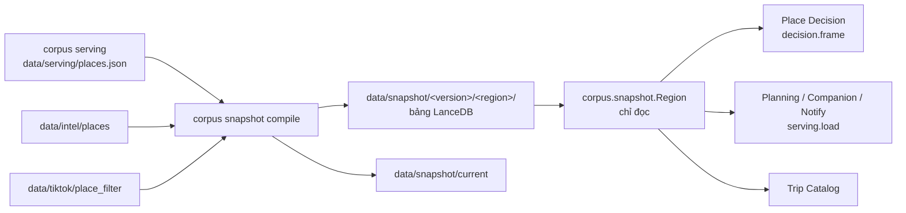
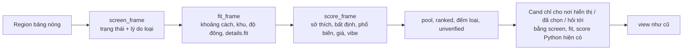

# Spec: corpus snapshot — truy vấn corpus nhanh nhất cho Place Decision và agent

File làm việc tạm (`RULE.md` §0.1). Khi xong: gộp vào `docs/CORPUS.md` (§Data model, §Place Decision dùng corpus thế nào, §Kiểm soát chi phí và hiệu năng), `docs/PLACE_DECISION.md` §18, `README.md` (CLI), rồi xóa spec này và plan `docs/superpowers/plans/2026-10-13-corpus-snapshot.md`. Spec này thay §2 "Mask tất định cho Place Decision" của `2026-10-12-corpus-semantic-index-design.md`.

## 1. Mục tiêu

**Nhanh** = độ trễ từ lúc server nhận yêu cầu của user đến lúc trả kết quả. Corpus phải chiếm phần nhỏ nhất có thể trong độ trễ đó ở mọi quy mô: hôm nay là Đà Lạt (1.696 nơi), sau này là nhiều thành phố.

Không đổi:
- Offline ghi, online chỉ đọc.
- `unknown` ≠ `false`; hard constraint fail-closed.
- Kết quả của Place Decision **y hệt** hiện tại. Có oracle test chứng minh (§7).

Ngoài phạm vi:
- Prompt và model của agent: độ trễ LLM chỉ được đo, không tối ưu ở đây.
- Thuật toán của Planning: chỉ đổi nguồn nạp.
- Chạy nhiều máy: chỉ ghi lại đường mở rộng ở §8.

## 2. Hiện trạng đo được (2026-10-13, 1.696 nơi)

| Chỗ | Số đo | Nguyên nhân |
|---|---|---|
| `decision` `create` | p50 117 ms, max 269 ms | `pipeline.run` duyệt dict lồng nhau của mọi record mỗi lượt |
| `decision` `act` | p50 104 ms, max 320 ms | như trên; `select` / `drop` cũng chạy lại từ đầu |
| Phân bổ (cProfile, 50 lượt) | `score` 34%, `screen` 23%, `mmr` 11%, `fit` 11%, thẻ 5% | `requirements.applicable` ~5.000 lần/lượt, `serving.feature` ~11.000, `groups.similarity` ~11.000 (`signature()` tính lại mỗi lần) |
| `Data.load` | 0,6 s | `data/serving/places.json` 28 MB |
| Trip `Catalog.load` | 12 s, 340 MB | đọc 1.761 file `data/intel/places/*.json` (90 MB) rồi `serving.build()` lại từng nơi |
| `corpus.index` warm | ~30 s | nạp embedder, không phải truy vấn |

Kết luận: ở quy mô này đổi sang DB server không làm nhanh hơn. Thứ tốn là tính lại giá trị tĩnh, và duyệt mọi record bằng vòng lặp Python ở mỗi lượt.

### 2.1 Tình trạng corpus (kiểm 2026-10-13 14:20 giờ VN)

| Lớp | Hiện có | Ghi chú |
|---|---|---|
| `data/serving/places.json` | 1.696 nơi, build 2026-10-08; **0 chỗ ở** | 65 nơi `DISABLED` đã bị loại (48 tạm đóng, 12 đóng hẳn, 2 judge đóng, 3 judge đổi); mọi record `VERIFIED` |
| `data/intel/places/` | 1.761 file, 2026-10-08 | chỉ 5 chỗ ở (trùng với danh sách chính) |
| Danh sách chính `list/dalat.json` | 1.779 nơi | **18 nơi** thêm sau lần aggregate 08/10, chưa vào intel |
| Chỗ ở `list/dalat_stay.json` | 1.524 nơi; 741 có giá một đêm | 1.523 đã có observation review; 1.405 đã có photo observation; 119 chưa có `photos.json` |
| Chỉ mục ngữ nghĩa (`style_observations`, `photo_vectors`) | 1.694 / 1.634 nơi | chỗ ở **chưa** vào chỉ mục (chỉ 5) |
| Build v13 (`corpus build --city dalat --skip tiktok`, session khác, log `logs/corpus_build_v13.log`) | đang ở `judge audit`, 17.300 / 26.295 call (14:20); 20.600 / 26.295 call (14:54) | sau đó tới `aggregate` → `serving`. Khi xong, serving mới có chỗ ở |
| TikTok | build này bỏ qua TikTok | |
| **Sau build v13** (kiểm 2026-10-13 16:10 giờ VN; build xong 09:00 UTC) | `places.json` build 2026-10-13T09:00:08Z: **3.208 nơi, mọi record `VERIFIED`**; **1.509 chỗ ở**, 737 có giá một đêm; 3.280 file intel; 72 nơi `DISABLED` bị loại (53 tạm đóng, 12 đóng hẳn, 4 judge đóng, 3 judge đổi) | 84 nơi của danh sách chính không được phục vụ: 66 có intel nhưng bị loại (`DISABLED`), 18 vẫn chưa có file intel (chưa có observation). 1.513 nơi được phục vụ không nằm trong danh sách chính (chỗ ở) |
| Còn thiếu sau build (plan này không làm) | chỗ ở chưa vào chỉ mục ngữ nghĩa (`python -m corpus index`, cần GPU); 119 chỗ ở chưa có ảnh (`LODGING_AT_SELECTION_HANDOFF.md` §3.1, cần user giải captcha); TikTok chưa chạy trong build này | |

Snapshot chỉ chứa record có trạng thái được phục vụ (`VERIFIED`, `UNCERTAIN`, `OUTDATED`). `DISABLED` và `NEEDS_REVIEW` không bao giờ vào snapshot, nên không tới Decision, Planning hay Trip. Chỗ ở (`category_group = stay`) có trong snapshot cho Planning (tab "Chỗ ở", `docs/plans/LODGING_AT_SELECTION_HANDOFF.md`). Decision không bao giờ gợi ý chỗ ở.

## 3. Lựa chọn công nghệ

| Cần | Chọn | Vì sao |
|---|---|---|
| Lưu snapshot theo vùng, đọc theo id | **LanceDB** (đã dùng cho `corpus.index`) | Embedded, Arrow, có scalar index; không có network hop |
| Lọc và chấm điểm trên bảng | **Polars** (đã cài, 2.0) để join và lọc; **numpy** cho phép cộng theo cột | Dạng cột, không vòng lặp Python theo nơi |
| Ghi online (session, profile) | Postgres (đã có) | Không đổi |

Đã loại:
- **Milvus / Qdrant**: thêm dịch vụ và một vòng mạng, trong khi corpus online chỉ đọc. Phần vector đã có LanceDB.
- **Postgres cho corpus**: mỗi request phải kéo hàng nghìn hàng qua mạng.

Thêm vào `pyproject.toml` các thư viện đang dùng mà chưa khai báo: `lancedb`, `polars`, `pyarrow`, `orjson`.

## 4. Kiến trúc



Ba quy tắc:
1. **Offline ghi, online chỉ đọc.**
   - `corpus serving` biên dịch snapshot ngay ở cuối lần chạy, nên snapshot không bao giờ cũ hơn `places.json`.
   - `current` là file text chứa tên version, ghi nguyên tử, giống `data/index/current`.
   - Server đọc snapshot lúc khởi động. Build mới thì khởi động lại server, như hiện nay.
2. **Tách nóng và lạnh.**
   - Bảng nóng (một hàng mỗi nơi, cột đã tính sẵn) dùng cho lọc và xếp hạng.
   - Record đầy đủ chỉ đọc theo id, cho thẻ đang hiển thị và các nơi đã chọn.
3. **Mỗi request đọc corpus tối đa một lần.**
   - Bảng xếp hạng của phiên được memo theo input.
   - `select` / `drop` / `lock` chỉ tính lại phần có input đổi.

**Vùng (region)** là key trong `config/cities.yaml`:
- Một nơi thuộc vùng có `area` (bbox) chứa tọa độ của nó. Không có tọa độ thì thuộc vùng được truyền vào lúc compile.
- Vùng mặc định của online là `default_region` trong `config/serving.yaml` (`dalat`).
- Khi Trip có thành phố đích, nó sẽ truyền key vùng. Việc đó ngoài phạm vi spec này.

## 5. Snapshot

```text
data/snapshot/
├── current                     tên version (text)
└── <version>/                  YYYYMMDDTHHMMSS; giữ keep_versions bản mới nhất
    ├── manifest.json           version, built_at, serving_built_at, ontology_version, regions{key: {places}}
    └── <region>/               một LanceDB database
        ├── places              bảng nóng: một hàng mỗi nơi được phục vụ
        ├── features            dài: một hàng mỗi (nơi, feature được phục vụ), kể cả fit.<who>
        ├── feature_ctx         dài: (nơi, feature, ctx_key) -> giá trị trội trong bối cảnh đó
        ├── fit_verdicts        dài: (nơi, who) -> verdict của details.fit
        ├── records             id -> serving record đầy đủ (JSON), scalar index BTREE trên id
        ├── intel               id -> phần intel Trip Catalog cần (JSON gọn)
        └── videos              video_id -> place_id (TikTok, relevance = yes)
```

### 5.1 `places`

Mọi cột suy ra được tính lúc compile bằng **chính hàm Python hiện có**, không viết lại. Vì vậy chỉ có một định nghĩa.

| Cột | Kiểu | Tính bằng |
|---|---|---|
| `id`, `name`, `status`, `kind`, `category`, `category_group`, `area`, `address` | str | `identity` |
| `lat`, `lng` | float64, null được | `identity` |
| `usable_as` | list[str] | record |
| `role` | str, null được | `decision.model.role_of` rồi chỉnh theo `activity_for` như `pipeline.run` khi không có override |
| `activity` | str, null được | `requirements.activity_for(rec, None, role_of(rec))` |
| `category_for` | str, null được | `requirements.category_for` |
| `is_stay` | bool | `category_group == "stay"` |
| `near_duplicate_group` | int32, null được | record |
| `voices` | int32 | `provenance.voices or 0` |
| `price_mid_vnd` | float64, null được | như `rank._price_norm` trước bước chia `price_ref_vnd` |
| `hours_status` | str, null được | `operation.hours.status` |
| `open_mask` | uint8 | bit i = `hours.value.get(DAYS[i])` khác rỗng (`DAYS` của `trip_days`) |
| `has_hours_value` | bool | `bool(hours.value)` |
| `crowd_<weekday\|weekend>_<morning\|noon\|afternoon\|evening>` | int16, null được | `operation.crowd_by_time` |
| `has_crowd` | bool | `bool(crowd_by_time)` |
| `signature` | list[str] `"fid=value"` | `serving.groups.signature` |

### 5.2 Các bảng dài

- **`features`**: `place_id`, `fid`, `value`, `status`, `n`, `conf`, `dist_values` (list[str], key của `distribution`). Thêm một hàng `fid = "fit.<who>"` cho mỗi `details.fit.<who>` (`n` / `conf` null), để hard filter `fit.*` đi cùng đường. `conf` = `rank.conf(f)` tính sẵn.
- **`feature_ctx`**: `place_id`, `fid`, `ctx_key` (`"time_of_day=morning"`), `top` = `max(d, key=d.get)`. Chỉ lưu `d` không rỗng.
- **`fit_verdicts`**: `place_id`, `who`, `value`, `status`.

## 6. Online

### 6.1 `corpus.snapshot` (public API)

```python
Snapshot.open(root: Path | None = None) -> Snapshot      # đọc current; lỗi rõ ràng nếu chưa compile
Snapshot.region(key: str | None = None) -> Region       # None = default_region; nạp một lần, cache
Region.from_records(records, intel=None, videos=None, key="test") -> Region   # trong RAM, cho test
Region.places / .features / .feature_ctx / .fit_verdicts : pl.DataFrame
Region.record(pid) -> dict | None                        # LRU, đọc bảng records theo id
Region.records() -> list[dict]                           # mọi record, parse một lần (Planning, Notify)
Region.by_id -> Mapping[str, dict]                       # lazy, dùng record()
Region.intel() -> list[dict]; Region.videos -> dict[str, str]
compile_snapshot(city: str) -> dict                      # offline
```

`corpus.serving.load(region=None)` trả `Snapshot.open().region(region).records()`. Planning, Companion, Notify, bench và harness tự hưởng lợi mà không phải sửa. Bước offline (`index`, `style_observe`) vẫn đọc `places.json`.

### 6.2 Place Decision trên bảng (`decision.frame`)



- `screen` / `fit` / `score` / `preference` hiện có **vẫn là định nghĩa**. Chúng dựng `Cand` (lý do, cờ, matches) cho số ít nơi được hiển thị hoặc được hỏi (`why_not`, `compare`). `decision.frame` tính cùng con số đó cho mọi nơi bằng bảng. Oracle test giữ hai bên khớp nhau.
- **Khớp chính xác từng bit:**
  - Các tổng cộng dồn **theo đúng thứ tự** của Python: lặp theo want / part, vector hóa theo nơi, float64.
  - Làm tròn bằng `round()` của Python trên list kết quả.
  - Khoảng cách tính bằng `decision.geo.km` (Python `math`), sau đó memo theo tâm.
- **Đường dự phòng:**
  - Feature đặc biệt (`venue_category`, `activity`, `wine_tasting_available`, `activity = alcohol_consumption`) và các nơi có override `activities` được tính bằng hàm Python hiện có, rồi vá vào bảng.
  - Phạm vi áp dụng dùng một hàm chung `requirements.scope_allows(requirement, activity)` tách từ `applicable()`. Hành vi giữ nguyên.
- **`Result.cands`** thành Mapping lazy: `in` là id có trong bảng; `[]` dựng `Cand` khi cần. `rank.score` nhận thêm `voices` (danh sách voices của tập live) để tính `pop` cho một nơi lẻ.
- **`groups.mmr`** nhận thêm `sigs`, dùng cột `signature`, không tính lại.
- **Memo theo phiên** trong `Engine`, ba tầng theo khóa input:

  | Tầng | Phụ thuộc |
  |---|---|
  | screen | `hard_filters`, ngày, `relaxed`, `activities` |
  | fit | `context`, `pace`, `anchors`, các field liên quan của `profile` |
  | score | `soft_weights`, `profile.soft`, `price_sensitivity`, `visited`, `novelty`, `vibes`, tập live |

  Khóa là hash JSON của đúng các field đó.

### 6.3 Trip Catalog

- `Catalog.load` đọc `Region.intel()` + `Region.videos`.
- `evidence_record` lấy record đã phục vụ, không gọi `serving.build()` lại.
- **Đổi hành vi có chủ đích (user đã duyệt 2026-10-13):** catalog chỉ còn nơi được phục vụ. Nơi `DISABLED` / `NEEDS_REVIEW` không còn hiện cho Trip, đúng `docs/CORPUS.md` §Trạng thái.

### 6.4 Agent

Tool `search_places` / `search_features` / `ask(look)` vẫn chạy trong RAM. Nhanh hơn chủ yếu vì catalog nạp nhanh và kết quả gọn. Độ trễ từng tool được đo (§7). Chỉ chuyển sang full-text LanceDB khi số đo vượt ngân sách.

## 7. Đo và kiểm chứng

**Lệnh đo:** `python -m bench latency [--scale 1,5,20] [--out DIR]`. Kết quả ghi `data/bench/latency/<ts>.json` và in ra bảng.

| Nhóm | Đo |
|---|---|
| Khởi động | `Snapshot.open` + `region()`, `Data.load`, Trip `Catalog.load`, `planning.create_engine`, `serving.load()` |
| Decision | `create` (30 chuyến `eval_trips`); `act` `select` / `drop` / `lock` / `undo`, `page`, `why_not`. Đo p50 / p95 / p99 / max. |
| Quy mô | ×1, ×5, ×20: nhân bản vùng Đà Lạt (id `<id>~k`, tọa độ dịch trong bbox), cùng kịch bản |
| Agent tool | `search_places`, `search_features` (Trip lookup), p50 / p99 |
| Chỗ ở | `planning.Engine.lodging_options(decision)` (tab "Chỗ ở" của Lựa chọn), lần đầu và lần lặp lại (cache) |
| End-to-end offline | `Harness.request` cho `decision.create` / `decision.act` không model, như `bench run` |

**Ngân sách** (lần nào đo cũng kiểm; không đạt thì không nới, phải báo lại):

| Thao tác | ×1 p99 | ×20 p99 |
|---|---|---|
| `create` | ≤ 30 ms | ≤ 150 ms |
| `act` | ≤ 15 ms | ≤ 25 ms |
| Nạp vùng (frames) | ≤ 1 s | ≤ 5 s |
| Trip `Catalog.load` | ≤ 1,5 s | — |
| Tool agent | ≤ 10 ms | ≤ 20 ms |

`act` gồm dựng khoảng 40 thẻ và kiểm khả thi. Hai phần này không phụ thuộc quy mô corpus, nên ngân sách của `act` lớn hơn phần corpus thuần.

**Oracle test (bắt buộc):**
- `tests/decision/reference.py` giữ bản sao `pipeline.run` hiện tại, chạy trên list record.
- Với cùng session, `run(...).view` phải bằng y hệt `run_reference(...).view` trên:
  - mọi session trong test decision hiện có;
  - 200 session sinh ngẫu nhiên (seed cố định) trên record fixture;
  - 30 chuyến `eval_trips` cộng kịch bản thao tác, trên snapshot thật (marker `corpus`, tự skip khi không có snapshot).

## 8. Mở rộng

| Khi | Làm |
|---|---|
| Thêm thành phố | Thêm key vào `config/cities.yaml`; compile tạo thư mục vùng mới. Không đổi code online. |
| Một vùng quá lớn cho RAM của Planning | Planning chuyển sang `Region.record()` như Decision |
| Một máy không đủ | Chia vùng cho nhiều máy, router theo vùng của chuyến đi. Snapshot là file bất biến, chép hoặc đọc từ object storage. |
| Tìm tên vượt ngân sách | Bảng `names` + full-text LanceDB (`ascii_folding`) |

## 9. Kết quả đo

Sonnet điền sau mỗi task có đo (plan ghi rõ task nào). Không xóa dòng cũ.

| Lần đo | Task | create p50/p99 ×1 | act p50/p99 ×1 | create p99 ×20 | act p99 ×20 | Nạp vùng | Catalog | Ghi chú |
|---|---|---|---|---|---|---|---|---|
| | | | | | | | | |
| tạm (pre-build v13, 1.696 nơi, load avg 12) | 4 | — | — | — | — | `Snapshot.open`+`region()` 0,26 s (nạp thư viện `lancedb` thêm 2–3 s lúc máy bận, chỉ một lần/process); `records()` 0,7 s | — | đo lại sau build v13 |
| tạm (pre-build v13, 1.696 nơi, load avg 12) | 5 | — | — | — | — | region 0,26 s (+2–3 s nạp lancedb lần đầu) | `Catalog.from_snapshot` 1,17 s lần đầu (gồm parse 1.696 record), 0,34 s lần sau; tổng ≈ 1,4 s không kể nạp lancedb. Cũ: 12 s | đo lại sau build v13 |
| baseline (code cũ = `tests/decision/reference.py`, 3.208 nơi gồm 1.509 chỗ ở, sau build v13) | 1 | 89.5/1086.7 ms | 91.9/886.6 ms | 21063.4 ms (chỉ 3 chuyến) | 2130.2 ms (3 chuyến) | — | — | file `data/bench/latency/baseline-20261013-161105.json`; ×5: create p50 456.1 ms |
| cuối (3.208 nơi, snapshot 20261013T090424) | 9 | 49.8/87.3 ms | 14.8/22.8 ms (`drop`/`undo` p50 41.1) | 724.9 ms | 229.4 ms (`drop` p99 5103.6) | ×1 2.068 s (gồm làm nóng cột), ×5 7.676 s, ×20 32.021 s; `Snapshot.region()` 0.297 s | `from_snapshot` 1.764 s | file `data/bench/latency/20261013-163300.json`. Máy dùng chung, tải 7–12. Tool agent `search_places` p50/p99: ×1 6.7/14.2 ms, ×5 58.6/90.7, ×20 287.8/7332.3. Chỗ ở: `lodging_options` lần đầu p50 32.9 ms, lặp lại 0.3 ms (1509 chỗ ở, 6 ứng viên mỗi chuyến). Qua `decision.Tools`: create p50 54.5 ms, select p50/p99 18.2/23.3 ms |

**So với ngân sách (§7), lần đo cuối:**
- Đạt: `search_places` ×1 p50 (6,7 ms; p99 14 ms hơi vượt 10 ms), nạp vùng `Snapshot.region()` 0,3 s, `lodging_options`.
- **Không đạt, báo user (không nới ngân sách):** `create` p99 ×1 87 ms (ngân sách 30), `act` p99 ×1 23 ms (15; `drop`/`undo` p50 41 ms vì đổi profile nên tầng fit và score tính lại), nạp vùng ×1 gồm làm nóng 2,1 s (1), `Catalog` 1,8 s (1,5). Ở ×20 (64.160 nơi vì vùng nay gồm chỗ ở, spec giả định 34k) mọi mục vượt xa: create p99 725 ms, act p99 230 ms, nạp vùng 32 s, `search_places` p50 288 ms.
- Ba hàm tốn nhất của một lượt `act` ×1 (cProfile): dựng `Cand` theo từng nơi được hiển thị (`Cands.__getitem__` → `screen` / `fit` / `rank.score`), dựng thẻ (`cards.card`), `groups.mmr` (đã đổi sang cập nhật tương đồng tăng dần). Phần bảng (`frame.table`) khi memo trúng chỉ vài ms.
- Cách đi tiếp nếu cần đạt ×20: cache thẻ theo (Cand, trạng thái chọn); `search_places` dùng bảng `names` + full-text (§8); nạp vùng lười theo cột. Chưa làm, chờ user quyết.
- Memo sống theo process (Engine không xóa memo khi hết phiên).
