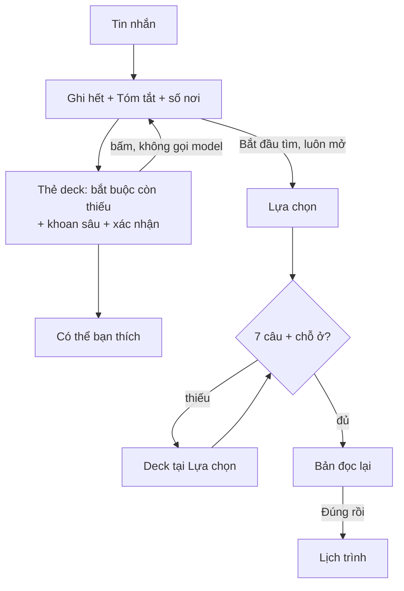

# Thiết kế lại Trip Understanding: hiểu đúng để lịch đúng

Spec làm việc (tạm thời, `RULE.md` §0.1). Hiện trạng: `docs/TRIP_UNDERSTANDING.md`. Bằng chứng: `2026-10-15-trip-understanding-cases.md` (77 persona chạy thật). Hai spec cùng đợt: `2026-10-15-place-decision-needs-design.md`, `2026-10-15-planning-day-frame-design.md`. Khi xong, gộp vào tài liệu chính thức rồi xóa các file này.

## 1. Mục tiêu

Output user cần là **lịch trình**. Mọi câu Trip hỏi phải giúp Decision chọn đúng nơi và Planning xếp đúng nhịp; câu nào không đổi được lịch thì không hỏi.

- Hiểu hết tin nhắn đầu trước, rồi khoan sâu sở thích đã nói, cuối cùng mới mở rộng hướng mới.
- Hỏi như Claude: ít câu, mỗi câu có lựa chọn rõ, có ảnh thật khi là chuyện "trông thế nào", luôn có "Khác, tự gõ".
- Không hiểu sai: điều đoán được user xác nhận một chạm; trước lần lập lịch đầu, user duyệt bản đọc lại.
- Không mất ý: mọi cách nói của user có chỗ ghi; điều corpus chưa có thì nói thật và giữ lại.
- Nhanh: bấm thẻ không gọi model; lượt gõ thường không bật thinking.

## 2. Đã chốt với người dùng

| Ngày | Chủ đề | Quyết định |
|---|---|---|
| 13/10 | Đi lại | `motorbike` · `car` · `walk`; taxi / Grab / xe có tài xế = `car` + `driver = hired` |
| 13/10 | Bỏ hẳn | câu `arrival`, `origin`, thuê xe (`rental`), `stay_times_q`, `days_q`, `dates_q` riêng, `vibe_q`, thứ tự cố định của `quiz_queue` |
| 13/10 | Hiện suy nghĩ | dòng nghĩ ngắn qua tool `note`, qua guard; thinking gốc không hiện |
| 13/10 | Hành vi | dùng ngay trong phiên; vào profile dài hạn khi lặp ở ≥ 2 phiên |
| 13/10 | Vé chuyến | đổi thành **Tóm tắt chuyến đi** |
| 15/10 | Bấm lựa chọn trên thẻ của agent | ghi thẳng `writes` đã qua guard, không gọi model; chỉ "Khác, tự gõ" chạy agent |
| 15/10 | Thẻ | **một** thẻ `deck`, mỗi câu một tab; câu ảnh hiện 3 ô ảnh ngang (thay "một ảnh lớn" cũ) |
| 15/10 | Câu ảnh | tối đa **3 lựa chọn**, mỗi lựa chọn 1 ảnh top-1, chọn top 3 trong các biến thể |
| 15/10 | Khoan sâu | mỗi sở thích rộng đã nói có một câu ảnh "… kiểu nào?" trước khi gợi ý hướng mới |
| 15/10 | Trường lạ không có trong corpus | nói thật với user + ghi `data/trip/gaps.jsonl` cho offline |
| 15/10 | User hỏi ngược | corpus → web có nguồn; lời khuyên chung (không phải số liệu) được nói, ghi là gợi ý |
| 15/10 | Cổng | **Lựa chọn luôn vào được**; **Lịch trình** cần đủ 7 câu bắt buộc (§5) + đã có chỗ ở |
| 15/10 | Chỗ ở | đã có thì tìm và chọn; chưa có thì qua Lựa chọn, chọn ở tab Chỗ ở trước khi lập lịch |
| 15/10 | Bản đọc lại | bắt buộc 1 chạm trước lần lập lịch đầu; hiện lại khi có thay đổi làm đổi lịch |
| 15/10 | Bữa ăn, khung giờ, nghỉ | Trip ghi nhu cầu (§4); Decision, Planning dùng theo spec riêng |

## 3. Luồng



## 4. Khung chuyến (`TripFrame`)

Nhu cầu về giờ giấc là thứ Planning cần nhất mà Trip State hiện không có chỗ ghi (`cases` §7). Trip sở hữu `TripFrame`; mỗi giá trị có `source` (`user` · `inferred` · `default`) và evidence như mọi Field.

```text
TripFrame
├── arrive      {at, how: self|bus|plane, ready_at}   mốc chơi sớm nhất ngày 1
├── leave       {at, how, done_by}                    mốc chơi muộn nhất ngày cuối
├── rhythm      {day_start, day_end}                  các ngày giữa; mặc định 08:00–21:00
├── days[i]     {date, start?, end?, intensity: light|normal|full|free}
├── busy[]      {label, kind: rest|nap|sleep|work|event, where: lodging|place_id|text,
│                start, end, on: all|[i]|weekdays|weekend}
├── meals       {skip[], breakfast_at_lodging, snacks, shift_min}
├── rest        {every_min, rest_min}                 ghi đè nhịp nghỉ theo pace
├── visit       {kind → phút}                         "cà phê 2 tiếng", "check-in 20 phút", "bé tối đa 1 tiếng"
├── periods[]   {period, kinds|activity, weight}      "sáng thiên nhiên", "tối spa", golden hour
├── drive_day_min                                     trần lái xe mỗi ngày (khác max_leg_min mỗi chặng)
└── pattern     interleave_kids?                      xen chỗ cho bé với chỗ cho người lớn
```

- Compile trải `busy` theo `on` vào từng ngày: `SearchInput.context.frame.days[i] = {date, start, end, busy[], intensity}` đã là khung cuối cùng; Decision và Planning không tự tính lại.
- Mọi ngày bắt đầu và kết thúc ở chỗ ở (`docs/PLANNING.md` §Đầu vào): `ready_at` = giờ tới + đệm + đường từ bến / sân bay về chỗ ở; `done_by` = giờ đi − đệm − đường từ chỗ ở ra bến / sân bay.
- `arrive.at` / `leave.at` là giờ phương tiện; `checkin_at` / `checkout_at` đổi nghĩa thành `ready_at` / `done_by` (giờ chơi), không phải giờ khách sạn.
- Sự kiện giờ cố định: nơi trong corpus → anchor có `at`; nơi ngoài corpus (tour, họp, đặt bàn chưa resolve) → `busy` kiểu `event`, không bịa `place_id`.
- `SearchInput.context.frame` mang `TripFrame` đã compile; Decision và Planning chỉ đọc (spec riêng).
- Đệm tới / rời và đường vào lấy từ `config/trip.yaml` (`arrival_buffer_min`, `entry_roads`) và tọa độ sân bay / bến xe.

## 5. Bảy câu bắt buộc và cổng vào Lịch trình

`config/trip.yaml` `required: [trip, companions, mobility, care, pace, budget, lodging]`. `readiness.missing` là nguồn duy nhất. **Planning từ chối tạo phiên khi `missing` khác rỗng** (server, fail-closed); `show` sang Lựa chọn không bị chặn (thay chặn cũ). Signal sức khỏe còn mở khi `show`: áp `strictest()` như `Engine._show` hiện nay (fail-closed) để Lựa chọn vẫn an toàn; ④ vẫn phải được trả lời trước khi lập lịch. Trả lời dần được: một phần ở Tìm hiểu, phần còn lại tại Lựa chọn khi bấm "Lập lịch".

Mỗi lựa chọn nói hệ quả lên lịch, không chỉ nhãn.

| # | Tab | Hỏi | Đủ khi | Planning / Decision dùng |
|---|---|---|---|---|
| ① | Chuyến đi | "Bạn ở Đà Lạt từ ngày nào đến ngày nào?" (lịch chọn khoảng) · "Ngày đầu bắt đầu chơi được từ mấy giờ?" · "Ngày cuối cần xong lúc mấy giờ?" Chip buổi `Sáng sớm (5–7h)` `Sáng` `Trưa` `Chiều` `Tối` + ô `HH:MM`; gợi ý từ cách tới (xe đêm → sáng sớm; bay → giờ hạ cánh + đệm) | ngày tới + ngày về thật (chỉ tháng chưa đủ); 2 mốc giờ có giá trị hoặc user xác nhận mặc định | `start_date`, `days`, `arrive`, `leave`: giờ mở theo thứ, `closed:`, thời tiết, khung ngày đầu / cuối |
| ② | Đi cùng | "Ai đi cùng bạn? (chọn nhiều)" `Một mình` `Người yêu / vợ chồng` `Bạn bè` `Đồng nghiệp` `Có trẻ em` `Có người lớn tuổi` `Có thú cưng` + số người. Câu phụ: bé mấy tuổi (`dưới 3` → `baby`), người lớn tuổi đi lại `bình thường` / `chậm, cần nghỉ`, thú cưng loại gì | `companions` + `people` | hard `fit.*`, `pets`, `stroller_access`; `coach_access`; chia ngân sách |
| ③ | Đi lại | "Ở Đà Lạt bạn đi lại bằng gì?" `Xe máy` `Ô tô tự lái` `Taxi / Grab / xe có tài xế` `Đi bộ là chính` | `mobility` | tốc độ, bán kính, `night_road_risk`, đỗ xe |
| ④ | Lưu ý | "Có điều gì mình cần tránh giúp cả nhóm không?" `Không có gì` (loại trừ) `Khó leo bậc, đi bộ xa` `Xe lăn` `Mang thai` `Say xe, ngại đèo` `Sợ độ cao` `Ăn chay` `Thuần chay` `Dị ứng / kiêng món khác`. Câu phụ: ai (cả nhóm / một người); mức (tránh hẳn / đi chậm được) | đã trả lời, không còn signal mở | hard fail-closed |
| ⑤ | Nhịp độ | "Mỗi ngày bạn muốn đi mấy nơi?" `Thong thả · ~3 nơi, ngồi lâu, nghỉ 20'` `Vừa · ~4 nơi` `Đi nhiều · ~6 nơi, ghé nhanh` (số từ `config/planning.yaml`) | `pace` (đoán sẵn ✎ được, user xác nhận) | `per_day`, thời lượng ghé, đệm, nghỉ |
| ⑥ | Ngân sách | "Ngân sách khoảng bao nhiêu?" ô tiền + "tính cho `cả nhóm cả chuyến` · `mỗi người cả chuyến` · `mỗi người mỗi ngày`" + `Không giới hạn`; ghi "chưa gồm vé tới Đà Lạt" | số tiền + phạm vi, hoặc `Không giới hạn` | trần giá chỗ ở, kiểm ngân sách |
| ⑦ | Chỗ ở | "Bạn đặt chỗ ở chưa?" `Đã đặt` → tìm corpus rồi địa chỉ · `Ở nhà người quen` → địa chỉ · `Chưa đặt, chọn sau` | có `lodging` (Tìm hiểu hoặc tab Chỗ ở của Lựa chọn) | mọi ngày đi và về từ chỗ ở |

- Mặc định giờ của ① (chốt 13/10): ngày đầu chơi từ 14:00, ngày cuối xong 12:00 (giờ nhận / trả phòng thường gặp), hiện dạng chữ mờ để user xác nhận một chạm; có `arrive` / `leave` thì tính từ đó thay mặc định.
- Kiểm ngay tại thẻ: ngày đã qua, về trước đi, > 30 ngày, giờ xong trước giờ bắt đầu, số người < số nhóm, ngân sách thấp hơn chỗ ở rẻ nhất trong corpus (báo, không chặn).
- "Chưa chốt ngày" → chọn ngày dự kiến, Tóm tắt ghi "dự kiến"; vẫn tính đã trả lời.
- Nhiều chỗ ở cho các đêm khác nhau: chưa hỗ trợ → nói thật, chọn chỗ ở chính.
- Tiến độ trên thẻ: "Còn 3/7 để lập lịch". Nút "Lập lịch" không bao giờ xám chết: bấm khi thiếu → mở deck đúng các tab thiếu.

## 6. Câu xác nhận theo hệ quả lên lịch

Một mong muốn có hệ quả lên lịch không được áp im lặng. Agent đoán sẵn, tab hiện với chip chọn sẵn ✎; bỏ qua được (dùng mặc định, hiện ở bản đọc lại); không khóa cổng.

| Kích hoạt khi user nói | Câu xác nhận | Ghi vào |
|---|---|---|
| săn mây, bình minh, golden hour sáng | "Cần có mặt khoảng 5:30. Bạn dậy sớm được ngày nào?" `Ngày <i>` `Ngày nào cũng được` `Không dậy sớm` | `days[i].start`, `periods` |
| hoàng hôn, chợ đêm, bar, nhạc sống, spa tối | "Tối đi tới khoảng mấy giờ?" `20h` `22h` `Khuya`; xe máy + nơi `night_road_risk` → báo trước | `rhythm.day_end`, `periods` |
| bé < 6 tuổi, ông bà, bầu, "nghỉ trưa" | "Có cần về chỗ ở nghỉ trưa không?" `Có, 12h–14h` `Không` (+ giờ ngủ của bé) | `busy` kiểu `rest` / `nap` / `sleep` |
| danh sách món, food tour, "ăn vặt" | "Mỗi ngày ăn mấy bữa chính, có xen ăn vặt không?"; khách sạn có `breakfast=included` → "ăn sáng ở chỗ ở?" | `meals` |
| nơi phải đến có giờ, đặt bàn, tour | "Ghé <nơi> lúc nào?" `Đúng giờ … (nhập)` `Buổi … nào cũng được` | anchor `at` hoặc `busy` `event` |
| danh sách phải đến dài hơn sức chứa theo pace | "Nếu không đủ giờ, giữ nơi nào trước?" (kéo sắp xếp) | anchor `priority` |
| say xe, "không đi xa trung tâm", "lái tối đa X mỗi ngày" | "Mỗi chặng tối đa bao lâu?" `15'` `30'` `Không sao`; "mỗi ngày" → `drive_day_min` | `max_leg_min`, `drive_day_min` |
| tới bằng xe đêm / bay | "Tới <giờ>: nghỉ trước hay đi luôn?" · "Bay về lúc mấy giờ?" | `arrive`, `leave` |
| bận cố định (họp, làm việc) | "Bận những giờ nào, ngày nào?" | `busy` kiểu `work` |
| nhóm hỗn hợp gu | "Lịch nên xen kẽ mỗi ngày, hay chia ngày cho từng gu?" | `pattern`, soft có `subject` |
| ngày nhẹ / ngày nghỉ | "Ngày <i> chỉ nghỉ ở chỗ ở, hay đi nhẹ 1–2 nơi gần?" | `days[i].intensity` |
| thời lượng ("ngồi 2 tiếng", "20 phút mỗi chỗ") | xác nhận số phút cho loại nơi | `visit` |
| mâu thuẫn ("đi nhiều" + "thong thả") | tab ⑤ mở sẵn, không chọn trước, ghi "bạn nói cả hai" | — |

## 7. Bản đọc lại trước khi lập lịch

Lần đầu bấm "Lập lịch", và khi thay đổi đổi lịch (ngày, giờ, chỗ ở, nhịp độ, giới hạn, khung bận), hiện bản đọc lại; bấm "Đúng rồi, lập lịch" mới chạy Planning. Dựng bằng code (`domain/readback.py`) từ Trip State + Decision Output, không gọi model.

```text
MÌNH SẼ LẬP LỊCH NHƯ SAU — đúng chưa?
📅 T6 20/11 → CN 22/11 · ngày 1 từ 10:30 (bay tới 9:30) · ngày cuối xong 14:00 (bay 16:00)
👥 2 người lớn + bà (khó leo bậc) · taxi
🏨 Khách sạn Colline — mọi ngày đi và về từ đây
⏱ Thong thả ~3 nơi/ngày · nghỉ trưa 12–14h ở khách sạn
🌅 Săn mây sáng ngày 2 (có mặt 5:30)                         ✕
🚫 Tránh bậc thang (cả nhóm)
💰 25 triệu cả nhóm → phòng tối đa ~2,5 triệu/đêm
✎ Mình đoán: thích yên tĩnh (vì "không thích chỗ đông")      ✕
📌 Mặc định: ăn 3 bữa · về trước 21:00
🔎 Tự kiểm: quán halal (mình chưa có dữ liệu)
[Sửa]                                     [Đúng rồi, lập lịch ▸]
```

Ba loại dòng tách rõ: **bạn nói** · **mình đoán ✎** (có ✕ hủy suy luận) · **mặc định 📌**; thêm **tự kiểm 🔎** cho ý không có dữ liệu. Mỗi dòng bấm để sửa tại tab tương ứng.

## 8. Agent hỏi bằng `ask_user`

### 8.1 Tool

```text
ask_user(questions: 1–3)
  question   ≤ 90 ký tự, lời của user, không id
  header     ≤ 12 ký tự (nhãn tab)
  why        một dòng: hỏi để lịch đổi gì
  multi      bool
  visual     bool          câu về "trông thế nào"
  axis       place|time    chỉ câu visual (§9)
  options    2–4 (visual: 2–6, code chọn 3)
    label        ≤ 40 ký tự
    description  ≤ 80 ký tự: chọn cái này thì lịch / nơi đổi thế nào
    writes       [record_fact args]   ghi khi bấm
    cues         visual: 3–6 dấu hiệu nhìn thấy được
  recommended    index đoán sẵn (hiện "Gợi ý", xếp đầu)
```

`ask_user` thay `ask kind=this_or_that`, `bank_card`; `ask kind=look` thành `ask_user` có `visual`. Luồng cues → kinds → ảnh của `vibes.py` giữ cho "xem thêm nơi kiểu này".

### 8.2 Hậu kiểm (`domain/ask.py`, hàm thuần)

1. Bỏ câu hỏi field `source = user`, field trong `declined`, field trùng tab bắt buộc đang mở.
2. Chạy `writes` của từng lựa chọn qua guard trên bản sao state; lựa chọn có fact bị từ chối bị bỏ. Hard chỉ nhận khi có quote của user.
3. Đếm số nơi còn lại sau `writes` (cùng Catalog, hard, release). Bỏ lựa chọn 0 nơi; bỏ câu khi mọi lựa chọn ra cùng một tập.
4. Câu visual: chấm biến thể và lấy ảnh theo §9.
5. Thêm "Khác, tự gõ" và "Bỏ qua". Còn < 2 lựa chọn → câu đó thành câu chữ trong lời đáp.

### 8.3 Deck

Card `deck` (`domain/card.py`): `tabs: [Question + required + prefilled + impact]`, thứ tự: bắt buộc còn thiếu (§5) → khoan sâu (§9) → xác nhận (§6) → câu của agent → "Có thể bạn thích". Tối đa 4 tab mỗi lượt. Trả lời `{kind: "deck", answers: {qid: chips | value}}`: áp `writes` đã kiểm, `source = user`, không gọi model; "Khác, tự gõ" qua other-gate như hiện nay.

```text
[Đi lại ●] [Săn mây kiểu nào?] [Ngắm đồi kiểu nào?]      Còn 3/7 để lập lịch
Săn mây kiểu nào? (chọn nhiều được)
 ┌ảnh┐ Sương sáng sớm    ┌ảnh┐ Trời trong buổi trưa   ┌ảnh┐ Hoàng hôn trên mây
 56 nơi · Mộc Trà Farm   62 nơi · View Triệu Mây      47 nơi · Kong Coffee
 ✎ Khác, tự gõ                                        Bỏ qua      Tiếp ▸
```

Tab chữ: danh sách bên trái, khung phải là `why` + `impact` ("còn 212 → 140 nơi"). Component `DeckCard` (`screens/understand/Cards.tsx`) thay `QuickReply` / `ImageChoice`; dùng lại ở Lựa chọn cho cổng §5. Desktop, màu từ token.

## 9. Khoan sâu sở thích bằng ảnh

1. **Khai thác trước**: ghi mọi sở thích trong tin nhắn đầu. Sở thích rộng (săn mây, ngắm đồi, cà phê, chill, chụp ảnh, thiên nhiên, cắm trại, ăn uống, về đêm, tâm linh) mang `drill = pending`; sở thích đã cụ thể thì không.
2. **Khoan sâu**: mỗi `pending` thành một tab visual, theo thứ tự user nói, tối đa 3 sở thích mỗi chuyến. Agent đề xuất 4–6 biến thể `{label, cues, axis, writes}`:
   - `axis = place` (loại cảnh / quán): `writes` = soft + cues vibe → đổi tập nơi.
   - `axis = time` (buổi): `writes` = `periods` + soft `@time_of_day.<x>`; ảnh ghi "ảnh thật tại <nơi>"; bản đọc lại ghi "chưa kiểm được nơi nào đẹp nhất vào buổi này" (corpus chưa có `best_time`).
3. **Code chọn top 3**: `looks.by_cues(cues)` trong tập nơi qua hard và thuộc sở thích cha; điểm = số nơi có ảnh ≥ `min_text_photo` × điểm ảnh tốt nhất; bỏ biến thể < `drill_min` nơi (10) hoặc điểm ảnh tốt nhất < `drill_score_min`; 3 biến thể đầu, không trùng nơi đại diện, mỗi biến thể 1 ảnh `best_photo` của nơi top-1; < 2 biến thể → bỏ tab, `drill = none`.
4. Một tab một trục; có cả hai trục thì tab thứ hai cho trục kia (vẫn trong 4 tab).
5. **Mở rộng**: `suggest_directions` chỉ chạy khi không còn tab khoan sâu chờ.

Bỏ qua tab → `drill = skipped`, không hỏi lại. Chỗ ở chưa khoan sâu được (3/1.475 nơi có ảnh) → gap.

## 10. Hỏi sao user tự nguyện trả lời

| Nguyên tắc | Cách làm |
|---|---|
| Cho trước, hỏi sau | Lượt đầu luôn có Tóm tắt "mình hiểu thế này" + số nơi hợp; câu hỏi đến sau như cách thu hẹp |
| Câu hỏi là xem ảnh | Câu khoan sâu hiện 3 ảnh thật và số nơi; chọn xong số nơi đổi ngay |
| Đoán sẵn, chạm xác nhận | Chip đoán chọn sẵn ✎ kèm "vì bạn nói '<từ>'" |
| Đúng chữ user | "Săn mây kiểu nào?", không "Chọn sở thích"; cấm câu mẫu, bỏ ví dụ "lãng mạn hay bạn bè" khỏi prompt |
| Không chặn đường | Luôn có "Bỏ qua" và "Tìm luôn với những gì đã có"; user vội đi thẳng Lựa chọn |
| Lưỡng lự thì cho xem | `stuck` hoặc "sao cũng được" → thẻ Khám phá: 3 hướng ảnh đa dạng nhất ("cái nào trông vui?"), không hỏi mở |
| Ngân sách câu hỏi | ~4 thẻ trước Lựa chọn; trả lời cụt hoặc bỏ qua 2 lần → ngừng câu mềm |
| Hỏi gì đáp nấy | Trả lời câu của user trước, không kèm câu hỏi (§12) |
| Nói thật | Điều không có dữ liệu: một câu, giữ ý ở 🔎 |
| Hợp giọng | Trả lời bằng ngôn ngữ user dùng; chuyến chữa lành giọng nhẹ; không lộ field; không nói "đã ghi" khi tool không ghi |

## 11. Mong muốn lạ: thang khắc phục

Dừng ở bậc đầu tiên làm được; kết quả mỗi tool kèm số nơi thật, 0 nơi thì sang bậc sau.

| Bậc | Tool | Ví dụ | Ghi |
|---|---|---|---|
| 1 | `search_features` (có) | xe đẩy → `stroller_access`; cho mang chó → `pets` (không phải `animals`); đoàn đông → `groups` | hard / soft |
| 2 | ✚ `find_dishes(text)` → `corpus.serving.dishes.search` | bánh căn, lẩu gà lá é, sữa đậu nành | `wishes.dishes` |
| 3 | ✚ `find_kinds(text)` → category của Catalog | karaoke, bar, chợ đêm, spa, khu cắm trại, resort 5 sao, cửa hàng đặc sản | `wishes.kinds` |
| 4 | `ask_user` visual + index ảnh | vintage, giống Hàn Quốc, đẹp như phim | vibe cues |
| 5 | `web_search` chỉ để hiểu từ, rồi quay lại 1–4 | wabi sabi, glamping | — |
| 6 | Không có dữ liệu | halal, dị ứng đậu phộng, bồn tắm, nơi hợp buổi nào | `unmapped` + 🔎 + `gaps.jsonl` |

- "Giống X (nhưng …)" là **tham chiếu**: `wishes.like = {place_id, but: [soft]}`, không phải anchor.
- Khách sạn đã đặt là `lodging`, không phải anchor.
- `gaps.jsonl`: `{phrase, kind, count, last_seen}` gom theo cụm từ; online chỉ ghi file này, không ghi Place Intelligence.
- `SearchInput.wishes = {dishes[], kinds[], like[]}` (Decision dùng, spec riêng).

## 12. Trả lời câu hỏi của user

| Câu hỏi | Tool ✚ | Nguồn |
|---|---|---|
| "Có gì chơi?", "mưa thì đi đâu?" | `corpus_overview(filter)` | đếm theo loại nơi trong tập qua hard, kèm 3 ảnh |
| giờ mở cửa, khoảng cách | `place_facts(place)` | `operation.hours`, tọa độ → phút theo `mobility` |
| giá phòng, "800k đủ không" | `price_range(kind)` | `price_per_night` / `price_per_person`, ghi ngày đọc |
| mùa hoa, ngày lễ có đông | `best_months`, `crowd_by_time`, rồi `web_search` | ghi tên nguồn |
| nên đi mấy ngày, mang áo gì | — | lời khuyên chung, ghi là gợi ý |

Clef `DATA` chỉ trả câu cố định khi không tool nào trả lời được (tỷ giá, tin tức, nơi ngoài Đà Lạt).

## 13. Sửa guard và trích xuất

| Lỗi (`cases` §3) | Sửa |
|---|---|
| Từ chối người đi cùng theo từ điển đóng | Agent đề xuất id; Clef `SUPPORT` chỉ phủ quyết khi chắc quote không nói vậy; từ điển chỉ còn là gợi ý cho prepass |
| `requirement` sai làm mất fact | Bỏ metadata sai, giữ fact; trả cảnh báo cho agent |
| Quote chỉ từ tin nhắn mới nhất | Nhận quote từ mọi lượt user trong phiên, evidence ghi đúng lượt |
| Bỏ companions vẫn còn signal suy ra | Gỡ signal `inferred` có evidence từ companions bị bỏ |
| Grab → `car`, `walking`, taxi bị từ chối | Prompt liệt kê đủ `walk`; taxi / Grab → `car` + `driver = hired` |
| Ngày tương đối không ra ngày | Prompt bắt buộc gọi `resolve_relative_date`; thêm "Tết dương lịch", "cuối tuần sau", "chủ nhật này" vào resolver |
| Giờ tới ghi thành `checkin_at` | Ghi `arrive` / `leave` (§4) |
| Lộ field, nói sai, sai ngôn ngữ | `guard.bad_say`: chặn id field; đối chiếu câu "đã ghi …" với tool đã ghi; trả lời bằng ngôn ngữ của tin nhắn |
| `base` resolve mờ thành nơi bất kỳ ("dorm") | `base` chỉ nhận `place_id` khi `search_places` trả match chắc |
| Mâu thuẫn ghi cả hai | Phát hiện cặp mâu thuẫn (pace, crowd) → tab §6 |

## 14. Agent thích nghi

- Mức nỗ lực chọn bằng code (`domain/effort.py`): 0 bấm chip / câu prepass đọc trọn; 1 mặc định, thinking tắt, tool song song; 2 câu hỏi hướng vào agent, từ chưa đọc được, mâu thuẫn, hoặc agent gọi `think_deeper` / `web_search`. Agent chỉ leo mức. Log `effort=<n> reason=<…>`.
- Cờ thinking đi qua adapter vai trò Agent và cấu hình provider (`docs/LLM_PROVIDER.md`), không gắn model vào Trip.
- `note(text)`: ≤ 80 ký tự, tối đa 3 dòng mỗi lượt, cùng guard với lời đáp. `progress.steps[].kind`: `step` (code viết từ tool thật) | `note`.
- Lời đáp tối đa 2 câu, ≤ 250 ký tự (`guard.trim_say`); không nhắc lại điều đã có trên Tóm tắt.
- `record_fact.why` bắt buộc khi `how = inferred`; fact suy luận chỉ là soft hoặc scalar ✎ confidence `low`, trừ chiều fail-closed của tín hiệu an toàn.

## 15. Học từ hành vi

Sự kiện `{kind: "signal", events}` (debounce 2 s, không gọi model): `dwell` ≥ 1,5 s trên ảnh → soft của biến thể, `source = behavior`, confidence `low`; ✕ dòng đoán → bỏ đúng suy luận đó, không thành `avoid`; bỏ qua cả tab gợi ý → hạ số câu mềm; trả lời cụt / nhiều "Bỏ qua" → 0 câu mềm. Hành vi không bao giờ thành hard, không đè `source = user`. Dài hạn: thành mẫu khi lặp ở ≥ 2 phiên, chỉ khi user đồng ý; không lưu sức khỏe, ngày, người đi cùng, hard.

## 16. Thay đổi contract

| Chỗ | Đổi |
|---|---|
| `TripState` | `frame: TripFrame`; `wishes`; `Field.source` thêm `behavior`; `Field.why`; `drill` theo sở thích |
| `SearchInput` | `context.frame`; `wishes {dishes, kinds, like}`; `context.driver` |
| API turn | `{kind: "deck"}`, `{kind: "signal"}`, `{kind: "readback_ok"}`; card `deck`; `progress.steps[].kind` |
| Agent tools | `ask_user`, `find_dishes`, `find_kinds`, `corpus_overview`, `place_facts`, `price_range`, `note`, `suggest_directions`, `think_deeper`; bỏ `ask` |
| `config/trip.yaml` | `required` mới; `drill_min: 10`, `drill_score_min: 0.14` (đo 15/10: biến thể đúng ≥ 0,15, sai / yếu ≤ 0,134), `direction_min: 8`, `soft_min_shift: 3`, `behavior_weight: 0.3`, `dwell_ms: 1500`, `max_tabs: 4`; `patterns.min_sessions: 2` |
| Planning | từ chối phiên khi `readiness.missing` khác rỗng hoặc chưa `readback_ok` (spec Planning) |
| File | `data/trip/gaps.jsonl` |

Bất biến giữ nguyên: không bịa nơi; `unknown` ≠ không thích; hard fail-closed; physical không nới được; online không ghi Place Intelligence; module chỉ qua public API.

## 17. Đo

`src/bench` chạy 77 persona của `cases` + phiên thật trong `data/harness/sessions`, user giả lập có Trip State ẩn. So trước / sau trên cùng release.

| Chỉ số | Mục tiêu |
|---|---|
| Fact user nói bị mất (refused rồi không ghi lại) | 0 trên 77 persona |
| Câu hỏi lặp lại điều đã nói | 0 |
| Thẻ trước khi đủ 7 câu (median) | ≤ 3 |
| Lượt đầu mức 1, p50, Gemma LAN | ≤ 3 s |
| Câu hỏi của user được trả lời bằng nguồn (không câu cố định) | ≥ 90% khi corpus / web có dữ liệu |
| Dòng ✎ bị ✕ ở bản đọc lại | theo dõi, giảm dần |
| Lời đáp ≤ 250 ký tự, không lộ field | 100% |

## 18. Phần việc

Mỗi phần chạy được, có test riêng:

1. **Sửa guard + trích xuất** (§13): không cần contract mới; đo lại 77 persona.
2. **`TripFrame` + 7 câu + cổng** (§4–5): `readiness`, compile, deck bắt buộc, chặn ở Planning.
3. **`ask_user` + hậu kiểm + deck** (§8) và **câu xác nhận** (§6).
4. **Khoan sâu bằng ảnh** (§9) và **thang khắc phục + trả lời câu hỏi** (§11–12).
5. **Bản đọc lại** (§7) và **Web**: `DeckCard`, dòng bước, Tóm tắt, bản đọc lại.
6. **Hành vi** (§15), **đo** (§17), gộp vào `docs/TRIP_UNDERSTANDING.md`, `docs/UI_SPEC_USER_WEB.md`.

## 19. Sử dụng dữ liệu chuẩn hóa

Phạm vi đã chọn cho đợt tiếp theo: hoàn tất contract normalization trước redesign agent/sản phẩm
mở rộng. Spec normalization tổng: `2026-10-14-corpus-normalization-design.md` §5–6. Phần này
làm rõ cách dùng dữ liệu cho các ý tưởng trên; không thay quyết định sản phẩm ở §2.

### 19.1 Nền tảng reader

- Trip resolve một data root qua public `corpus.releases`, đọc snapshot và index từ cùng root đó.
  Root legacy explicit vẫn dùng được; manifest của active release bị thiếu phải fail-closed.
- Catalog từ snapshot chỉ chứa membership được phục vụ. Feature dùng để đếm / hợp gu lấy verdict,
  giá trị, số evidence và context từ serving record; không nâng signal raw thành VERIFIED, không
  lấy observation bị loại hay inventory lịch sử làm ứng viên.
- Semantic lookup chỉ truy xuất trong eligible ID của Catalog và phạm vi caller đã lọc. Ảnh / style /
  cluster phải trỏ lại nơi trong tập này. Index chưa sẵn sàng hoặc coverage partial thì báo thiếu;
  không lấy index của root khác để lấp chỗ trống.
- Đây mới là consistency của reader trong một Engine. Pin release cho **toàn journey**, restore,
  undo/redo và handoff của ba module là contract riêng; không tuyên bố đã pin journey chỉ vì resolve
  root một lần khi server khởi động.

### 19.2 Ba ý tưởng hưởng lợi trực tiếp

| Ý tưởng | Dữ liệu dùng | Điều kiện được trình bày |
|---|---|---|
| `suggest_directions` | Serving feature/context, category, ảnh/style/span hợp lệ từ cùng release | Mỗi hướng có đủ nơi thật qua hard constraint và scope; model chỉ đề xuất hướng, code tính ID/count/photo. Similarity chỉ xếp hạng, không chứng minh món ăn / accessibility / an toàn |
| Chọn câu mềm có tác động cao | Counterfactual trên bản sao Trip State với cùng Catalog / dependency version | Không ghi state hoặc corpus khi preview. Metric count khác metric ranking; câu mà evidence không phân biệt được lựa chọn không được gán tác động giả |
| Tóm tắt chuyến đi có nguồn rõ | Trip State, evidence của user và contract budget/time có provenance | Tách user, inferred/profile/behavior và default; unknown vẫn chưa biết. Giá phòng/người/đêm không tự đổi thành tổng nhóm; giờ khách sạn không tự thành fact về thời gian user được đi chơi |

### 19.3 Budget/time và prior

- Bàn giao amount/currency/scope user nói, việc scope được suy đoán hay xác nhận, và phép đổi có đủ
  days/people hay chưa. Scalar VND/người/ngày chỉ là giá trị tương thích; không làm mất raw intent.
- Giờ đi chơi và ngày tới/về thuộc timezone chuyến. Kiểm cộng/trừ buffer qua nửa đêm bằng thời điểm
  đầy đủ; 14:00 / 12:00 ở §5 ① là default được công bố, không phải bằng chứng khách sạn hoặc giới
  hạn vật lý mới. Không nới giờ vận tải đã biết.
- Không dùng số lượng corpus hoặc một feature của địa điểm để suy ra user thích nó. Hành vi là prior
  confidence thấp; ✕ suy luận chỉ hủy suy luận. Chỉ lời không thích rõ ràng mới tạo `avoid`.

### 19.4 Thứ tự tích hợp và kiểm chứng

1. Reader cùng release, eligible ID và serving evidence; test bằng fixture không gọi model/network.
2. Contract release trên journey + budget/time được bàn giao có kiểu, rồi đo count / ranking impact.
3. Grounded directions và question selection; sau đó tích hợp deck/summary theo §18.

So trước/sau trên cùng input và release. Test thiếu evidence, stale/conflict, ID ngoài membership,
root/index không khớp, index partial/unavailable và legacy restore. Không dùng normalization để
tăng VERIFIED, thay raw source hoặc chứng minh feature nguồn chưa có.
