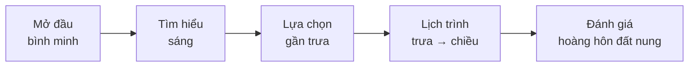
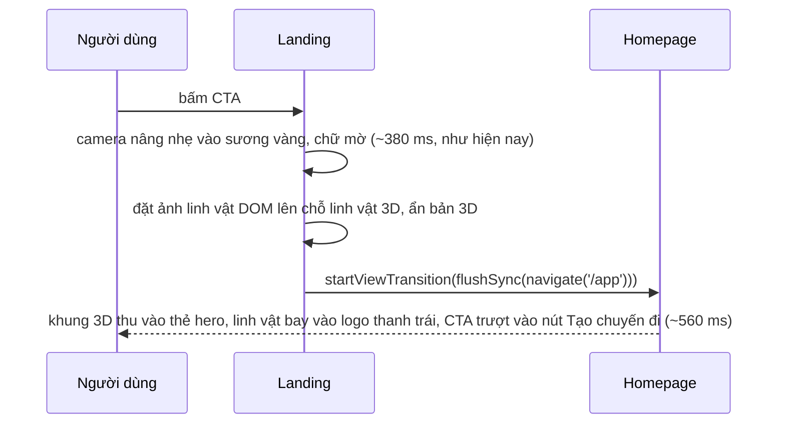

# Landing hành trình linh vật + màu thương hiệu đất nung

Ngày: 2026-10-15 · Trạng thái: **đã làm (2026-10-16)**, nền đổi sau khi xem bản đầu — xem §0. Đặc tả đang chạy: `docs/UI_SPEC_LANDING.md`.

## 0. Thay đổi khi làm (2026-10-16)

Bản đầu (thung lũng 3D + linh vật đi trên đất) làm linh vật **chìm giữa cây và nhà**. Người dùng chọn theo video mẫu (nền lặng, một nhân vật to bơi quanh):

| Spec gốc | Đã làm |
|---|---|
| Thung lũng 3D: đất, thông, mái nhà, hoa, sương, tia nắng | **Bản đồ hành trình sống**, giấy kem: lớp phủ + dải độ cao pha nhạt, đường đồng mức, hồ, đường, lưới kinh vĩ, đốm vàng, bưu thiếp, tuyến chấm đất nung |
| Linh vật nhảy xuống thung lũng, đi trên tuyến, ngồi ở Hoàng hôn 3000 (§5) | Linh vật **luôn ở tiền cảnh** (không gian camera), to, trôi quanh chỗ đậu mỗi nhịp như cá; camera lướt trên bản đồ và bám tuyến ở Lịch trình |
| Bầu trời / sương / nắng đổi theo `hour` (§3) | `hour` nhuộm cả tờ bản đồ + ánh sáng trên linh vật (trời ít khi thấy vì góc nhìn cao) |
| Bóng tròn dưới chân linh vật | bỏ (linh vật không đứng trên đất) |

Phần còn lại (§2 token + bỏ hồng/Lora, §4 linh vật, §6 chuyển trang, §7 logo, §8 bản nhẹ) làm như spec.

## 1. Mục tiêu

Landing kể sản phẩm bằng **một linh vật 3D cầm bản đồ đi qua Đà Lạt**: mỗi trạm là một bước (Tìm hiểu → Lựa chọn → Lịch trình → Đánh giá). Bấm CTA thì landing **chảy** sang homepage như một trang tự sắp xếp lại, không như đổi sang web khác.

Đã chốt với người dùng (2026-10-15):

| Quyết định | Thay cho |
|---|---|
| Màu thương hiệu **đất nung hoàng hôn `#b4532a`** cho logo + linh vật | logo đỏ hồng, logo con dấu máy bay đen |
| Landing **bỏ hệ hồng**, dùng token của app + ánh sáng vàng ấm trong cảnh 3D | "hồng chỉ ở landing" (2026-10-14) |
| Landing **bỏ Lora**, dùng Be Vietnam Pro như homepage | Lora + Be Vietnam Pro |
| Linh vật dựng **thủ công bằng three.js, kiểu toon có viền** (phương án 1) | quả cầu `rider` |
| Chuyển landing → homepage bằng **phần tử chung** (View Transitions) | mờ cả trang |

Không đổi: cấu trúc sticky stage 6 nhịp, địa hình thật, dữ liệu nơi thật, CTA duy nhất, bản nhẹ khi không có GPU.

## 2. Màu và chữ

**Token mới** (thêm vào `web/src/user/css/tokens.css`, ghi vào `docs/UI_SPEC_USER_WEB.md` §8):

| Token | Giá trị | Dùng cho |
|---|---|---|
| `--tg-brand` | `#b4532a` | logo, linh vật, chấm tab đang chọn, ghim bản đồ, đường chấm tuyến đi |
| `--tg-brand-soft` | `#f4c9ae` | má linh vật, nền nhạt rất ít chỗ |

Nút và chữ giữ `--tg-brown` `#2b2720` / `--tg-ink`. App vẫn trắng chủ đạo; đất nung chỉ là điểm nhấn, không làm nền mảng lớn. Độ tương phản `#b4532a` trên trắng 5,0:1 (đạt AA cho chữ nhỏ).

**Landing CSS:** xoá khối ghi đè hệ hồng và Lora trong `landing.css` (`.tg.tg-landing { --tg-bg … }`, `--tg-display: 'Lora'`), để landing dùng y token của homepage (`home.css`: Be Vietnam Pro cho cả tiêu đề và thân). Các phần giấy bên dưới (chat thu nhỏ, thẻ lý do, timeline, ảnh, Hỏi nhanh, CTA cuối) vì vậy trông như màn trong app.

**Cảnh 3D:** đổi bảng màu từ hồng sang ấm tự nhiên. Màu địa hình được nướng sẵn, nên đổi cả `web/scripts/landscape/bake.ts` và chạy lại `npm run bake:landscape`.

| Lớp | Cũ (hồng) | Mới |
|---|---|---|
| Đất theo độ cao | `#f1d9d2` → `#a96d8c` | cát kem `#efe4d2` → nâu đất `#b59a7a` → xám đá `#d9d2c6` |
| Thông | hồng mận `#b27693`… | xanh thông trầm `#3f5a4a`, `#4d6b57`, `#5d7a63` |
| Mái nhà | hồng `#f2a9b8`… | đất nung nhạt `#d9a07f`, `#c98c6c`, `#e3b597` (không vàng: vàng chỉ dành cho đèn = địa điểm) |
| Hoa | anh đào hồng | bớt một nửa, san hô nhạt `#f0a58a` |
| Mặt hồ | `#aebfee` | xám xanh `#a9bccb` |
| Tuyến đi | chấm `#b83a74` | chấm `--tg-brand` |
| Đèn địa điểm | `#f4b43c` | giữ nguyên |

## 3. Ánh sáng theo giờ: câu chuyện bằng màu

`SceneState` thêm `hour` (0..1). Cảnh nội suy bầu trời, sương, đèn mặt trời, ánh sáng bán cầu giữa 3 mốc. Giờ đi theo đúng ngày ví dụ (`DAY` trong `Landing.tsx`: 05:30 Săn Mây … 17:15 Hoàng hôn 3000), nên **màu trời là đồng hồ của chuyến đi**.

| Mốc | `hour` | Trời (đỉnh / giữa / chân trời) | Nắng |
|---|---|---|---|
| Bình minh | 0 | `#efe6da` / `#fff8ee` / `#f7d9ae` | vàng đào `#ffe2bf`, thấp phía đông |
| Trưa | 0.5 | `#dde8ee` / `#fbfaf6` / `#f2eadc` | trắng ấm `#fff6e8`, cao |
| Hoàng hôn | 1 | `#e8cbb4` / `#f9e3cc` / `#ef9f68` | cam đất `#ff9a5c`, thấp phía tây |

Sương (`scene.fog`) dùng màu chân trời của mốc hiện tại. Bản đồ mép mờ vào chân trời như hiện nay.



## 4. Linh vật 3D

Module mới `web/src/user/landing/mascot.ts`, chỉ phụ thuộc `three`. Scene tạo một `Mascot`, thay `rider`.

**Hình khối** (bám logo; mục tiêu < 8 nghìn tam giác, chỉ code, không tệp model):

| Phần | Cách dựng |
|---|---|
| Thân mây | 6–7 khối cầu gộp (`mergeGeometries`), `MeshToonMaterial` trắng, gradient 3 nấc |
| Viền | vỏ lộn ngược (backface, phóng 1,04) màu `--tg-brand`: ra nét line-art như logo |
| Mặt | mắt viên nhộng nâu `#2b2720`, má `--tg-brand-soft`, miệng; chớp mắt ngẫu nhiên 3–5 s |
| Mũ | nửa cầu + vành, trắng viền đất nung, decal máy bay |
| Tay | 2 khối cầu |
| Bản đồ | 2 tấm gập có bản lề, texture canvas: đường chấm + ghim đất nung; mở 0..1 |
| Tai nghe | vòng + 2 chụp, chỉ hiện ở trạm Tìm hiểu (như logo chatbot) |
| Bong bóng "…" | sprite, hiện ở trạm Tìm hiểu |

**Giao diện module:**

```ts
export type MascotAct = 'hover' | 'listen' | 'pick' | 'walk' | 'stamp' | 'wave'
export class Mascot {
  readonly root: THREE.Object3D
  constructor(brand: string) // màu viền, lấy từ token khi tạo scene
  set(act: MascotAct, k: number): void // k 0..1: tiến độ của hành động (mở bản đồ, đóng dấu…)
  lookAt(target: THREE.Vector3 | null): void // mắt + đầu nhìn theo con trỏ / bưu thiếp
  update(dt: number): void // nhún, chớp, nghiêng; không phụ thuộc FPS
  dispose(): void
}
```

Mọi chuyển động là thủ tục (sin, nội suy, nảy co giãn), không khung xương. Scene quyết định vị trí; `Mascot` chỉ lo dáng.

## 5. Câu chuyện theo trạm

Giữ 6 nhịp hiện có của timeline GSAP (`cam` 0..5). Thêm `hour` và `act` vào cùng timeline.

| Nhịp | Linh vật | Vị trí | `hour` | Chữ / UI |
|---|---|---|---|---|
| 0 Mở đầu | `hover`: lơ lửng gần camera bên phải (như con cá trong video mẫu), mắt theo con trỏ, mở bản đồ | gắn theo camera | 0 | tiêu đề trái, CTA |
| 1 Tìm hiểu | `listen`: đội tai nghe, bong bóng "…" bật lên | vẫn gần camera, lùi vào cảnh | 0.15 | chat thu nhỏ |
| 2 Lựa chọn | nhảy xuống thung lũng; `pick`: giơ bản đồ, 5 bưu thiếp mọc lên | cạnh bưu thiếp đầu | 0.3 | — |
| 3 Bằng chứng | đứng cạnh bưu thiếp đang nói, nhìn vào nó | bưu thiếp `FOCUS` | 0.4 | thẻ lý do |
| 4 Lịch trình | `walk`: đi theo đường chấm (thay `travel` của `rider`), nảy nhẹ, hướng theo tiếp tuyến | trên tuyến | 0.45 → 1 theo `travel` | timeline; giờ trên timeline sáng theo vị trí |
| 5 Đánh giá | ngồi ở Hoàng hôn 3000, `stamp` dấu "Đúng gu" lên bản đồ, `wave` | điểm cuối | 1 | thẻ đánh giá, CTA |

Chuyển từ "gắn camera" (nhịp 0–1) sang "trong thế giới" (nhịp 2): nội suy vị trí giữa điểm neo trước camera và điểm neo trên mặt đất, kèm một cú nhảy vòng cung + nảy co giãn khi chạm đất.

Chế độ **Khám phá tự do**: linh vật đứng ở Trung tâm, `hover`, nhìn theo camera.

## 6. Chuyển landing → homepage

Bấm bất kỳ `Lên lịch chuyến của bạn` → chạy trong `startTransition` hiện có, nhưng thay "mờ cả trang" bằng 3 cặp phần tử chung:

| `view-transition-name` | Bên landing | Bên homepage |
|---|---|---|
| `tg-l2h-frame` | khung sân khấu 3D (đang hiện) hoặc ảnh nền hộp CTA cuối | `.tg-hm__cover` (ảnh mây vàng) |
| `tg-l2h-mascot` | ảnh linh vật DOM đặt đúng chỗ linh vật 3D (chiếu toạ độ ra màn hình) | logo dạng đầu linh vật ở thanh trái (`.tg-hf__logo`) |
| `tg-l2h-cta` | nút CTA vừa bấm | nút `Tạo chuyến đi` (`.tg-hf__new`) |



Phần còn lại của trang (`root`) chỉ mờ chéo nhanh (220 ms). Camera **không** bay vào một địa điểm có tên, vì ảnh hero là Đồi Đa Phú (không nằm trong tuyến): chỉ nâng lên vào vùng sương, nên không gán sai nơi.

Giảm chuyển động hoặc trình duyệt không có View Transitions: chuyển thẳng như hiện nay.

## 7. Logo

Sinh bằng `cx/gpt-6.1-sol` qua 9router (`/images/generations` có ảnh tham chiếu = sửa ảnh, nền trong suốt), giữ nguyên nét vẽ, chỉ đổi màu sang đất nung. Ghi vào `web/public/img/gen/manifest.json` như ảnh sinh khác.

| Tệp | Nội dung | Dùng ở |
|---|---|---|
| `web/public/img/brand/logo-full.webp` | linh vật + chữ TripGUARDIAN + tagline | thanh trên landing, footer, ảnh chia sẻ |
| `web/public/img/brand/mark.webp` | chỉ linh vật (cắt từ logo-full) | thanh trái app, favicon, đích của `tg-l2h-mascot` |
| `web/public/img/gen/bot-avatar.webp` | linh vật chatbot (tai nghe, bong bóng), 160 px | avatar chat |

`Logo` trong `web/src/user/ui/icons.tsx` thêm `variant: 'full' | 'mark'`; thanh trái dùng `mark`.

## 8. Hiệu năng và bản nhẹ

- Linh vật: 1 lượt vẽ thân + 1 viền + phụ kiện, ≤ 12 draw call, không bóng đổ động (bóng tròn mờ dưới chân là sprite). Bộ hạ chất lượng (`govern`) không cần nấc mới.
- `hour` chỉ đổi uniform và màu đèn, không dựng lại gì; bóng đổ địa hình vẫn vẽ một lần (hướng nắng đổi nhưng bóng giữ, chấp nhận).
- Bản nhẹ (không GPU): chụp lại `landing-poster.webp` và `landing-p1..p5.webp` bằng Playwright với bảng màu mới và linh vật trong khung.
- Ngân sách giữ như `UI_SPEC_LANDING.md` §3: ảnh nền < 1 s, cảnh < 3 s, 50–60 FPS.

## 9. Kiểm thử

- Playwright: chụp 6 nhịp + Khám phá tự do, so mắt với spec; kiểm tra không lỗi console.
- Chuyển trang: quay 1 lượt bấm CTA ở nhịp 0 và ở hộp CTA cuối, xác nhận 3 cặp phần tử bay đúng đích, `?3d=off` và reduced-motion chuyển thẳng.
- `performance.mark` hiện có: thời gian dựng cảnh không tăng > 100 ms vì linh vật.
- Typecheck + build web (`npm run build` vào thư mục thử, không vào `dist` live).

## 10. Tài liệu cập nhật khi làm

`docs/UI_SPEC_LANDING.md` (§1 tông màu, §2 cảnh + linh vật + chữ, §3 chuyển trang), `docs/UI_SPEC_USER_WEB.md` §8 (token brand), `docs/log/DEV_LOG.md`.

## 11. Ngoài phạm vi

Model GLB / khung xương (phương án 2), âm thanh, linh vật trong app ngoài avatar chat và logo, đổi ảnh hero homepage, bản điện thoại.
