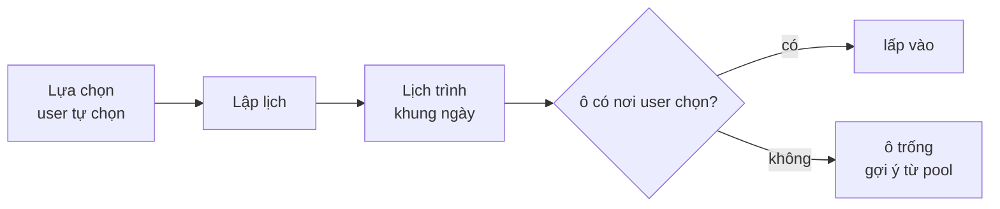
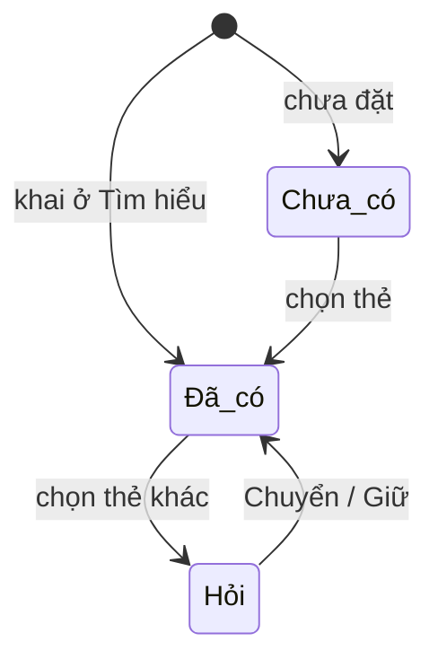

# Place Decision: đề xuất theo bản hiểu chuyến đi, user tự chọn

Spec làm việc (tạm thời, `RULE.md` §0.1). Hiện trạng: `docs/PLACE_DECISION.md`. Đầu vào mới từ `2026-10-13-trip-understanding-redesign-design.md` (§4 `TripFrame`, §11 `wishes`); đầu ra cho `2026-10-15-planning-day-frame-design.md`. Bằng chứng: `2026-10-15-trip-understanding-cases.md`.

## 1. Mục tiêu

Lựa chọn là nơi user tự chọn những nơi hợp nhất với nhu cầu và sở thích của mình. Decision **đề xuất đúng theo bản hiểu** mà Trip Understanding đã dựng: mỗi điều user đã nói phải đổi được danh sách, và thẻ phải nói được "vì bạn nói …". Người chọn là user.

- **Xếp theo bản hiểu, hiện đủ (§2, §4.1):** mọi mong muốn quy về điểm. Không nơi nào bị giấu hay loại vì sở thích; nơi hợp nhu cầu hơn có điểm cao hơn nên đứng trước. Corpus không có nơi nào cho một mong muốn thì nói thật.
- **Mọi thứ hiện ra đều có lý do (§2.1):** thẻ nói vì sao được đề xuất, `why_not` nói vì sao không hoặc vì sao xếp sau. Giao diện giữ nguyên; chỉ nội dung `why` / `why_not` đổi.
- Ràng buộc trước sở thích; không bịa; chỉ đọc Place Intelligence.
- **Không can thiệp khi user đang chọn:** chọn thiếu thì bù ở Lịch trình (§7).
- Ngoại lệ duy nhất là chỗ ở (§9).

| Đề xuất (được làm) | Can thiệp (không làm ở Lựa chọn) |
|---|---|
| Xếp hạng, nhóm "Hợp nhất", lý do "vì bạn nói …" | Đếm thiếu / thừa, nhắc "chọn thêm" |
| Dữ kiện về chính nơi đó: đóng cửa trong chuyến, chưa kiểm được lối xe lăn, xa chỗ ở | Popup, khóa nút, từ chối lựa chọn |
| Một dòng "đang lọc chặt vì chưa biết …" khi signal sức khỏe còn mở | Bắt trả lời trước khi xem tiếp |

## 2. Đề xuất theo bản hiểu Trip

Mỗi phần của bản hiểu phải tác động lên đề xuất **và** lên lời giải thích trên thẻ. Phần nào ghi được ở Trip mà không đổi được gì ở Decision thì là lỗi (đo ở §12).

| Bản hiểu (Trip) | Field | Decision làm | Thẻ / nhóm nói |
|---|---|---|---|
| Chăm sóc ④: xe lăn, bầu, ăn chay, ít bậc | `hard_filters` | sàng lọc fail-closed; `unknown` vẫn ở danh sách, không vào "Hợp nhất" | "Chưa kiểm được lối xe lăn" |
| Signal sức khỏe còn mở | `strictest()` | lọc chặt tạm thời | một dòng đầu danh sách, không chặn |
| Người đi cùng ② | `companions`, `details.fit` | điểm hợp người đi cùng (`PLACE_DECISION.md` §7) | "Hợp bé: có khu vui chơi" |
| Nhóm khác gu | soft có `subject`, `pattern` | mỗi người có thẻ "Hợp nhất" riêng | nhóm "Cho mẹ", "Cho bé" |
| Phương tiện ③, tài xế | `mobility`, `driver` | bán kính, đường vào; `hired` không phạt chuyện khó đỗ xe | "Đường dốc, xe máy khó lên" |
| Nhịp ⑤ | `pace` | bán kính, cỡ shortlist (§5) | — |
| Ngân sách ⑥ | `budget` | **không** xếp, không loại nơi nào: ngân sách là tổng cả chuyến, một nơi đắt bù được bằng nơi rẻ | thẻ ghi giá thật ("~350k/người"); tổng so với ngân sách hiện ở Lịch trình |
| Chỗ ở ⑦ | `lodging` | tâm khoảng cách thay cho `base` đoán | "12 phút từ chỗ ở" |
| Sở thích theo feature | `soft_weights` | `preference_fit` | "Yên tĩnh, 12 người nhắc" |
| Khoan sâu bằng ảnh | `vibes` | điểm `wish` (§4.1) | "Vì bạn chọn ảnh 'mây trên đồi thông'" |
| Loại nơi muốn đi | `liked_groups` | điểm `wish`, mức thấp (§4.1); không ẩn nhóm khác | "Vì bạn thích cà phê" |
| Mục đích chuyến | `context.purpose` | điểm `wish`, mức thấp nhất, là suy luận (§4.1) | "Hợp chuyến thư giãn ✎" |
| Buổi | `frame.periods` | hợp buổi: giờ mở, buổi vắng (§6) | "Mở 5:00 · vắng sáng thứ 4" |
| Món, loại nơi, giống X | `wishes` | nguồn truy xuất riêng (§4) + điểm `wish` (§4.1) | "Có bánh căn · theo menu" |
| Nơi bắt buộc | `anchors` | luôn đứng đầu | — |
| Đã đến, `novelty` | history | giảm điểm | "Bạn đã đến" |
| Không có dữ liệu | `unmapped`, 🔎 | không lọc | thẻ "tự kiểm" |

**Nhóm "Hợp nhất" chỉ dựa vào điểm:** MMR chọn như hiện nay trên `score` đã có `wish` (§4.1); không giữ chỗ riêng cho từng mong muốn. Danh sách mỗi nhóm vẫn đủ mọi nơi qua sàng lọc, xếp theo `score`. Không lọc theo ngưỡng điểm: bằng chứng feature thưa (một feature trung vị có bằng chứng ở 21% số nơi, đo 15/10), lọc sẽ biến `unknown` thành "không thích".

### 2.1 Lý do

Mỗi nơi mang `because[]`: khóa các mục bản hiểu nó khớp, theo thứ tự đóng góp điểm. Code dựng `because`; LLM chỉ diễn đạt lại thành câu.

| Chỗ | Nói gì | Nguồn |
|---|---|---|
| `card.why` (đã có, tối đa 3 dòng) | mong muốn user nói rõ trước ("Có bánh căn bạn muốn · theo menu"), rồi feature khớp, rồi vị trí. `purpose` đánh dấu ✎ (suy luận) | `because` |
| Thẻ không khớp mục nào | vẫn có ít nhất một dòng dự phòng theo thành phần lớn hơn ("Cách chỗ ở ≈8 phút" hoặc "240 người đã viết về nơi này") | `parts` |
| `why_not` (đã có) | xếp sau: "Xếp thứ 41/60: chưa khớp mong muốn 'bánh căn'"; thiếu bằng chứng nói là chưa biết ("Chưa thấy menu ghi bánh căn"), không nói "không bán" | `because`, `parts`, sàng lọc |

Không thêm thành phần giao diện mới: `PlaceCard` / `PlaceSheet` đã hiện `why`, agent đã gọi `why_not`. Lưới và đĩa xoay (`DiscPicker`) cùng một logic, chỉ khác giao diện: cả hai lấy dòng từ `web/src/user/ui/cardLines.ts` (tối đa 3 lý do, đánh đổi, 2 cảnh báo); đĩa xoay không tự tính mức "hợp" riêng.

## 3. Đầu vào mới

| Field (Search Input) | Dùng ở | Cách dùng |
|---|---|---|
| `context.frame.days[i]` `{date, start, end, busy[], intensity}` | ④ ⑥ ⑨ | Thay `trip_days` tự dựng từ config: Decision và Planning đọc **cùng** khung đã compile ở Trip |
| `context.frame.periods` | ④ ⑤ ⑥ | Buổi ↔ loại nơi ("sáng thiên nhiên", "tối spa") thành điểm hợp buổi khi xếp hạng |
| `context.frame.visit` | ⑨ | Thời lượng theo loại nơi user nói, thay `visit_minutes` ước tính |
| `context.frame.meals` | ⑥ ⑩ | Số bữa cần mỗi ngày; cỡ `meal_pool` |
| `wishes.dishes[]` | ② ⑤ | Nguồn truy xuất + điểm `wish` (§4.1) |
| `wishes.kinds[]` | ② ⑤ ⑥ | Nguồn truy xuất theo category + vai trò hiển thị |
| `wishes.like[]` `{place_id, but[]}` | ② ⑤ | Truy xuất `similar` quanh nơi tham chiếu, rồi áp `but` (vd `crowd=low`) |
| `context.driver` | ④ | `hired`: không phạt `parking=hard`; vẫn xét `rough_road_access` |
| `context.frame.drive_day_min` | ⑨ | Trần lái xe mỗi ngày |

## 4. Truy xuất theo mong muốn

```text
nguồn ứng viên (thêm vào §5 hiện tại)
├── món ăn       corpus.serving.dishes.search(món) → nơi bán, nguồn menu > review_order
├── loại nơi     category ∈ wishes.kinds (karaoke, bar, chợ, spa, khu cắm trại, cửa hàng đặc sản)
└── giống X      RetrievalEngine.similar(X) trong scope, trừ X
```

- Nơi vào từ một mong muốn mang `matched_wish`, đồng thời có trong `because`.
- Món: nguồn `menu` là bằng chứng; `review_order` là tín hiệu yếu; không có → `unknown`, không phải "không bán".
- "Giống X nhưng vắng hơn": `but` là soft (`crowd=low:love`), không thành hard.

### 4.1 Điểm mong muốn (`wish`)

Module mới `src/decision/wishes.py` dựng từ Search Input một danh sách mong muốn, mỗi cái là `{place_id: strength}`:

| Nguồn | strength | Áp cho | Mức `a` |
|---|---|---|---|
| `wishes.dishes` | theo thứ tự kết quả `dishes.search`, 1 → 0.5 | mọi nơi có ghi món đó (chốt 15/10: quán cà phê có cà phê muối cũng được cộng) | 0.8 |
| `wishes.kinds` | 1 | mọi vai trò | 0.8 |
| `vibes` | 1 → 0.5 theo hạng (thay `vibe_fit`) | mọi vai trò | 0.8 |
| `wishes.like` | `corpus.serving.similarity(X, ·)` ≥ `like_min`, không gồm X | cùng vai trò X | 0.8 |
| `liked_groups` | 1 với nơi thuộc nhóm hiển thị đó (`meal` = vai trò meal) | nhóm đó | 0.4 |
| `context.purpose` | 1 theo map: `relax→chill`, `food_culture→meal`, `nature→nature`, `explore→sights`, `photo→photo_spot` có bằng chứng; `bond`, `adventure` không map | theo map | 0.25 |

```text
wish(p) = 1 − Π_w (1 − a_w · strength_w(p))     chỉ các mong muốn áp cho vai trò / nhóm của p
score  += w_wish · wish(p)                       thay w_vibe · vibe_fit
```

- Khớp nhiều mong muốn thì điểm cao hơn; `wish` luôn trong 0–1; không khớp thì được 0, không bao giờ âm.
- Sàng lọc cứng chạy trước: nơi trong một mong muốn mà trượt hard filter không bao giờ được cộng.
- `a_w`, `like_min`, `w_wish` (khởi điểm 1.5), map `purpose` nằm trong `config/decision.yaml`; chỉnh bằng `evaluate`.
- `rank.score` và `frame.score_table` cùng tính `wish`; oracle `tests/decision/test_equivalence.py` giữ hai bên khớp. Khóa memo tầng score thêm `wishes`, `liked_groups`, `context.purpose`.
- `liked_groups` chỉ cộng điểm: "thích cà phê" không làm ẩn tab Thiên nhiên.

## 5. Cỡ shortlist

Cỡ cũ ở `PLACE_DECISION.md` §9.2 là `pace × số ngày`. Cỡ mới tính theo số ô của khung ngày (§7): bữa, cùng các ô chơi sáng / chiều / tối. Con số này chỉ dùng **nội bộ**, để quyết định số thẻ "Hợp nhất" mỗi vai trò và cỡ `fill_pool`; không hiện cho user.

## 6. Hợp buổi và độ đông theo giờ

| Dữ liệu | Độ phủ (`cases` §7) | Dùng |
|---|---|---|
| `operation.hours` | quán 89%, thiên nhiên 25%, cắm trại 5% | buổi mở trong các ngày của chuyến |
| `crowd_by_time` weekday/weekend × buổi | quán 78%, thiên nhiên 25% | `crowd_tolerance = avoid` → thẻ ghi buổi vắng ("vắng nhất sáng thứ 4") |
| cửa sổ mặc định theo category (✚ `config/decision.yaml` `default_windows`) | — | nơi thiếu giờ: thiên nhiên / cắm trại theo ánh sáng ban ngày; cờ `hours_unknown` "kiểm lại giờ" |

`best_time` của corpus đang 0%: không suy "đẹp nhất buổi …" từ độ nổi tiếng. User nói "sáng săn mây" thì thẻ chỉ nói được buổi mở và buổi vắng, không nói được "sáng đẹp nhất".

## 7. Chọn thiếu: bù ở Lịch trình



- Lựa chọn không báo thiếu, cũng không báo thừa.
- **Khung ngày:** có thông tin của Trip thì thiết kế theo thông tin (nghỉ trưa, ăn sáng ở chỗ ở, ông bà ngủ 20:00, ngày nhẹ); chỗ nào user chưa nói thì dùng mẫu mặc định "3 bữa + N nơi theo `pace` + nghỉ" (chốt 15/10).
- **Ô trống:** hiện sẵn một nơi gợi ý dạng mờ, nhãn "gợi ý", chưa tính vào giờ và đường đi. Chạm để thêm; ✕ để bỏ; "xem thêm" mở top 3 (chốt 15/10).
- **Học từ việc sửa lịch** thuộc spec Planning, theo luật Trip §15. Áp trong phiên trước; thành thói quen dài hạn chỉ khi lặp lại ở ≥ 2 phiên và user đồng ý. Phải tách "xóa ô" (khung) khỏi "đổi nơi" (gu). Không học sức khỏe, ngày đi, người đi cùng, ràng buộc cứng.
- Đã cân nhắc và bỏ hướng "gợi ý thêm trước khi sang Lịch trình": dù chỉ là gợi ý, nó vẫn là một bước chen vào trước khi user thấy lịch.

## 8. Khả thi theo khung ngày

`feasibility.evaluate` đọc `frame.days[i]` thay `trip_days`:

- `available` trừ `busy` (nghỉ trưa, ngủ, họp, sự kiện) và đường về chỗ ở cho `busy` tại `lodging`.
- `supply` theo buổi lấy từ khung từng ngày (ngày 2 bắt đầu 5:00 → có buổi sáng sớm; ông bà ngủ 20:00 → không có buổi tối).
- `time_windows` conflict giữ như hiện nay, nay đúng theo khung thật của user. Nơi đóng cửa suốt chuyến hiện dữ kiện trên thẻ.
- Quá tải và trần lái `drive_day_min`: không cảnh báo ở Lựa chọn. Lịch trình xếp không hết thì nơi chưa xếp được nằm trong khay "chưa xếp được", kèm lý do (spec Planning).
- Thời lượng ghé: `frame.visit` thắng `visit_minutes` (99% là ước tính theo category).

## 9. Tab Chỗ ở và cổng vào Lịch trình

Chỗ ở là chỗ duy nhất Decision can thiệp, vì mọi ngày đều đi và về từ chỗ ở.



- Tab Chỗ ở **luôn hiện**, dù chưa có hay đã có chỗ ở; chọn như các tab khác. Xếp hạng theo bản hiểu (`docs/PLANNING.md` ⓐ.5–6): gu, người đi cùng, gần các nơi đã chọn.
- **Ngân sách không lọc, không trừ điểm chỗ ở.** Thẻ ghi giá một đêm và tiền phòng cả chuyến (giá × số đêm). Thay ⓐ.2 (trần tham khảo `lodging_share`), `price_fit` ở ⓐ.5 và bước lọc theo trần giá ở ⓐ.6.
- Chưa có: tab chấm ●.
- Đã có: thẻ chỗ ở hiện tại đứng đầu. Chọn thẻ khác thì hỏi, và câu hỏi khác nhau theo nguồn:
  - `booked` (Trip ghi "Đã đặt"): "Bạn đã đặt <A>. Chuyển sang <B>? Lịch sẽ đi và về từ <B>; đặt phòng ở <A> bạn tự xử lý."
  - `chosen` (đã chọn ở tab này): "Chuyển chỗ ở sang <B>?"
  - Hai nút `Chuyển` · `Giữ chỗ cũ`. User quyết định.
- **Đổi chỗ ở phải ghi ngược về Trip.** Đây là field trong `plan_digest` (kiến trúc Trip A4) nên phải đọc lại trước khi lập lịch. Hiện tại `chosen` chỉ nằm trong state của Decision.
- **Chỗ ở đã đặt mà không qua được ràng buộc cứng:** giữ chỗ ở đó và cảnh báo trên thẻ ("chưa kiểm được lối xe lăn ở <A>"), không từ chối. Hôm nay `Engine._check_current_lodging` báo `ActionError`, làm cả phiên Lựa chọn lỗi vì một khách sạn user đã trả tiền. Chọn **mới** từ danh sách thì danh sách đã sàng sẵn, nên vẫn fail-closed.
- Chỉ một chỗ ở chính (Trip §5); chuyển là thay, không cộng thêm.
- Nút "Lập lịch": còn thiếu câu bắt buộc hoặc chỗ ở → mở `DeckCard` (dùng chung với Trip) với đúng các tab thiếu, gửi `{kind: "deck"}` sang Trip qua harness, rồi `rebase` Decision. Đủ → bản đọc lại (Trip §7) → Planning. Đây là cổng lúc chuyển màn, không phải can thiệp lúc chọn.
- Ảnh chỗ ở: 3/1.475 nơi có ảnh trong index → ghi `gaps.jsonl` (`kind: lodging_photo`); thẻ không có ảnh vẫn hiện đủ thông tin chữ.

## 10. Output thêm cho Planning

```text
Decision Output (thêm)
├── meal_pool     ~40 nơi ăn qua hard, xếp theo score (gồm `wish`) + giá, phủ các khu (MMR)
├── fill_pool     nơi chưa chọn theo (loại ô × khu), xếp theo score (gồm `wish`, §4.1)
├── because       theo nơi: khóa các mục bản hiểu nơi đó khớp
└── matched_wish  theo nơi: món / loại / giống X đã khớp
```

`backup_pool` giữ vai trò thay thế nơi đã chọn. `meal_pool` và `fill_pool` là nguồn gợi ý **thêm**: chỉ ID thật, user chạm mới vào lịch, Planning không tự chèn. Gợi ý ở ô trống ưu tiên mục bản hiểu mà các nơi user đã chọn chưa phủ (user nói muốn ăn bánh căn mà chưa chọn quán nào → ô bữa ưu tiên quán bánh căn).

## 11. Thay đổi contract

| Chỗ | Đổi |
|---|---|
| Đọc Search Input | `context.frame`, `wishes`, `context.driver`, `liked_groups`, `context.purpose` |
| `trip_days` | đọc `frame.days`; config chỉ còn là fallback cho Search Input cũ |
| Truy xuất | nguồn món, loại nơi, giống X |
| Xếp hạng | `w_wish · wish` thay `w_vibe · vibe_fit` (§4.1, config có version); "Hợp nhất" là MMR trên score, không giữ chỗ theo mong muốn |
| View | `because` → nội dung `card.why` và `why_not` (§2.1), không thêm thành phần giao diện; `matched_wish`, buổi vắng; câu xác nhận chuyển chỗ ở theo `booked` / `chosen`; bỏ cảnh báo thiếu / thừa ở Lựa chọn |
| Chỗ ở | `set_lodging` ghi về Trip; chỗ ở `booked` trượt hard → cảnh báo, không `ActionError`; bỏ trần giá và `price_fit` theo ngân sách |
| Ngân sách | không vào điểm, không vào sàng lọc của nơi chơi, nơi ăn, chỗ ở |
| Decision Output | `meal_pool`, `fill_pool`, `because`, `matched_wish` |
| `config/decision.yaml` | `default_windows` theo category, `w_wish`, `wish.a`, `wish.like_min`, `wish.purpose`, hệ số dư theo vai trò |

## 12. Đo

`python -m decision evaluate` thêm bộ ca từ 77 persona (Search Input đã compile theo spec Trip):

| Chỉ số | Mục tiêu |
|---|---|
| Mong muốn user nói rõ có ≥ 1 nơi khớp trong "Hợp nhất" khi corpus có nơi qua hard | đo, không ép; dưới 90% thì chỉnh `w_wish` / `a` |
| Thứ hạng trung vị của nơi khớp mong muốn trong nhóm của nó | nằm trong cửa sổ đầu (`page_size`) |
| Bỏ một mục bản hiểu khỏi Search Input thì thứ hạng hoặc `because` đổi | 100% mục (mục không đổi gì = lỗi nối dây) |
| Nơi bị loại khỏi danh sách hoặc bị trừ điểm vì một mong muốn | 0 |
| Thẻ hiện ở Lựa chọn có ≥ 1 dòng `why` | 100% |
| `why_not` của nơi xếp sau nêu mong muốn chưa khớp hoặc thành phần điểm thấp | 100% |
| Ô trống của khung có ≥ 3 gợi ý qua hard | 100% khi corpus có |
| Nhắc "chọn thêm" / "còn thiếu" hiện ở Lựa chọn | 0 |
| Chuyển chỗ ở mà không qua câu xác nhận | 0 |
| Chỗ ở `booked` làm phiên lỗi | 0 |
| Nơi hoặc chỗ ở bị loại hay trừ điểm vì ngân sách | 0 |
| Thời gian khả thi tính trên khung user | khớp Planning ±10% |
| Thẻ có cờ `hours_unknown` hiển thị "kiểm lại giờ" | 100% |

### 12.1 Test case cho điểm `wish` và lý do

Fixture dùng `tests/decision/fixtures.py` (`srec`, `si`, `love`, `hard`). Mỗi ca kiểm **hành vi** (thứ hạng, `why`, `why_not`), không kiểm hằng số cấu hình. Ca nào cần mức `a` cụ thể thì đọc từ `cfg`, không chép số.

**A. Dựng mong muốn: `tests/decision/test_wishes.py`**

| # | Đầu vào | Kỳ vọng |
|---|---|---|
| A1 | `wishes.dishes` "bánh căn", `place_ids` [P1, P2, P3] | strength P1 = 1, P3 = 0.5, giảm dần theo thứ tự; áp cho mọi vai trò |
| A2 | món có `place_ids` rỗng | không có mong muốn nào áp; không lỗi |
| A3 | hai món cùng tên khác dấu / hoa thường | một mong muốn (Trip đã gộp theo `squash`); Decision không đếm đôi |
| A4 | `wishes.kinds` "karaoke", `place_ids` [K1, K2] | strength 1 cho cả hai |
| A5 | `vibes` một look 4 nơi | 1 → 0.5 theo hạng, giống `vibe_fit` hiện nay |
| A6 | `wishes.like` X = quán cà phê có signature | nơi cùng nhóm có `similarity ≥ like_min` được strength = độ giống; X không có trong mong muốn; nơi khác `category_group` = 0 |
| A7 | `like` X có ít feature hơn `near_duplicate.min_features` | không nơi nào khớp (similarity 0); không lỗi |
| A8 | `like` X không có trong snapshot | bỏ mong muốn đó, không lỗi |
| A9 | `liked_groups` = (chill,) | mọi nơi nhóm `chill` strength 1; nơi `nature` 0 |
| A10 | `liked_groups` = (meal,) | áp theo vai trò `meal`, không theo nhóm hiển thị |
| A11 | `purpose` = relax / food_culture / nature / explore | map đúng nhóm trong config |
| A12 | `purpose` = photo | chỉ nơi có `photo_spot` bằng chứng VERIFIED/OUTDATED; nơi thiếu bằng chứng = 0 |
| A13 | `purpose` = bond / adventure / null | không có mong muốn |
| A14 | Search Input cũ không có `wishes`, `liked_groups`, `purpose` | danh sách rỗng; điểm giống hệt bản trước khi có `wish` (trừ `vibe` đã chuyển sang `wish`) |

**B. Điểm: `tests/decision/test_rank.py` (thêm)**

| # | Đầu vào | Kỳ vọng |
|---|---|---|
| B1 | A khớp một món, B không khớp, mọi thứ khác bằng nhau | `A.score > B.score`, `B.parts["wish"] == 0` |
| B2 | A khớp món + kiểu nơi, B chỉ khớp món | `A.parts["wish"] > B.parts["wish"]` |
| B3 | khớp mọi mong muốn có thể | `wish ≤ 1` |
| B4 | quán cà phê có ghi món user muốn, quán cà phê khác không ghi | quán có ghi được cộng, quán kia = 0 |
| B5 | A khớp mong muốn user nói (a 0.8), B chỉ khớp `purpose` (a 0.25) | `A.parts["wish"] > B.parts["wish"]` |
| B6 | `vibes` như cũ, không mong muốn khác | thứ hạng giống bản trước khi gộp `vibe` vào `wish` |
| B7 | `parts` | có khóa `wish`, không còn khóa `vibe`; `score` = Σ `weights × parts` |

**C. Bất biến: `tests/decision/test_wishes.py`**

| # | Đầu vào | Kỳ vọng |
|---|---|---|
| C1 | nơi khớp món nhưng trượt hard `vegetarian_options = yes` | không xuất hiện trong nhóm; `why_not` nêu điều kiện, không nêu món |
| C2 | nơi khớp món, hard có `unknown_policy = flag` và thiếu bằng chứng | ở mục "chưa xác minh", không vào nhóm chính |
| C3 | bật / tắt mọi mong muốn | tập id trong `ranked` (hợp các nhóm) **không đổi**: chỉ thứ tự đổi |
| C4 | nơi không khớp mong muốn nào | `parts["wish"] == 0`, không âm; vẫn có trong danh sách |
| C5 | `liked_groups` = (chill,) | nhóm `nature`, `sights`, `meal` vẫn có đủ nơi như khi không có `liked_groups` |
| C6 | anchor không khớp mong muốn | vẫn đứng đầu nhóm `anchors` |
| C7 | nơi đã chọn / khóa, rồi rebase thêm mong muốn | không bị gỡ, không đổi vị trí ghim (§12.2 `PLACE_DECISION.md`) |
| C8 | `novelty = new`, nơi đã đi khớp món | vẫn bị bỏ khỏi khám phá như hiện nay; `wish` không kéo nó lại |
| C9 | chỗ ở (`stay`) nằm trong `place_ids` của một kiểu nơi | không bao giờ thành ứng viên |
| C10 | `place_ids` chứa id không có trong snapshot | bỏ qua, không lỗi, không tạo thẻ stub |

**D. Lý do: `tests/decision/test_cards.py`, `test_pipeline.py` (thêm)**

| # | Đầu vào | Kỳ vọng |
|---|---|---|
| D1 | nơi khớp món "bánh căn" theo menu | `why[0]` nói món và nguồn ("Có bánh căn bạn muốn · theo menu") |
| D2 | nơi khớp 2 mong muốn + 2 feature | `why` ≤ 3 dòng, mong muốn user nói đứng trước feature |
| D3 | nơi chỉ khớp `purpose` / `liked_groups` | dòng `why` mang dấu suy luận ✎ (purpose) |
| D4 | thẻ không khớp mục nào | `why` vẫn có ≥ 1 dòng, theo thành phần lớn hơn giữa vị trí (`ctx`) và số người viết (`pop`) |
| D5 | mọi thẻ của mọi nhóm, trên 30 chuyến `config/eval_trips.yaml` + chuyến sinh ngẫu nhiên | `len(why) ≥ 1` cho 100% thẻ |
| D6 | `why_not` nơi xếp sau, không khớp món user muốn | nêu thứ hạng và "chưa khớp mong muốn 'bánh căn'" |
| D7 | `why_not` nơi thiếu menu | "Chưa thấy menu ghi …", không có chữ "không bán" |
| D8 | `why_not` nơi bị loại vì hard | lý do hard đứng trước mọi lý do mong muốn |
| D9 | `why` / `why_not` | chỉ chứa tên món / kiểu / nơi có trong Search Input hoặc serving record (không bịa) |

**E. Ca user: `tests/decision/test_wish_cases.py`**

Mỗi ca là một Search Input dựng tay theo một persona ở `2026-10-15-trip-understanding-cases.md` §2, §5, chạy `pipeline.run` trên fixture. Kỳ vọng chung: nơi khớp mong muốn chính đứng trong cửa sổ đầu của nhóm nó; không nơi nào bị loại vì mong muốn; mọi thẻ có `why`.

| # | Persona | Search Input chính | Kỳ vọng riêng |
|---|---|---|---|
| E1 | Food tour một mình | dishes: bánh căn, lẩu gà lá é; `purpose` food_culture | nhóm `meal`: quán có cả hai món đứng trên quán có một món |
| E2 | Cặp đôi chill, thích cà phê | `liked_groups` (chill,), soft `crowd=low` | quán cà phê vắng có bằng chứng đứng đầu `chill`; nhóm `nature` vẫn đủ |
| E3 | Gia đình có bé 4–6 tuổi | companions kids, kinds "khu vui chơi", soft `kids_play_area` | nơi `fit.kids` good + kiểu khớp đứng trên nơi chỉ khớp một trong hai |
| E4 | Mẹ đi xe lăn + thích chụp ảnh | hard `fit.wheelchair != bad`, `purpose` photo | nơi chụp ảnh đẹp nhưng `fit.wheelchair = bad` không xuất hiện (C1) |
| E5 | Ăn chay cả nhóm + muốn ăn bánh căn | hard `vegetarian_options = yes` eating + dish bánh căn | quán bánh căn chưa xác minh món chay không vào nhóm chính |
| E6 | "Giống Mọt Cafe nhưng vắng hơn" | like X + `but` → soft `crowd=low` | nơi giống X và vắng đứng trên nơi giống X nhưng đông; X vẫn trong danh sách nhưng không được cộng `wish` vì giống chính nó |
| E7 | Săn mây, chọn ảnh "sương sáng sớm" | vibes 1 look | thứ tự như `vibe_fit` hiện nay (B6) |
| E8 | Về đêm: karaoke, bar | kinds karaoke, bar; hard `activity != alcohol_consumption` cho một người | bar chỉ phục vụ rượu không bị cấm (contract §9 Trip); karaoke khớp đứng đầu |
| E9 | Nhóm hỗn hợp: 2 cặp + bé + ông | companions kids, parents; dishes; liked_groups (nature, meal) | cả `nature` và `meal` có nơi khớp ở cửa sổ đầu |
| E10 | Lưỡng lự "sao cũng được" | không mong muốn nào | thứ hạng giống bản trước khi có `wish` |
| E11 | Đổi ý: rebase bỏ món, thêm kiểu nơi | rebase Search Input | `change` của nhóm `meal` có `removed` / `added` hợp lý; nơi đã chọn giữ |
| E12 | Món không có trong corpus (halal) | dish có `place_ids` rỗng | không lỗi, không thẻ bịa; thứ hạng như không có món |
| E13 | Nhiều mong muốn hơn số ô (5 món, 3 kiểu, 1 ngày) | | không lỗi; nơi khớp nhiều đứng trước; không nơi nào bị loại |
| E14 | Đoàn 18 người, xe khách | people 18, car; kinds "nhà hàng" | hard `coach_access != no` vẫn chạy trước điểm `wish` |
| E15 | Khách quay lại, `novelty = new`, đã đi P | dish khớp P | P không quay lại khám phá (C8) |

**F. Oracle và sinh ngẫu nhiên**

| # | Việc | Kỳ vọng |
|---|---|---|
| F1 | `tests/decision/gen.py` sinh thêm `wishes` (dishes / kinds / like từ id thật), `liked_groups`, `purpose`, `vibes` | — |
| F2 | `test_equivalence` mọi seed hiện có, với Search Input mới | view của `frame` bằng view của `reference.py` |
| F3 | `test_equivalence_along_a_session_with_one_memo` đổi mong muốn giữa phiên | memo không trả điểm cũ (khóa tầng score có `wishes`, `liked_groups`, `purpose`) |
| F4 | `test_equivalence_eval_trips_on_the_real_snapshot` | vẫn pass trên snapshot thật |

**G. Tốc độ: `tests/decision/test_wish_speed.py`** (đánh dấu `slow`, cần snapshot, skip khi thiếu)

Số nền đo ngày 15/10 trên snapshot thật (3.208 nơi, 30 chuyến eval): chạy lần đầu trung vị 59 ms, p95 100 ms; chạy lại khi memo trúng trung vị 17 ms.

| # | Việc | Ngưỡng |
|---|---|---|
| G1 | `run` lần đầu, 30 chuyến eval + mỗi chuyến 3 món, 2 kiểu, 1 like, `liked_groups`, `purpose` | p95 ≤ 120 ms (+20% so với nền) |
| G2 | `run` lại cùng phiên (memo trúng) | trung vị ≤ 20 ms |
| G3 | `like` trên nơi có signature lớn nhất corpus | dựng mong muốn ≤ 10 ms (dùng `region.sigs`, không tính lại signature) |
| G4 | chạy lại cùng phiên, cùng Search Input (memo trúng) | không gọi lại `score_table`, không dựng lại danh sách mong muốn (đếm số lần gọi = 0) |

Ngưỡng đo bằng trung vị của 3 lần chạy để tránh nhiễu máy; vượt ngưỡng là fail.

**H. Đo trên dữ liệu thật: `python -m decision evaluate`** — các chỉ số §12, chạy tay khi đổi `a`, `w_wish`, `like_min`.

## 13. Đã chốt (15/10)

| Câu | Chốt |
|---|---|
| Ô trống ở Lịch trình | hiện sẵn gợi ý mờ |
| Khung Lịch trình | có thông tin thì theo thông tin, thiếu thì mặc định |
| Ngân sách | không trừ điểm, không loại: ngân sách là tổng cả chuyến; chỉ so tổng ở Lịch trình |
| Sở thích ở Lựa chọn | chỉ xếp hạng, hiện đủ; không lọc theo ngưỡng điểm, không giữ chỗ theo mong muốn |
| Lý do | mọi thẻ có `why`, mọi nơi có `why_not`; giao diện giữ nguyên |

## 14. Phần việc

1. Đọc `frame.days` + `busy` trong `trip_days` / `feasibility` (fallback Search Input cũ).
2. Nguồn truy xuất món, loại nơi, giống X + `matched_wish`; điểm `wish` (§4.1) trong `rank` + `frame` + oracle. **Điểm `wish` xong 15/10** (`docs/PLACE_DECISION.md` §8); còn nguồn truy xuất riêng và `matched_wish` trong Output.
3. `because` theo mục bản hiểu → `card.why`, `why_not` (§2.1) + cỡ shortlist theo khung; bỏ cảnh báo thiếu / thừa ở Lựa chọn. **`why` / `why_not` theo mong muốn xong 15/10**; còn `because` cho người đi cùng, buổi, cỡ shortlist, cảnh báo.
4. `default_windows`, buổi vắng từ `crowd_by_time`.
5. Chỗ ở: tab luôn hiện, câu xác nhận theo `booked` / `chosen`, ghi về Trip, `booked` trượt hard thì cảnh báo, bỏ lọc và điểm theo ngân sách.
6. `meal_pool`, `fill_pool` trong Output; cổng "Lập lịch" dùng `DeckCard`.
7. Đo (§12), gộp vào `docs/PLACE_DECISION.md`.
