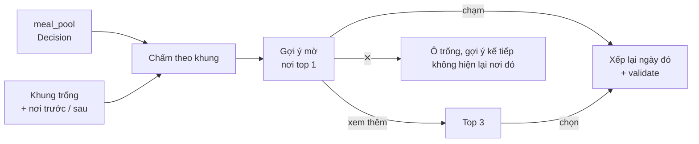

# Planning: xếp lịch theo khung ngày của user

Spec làm việc (tạm thời, `RULE.md` §0.1). Hiện trạng: `docs/PLANNING.md`. Đầu vào: `TripFrame` (`2026-10-13-trip-understanding-redesign-design.md` §4), Decision Output mới (`2026-10-15-place-decision-needs-design.md` §10). Bằng chứng: `2026-10-15-trip-understanding-cases.md` §7.

## 1. Mục tiêu

Lịch trình là output user cần. Lịch đúng khi nó theo **nhịp sống thật** của nhóm (giờ dậy, giờ ngủ, nghỉ trưa, việc cố định, ngày nhẹ), có **đủ bữa và đủ chỗ chơi** hợp gu, và nói rõ chỗ nào là đoán.

- Không xếp khi chưa hiểu đủ: cổng 7 câu + chỗ ở + bản đọc lại.
- Khung ngày là **đầu vào**, không phải hằng số config: mỗi ngày có khung riêng, có khung bận.
- Ô trống (bữa, buổi) **hiện sẵn một gợi ý mờ**: nơi thật, hợp bản hiểu, chưa tính vào giờ và đường đi; user chạm mới thêm.
- Học từ cách user sửa lịch (§10), như một thói quen tham khảo, không phải sự thật.
- Không duyệt tổ hợp: tách ngày thành đoạn, tách gợi ý theo từng khung (§9).
- Ngân sách là tổng cả chuyến: không vào điểm của nơi nào; lịch chỉ so tổng đã biết với ngân sách (§8).

Giữ nguyên: validator là nơi duy nhất kết luận đạt; không bịa nơi; physical không nới; chỉ act của user thêm nơi.

## 2. Cổng tạo phiên

`Engine.create` từ chối (lỗi có kiểu `trip_incomplete`, kèm danh sách) khi:

| Điều kiện | Nguồn |
|---|---|
| `readiness.missing` của Trip khác rỗng (7 câu, Trip §5) | `trip_context` |
| chưa có `lodging` | Decision Output `lodging` (bỏ ca `base_unknown` ở ⓐ.7) |
| chưa `readback_ok` cho phiên bản Trip State hiện tại | Trip §7 |

`require_lodging` hiện có thành mặc định `True`. Lỗi trả về để Web mở deck đúng tab thiếu; không có đường tạo phiên bỏ qua cổng.

## 3. Khung ngày từ `TripFrame`

`frame.trip_days` (Planning) và `trip_days` (Decision) cùng đọc `context.frame.days[i]` đã compile ở Trip; config chỉ còn là fallback cho Search Input cũ.

```text
Ngày i = [start_i, end_i]   start/end từ days[i] → rhythm → mặc định
         − busy (nghỉ trưa, ngủ, họp, tour, đặt bàn) theo `on`
= các ĐOẠN rảnh, mỗi đoạn có điểm đầu và điểm cuối:
  chỗ ở → (đoạn sáng) → chỗ ở [nghỉ trưa] → (đoạn chiều) → nhà hàng 19:00 [event] → (đoạn tối) → chỗ ở
```

| Mục | Xử lý |
|---|---|
| Ngày đầu | `start = arrive.ready_at` (giờ tới + `arrival_buffer_min` + đường từ bến / sân bay về chỗ ở, tính bằng ma trận) |
| Ngày cuối | `end = leave.done_by` (giờ đi − đệm rời − **đường từ chỗ ở ra bến / sân bay**); thay `checkout_at` cố định; giữ quy ước mọi ngày kết thúc ở chỗ ở |
| `busy` tại `lodging` | khung cố định ở chỗ ở; đường về và đi tính như chặng thường |
| `busy` kiểu `event` ngoài corpus | khung cố định tại địa chỉ user nhập (không có địa chỉ: tại chỗ ở, cảnh báo `event_location_unknown`) |
| `intensity: light` | `per_day × light_factor` (0,5), đệm `slow` |
| `intensity: free` | không xếp nơi; chỉ bữa (nếu cần) |
| `drive_day_min` | tổng phút lái trong ngày ≤ trần; vượt → vi phạm user constraint có cái giá (không phải physical) |

**Thông tin trước, mặc định sau** (chốt 15/10): mỗi mục của ngày lấy từ thông tin user đã nói; mục nào user chưa nói thì lấy mẫu mặc định. Mặc định không bao giờ đè thông tin.

| Mục | Có thông tin (Trip) | Không có → mặc định |
|---|---|---|
| Giờ ngày | `days[i]`, `rhythm`, `arrive` / `leave` | `FrameDefaults` 08:00–21:00, ngày đầu 14:00, ngày cuối 12:00 |
| Bữa | `meals` (bỏ bữa, ăn sáng ở chỗ ở, ăn vặt, dịch sớm) | 3 bữa sáng · trưa · tối theo `meal_windows` |
| Số nơi chơi | `intensity`, `frame.visit` | N theo `pace` (`per_day`) |
| Nghỉ | `busy` kiểu `rest` / `nap` / `sleep`, `frame.rest` | `rest_min`, `max_consecutive_min` theo `pace` |
| Buổi ↔ loại nơi | `periods` | không ưu tiên buổi |
| Thói quen dài hạn (§10) | — | dùng khi user đồng ý; thông tin chuyến này vẫn thắng |

Validator thêm 3 kiểm: **khung bận** không bị chồng (user hard) · **mốc rời** không trễ (physical, chuyến bay / xe) · **trần lái ngày** (user constraint).

## 4. Cửa sổ của từng nơi

| Nguồn | Độ phủ | Vai trò |
|---|---|---|
| `operation.hours` theo thứ | 45% (quán 89%, nature 25%) | cứng |
| `default_windows` theo category (dùng chung config với Decision) | nơi thiếu giờ | mềm + cờ `hours_unknown`; thiên nhiên / cắm trại theo ánh sáng ban ngày từ `sun_times` |
| `pins` (sương, bình minh, hoàng hôn, nhạc) | có | ghim đầu / cuối ngày như hiện nay; chỉ ghim buổi user muốn |
| `frame.periods` (buổi ↔ loại nơi) | Trip | soft window có `weight` cho `timefit`; ưu tiên user thắng heuristic |
| `crowd_by_time` weekday / weekend | quán 78% | `crowd_tolerance = avoid` → phạt buổi đông của chính nơi đó trong `timefit` (mở rộng `busy_buckets` từ cảnh báo thành phí); ngày thường / cuối tuần theo `day_type` |

Không suy "giờ đẹp nhất" khi `best_time` trống (0%); lịch ghi "chưa có dữ liệu buổi đẹp" thay vì đoán.

## 5. Thời lượng, nghỉ, đệm

| Mục | Hiện nay | Thêm |
|---|---|---|
| Thời lượng ghé | `visit_key[pace]` của `visit_minutes` (99% ước tính theo category) | `frame.visit[kind]` thắng; "bé tối đa 1 tiếng" là **trần** cho nơi cho bé; ghi nguồn "bạn nói" / "ước tính" trên lịch |
| Nghỉ | `rest_min`, `max_consecutive_min` theo pace | `frame.rest {every_min, rest_min}` thắng; chỗ nghỉ ưu tiên nơi có `rest_benches` / quán kế tiếp, không chèn khối "nghỉ" giữa đường khi có quán gần |
| Đệm | `buffer_min[pace]` + phụ phí bất định | + phụ phí `hours_unknown`; + đệm sau `event` (đến sớm `event_early_min`) |
| Xen kẽ | — | `pattern.interleave_kids`: phí thứ tự khi hai nơi chỉ hợp bé (hoặc chỉ hợp người lớn) đứng liền nhau |

## 6. Bữa ăn

Cố định **nhu cầu ăn** theo ngày; **giờ và nơi** co giãn.

| Tình huống | Nhu cầu của ngày |
|---|---|
| mặc định | sáng · trưa · tối theo `meal_windows` |
| khung ngày không chứa khung bữa | bỏ (có sẵn `meal_missed`) |
| `meals.breakfast_at_lodging` hoặc chỗ ở `breakfast=included` | sáng tại chỗ ở, không gợi ý |
| `meals.skip` | bỏ bữa đó |
| có bé / ông bà (`meals.shift_min`) | khung dịch sớm |
| `meals.snacks` | thêm khung `snack` 15:00–17:00, `late` 21:00–23:00 (config) |
| ghim tối (chợ đêm, nhạc) | bữa tối dịch để không đè ghim |

**Gợi ý cho khung trống** (thay `meal_free` không nơi):



- Cứng: mở trong khung · qua hard · đi vòng ≤ `meal_detour_max` so với nơi trước / sau (ma trận có sẵn).
- Mềm: gu (soft, `dish_fit`, người đi cùng) · mục bản hiểu chưa có nơi nào phủ (muốn ăn bánh căn mà chưa chọn quán → ưu tiên quán bánh căn) · hợp bữa (sáng: bánh căn / phở / bánh mì; tối: lẩu / nướng — qua dishes + category) · không lặp kiểu món trong chuyến. Giá không vào điểm (ngân sách là tổng chuyến); thẻ gợi ý vẫn ghi giá.
- Gợi ý mờ không vào dòng thời gian, `metrics`, hay validator cho tới khi user chạm.
- Nơi ăn user đã chọn tự nhận khung hợp nhất (logic `schedule.py` hiện có); thừa → nơi ăn nhẹ (`usable_as: meal` của tiệm bánh, chè) sang khung `snack`; vẫn thừa → quá tải như hiện nay, hỏi giữ nơi nào.

## 7. Khung trống khác (chỗ đi chơi)

Đoạn rảnh còn ≥ `fill_min_gap` phút sau khi xếp: hiện gợi ý mờ từ `fill_pool` theo cùng cách §6 (top 1 mờ, "xem thêm" mở top 3) — hợp buổi (`periods`, giờ mở, `default_windows`), vai trò còn thiếu, đi vòng nhỏ. Không có ứng viên hợp → gợi ý "nghỉ / ngồi lâu hơn ở <nơi trước>". Mở rộng `recommendations.py`: bỏ điều kiện bỏ qua `meal_free`; nguồn thêm `meal_pool`, `fill_pool` ngoài `backup_pool`.

## 8. Lịch nói rõ điều gì là của user

Mỗi mục của `TripFrame` có trạng thái trong Plan Output `frame_report`:

```text
✓ Nghỉ trưa 12–14h ở khách sạn: giữ cả 3 ngày
✓ Săn mây ngày 2: có mặt 5:30 ở Đồi Đa Phú
⚠ Ngày 3 xong 13:10 để kịp bay 16:00 (ra sân bay ~40')
✎ Thời lượng cà phê 120' (bạn nói) · nơi khác dùng ước tính
🔎 3 nơi chưa có giờ mở cửa, kiểm lại trước khi đi
💰 Đã biết ~2,1tr / ngân sách 5tr · 4 nơi chưa có giá
```

Dòng ngân sách chỉ là thông tin: không phạt, không bỏ nơi nào.

Mục không giữ được (bỏ ghim, cắt thời lượng, vượt trần lái) có lý do và cách sửa kèm cái giá, như vi phạm hiện nay.

## 9. Vì sao chịu được nhiều tổ hợp

Không liệt kê tổ hợp lựa chọn; bài toán tách tầng, mỗi tầng tất định và nhỏ:

1. **Ngày → đoạn**: khung bận cắt ngày thành 1–4 đoạn có điểm đầu / cuối cố định.
2. **Chia nơi vào ngày**: DP trên tập con hiện có (≤ 7 ngày, ≤ 8 cụm), sức chứa mỗi ngày = tổng sức chứa các đoạn.
3. **Thứ tự trong đoạn**: vét cạn khi ≤ `exact_n` (7) nơi mỗi đoạn — đoạn nhỏ hơn ngày nên vét cạn dùng được nhiều hơn; lớn hơn → NN + 2-opt + or-opt như hiện nay.
4. **Bữa và khung trống**: mỗi khung chấm độc lập theo hàng xóm (≈ số khung × |pool|, ~6 × 40), dùng lại ma trận + cache.
5. **User chọn gợi ý**: chỉ xếp lại ngày đó, rồi validate toàn lịch.

Ca lạ rơi vào đúng một nhánh: 0 nơi ăn → mọi khung bữa có gợi ý mờ; nơi chỉ mở sáng → khung sáng; ngày `free` → không đoạn; tour 4 tiếng ngoài corpus → khung bận.

## 10. Học từ việc sửa lịch

Lịch đầu là đề xuất theo bản hiểu cộng mặc định; user sửa trên đó. Mỗi lần sửa là một sự kiện `{kind: "plan_edit"}` (không gọi model):

| Sự kiện | Đọc thành | Không đọc thành |
|---|---|---|
| Xóa ô (bữa, buổi) | khung: user không cần ô đó | không thích loại nơi đó |
| Dời giờ, đổi thời lượng | nhịp: giờ dậy, giờ nghỉ, ở lâu / ngắn | — |
| Chạm gợi ý mờ | gu: cộng nhẹ cho loại nơi đó | — |
| ✕ gợi ý mờ | chỉ nơi đó, trong phiên | không thích cả loại (giống luật "không bấm ≠ không thích") |
| Đổi nơi trong ô | gu: phần **khác nhau** giữa hai nơi | — |

- **Trong phiên:** áp ngay cho các ô còn lại (xóa ô tối 2 ngày liền → ngày sau không hiện gợi ý tối nữa, kèm "Ngày 3 cũng bỏ buổi tối?" dạng chip, không popup).
- **Dài hạn:** thành thói quen khi lặp lại ở ≥ `patterns.min_sessions` (2) phiên và user đồng ý (Trip §15). Lưu ở User Profile như một prior, dùng thay mặc định ở §3 khi chuyến mới chưa có thông tin. Thông tin chuyến này luôn thắng.
- Không học: sức khỏe, ngày đi, người đi cùng, ràng buộc cứng.

## 11. Thay đổi contract

| Chỗ | Đổi |
|---|---|
| `Engine.create` | cổng §2; `require_lodging` mặc định bật |
| `frame.py` / `days.py` | đọc `context.frame`; ngày = các đoạn |
| `model.Item.kind` | thêm `busy`, `meal_suggest`, `fill_suggest` (gợi ý mờ: top 1 + top 3 khi mở, không vào timeline) |
| Act | `accept_suggestion`, `dismiss_suggestion`; sự kiện `plan_edit` (§10) |
| `lodging.py` | bỏ trần giá theo `lodging_share` và `price_fit`; danh sách không lọc theo ngân sách |
| `validate.py` | khung bận, mốc rời, trần lái ngày; kiểm `budget` (cộng dồn chi phí/người so với ngân sách) đổi từ vi phạm thành cảnh báo cho dòng 💰 ở §8 |
| `timefit.py` | `periods`, phí buổi đông, `default_windows` |
| `schedule.py` | nhu cầu ăn theo ngày, `snack` / `late`, `frame.visit`, `frame.rest`, xen kẽ |
| `recommendations.py` | gợi ý cho `meal_free` và đoạn trống từ `meal_pool` / `fill_pool` |
| Plan Output | `frame_report`, `suggestions[]` theo khung |
| `config/planning.yaml` | `light_factor`, `meal_detour_max`, `fill_min_gap`, khung `snack` / `late`, `event_early_min` |

## 12. Đo

`python -m planning evaluate` thêm 20 ca nhịp ngày (`cases` §7) + 10 ca bữa ăn (0 / 1 / đủ / thừa nơi ăn; có bé; buffet sáng; food tour):

| Chỉ số | Mục tiêu |
|---|---|
| Khung bận bị chồng | 0 |
| Lịch xong sau mốc rời (bay / xe) | 0 |
| Khung bữa cần mà không có nơi chọn hoặc gợi ý mờ (khi `meal_pool` có nơi hợp) | 0 |
| Mục user đã nói bị mặc định đè | 0 |
| Gợi ý mờ lọt vào timeline / validator khi chưa chạm | 0 |
| ✕ một gợi ý làm giảm điểm cả loại nơi | 0 |
| Mục `TripFrame` có trong `frame_report` | 100% |
| Thời gian dựng lịch, cache nóng | < 2 s như hiện nay |

## 13. Phần việc

1. Cổng tạo phiên (§2) — làm cùng phần 2 của spec Trip.
2. Khung ngày đọc `TripFrame`, ngày → đoạn, `arrive` / `leave` với đường ra bến (§3) + 3 kiểm mới của validator.
3. Cửa sổ nơi: `default_windows`, `periods`, phí buổi đông (§4); thời lượng / nghỉ / xen kẽ (§5).
4. Nhu cầu ăn + gợi ý mờ cho khung bữa (§6), cần `meal_pool` của Decision.
5. Gợi ý mờ khung trống (§7), `frame_report` có dòng ngân sách (§8).
6. Học từ việc sửa lịch (§10): `plan_edit`, áp trong phiên, prior dài hạn khi user đồng ý.
7. Đo (§12), gộp vào `docs/PLANNING.md`.
