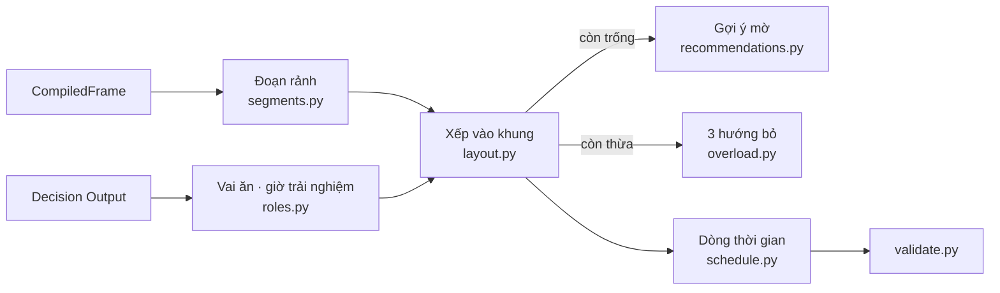
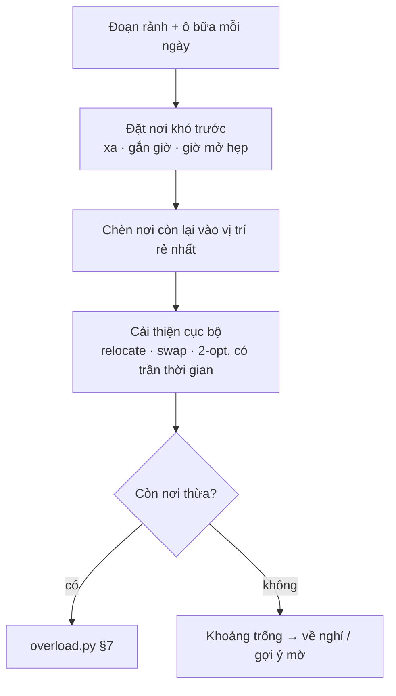

# Planning: lịch trình thật, dùng được, nhanh

Spec làm việc (tạm thời, `RULE.md` §0.1). Thay và gộp `2026-10-15-planning-day-frame-design.md`. Hiện trạng: `docs/PLANNING.md`. Đầu vào: `CompiledFrame` (`src/trip/domain/frame.py`), Decision Output (`docs/PLACE_DECISION.md` §15).

## 1. Mục tiêu

Planning cố hết sức thỏa nhu cầu của user: một lịch họ cầm đi được, đúng nhịp thật, mỗi lựa chọn hiểu được, dựng và sửa tức thì.

| Đã chốt với user (15/10) | |
|---|---|
| Đầu ra mặc định | **một lịch chính** để sửa |
| Quá tải (không đủ thời gian cho mọi nơi đã chọn) | 3 lịch theo 3 hướng cố định: Giữ nơi hợp gu nhất · Ít đi lại · Tiết kiệm; + Tự chọn nơi bỏ; + dòng "đi sớm / về muộn ≤ 1 tiếng/ngày là giữ đủ" khi đúng |
| User đổi thứ tự | giữ đúng thứ tự, chỉ căn giờ; gợi ý thứ tự tốt hơn chỉ khi đáng |
| Sản phẩm dừng ở | **chốt lịch**: bỏ màn Hôm nay và thông báo trong chuyến; Google Calendar = một nút xuất lịch; giữ Phản hồi, Gửi lịch trình |
| Tốc độ | lịch đầu < 2 s; sửa một nơi / thứ tự < 0,1 s; đổi khung / nhịp < 1 s (§8) |

Giữ nguyên: validator là nơi duy nhất kết luận đạt; không bịa nơi; physical không nới; chỉ act của user thêm nơi; Lựa chọn không chặn, không nhắc; ngân sách là tổng chuyến, không tự loại nơi.

## 2. Bằng chứng (15/10, engine hiện tại, OSRM tắt)

| Ca | Thấy |
|---|---|
| Cặp đôi, 3 ngày, chậm, 4 nơi | ngày 1 "chờ" 13:52–18:00, không bữa trưa; ngày 2 chỉ 1 nơi; mọi bữa "tự chọn"; kết luận "Hợp lệ" |
| Gia đình có bé, 3 ngày, 12 nơi | phương án 1 giữ 5/12, 7 nơi bỏ không nêu tên; vẫn trống chiều 4 tiếng; **kem bơ làm bữa tối** sau "chờ khung giờ ăn" 4h20; **săn mây Cầu Đất 16:04**; 3 dòng đệm/nghỉ/đi cho một chặng; độ vững là đoạn liệt kê kịch bản |
| Tốc độ ca 12 nơi | 21 s; profile 27,5 s: `composer._select` → 158 × `schedule_trip` → 71.904 `days.day_cost` = 21,5 s |
| `evaluate` 12/10 | 1/10 chuyến hợp lệ, phút đi −35,7% so với baseline, chậm nhất 213 s |

Gốc lỗi trong code và dữ liệu:
- `usable_as` của cafe (346) và dessert (82) có `meal` như nhà hàng.
- Săn mây Cầu Đất mang cả `cloud_hunting` và `sunset_view`; ghim chọn hoàng hôn.
- `details.timing.*.by_time_of_day` rỗng ở 3.208/3.208 nơi; `operation.hours` 45%.
- `schedule.simulate` coi nơi ăn là bữa cố định và nơi có giờ đẹp là ghim, khoảng trống thành "chờ".

## 3. Kiến trúc

Thay **lõi xếp lịch**, giữ **vỏ** (phiên, act, preview token, undo/redo, replay log, validator, Live Context, chỗ ở, guard).



| Bỏ khỏi đường tạo phiên | Lý do |
|---|---|
| `composer._select` dò tập nơi | thay bằng thứ tự bỏ (§7) |
| vòng K+1 chỗ ở × 3 mục tiêu (`variants.py`) | chỗ ở bắt buộc chọn ở Lựa chọn trước khi vào Lịch trình; dựng với đúng một chỗ ở |
| `cluster.py` + `days.assign_days` DP | thay bằng chèn rẻ nhất + cải thiện cục bộ (§6) |

`engine.py` gọi lõi qua `layout.build(trip) -> Layout` và `layout.retime(trip, day, order) -> DayTimeline` thay cho `schedule_trip` / `compose`.

## 4. Khung ngày → đoạn rảnh — `segments.py`

Mỗi `DayFrame` thành các đoạn rảnh có điểm đầu, điểm cuối cố định:

| Ngày | Điểm đầu | Điểm cuối |
|---|---|---|
| đầu | nơi tới (`arrive.how`: sân bay / bến / nhà); tới trước giờ nhận phòng → chặng "ghé gửi đồ" ở chỗ ở | chỗ ở |
| giữa | chỗ ở | chỗ ở |
| cuối | chỗ ở, trả phòng theo giờ của chỗ ở | nơi rời; `self` = chỗ ở; xe máy / xe buýt sau trả phòng → ghi "mang theo hành lý", chỉ xếp nơi trong `luggage_radius_min` |
| busy ở chỗ ở (nghỉ trưa, ngủ) | — | đoạn trước kết thúc và đoạn sau bắt đầu ở chỗ ở |
| busy kiểu `event` | — | khung cố định tại `where`; không địa chỉ → cảnh báo `event_location_unknown` |

- Đường từ nơi tới / ra nơi rời tính bằng ma trận, thay `entry_min` cố định.
- `intensity: light` → sức chứa × `light_factor` (0,5); `free` → chỉ bữa.
- Thông tin user trước, `FrameDefaults` sau; mặc định không đè thông tin. Lịch ghi "giờ mặc định" ở ngày dùng mặc định.
- Không có `CompiledFrame` thì `create` từ chối (`TripIncomplete`, cổng hiện có).

Validator thêm: busy không bị chồng (user hard) · xong trước mốc rời tính cả đường ra (physical) · `drive_day_min` (user constraint, có cái giá).

## 5. Vai ăn và giờ trải nghiệm — `roles.py`

**`meal_kind(record)`** từ `category_group` + món (`menu.dishes`, `details.known_for`):

| Kết quả | Từ | Xếp vào |
|---|---|---|
| `main` | restaurant | ô trưa / tối |
| `breakfast` | món trong `breakfast_dishes` (config: bánh căn, phở, bánh mì, bún, xôi…) | ô sáng; trưa được |
| `light` | dessert, cafe, tiệm bánh, chè, kem | điểm dừng `snack_window` (14:30–17:00) hoặc sau bữa tối; **không vào ô bữa chính** |
| `night_meal` | market mở tối | thay bữa tối, ghi "ăn tối ở chợ" |

**`experience_time(record, frame)`**, thứ tự thắng: `frame.periods` của user → `cloud_hunting` / `sunrise_view` = sunrise → `sunset_view` = sunset → bar, market mở tối = evening → không có. Nơi có cả `cloud_hunting` và `sunset_view` lấy sunrise. Không suy từ `details.timing` (rỗng).

**Cửa sổ của nơi:** giờ mở đã biết = cứng; thiếu → `default_windows` theo category + cờ `hours_unknown` ("chưa rõ giờ mở, gọi trước"); trải nghiệm = mềm, trọng số cao; `periods` của user = mềm; `crowd_tolerance: avoid` → phí buổi đông của chính nơi đó; tháng mưa / dự báo mưa → nơi ngoài trời ưu tiên sáng.

## 6. Xếp vào khung — `layout.py`, `schedule.py`



- **Ô bữa** là nhu cầu cố định mỗi ngày (sáng 6:30–9:00 · trưa 11:00–13:30 · tối 17:30–20:00; `meals.shift_min` dịch sớm; `meals.skip`, `breakfast_at_lodging`, chỗ ở có ăn sáng → bỏ ô). Nơi `main` / `breakfast` đã chọn nhận ô hợp nhất, gần đường nhất; thừa → quá tải.
- **Chi phí chèn** = phút đi thêm + phí cửa sổ (§5) + phí lệch nhịp. Một nơi xa quyết định khu của ngày nó nằm.
- **Sức chứa ngày tính bằng phút** (đoạn rảnh − bữa − nghỉ), không bằng số nơi; `pace` đổi thời lượng (`visit_key`), nghỉ, đệm.
- **Thời lượng:** `frame.visit[kind]` > ước tính; nơi cho bé với "bé tối đa N′" là trần. Lịch ghi "(bạn nói)" / "(ước tính)".
- **Nghỉ:** `frame.rest` > `rest_min` theo pace; nghỉ tại nơi `light` kế cận nếu có, không chèn khối nghỉ giữa đường.
- **Có bé:** `pattern.interleave_kids` → nơi chỉ hợp người lớn không đứng liền nhau, ≤ 60′.
- **Ngày bình minh:** nơi `sunrise` kéo giờ bắt đầu ngày đó; tự thêm nghỉ trưa ở chỗ ở và giảm sức chứa chiều × `early_day_factor`; đầu ngày ghi "Dậy 4:30". User đổi ngày hoặc bỏ giờ bình minh bằng một chạm.
- **Khoảng trống** sau xếp: ≥ `rest_home_min` (90′) và đường về chỗ ở ≤ `rest_home_road_max` → "Về khách sạn nghỉ"; còn lại ≥ `fill_min_gap` → gợi ý mờ; "chờ" chỉ khi < `wait_max` (20′).
- **Chặng = một dòng:** đệm, phụ phí bất định, gửi xe gộp vào phút chặng ("Đi xe 12′ (đã tính gửi xe)"). Không còn item `buffer` / `wait` dài.

**Gợi ý mờ** (`recommendations.py`): ứng viên lấy từ corpus qua `sieve(hard_filters)` + `preference(soft_weights)`, trong bán kính `suggest_radius_min` quanh nơi trước / sau; cứng: mở trong khung, đi vòng ≤ `meal_detour_max`; mềm: gu, món user muốn mà chưa có quán, hợp bữa (`meal_kind`), không trùng món trong chuyến. Giá không vào điểm, thẻ có ghi giá. Top 1 hiện mờ; "xem thêm" top 3; ✕ chỉ ẩn nơi đó trong phiên. Không vào timeline, `metrics`, validator khi chưa chạm.

## 7. Quá tải — `overload.py`

Quá tải = sau §6 còn nơi user chọn không vào được đoạn rảnh nào. Còn chỗ trống thì không bao giờ bỏ nơi.

| Hướng (`id`) | Thứ tự bỏ | Lý do trên thẻ |
|---|---|---|
| `fit` Giữ nơi hợp gu nhất | `selection_utilities` tăng dần; bằng → phút đi tiết kiệm lớn hơn | "ít khớp gu nhất" / "thứ hai từ dưới lên" |
| `travel` Ít đi lại | phút đi tiết kiệm nếu bỏ (giảm dần), tính lại sau mỗi lần bỏ | "bớt 1h20 đi xe" + "các nơi khác cách khách sạn < 15′" khi nơi nằm riêng một hướng |
| `cost` Tiết kiệm | giá/người đã biết (`price_per_person` trung điểm, `entry_fee`) giảm dần; chưa có giá không xét | "đắt nhất ~450k/người"; thẻ ghi "N nơi chưa có giá, không xét" |

- Bỏ dần tới khi vừa, rồi thử thêm lại từng nơi đã bỏ (nơi nào còn vừa thì giữ).
- Không bao giờ bỏ: `must_places` (role `anchor` / `locked`, anchor `must`), chỗ ở, nơi user ghim ngày / giờ.
- Bỏ quán `main` → ô bữa đó có gợi ý mờ.
- Hai hướng ra cùng tập nơi → gộp thẻ ("Hợp gu · Ít đi lại").
- **Mở rộng:** nếu đi sớm / về muộn ≤ `extend_max_min` (60′) mỗi ngày là giữ đủ → `extend {side, per_day_min}`, dòng "Hoặc giữ đủ 12 nơi: mỗi ngày đi sớm hơn 45′".
- **Tự chọn:** danh sách mọi nơi kèm phút chiếm; bộ đếm "còn thừa 1h20"; về 0 thì xếp.

Thẻ hiện: dòng đầu "Không đủ thời gian cho cả N nơi: thiếu ~X giờ" · "Được" · "Mất" (mỗi nơi + con số của chính tiêu chí) · ba dòng so sánh giống nhau ở mọi thẻ: Trên xe · Chi phí đã biết (+ số nơi chưa có giá) · Hợp gu, ★ ở thẻ thắng mỗi dòng. Không km, không thuật ngữ.

Chọn hướng → thành lịch chính; nơi bỏ nằm ở khay `unplaced` ("Chưa xếp (2)"). "Thêm lại" vào ngày kín → hỏi tại chỗ: "Ngày 2 đầy: dời X sang ngày 3 · bỏ một nơi · vẫn thêm (về muộn 40′)". Quá tải do sửa sau không mở lại 3 thẻ.

## 8. Sửa lịch nhanh

| Act | Tính lại | p95 |
|---|---|---|
| `reorder(day, order)` | căn giờ đúng thứ tự user (`layout.retime`) | < 50 ms |
| `drop_place` | căn giờ ngày đó; chỗ trống → gợi ý mờ | < 50 ms |
| `move_place`, `add_from_backup`, `accept_suggestion` | chèn rẻ nhất (hoặc đúng vị trí thả) ở ngày đích, căn giờ ngày nguồn / đích | < 100 ms |
| `set_day_window`, `set_pace` | dựng lại cả chuyến | < 1 s |
| `pick_variant(fit\|travel\|cost)`, `drop_manual(ids)`, `extend_days(side, min)` | §7 | < 1 s |
| `confirm` | validate toàn lịch | < 1 s |

**Sau `reorder`:** không đổi thứ tự. Tính nền (`suggestions` token, như gợi ý hiện có) thứ tự tốt nhất của ngày đó; chỉ hiện `better_order` khi bớt ≥ `better_order_min` (15′) đi xe hoặc sửa được vi phạm. Vi phạm (đóng cửa, lỡ bữa, trễ mốc rời) đánh dấu ở đúng dòng, không chặn. `keep_my_order(day)` tắt gợi ý cho ngày đó.

Mỗi act chỉ kiểm phần đã đổi; kiểm toàn lịch khi `confirm`. Ma trận đường đi tính một lần mỗi phiên cho: chỗ ở, nơi tới / rời, nơi đã chọn, nhóm ứng viên gợi ý (≤ `suggest_pool_max`).

## 9. Plan Output và màn Lịch trình

**Thêm vào `view` / Plan Output:**

```text
days[i].header      giờ rời / về chỗ ở, số nơi, phút trên xe, cờ (dậy sớm, nghỉ trưa, giờ mặc định)
days[i].items[]     kind: arrive | leave | stop | meal | suggest | leg | rest | busy
days[i].risk        ≤ 1 câu: "Ngày này sát giờ: trễ 30′ thì lỡ hoàng hôn · nếu trễ, bỏ Ga Đà Lạt trước"
days[i].rain_swap   "Nếu mưa: đổi A → B (trong nhà, 10′)" từ backup_pool
unplaced[]          {place_id, reason}
overload            {missing_min, directions[], extend | null} | null
better_order        {day, order, saved_min} | null
frame_report[]      ✓ / ⚠ / 🔎 / 💰 từng mục user đã nói (giữ từ spec khung ngày)
```

Item `stop` / `meal` mang: giờ đến–đi, thời lượng + nguồn, gọi món / làm gì (`details.order`, `details.activity`), giá/người, `booking`, `hours_unknown`, lỗi tại dòng.

**Web** (`web/src/user/screens/plan/`, bố cục mock `ui_mock_for_design/designs/itinerary/` giữ nguyên):
- `DayView`: header ngày; thẻ nơi có thêm các trường trên; `leg` / `rest` / `busy` là dòng mảnh; `suggest` là thẻ nhạt [Thêm] [✕] [Xem 2 nơi khác]; lỗi đỏ dưới đúng thẻ; dòng `risk`, `rain_swap`; dòng `better_order` [Đổi] [Giữ như tôi xếp].
- `Choose`: chỉ khi `overload`; 3 thẻ theo §7 + dòng mở rộng + Tự chọn.
- `Overview`: `frame_report`; bỏ bảng độ vững.
- Thanh đáy: Chưa xếp (n) · chi phí đã biết / ngân sách · Hoàn tác · Chốt lịch. Sau chốt: Gửi lịch trình, Thêm vào Google Calendar (xuất một lần), Google Maps cả ngày.
- UI làm với `ui-ux-pro-max`, màu từ tokens, ảnh vào `frontend_images/` (`RULE.md` §0.2).

## 10. Bỏ phần sau chốt lịch

| Gỡ | Chỗ |
|---|---|
| Màn Hôm nay, "Ở đây", "Phần còn lại hơi chật" | `web/src/user/screens/Today.tsx`, `today.ts`, route trong `UserApp.tsx`; `src/companion/` phần `today`, `suggest` |
| Thông báo trong chuyến (push nhắc điểm dừng) | `src/notify`, `web/src/user/notify.ts`, `public/sw.js` phần nhắc chuyến |
| Calendar theo dõi lệch | `companion/calendar.py`: chỉ còn xuất một lần các điểm dừng của lịch đã chốt |
| Giữ | Phản hồi (`Done.tsx`), Gửi lịch trình, Hộp thông báo cho tin nhắn / bạn bè |

Gỡ là một phần việc riêng (§12); `docs/COMPANION.md` và `Role_Web_Functional_Design.md` §2.13 sửa theo.

## 11. Đo — bộ test thực tế

**Ca** (`tests/planning/realistic/cases.yaml`, nơi thật trong corpus Đà Lạt, ~25 ca), mỗi ca là Decision Output + `CompiledFrame` + chỗ ở:

| Nhóm | Ca |
|---|---|
| Nhịp, giờ | cặp đôi chậm + săn mây · họp 15–16h ngày 2 · tới xe đêm 5:00 · bay 16:40 ngày cuối · đi trong ngày · 7 ngày |
| Người đi cùng | gia đình bé 6 tuổi, nghỉ trưa · bố mẹ lớn tuổi · xe lăn · nhóm bạn đi nhiều + bar |
| Ăn | food tour 8 quán · 0 quán · ăn chay · khách sạn có buffet sáng |
| Quá tải | 12 nơi / 3 ngày · 25 nơi / 2 ngày · thiếu 40′ (phải có `extend`) |
| Thiếu dữ liệu | toàn nơi chưa có giờ mở · chưa có giá · tháng mưa |
| Sửa | reorder xấu (giữ thứ tự + `better_order`) · reorder hợp lý (không gợi ý) · thêm vào ngày kín |

**12 kiểm tự động** (`tests/planning/realistic/test_realism.py`), mỗi ca:

1. Không item chờ > `wait_max`.
2. Mọi ô bữa cần có nơi `main` / `breakfast` / `night_meal` hoặc gợi ý; nơi `light` không ở ô bữa chính.
3. Mọi nơi đã chọn ở trên lịch hoặc trong `unplaced` có lý do.
4. Nơi `sunrise` / `sunset` / `evening` nằm trong cửa sổ của nó.
5. Đến khi đang mở (giờ đã biết); thiếu giờ → có cờ.
6. Trong khung ngày; busy không chồng; xong trước mốc rời tính cả đường ra.
7. Có bé: có nghỉ, tối sớm, nơi người lớn ≤ 60′, không liền nhau.
8. Không ngày nào có đoạn trống ≥ `fill_min_gap` không gợi ý khi `unplaced` khác rỗng.
9. Phút đi ≤ baseline nearest-neighbour cùng tập nơi.
10. Quá tải: bỏ vừa đủ (thêm lại bất kỳ nơi bỏ nào → không vừa); thứ tự đúng tiêu chí; lý do có con số; `extend` có khi thiếu ≤ 60′/ngày.
11. Mục user đã nói không bị mặc định đè.
12. `reorder` giữ đúng thứ tự user.

**Tốc độ** (`tests/planning/realistic/bench.py`): p50 / p95 mỗi act trên mọi ca; chế độ không mạng (ma trận ước lượng) và chế độ OSRM. Đạt bảng §8 và lịch đầu < 2 s.

**Đọc bằng mắt:** `bench.py --render` in lịch dạng chữ của mỗi ca ra `logs/planning_realistic/{before,after}/`; chạy trên engine cũ và mới để so; user đọc 5–10 ca trước khi đưa lên prod.

## 12. Phần việc

1. Bộ ca + 12 kiểm + bench + render; chạy trên engine cũ làm mốc (đa số đỏ).
2. `segments.py`: đoạn rảnh, nơi tới / rời, nhận / trả phòng, hành lý; 3 kiểm validator.
3. `roles.py`: `meal_kind`, `experience_time`, cửa sổ nơi.
4. `layout.py` + `schedule.py` mới: chèn rẻ nhất, cải thiện cục bộ, ô bữa, nghỉ, ngày bình minh, khoảng trống, chặng một dòng; nối vào `engine.py`, bỏ vòng chỗ ở và `composer._select` khỏi `create`.
5. Gợi ý mờ từ corpus cho ô bữa và khoảng trống.
6. `overload.py`: 3 hướng, thêm lại, gộp, `extend`, tự chọn.
7. Act sửa nhanh + `better_order`; đạt bảng §8.
8. Plan Output §9 + Web màn Lịch trình (ảnh vào `frontend_images/`).
9. Gỡ phần sau chốt lịch (§10).
10. Học từ việc sửa lịch: giữ nguyên §10 của spec khung ngày (`plan_edit`, áp trong phiên, prior dài hạn khi user đồng ý).
11. Đo trước / sau, user đọc ca; gộp vào `docs/PLANNING.md`, `docs/COMPANION.md`, `Role_Web_Functional_Design.md`; xóa spec này và spec khung ngày.

## 13. Config mới — `config/planning.yaml`

`light_factor` 0,5 · `early_day_factor` 0,6 · `luggage_radius_min` 20 · `breakfast_dishes` · `snack_window` 14:30–17:00 · `meal_windows` sáng 06:30–09:00, trưa 11:00–13:30, tối 17:30–20:00 · `rest_home_min` 90 · `rest_home_road_max` 15 · `fill_min_gap` 60 · `wait_max` 20 · `meal_detour_max` 15 · `suggest_radius_min` 15 · `suggest_pool_max` 60 · `extend_max_min` 60 · `better_order_min` 15 · `event_early_min` 15. Đơn vị: phút.
