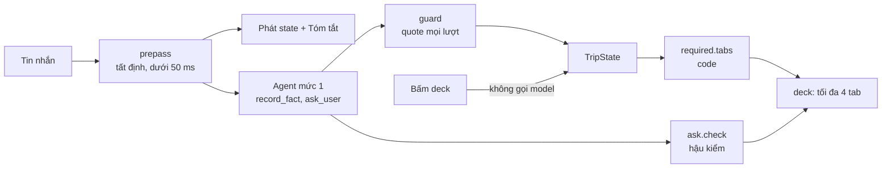
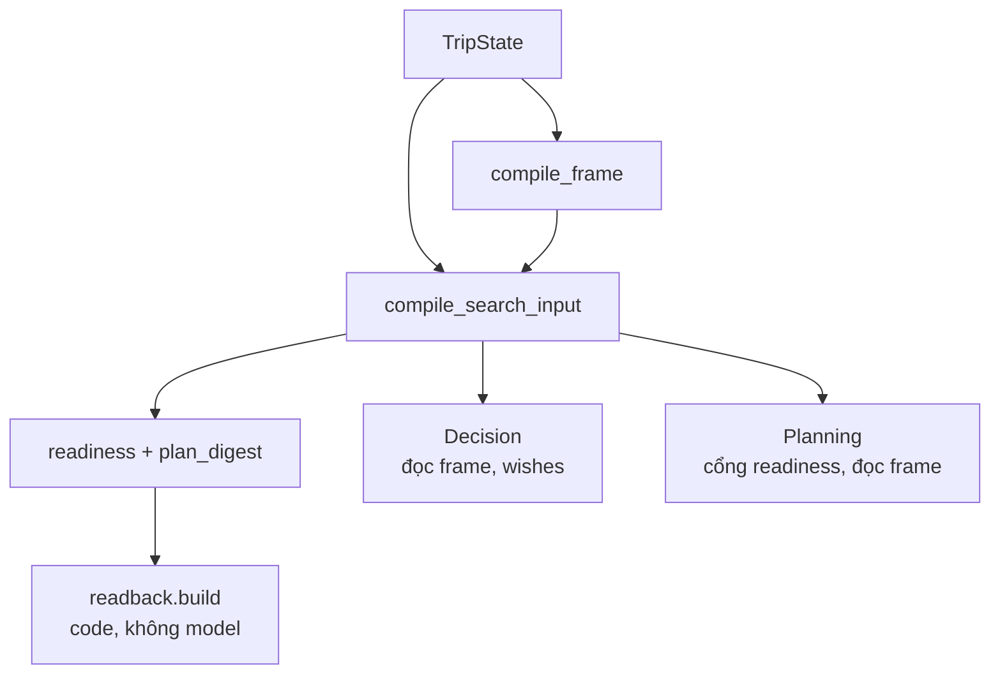
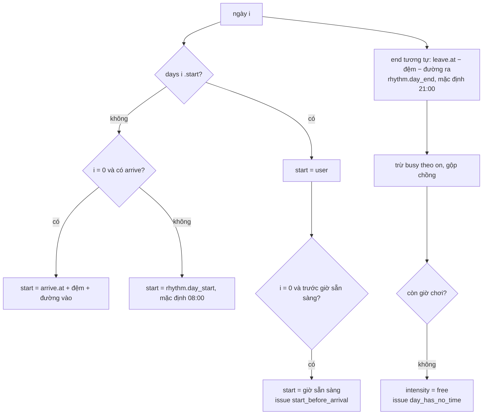
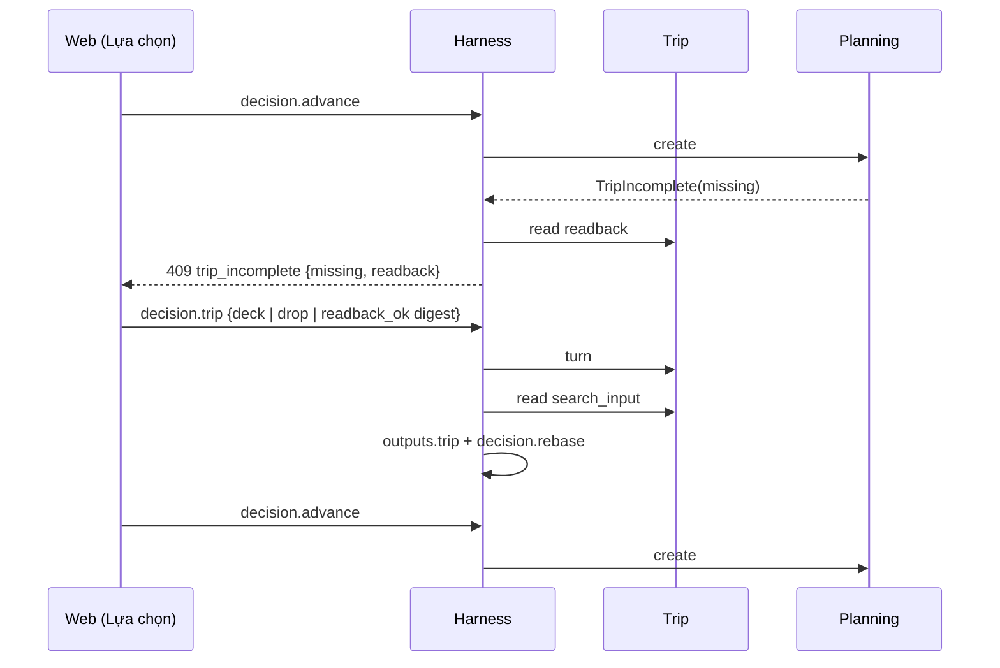

# Trip Understanding: kiến trúc và bộ test phản biện

Spec làm việc (tạm thời, `RULE.md` §0.1). Hiện thực hóa `2026-10-13-trip-understanding-redesign-design.md` (gọi tắt **R**); đầu ra phục vụ `2026-10-15-place-decision-needs-design.md` (**D**) và `2026-10-15-planning-day-frame-design.md` (**P**). Bằng chứng: `2026-10-15-trip-understanding-cases.md` (**C**). Phân vai: Claude thiết kế + viết test + review; sol 6.1 (Codex) viết code cho test xanh.

## 1. Sáu quyết định kiến trúc

| # | Quyết định | Vì sao (phản biện R) |
|---|---|---|
| A1 | **Một khung ngày, compile một lần ở Trip.** `compile_frame(state, cfg) → CompiledFrame`; `SearchInput.context.frame` mang nó. Decision `trip_days.py` và Planning `frame.py` chỉ đọc, không tự tính | Hôm nay hai module tự dựng khung từ `checkin_at` + config → lệch nhau. Lệch khung = lịch sai dù từng bước đúng |
| A2 | **Câu bắt buộc do code dựng, không do model.** Tab ①–⑦ là mẫu cố định trong `domain/required.py`, `writes` viết sẵn, chip đoán sẵn lấy từ state; `ask_user` của agent chỉ cho khoan sâu / xác nhận / câu riêng | Câu bắt buộc phải đúng 100%, nhanh, test được; model chỉ cần ở chỗ cần hiểu ngôn ngữ |
| A3 | **Field bắt buộc chỉ "đủ" khi `source = user`.** Giá trị `inferred` / `default` / `profile` của field bắt buộc là **chip chọn sẵn ✎** trên tab, user chạm một lần | "Không hiểu sai" (R §1) thành luật code, không thành lời nhắc prompt |
| A4 | **Bản đọc lại gắn với digest.** `plan_digest(si)` = hash của phần Search Input làm đổi lịch (khung, chỗ ở, pace, hard, người, phương tiện, ngân sách, anchor, trần lái). `readback_ok` lưu digest; đổi soft / vibe không bắt đọc lại, đổi giờ thì bắt | R §7 liệt kê field bằng chữ — dễ sót. Digest tự đúng khi contract thêm field |
| A5 | **Cổng ở dữ liệu, không ở UI.** `SearchInput.readiness = {missing, readback_ok}` do Trip compile; Planning `create` từ chối `TripIncomplete` khi có `readiness` mà chưa đủ. Planning không import gì mới của Trip | Fail-closed ở server; không thêm phụ thuộc chéo module |
| A6 | **Không mất ý.** Mọi lời user được ghi vào đúng một trong: field · `companions_other` · `unmapped`. Từ chối của guard luôn kèm đường thoát; sai metadata → bỏ metadata, giữ fact (`warning:`), không `refused:` | C §3: 17/57 persona mất người đi cùng vì từ điển đóng |

Bất biến giữ nguyên: không bịa nơi; `unknown` ≠ không thích; hard fail-closed; physical không nới được; online không ghi Place Intelligence; module chỉ qua public API.

## 2. Luồng một lượt

## 3. Public API (sol code đúng tên này)

| Chỗ | API | Ghi chú |
|---|---|---|
| `domain/state.py` | `Vehicle` có `walk`; `TripState.driver: Field[Literal["self","hired"]]`; `TripState.frame: TripFrame`; `TripState.care: Field[Literal["none","listed"]]`; `TripState.budget_unlimited: Field[bool]`; `Signal.from_companion: str \| None`; `Meta.conflicts: tuple[str, ...]`; `Meta.readback_digest: str \| None` | thêm, không đổi tên field cũ |
| `domain/frame.py` (mới) | `TripFrame`, `Moment{at, how}`, `DayPlan{start?, end?, intensity}`, `Busy{label, kind, where, start, end, on}`, `Meals`, `CompiledFrame{days: tuple[DayFrame], drive_day_min, periods, visit, meals, rest, pattern, issues}`, `DayFrame{date, start, end, busy, intensity}`, `compile_frame(state, arrival_buffer_min, entry_min) -> CompiledFrame \| None` | giờ trong ngày dạng `HH:MM`; `arrive.at` / `leave.at` dạng `YYYY-MM-DDTHH:MM` giờ Đà Lạt |
| `domain/readiness.py` | `REQUIRED = ("trip","companions","mobility","care","pace","budget","lodging")`; `missing(state, required=REQUIRED) -> list[tuple[key, label]]` | luật đủ ở §4 |
| `domain/readback.py` (mới) | `plan_digest(si) -> str`; `build(si) -> Readback{lines: tuple[Line{kind: said\|guess\|default\|check, text, tab}], digest}` | không gọi model |
| `domain/compile.py` | `SearchInput.context.frame`, `SearchInput.context.driver`, `SearchInput.readiness: Readiness{missing, readback_ok}` | `readiness` luôn có |
| `domain/guard.py` | `record_fact(..., history: tuple[tuple[int, str], ...] = ())` | quote tìm trong lượt hiện tại rồi các lượt trước; evidence ghi đúng lượt |
| `api/engine.py` | `TurnInput.kind` thêm `deck`, `readback_ok`; `TurnInput.answers: dict[str, list[str] \| str]` | `deck` không gọi model trừ "Khác, tự gõ" |
| `planning` | `Engine.create` → `TripIncomplete(missing)` khi `trip_context.readiness` có mà chưa đủ | thiếu `readiness` (fixture cũ) = đầu vào legacy |
| `trip/__init__.py` | export `compile_frame`, `CompiledFrame`, `plan_digest`, `readiness_missing` | |
| `decision/trip_days.py`, `planning/frame.py` | có `context.frame` → dùng nguyên `frame.days[i].start/end`; không có → cách cũ | không kẹp vào `day_start` của config |

Chi tiết contract test đã chốt:

- `TripFrame`: `arrive`, `leave`, `day_start`, `drive_day_min`, `meals`, `rest`, `pattern` là `Field` (có source + evidence); `days: tuple[DayPlan{index, start?, end?, intensity?, source, evidence}]`; `busy: tuple[Busy{label, kind: rest|nap|sleep|work|event, where, start, end, on: all|weekdays|weekend|list[int], source="user", evidence=()}]`; `visit: dict[str, int]`; `periods`. Giờ ngày đầu / cuối user muốn vẫn là `checkin_at` / `checkout_at`, nhịp tối là `day_end` (không đổi tên field cũ).
- `Busy`: `start == end` hoặc giờ sai → `ValueError`; `end < start` chỉ hợp lệ với `kind = sleep` (qua nửa đêm).
- `FrameDefaults(day_start="08:00", day_end="21:00", first_start="14:00", last_end="12:00")`; chuyến 1 ngày không áp `first_start` / `last_end`.
- `DayFrame.busy`: `BusyBlock{start, end, kinds, labels, where}` đã gộp chồng, đã cắt theo khung.
- Mã issue: `start_before_arrival`, `end_after_departure`, `arrive_not_on_first_day`, `day_has_no_time`.
- Trả lời deck: khóa `trip.dates` (`YYYY-MM-DD..YYYY-MM-DD`), `trip.start`, `trip.end`, `companions.who`, `companions.people`, `mobility` (`motorbike|car_self|car_hired|walk`), `care` (`none|…signal`), `pace`, `budget.amount`, `budget.scope`, `budget.unlimited`, `lodging`. Giá trị ngoài tab bị bỏ, không ghi.
- `readback_ok` chỉ nhận khi `readiness.missing` rỗng; lưu `meta.readback_digest`.
- Tab ④ `care`: `none` · `steps` · `wheelchair` · `pregnant` · `motion_sick` · `height` · `vegetarian` · `vegan` · `other`. Mỗi chip ghi ràng buộc thật + đóng signal (dùng lại drafts của câu `care` / `c_effort` / `c_other` hiện có); chip không có dữ liệu (`motion_sick`, `height`) ghi `unmapped` (dòng 🔎). `none` chỉ đóng signal **suy ra**; signal user tự nói còn mở → issue `contradicts_said`.
- Deck không bao giờ bỏ im lặng: mỗi giá trị không dùng được phát `deck_issues {issues: [{key, code}]}`. Mã: `past_date`, `end_before_start`, `too_long`, `people_below_groups` (vẫn ghi, chỉ báo), `contradicts_said`, `invalid`.
- Từ điển người đi cùng: từ ngắn (≤ 4 ký tự sau bỏ dấu: bồ, vợ, chồng, ny, bé) phải khớp **có dấu**; chỉ quote được đối chiếu, không lấy cả tin nhắn để bảo lãnh. Không chắc → không ghi `said`, để tab ② hỏi.
- Hand-off tạm (đến khi Planning có đoạn ngày, spec P §3): `intensity = free` → khung rỗng ở cả Decision và Planning; Decision `TripDay.busy: tuple[(start_min, end_min)]` và thời gian khả dụng trừ busy.
- `TripIncomplete.missing`: danh sách khóa thiếu, thêm `"readback"` khi `readback_ok = False`.
- Đổi test cũ có chủ đích: `tests/trip/test_guard.py::test_a_group_the_message_names_is_taken_even_when_the_quote_is_only_the_person` → quote phải tự nêu nhóm ("kiểu bạn bè" được, "anh họ" bị từ chối kèm đường thoát); `tests/trip/test_requirement_intent.py::test_intent_cannot_put_diet_on_sightseeing_or_hide_an_access_constraint` — scope sai không còn làm mất ràng buộc; ràng buộc được giữ với scope chuẩn (chặt hơn), kết quả là cảnh báo. Ambiguity trên hard vẫn bị từ chối.

## 4. Luật compile khung ngày (A1)

- Physical thắng mong muốn: giờ user muốn bắt đầu sớm hơn giờ sẵn sàng → dùng giờ sẵn sàng + issue, không bao giờ ngược lại.
- `busy` `on`: `all` · danh sách chỉ số ngày (0-based) · `weekdays` · `weekend` theo ngày thật; cắt theo khung ngày; các khung chồng nhau gộp lại.
- `kind = sleep` buổi tối: `end = min(end, busy.start)`.
- Ngày cuối không bao giờ kết thúc sau `leave.at − đệm`; ngày đầu không bao giờ bắt đầu trước `arrive.at + đệm`.
- `drive_day_min` (mỗi ngày) tách khỏi `max_leg_min` (mỗi chặng).

**Luật "đủ" của 7 câu (A3):** `trip` = `start_date` + `days` + giờ đầu và cuối do user (chọn hoặc xác nhận mặc định) · `companions` user + `people` · `mobility` user · `care` = `"none"` hoặc đã có ràng buộc, không còn signal mở · `pace` user · `budget` = (số tiền + phạm vi) hoặc `budget_unlimited` · `lodging` có giá trị. Chỉ có tháng → `trip` thiếu.

## 5. Ma trận test phản biện

Mỗi dòng là một test; file ở cột cuối. Phần 1–2 đã viết thành test chạy được (đỏ trước khi sol code). Phần 3–6 viết khi tới phần đó.

### 5.1 Hiểu đúng, không mất ý (R §13, C §3) — `tests/trip/test_redesign_guard.py`

| ID | Tình huống | Kỳ vọng |
|---|---|---|
| G1 | "đi với bồ / ny / ngừi iu / vợ / wife" | `companions ∋ partner`, không `refused` |
| G2 | "với mẹ", "bé 6 tuổi", "2 bé 8 và 11" | `parents` / `kids` |
| G3 | "cả nhà", "họ hàng" | không mất: vào `companions_other`, tab ② còn thiếu |
| G4 | requirement metadata sai một trường | fact được ghi, note bắt đầu `warning:` |
| G5 | quote ở lượt trước | ghi được, `evidence.turn` = lượt nói |
| G6 | quote không có ở lượt nào | vẫn `refused:` (chống bịa) |
| G7 | bỏ `parents` sau khi thêm | signal `elderly` suy ra từ đó biến mất; signal có quote riêng ở lại |
| G8 | Grab / taxi | `mobility = car`, `driver = hired` |
| G9 | "đi bộ là chính" | `mobility = walk` |
| G10 | "Tết dương lịch", "chủ nhật này", "cuối tuần sau", "thứ 6 tuần sau" | ra ngày thật (today = 15/10/2026) |
| G11 | lời đáp lộ `budget_scope`, `signal` | `bad_say` chặn |
| G12 | "thong thả" + "đi nhiều chỗ" cùng lượt | `pace` không giữ giá trị nào, `meta.conflicts ∋ pace` |
| G13 | "lái tối đa 2 tiếng mỗi ngày" | `frame.drive_day_min = 120`, `max_leg_min` không đổi |
| G14 | "dorm" làm `base` | không thành `place_id` của nơi bất kỳ |

### 5.2 Khung ngày (A1, R §4) — `tests/trip/test_redesign_frame.py`

| ID | Tình huống | Kỳ vọng |
|---|---|---|
| F1 | 3 ngày, không gì thêm | 3 `DayFrame`, ngày liên tiếp; 14:00–21:00 · 08:00–21:00 · 08:00–12:00 |
| F17 | đi trong ngày, không giờ | start < end (không áp 14:00 / 12:00) |
| F2 | bay tới 09:30 ngày 1 | ngày 1 start = 09:30 + đệm + đường vào |
| F3 | user muốn bắt đầu 08:00, máy bay 10:00 | start = giờ sẵn sàng, issue `start_before_arrival` |
| F4 | bay về 16:00 ngày cuối | end = 16:00 − đệm − đường ra |
| F5 | xe đêm tới 04:00 | start ≥ 04:00 + đệm, không bao giờ trước |
| F6 | về lúc 07:00 ngày cuối | ngày cuối `free`, issue `day_has_no_time` |
| F7 | nghỉ trưa 12–14 mọi ngày | mỗi ngày có busy 12:00–14:00 |
| F8 | họp 8–17 thứ 2–6, chuyến T6→CN | busy chỉ ngày thứ 6 |
| F9 | hai busy chồng nhau | gộp thành một |
| F10 | bé ngủ 19:30 | end = 19:30 |
| F11 | ngày 2 dậy 5:00 săn mây | chỉ ngày 2 start 05:00 |
| F12 | ngày 3 nghỉ ở resort | ngày 3 `free` |
| F13 | chưa có `start_date` | `compile_frame` trả `None` |
| F14 | busy ngoài khung ngày | bị cắt / bỏ, không âm |

### 5.3 Bảy câu, cổng, đọc lại (A3–A5, R §5, §7) — `tests/trip/test_redesign_gate.py`

| ID | Tình huống | Kỳ vọng |
|---|---|---|
| Q1 | state rỗng | thiếu đủ 7 theo thứ tự `REQUIRED` |
| Q2 | chỉ có tháng | `trip` thiếu |
| Q3 | companions `inferred` | `companions` thiếu (chờ chạm ✎) |
| Q4 | `care = none` | `care` đủ |
| Q5 | signal mở | `care` thiếu dù `care = none` |
| Q6 | `budget_unlimited` | `budget` đủ không cần số |
| Q7 | số tiền thiếu phạm vi | `budget` thiếu |
| Q8 | đủ hết | `missing == []`, `readiness.missing == ()` |
| Q9 | digest ổn định, đổi soft | digest không đổi |
| Q10 | đổi pace / giờ / chỗ ở / hard | digest đổi |
| Q11 | `readback_ok` rồi đổi giờ | `readiness.readback_ok` thành `False` |
| Q12 | `build` đọc lại | dòng `said` / `guess` / `default` tách, mỗi dòng có `tab`; không chứa id field |
| Q13 | `deck` trả lời qua engine | không gọi model (chat lỗi vẫn chạy), field `source = user` |
| Q14 | Planning nhận `readiness` thiếu | `TripIncomplete` có danh sách thiếu |

### 5.4 Deck, `ask_user`, câu xác nhận (R §6, §8, §10) — `tests/trip/test_redesign_deck.py`

Contract:

- `trip/domain/deck.py`: `Option{id, label, description, writes: tuple[Draft], prefilled, because, count}` · `Tab{qid, kind: required|drill|confirm|agent|maybe, header, question, why, multi, inputs: tuple[str], options}` · `Deck{tabs, left, total=7}` · `build(state, catalog, cfg, agent=(), at="understand"|"gate") -> Deck` · `confirm_tabs(state, catalog, cfg) -> tuple[Tab]`.
- Thứ tự: required (thiếu, theo `REQUIRED`) → drill → confirm → agent → maybe; tối đa `max_tabs` (4). Ở `at="understand"`: tối đa 3 tab required và giữ 1 chỗ cho câu theo chủ đề user nói (drill / confirm / agent) khi có — lượt đầu không bao giờ là form 4 trường; không có câu chủ đề thì đủ 4 required. Ở `at="gate"`: required trước, chỗ còn lại cho confirm. `at="understand"` bỏ tab bắt buộc user đã bỏ qua (`meta.declined`); `at="gate"` luôn hiện mọi tab bắt buộc còn thiếu.
- Tab bắt buộc: `inputs` chỉ gồm phần còn thiếu (tab ① đã có ngày → chỉ còn `start`, `end`). Giá trị đoán (`inferred` / `profile` / `default`) → option `prefilled` + `because = "vì bạn nói '<quote>'"`. Mâu thuẫn (`meta.conflicts`) → không chọn sẵn, `why` ghi "bạn nói cả hai".
- `trip/domain/ask.py::check(questions, state, catalog, cfg) -> tuple[Tab]`: bỏ câu về field `source = user` hoặc trong `declined`; bỏ câu > 90 ký tự hoặc lộ id feature / field; bỏ option có write bị guard từ chối hoặc ghi `hard`; `count` = `matching` sau writes, bỏ option 0 nơi; bỏ câu khi mọi option ra cùng tập nơi; còn < 2 option → bỏ câu; thêm `other`, `skip`.
- Tool agent `ask_user(questions: 1–3)` thay `ask` kind `this_or_that` / `bank_card` (`look` giữ tới phần 4).
- Card JSON: `{kind: "deck", tabs: [{qid, kind, header, question, why, multi, inputs, options: [{id, label, description, prefilled, because, count}]}], left, total}`.
- Trả lời: id option → áp `writes` với `source = user`, không gọi model; `skip` → `meta.declined += qid`, tab không bắt buộc thì `meta.soft_skips += 1`; `other` + `text` → chạy agent với lời user.
- `meta.soft_skips ≥ 2` hoặc `meta.rushed` → không tab drill / confirm / agent / maybe. `rushed` do code bật khi user nói "gợi ý luôn", "tìm luôn", "khỏi hỏi", "nhanh lên".
- `apply`: `frame.busy` `add` (bỏ trùng) / `remove` theo `label`; `frame.days` `add` gộp theo `index`; `frame.periods` `add`; `frame.visit` `add` gộp key.
- Prepass: slot chính xác (ngày, số ngày / đêm, số người, số tiền) không `inferred` → `source = user` (quote là chữ user gõ); không được hỏi lại.
- Câu xác nhận (qid): `confirm.early` (soft `cloud_hunting` / bình minh love → `day.<i>` · `any` · `no`; ghi `frame.days[i].start ≤ 05:30` + `periods`) · `confirm.evening` (nhạc sống, chợ đêm, bar… love → `20` · `22` · `late` ghi `day_end`; xe máy → `why` cảnh báo đường tối / đèo) · `confirm.nap` (bé, em bé, ông bà, bầu → `yes` ghi busy nghỉ 12:00–14:00 tại `lodging` `on=all` · `no`) · `confirm.priority` (anchor `must` > số ngày × số nơi/ngày theo pace) · `confirm.arrive` (tới trước 07:00 → `rest` ghi `days[0].start ≥ 08:00` · `go`) · `confirm.drive` (say xe, "không đi xa" → `max_leg_min`). Đã biết câu trả lời hoặc đã bỏ qua → không hỏi.

| ID | Tình huống | Kỳ vọng |
|---|---|---|
| DK1–DK5 | tab bắt buộc: thứ tự, không hỏi lại điều đã nói, chip đoán có lý do, mâu thuẫn không chọn sẵn, bỏ qua chờ tới cổng | như tên test |
| DK6–DK11 | câu xác nhận theo hệ quả lên lịch; không hỏi khi đã biết / đã bỏ qua | ghi đúng khung |
| DK12–DK14 | bắt buộc trước, ≤ 4 tab; 2 lần bỏ qua / user vội → chỉ còn bắt buộc | |
| DK15 | hậu kiểm `ask_user` | bỏ câu thừa, option sai, option hard, option 0 nơi, câu không phân biệt |
| DK16–DK17 | qua engine: bấm không gọi model; "Khác, tự gõ" qua agent | |
| DK20 | lượt đầu: 7 câu thiếu + user nói "săn mây" | 3 tab bắt buộc + 1 tab săn mây |
| DK18 | ghi busy / days nhiều lần | cộng dồn, không ghi đè |
| DK19 | "20-22/11, 2 người, 10 triệu" | `source = user`, tab ① chỉ hỏi giờ |

### 5.5 Từ bộ đo 76 persona trên Gemma LAN — `tests/trip/test_redesign_review2.py`

Đo 15/10 (`logs/bench_trip/score.py`, cùng luật chấm cho trước / sau phần 1–2): mất người đi cùng 22/47 → 13/47 (9 ca thật), Grab / taxi 3/6 → 1/6, ngày tương đối 8/11 → 1/11, sai ngôn ngữ 2/2 → 2/2, lời đáp > 250 ký tự 20 → 22 / 102 lượt.

- R5: tham số tool-call không phải JSON (Gemma lúc tải cao) làm sập cả lượt ở lần gọi model sau → loop thay bằng `{}`, trả tool message báo JSON hỏng cho model, lịch sử luôn là JSON hợp lệ.
- R6: người đi cùng do **prepass** đọc trước (từ điển có dấu, cụm không dấu dài), thành `suggestions` → tab ② chọn sẵn ✎ kèm `because`; agent chỉ là lớp hai. Cụm mơ hồ ("2 mẹ con") không đoán. Số người trong "tụi tui 4 đứa" là `people` của user.
- R7: ngôn ngữ trả lời do code xác định từ tin nhắn (tiếng Việt không dấu vẫn là tiếng Việt), ghi vào prompt; `bad_say` chặn lời đáp sai ngôn ngữ.
- R8: `guard.trim_say`: ≤ 2 câu, ≤ 250 ký tự, giữ câu hỏi cuối.

### 5.6 Khoan sâu bằng ảnh và thang khắc phục (R §9, §11) — `tests/trip/test_redesign_drill.py`

Contract:

- `trip/domain/drill.py`: `topics(text) -> list[str]` (từ điển sở thích rộng có dấu: săn mây, ngắm đồi, cà phê, chill, chụp ảnh, thiên nhiên, cắm trại, ăn uống, về đêm, tâm linh; có từ định kiểu như "vintage", "có sách", "view …" → đã cụ thể; chỗ ở không bao giờ khoan) · `note(state, text, turn) -> TripState` (tối đa 3 `pending` mỗi chuyến) · `choose(variants, topic, state, catalog, looks, cfg) -> list[Option]` · `skip(state, topic) -> TripState`.
- `TripState.drills: tuple[Drill{topic, quote, turn, status: pending|done|skipped|none, tab: Tab | None}]`.
- `choose`: phạm vi = nơi qua hard thuộc sở thích cha; `looks.scored_by_cues(cues, within) -> [(place_id, best_photo_score)]`; bỏ biến thể < `drill_min` (10) nơi hoặc điểm ảnh tốt nhất < `drill_score_min` (0,14); xếp theo số nơi × điểm ảnh tốt nhất; lấy 3, mỗi biến thể một nơi đại diện khác nhau (`Option.photo = (place_id, best_photo)`), `count` = số nơi; < 2 → `[]` (`status = none`). Biến thể `axis = time` ghi `frame.periods` + soft `@time_of_day`; bản đọc lại ghi "chưa kiểm được nơi nào đẹp nhất vào buổi này".
- Tool `suggest_directions` chỉ có khi không còn drill `pending`.
- Thang: tool `find_dishes(text, quote)` → `Catalog.dishes(query)` (dùng `corpus.serving.dishes.search` trên record của chính Catalog) → `wishes.dishes[{dish, quote, place_ids}]`, trả `{count, top}`; `find_kinds(text, quote)` → category của Catalog → `wishes.kinds[{kind, quote, place_ids}]`; `record_fact field=like` (`{place, but[]}`) → `wishes.like[{place_id, but, quote}]`, không anchor, `but` là soft; `record_fact field=unmapped` kèm `gap` → một dòng gộp theo cụm trong `data/trip/gaps.jsonl` (`{phrase, kind, count, last_seen}`; `TurnTools(..., gaps=path)` cho test). `SearchInput.wishes`.

| ID | Tình huống | Kỳ vọng |
|---|---|---|
| D1–D2 | sở thích rộng theo thứ tự nói; đã cụ thể thì không; tối đa 3 | |
| D3–D5 | 5 biến thể → 3 theo số nơi × điểm ảnh, đại diện khác nhau; < 2 → không tab; biến thể buổi | |
| D6–D7 | drill trước confirm; bỏ qua là xong; hướng mới chờ drill xong | |
| L1–L6 | món, loại nơi, "giống X nhưng", không dữ liệu → gaps gộp, chỉ ghi gaps; chỗ ở không khoan | |

### 5.7 Bản đọc lại gọn, cổng ở "Lập lịch", vòng đo 3 — `tests/trip/test_redesign_readback.py`, `tests/harness/test_trip_gate.py`, `tests/trip/test_redesign_review3.py`

Lỗi gốc tìm thấy khi đọc code: Planning ném `TripIncomplete` nhưng harness không bắt → bấm "Lập lịch" ra 500; web chưa đọc được thẻ `deck`; bản đọc lại chưa tới client. Bản đọc lại cũ ra một dòng mỗi field (chuyến 5 ngày đủ ý = 42 dòng).

| # | Kiểm |
|---|---|
| RB1–RB2 | ca đủ mọi thứ ≤ 12 dòng; 1 dòng mặc định, 1 dòng tự kiểm, ≤ 3 dòng đoán; chuyến 14 ngày không thêm dòng mỗi ngày; dòng chuyến "T6 20/11 → CN 22/11" kèm giờ đến / sẵn sàng / rời đi |
| RB3 | tiền đọc kiểu người Việt: 25 triệu, 2,5 triệu, 800 nghìn, 1,2 tỷ |
| RB4–RB6 | mặc định không bao giờ nằm trong dòng "bạn nói"; dòng đoán có `undo`, dòng khác không; tất định |
| RB7 | `drop` hủy đúng một suy luận, không đụng lời user, không gọi model |
| RB8–RB10 | `view.readback` chỉ có khi đủ 7 câu; `readback_ok` phải mang digest user đã thấy, lệch → phát `readback` mới |
| RB11, H1–H4 | `Tools.read("readback" \| "search_input")`; harness đổi `TripIncomplete` thành `TripNotReady` (409), trả lời ngay ở Lựa chọn qua `decision.trip` (chỉ `deck`, `drop`, `readback_ok`) |
| G15 | "với mẹ", "bố", "ba má" → bố mẹ; "2 mẹ con", "ba người", "me" không dấu → không đoán, giữ lời |
| G16–G18 | giá trị ngoài danh sách đóng → giữ lời user ở `unmapped` + cảnh báo, không tính là lỗi tool; giá trị giữ chỗ ("unknown") không ghi gì; cờ đọc yes/có/không; `schema_refused` ghi lý do |

### 5.8 Phần sau (viết khi tới phần đó)

| Nhóm | Test chính |
|---|---|
| ask_user + hậu kiểm (R §8) | bỏ câu về field `user`; bỏ lựa chọn 0 nơi; bỏ câu mọi lựa chọn ra cùng tập; < 2 lựa chọn → câu chữ; tối đa 4 tab; required trước drill trước confirm |
| Xác nhận theo hệ quả (R §6) | "săn mây" → tab dậy sớm có chip ✎; xe máy + chợ đêm → báo `night_road_risk`; danh sách phải đến dài hơn sức chứa → tab ưu tiên |
| Khoan sâu ảnh (R §9) | 3 biến thể, không trùng nơi đại diện, bỏ biến thể dưới `drill_min` / `drill_score_min`; tâm linh "chùa" không ra nhà thờ; bỏ qua → `skipped`, không hỏi lại |
| Thang khắc phục (R §11) | bánh căn → `wishes.dishes`; karaoke → `wishes.kinds`; "giống Túi Mơ To" → `wishes.like`, không anchor; halal → `unmapped` + 1 dòng `gaps.jsonl` |
| UX | user vội → 0 câu mềm, đi thẳng Lựa chọn; "sao cũng được" → thẻ Khám phá, không hỏi mở; 2 lần bỏ qua → ngừng câu mềm; tiếng Anh → đáp tiếng Anh; prompt injection không ghi fact |
| Tốc độ | bấm deck < 150 ms (fixture); lượt chữ phát `state` trước lần gọi model đầu |
| Hand-off | Decision và Planning đọc cùng `frame.days` (cùng giờ mở / đóng mỗi ngày) |
