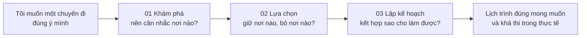
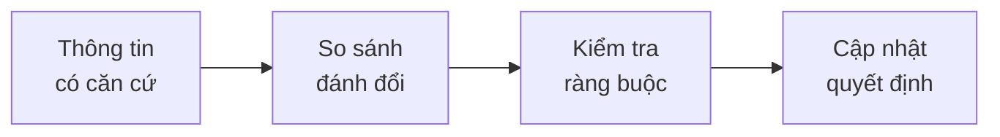
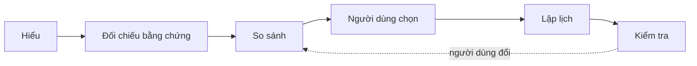
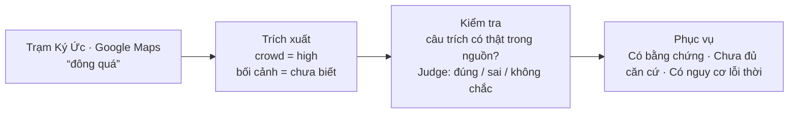
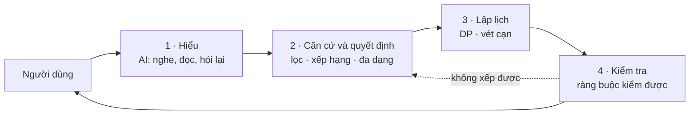

# Pitch desk TripGuardian — 13 slide, 11 phút 15 giây

Số liệu hệ thống: kiểm lại **17/10/2026**, nguồn mới nhất ở [bằng chứng pitch](submission/PITCH_EVIDENCE_20261017.md); bảng slide 8/9/11 cũ chỉ dùng để đối chiếu lịch sử. Số liệu người dùng: hai khảo sát Google Form, đã lọc bằng đúng bộ lọc trong notebook (§Phụ lục A).

Ký hiệu: ✅ có số đo hoặc bằng chứng · ⚠ phải chạy thử trước giờ pitch, chưa chạy được thì sửa slide, không giả lập.

---

## Bằng chứng theo 6 tiêu chí chấm điểm

Mỗi tiêu chí chỉ nói **một kết quả chính**, rồi chỉ vào demo hoặc số đo. Trọng số là điểm của tiêu chí, không phải điểm nhóm tự nhận.

| Tiêu chí | Điểm | Bằng chứng chính để trình bày | Slide |
|---|---:|---|---|
| Giải quyết vấn đề và tác động | 20 | **21/47 người (45%)** khó nhất ở cân đối lịch; **4,03/5** cho hỗ trợ cân nhắc địa điểm (36 người tạo được lịch) | 1–2, 5, 12 |
| Phù hợp Việt Nam | 15 | Agent thật hiểu **2 triệu / 2 người / 2 ngày → 500.000đ/người/ngày**; câu “đi cùng ba mẹ” được hỏi lại về sức đi bộ, không tự gán hạn chế | 6 |
| Sáng tạo và khác biệt | 20 | **0 vi phạm, 0 nơi thiếu bằng chứng lọt shortlist trên 30 ca nội bộ**; demo chọn quá nhiều → tối đa ba hướng đánh đổi, mỗi hướng chỉ rõ giữ/bỏ | 7, 10 |
| Đổi mới Dữ liệu & AI | 20 | **3.172 địa điểm** có cấu trúc bằng chứng; **240.574/769.936 nhãn (31,25%)** bị Judge đánh dấu sai; một câu review truy ngược được nguồn Maps | 8–9 |
| Khả thi và sản phẩm thử nghiệm | 15 | **2.950 test pass, 0 fail**; **10/10 lịch chốt được**; bắt **30/30 ca bơm lỗi**, báo nhầm **0/30** | 10–11 |
| Trình bày và trải nghiệm người dùng | 10 | **27/36 (75%)** nói lịch dùng nguyên hoặc chỉ chỉnh nhỏ; giao diện **3,78/5**, n = 32; demo một cốt truyện, 11:15 | 10, 12–13 |

**Câu chốt thực nghiệm:** “Chúng tôi kiểm cả chiều đúng lẫn chiều sai: 10/10 lịch tạo ra qua kiểm tra, và 30/30 lịch cố ý vi phạm bị phát hiện.” Đây là bộ kiểm nội bộ với dữ liệu/constraint đã mô hình hóa, không phải bảo đảm mọi lịch ngoài đời.

Chi tiết phép đo, nguồn và giới hạn để trả lời giám khảo: [bằng chứng pitch](submission/PITCH_EVIDENCE_20261017.md). Không đưa cả phụ lục lên slide.

---

## 0. Chọn hướng kể chuyện (trả lời câu hỏi cuối góp ý)

**Câu hỏi:** chọn một địa điểm làm lịch vi phạm điều kiện bắt buộc, hệ thống đã phát hiện, giải thích và đưa phương án thay thế chưa?

| Năng lực | Trạng thái | Bằng chứng | Giới hạn nói thẳng |
|---|---|---|---|
| Chọn quá nhiều so với thời gian → phát hiện **quá tải** | ✅ | `docs/PLANNING.md` §quá tải · browser E2E pass (`submission/OVERLOAD_THREE_PLANS_UPDATE_REPORT.md` §4) | Kiểm trên dữ liệu serving + fixture, chưa kiểm với người dùng thật |
| Giải thích bằng **tối đa 3 hướng** (Tiết kiệm · Trải nghiệm tốt nhất · Gọn tuyến): mỗi hướng giữ nơi nào, bỏ nơi nào | ✅ | cùng báo cáo; "Giữ tất cả" là lịch đối chiếu, có lỗi validator đi kèm | Chuyến 20 nơi / 3 ngày mất vài giây đến hơn 10 giây để dựng tối đa ba hướng |
| **Thay thế**: gợi ý nơi thật trong `backup_pool`, thử chèn rồi validate toàn lịch, ràng buộc cứng và ngân sách | ✅ | `docs/PLANNING.md` §Độ phù hợp giờ | Chỉ thêm khi người dùng bấm; không tự thêm |
| Nơi thiếu bằng chứng an toàn bị chặn, hỏi "vì sao không có nơi X?" | ✅ | `why_not` 0,1 ms · 0 nơi `unknown` lọt vào danh sách chính / 30 ca nội bộ | Chuyến "ăn nhóm" chỉ ra 7 nơi vì bằng chứng mỏng |
| Chốt lịch bị chặn khi validator còn lỗi | ✅ | 10/10 lịch qua validator; confirm từ chối timeline vi phạm | Đo khi chưa có OSRM và thời tiết: độ vững xếp "Mong manh" |

**Kết luận hướng:** đã làm được ở mức đủ để làm điểm nhấn, nhưng chưa ở mức "bảo đảm". Cốt truyện của cả deck:

> **Người dùng chọn trước, hệ thống chốt sau; khi lựa chọn không vừa với chuyến đi, hệ thống nói rõ vì sao và đưa phương án.**

Điểm nhấn là **lựa chọn có căn cứ và đánh đổi**. Phát hiện xung đột là cảnh quyết định của demo (slide 10), được nói đúng phạm vi: các ràng buộc đã mô hình hóa và có dữ liệu.

Lý do chọn như vậy:
- Khảo sát: câu **"Hỗ trợ cân nhắc lựa chọn địa điểm" cao nhất trong 20 câu (4,03/5)**. Người dùng đã cảm nhận đúng giá trị này.
- Nơi yếu nhất là "lịch áp dụng được thực tế" (3,47) và tốc độ. Nên không đặt cược toàn bộ vào chữ "khả thi".

**Một cốt truyện xuyên 13 slide.** Nhóm bạn đi **Đà Lạt 2 ngày, 2 người, tổng khoảng 2 triệu; thích cà phê, thiên nhiên, không muốn di chuyển nhiều.** Persona này xuất hiện ở slide 1, 2, 6, 10, 13 (phạm vi MVP, trang 10 hồ sơ).

---

## 1. Bố cục và thời gian

Tổng 12:00 → rút còn **11:15**, dư 45 giây cho trễ máy.

| # | Slide | Thời gian | Câu phải trả lời | Trọng tâm |
|---|---|---:|---|---|
| 1 | Bài toán | 0:25 | Người dùng cần ra những quyết định nào? | Ba quyết định, một persona |
| 2 | Vấn đề | 0:50 | Vì sao khó, hậu quả gì? | Ba khó khăn + số khảo sát |
| 3 | Giải pháp hiện nay | 0:35 | Người dùng đang giải quyết thế nào? | Công cụ mạnh từng khâu |
| 4 | Khoảng trống | 0:45 | Còn thiếu gì? | Quy trình nối các khâu |
| 5 | TripGuardian | 1:00 | Xử lý từng vấn đề ra sao? | Người dùng chọn trước khi chốt |
| 6 | Phù hợp Việt Nam | 0:40 | Hiểu người Việt ở đâu? | Một câu tiếng Việt, hiểu đúng |
| 7 | Sáng tạo | 0:55 | Khác gì LLM + RAG + kiểm tra? | Bốn cơ chế cụ thể |
| 8 | Đổi mới dữ liệu | 0:50 | Dữ liệu tin được đến đâu? | Chất lượng bằng chứng |
| 9 | AI và kiến trúc | 0:55 | AI làm gì, thuật toán làm gì? | Chia việc + giới hạn validator |
| 10 | Live demo | 2:30 | Có thật sự chạy không? | Căn cứ + xung đột |
| 11 | Khả thi và thực nghiệm | 0:55 | Đã kiểm gì, chưa bảo đảm gì? | Ba lớp thực nghiệm |
| 12 | Trải nghiệm người dùng | 0:35 | Người dùng phản hồi ra sao? | Khảo sát, nói rõ giới hạn |
| 13 | Kết luận | 0:20 | Điều đáng nhớ? | Một ảnh sản phẩm |

**Nếu bị lố giờ, cắt theo thứ tự:** câu thứ hai của slide 3 → ví dụ phụ ở slide 6 → hàng thứ ba của bảng slide 11. Không cắt demo.

---

## Slide 1 — Bài toán (0:25)

**Tiêu đề:** Từ "muốn một chuyến đi đúng ý" đến một lịch trình làm được.

**Trên slide** (chuỗi quyết định, không phải bốn đoạn chữ):

Góc slide, một dòng persona: *"Đà Lạt 2 ngày · 2 người · ~2 triệu · cà phê, thiên nhiên · không muốn di chuyển nhiều"*.

**Lời nói (~25 giây):**
> Hãy hình dung hai người bạn muốn đi Đà Lạt hai ngày, ngân sách khoảng hai triệu, thích cà phê và thiên nhiên, không muốn đi lại nhiều. Để có chuyến đi đó, họ phải khám phá, lựa chọn, rồi lập kế hoạch. Nghe đơn giản. Nhưng ở từng bước, họ gặp một khó khăn khác nhau.

---

## Slide 2 — Vấn đề (0:50)

**Tiêu đề:** Ba khó khăn, mỗi khó khăn làm khó khăn sau nặng hơn.

**Trên slide:** ba cột, mỗi cột một câu vấn đề, một hậu quả, một thanh tỷ lệ khảo sát.

| Vấn đề | Diễn đạt | Hậu quả | Khảo sát (n = 47) |
|---|---|---|---|
| 1 Thông tin | Tốn công đối chiếu và kiểm tra thông tin phân tán | Phải xem nhiều nguồn, nhiều review rồi tự kiểm lại | **28%** (13 người): "Kiểm tra độ chính xác" + "Tổng hợp từ nhiều nguồn" |
| 2 Quyết định | Khó so sánh và thấy đánh đổi giữa nhiều lựa chọn | 20 nơi hợp sở thích nhưng chỉ đi được 5; dễ chọn nơi nổi tiếng, bỏ nơi hợp chuyến đi | **23%** (11 người): "Tìm nơi phù hợp" + "Ưu tiên giữa nhiều nơi" |
| 3 Lịch trình | Khó ghép lựa chọn thành lịch đáp ứng ràng buộc | Xung đột giờ mở cửa, di chuyển, ngân sách, thời lượng | **45%** (21 người): "Cân đối thời gian và ngân sách", "Sắp xếp tuyến", "Ước lượng thời gian", "Điều chỉnh" |

Ghi chú nguồn trên slide: *Khảo sát TripGuardian 10/2026, câu B5 "Khó khăn lớn nhất"; nhóm gộp 9 đáp án thành 3 vấn đề; 2 người chọn "ít gặp khó khăn".*

**Hình bằng chứng:** 4 nơi cùng một hành trình Đà Lạt: (a) nơi đẹp nhưng thông tin giờ mở cần kiểm thêm; (b) nơi đẹp phải đánh đổi 40 phút di chuyển; (c) hai nơi đều hợp nhưng xếp cùng buổi sáng thì xung đột giờ. Không dùng ba icon.

**Lời nói (~50 giây):**
> Khó khăn thứ nhất là thông tin. Mỗi nơi có hàng chục review, và người dùng phải tự đối chiếu để biết cái nào đáng tin. Khó khăn thứ hai là quyết định. Tìm được hai chục nơi hợp sở thích không khó, nhưng chỉ đi được năm nơi, vậy giữ nơi nào, bỏ nơi nào, đánh đổi gì? Khó khăn thứ ba là ghép lại. Hai nơi đều hợp nhưng cùng mở buổi sáng, một nơi xa quá, và tổng chi phí vượt ngân sách. Trong khảo sát của chúng tôi, gần một nửa số người nói khó nhất là cân đối lịch với thời gian và ngân sách, và đây cũng là điều họ ưu tiên nhất ở một công cụ: gần bốn mươi phần trăm chọn "lịch trình hợp lý, dễ thực hiện".

**Số hỗ trợ:** B6, 18/47 (38%) chọn "Xây dựng lịch trình hợp lý, dễ thực hiện" là ưu tiên số một.

**Phản biện có thể gặp:** *"Người dùng vẫn tự lập lịch được, cần gì sản phẩm mới?"* → Họ tự làm được: 47% tham khảo lịch có sẵn rồi chỉnh. Chúng tôi không nói họ không làm được, mà nói họ tốn công và dễ bỏ sót xung đột. Giá trị tăng thêm cần đo bằng pilot đối chứng (slide 11, 12), hiện chưa có.

---

## Slide 3 — Người dùng đã có những công cụ mạnh (0:35)

**Tiêu đề:** Mỗi khâu đều có công cụ tốt.

**Trên slide** (theo hành trình người dùng):

| Khâu | Công cụ | Chúng làm tốt |
|---|---|---|
| Khám phá thông tin | TikTok · Google Maps · blog du lịch | Nguồn phong phú, trải nghiệm thật |
| Đề xuất và tư vấn | ChatGPT · Layla · Mindtrip | Hội thoại, cá nhân hóa, giải thích gợi ý, điều chỉnh phương án |
| Tổ chức kế hoạch | Wanderlog · Google Maps · bảng tính | Gom địa điểm, tối ưu tuyến, ngân sách |

Số khảo sát: 47% người dùng *tham khảo lịch có sẵn rồi chỉnh*; chỉ **15%** (7/47) dùng AI hoặc ứng dụng lập lịch.

✅ Đã mở lại trang chính thức ngày **17/10/2026**: [Wanderlog](https://wanderlog.com/) có lịch, tối ưu tuyến và ngân sách; [Layla](https://layla.ai/) lập lịch theo ngày/gu/ngân sách, kết hợp tư vấn viên và cho sửa trước đặt; [Mindtrip](https://mindtrip.ai/) ghi nhớ gu, cân nhắc đánh đổi, hỗ trợ lựa chọn/đặt dịch vụ. Đây là mô tả của nhà cung cấp, chưa phải kết quả đối chiếu thực nghiệm.

**Lời nói (~35 giây):**
> Người dùng không thiếu công cụ. Họ khám phá trên TikTok và Google Maps. Họ nhờ ChatGPT, Layla hay Mindtrip tư vấn, và các công cụ này đã biết giải thích gợi ý và điều chỉnh phương án. Họ tổ chức bằng Wanderlog, bản đồ hoặc bảng tính. Mỗi công cụ rất mạnh ở khâu của nó. Điều thú vị là trong khảo sát của chúng tôi, phần lớn người dùng vẫn chọn cách lấy một lịch trình có sẵn rồi tự chỉnh, và chỉ một phần nhỏ dùng AI hoặc ứng dụng lập lịch.

---

## Slide 4 — Khoảng trống cần chứng minh (0:45)

**Tiêu đề:** Không thiếu AI lập lịch. Thiếu một quy trình nối các khâu.

**Trên slide:**

Câu hỏi giữa slide, chữ lớn: **Làm sao nối bốn bước này trong một quy trình, cho bối cảnh du lịch Việt Nam?**

Dòng nhỏ dưới: *Đây là khoảng trống nhóm chọn giải quyết. Chúng tôi không khẳng định các công cụ trên hoàn toàn thiếu năng lực tương tự.*

**Bằng chứng hiện có của TripGuardian** (không đặt cột đối thủ khi chưa thử cùng bộ):

| Bước thử | Kết quả đã chạy 17/10/2026 |
|---|---|
| Hiểu ngân sách “2 triệu cả chuyến, 2 người, 2 ngày” | Đúng amount, scope, quy đổi 500.000đ/người/ngày; không gắn nhãn đoán |
| Truy căn cứ của nơi | Review Trạm Ký Ức → observation `crowd=high` → serving; có nguồn và ngày tương đối |
| Bắt lịch có vi phạm | 30/30 ca bơm lỗi thuộc 6 nhóm; 0/30 đối chứng bị báo lỗi nhầm |
| Đổi lựa chọn giữa chừng | Luồng preview/apply/undo đã có test; minh họa trong demo quá tải |

Bộ so sánh cùng yêu cầu với sản phẩm khác chưa chạy; không suy ra năng lực đối thủ từ bảng này.

**Lời nói (~45 giây):**
> Chúng tôi không nói các công cụ này thiếu tính năng. Layla và Mindtrip đã giải thích đề xuất và cho phép điều chỉnh; điều đó không phải đặc quyền của chúng tôi. Câu hỏi chúng tôi chọn theo đuổi hẹp hơn: làm sao nối bốn việc trong cùng một quy trình, cho du lịch Việt Nam. Từ thông tin có căn cứ, đến so sánh đánh đổi, đến kiểm tra ràng buộc, rồi cập nhật quyết định khi người dùng đổi ý. Đây là giả thuyết cần chứng minh, và cách chứng minh trung thực nhất là một bộ thử chung: cùng yêu cầu tiếng Việt, cùng ba điều kiện bắt buộc, cùng một lần thay đổi. Chúng tôi sẽ công bố kết quả theo cách đó.

**Phản biện có thể gặp:** *"Sao không có bảng so sánh với Mindtrip?"* → Vì chưa chạy bộ thử chung, nên chúng tôi không đặt dấu tích. Hồ sơ trang 13 đã ghi Mindtrip có nhiều điểm tương đồng.

---

## Slide 5 — TripGuardian (1:00)

**Tiêu đề:** Bạn chọn trước, hệ thống chốt sau.

**Trên slide:** màn hình thật ở giữa (màn **Lựa chọn**: thẻ địa điểm có nguồn và nhãn bằng chứng, nút chọn/bỏ, hộp "vì sao không"). Ba dòng bên cạnh:

| Vấn đề | TripGuardian | Giá trị |
|---|---|---|
| Thông tin phân tán | Gom thuộc tính địa điểm, kèm trích dẫn, nguồn, mức chắc chắn | Bớt công đối chiếu thủ công |
| Nhiều lựa chọn | Shortlist có ưu/nhược và đánh đổi; nơi giống nhau gom thành nhóm, có nơi thay thế | Biết vì sao nên ưu tiên một nơi |
| Khó lập lịch | Xếp lịch, kiểm tra ràng buộc, đánh giá lại khi người dùng đổi lựa chọn | Bớt nguy cơ lịch không làm được |

**Bốn bước người dùng đi qua** (tên màn trong sản phẩm): **Tìm hiểu → Lựa chọn → Lịch trình → Đánh giá**. Lựa chọn nằm **trước** lập lịch.

**Lời nói (~60 giây):**
> Với thông tin phân tán, chúng tôi gom thuộc tính của từng địa điểm và luôn gắn nguồn: câu review nào, ảnh nào, video nào. Chỗ nào chưa đủ căn cứ, chúng tôi nói là chưa chắc. Với nhiều lựa chọn, chúng tôi không đưa một lịch có sẵn. Chúng tôi đưa một danh sách có ưu điểm, hạn chế và đánh đổi; bốn quán cà phê view đồi gần giống nhau được gom thành một nhóm, người dùng chọn đại diện. Quan trọng nhất là bước này nằm trước khi lập lịch: bạn quyết định giữ gì, bỏ gì, hệ thống không chốt thay bạn. Với lập lịch, sau khi bạn chọn, hệ thống xếp ngày, kiểm tra giờ mở cửa, di chuyển, ngân sách, và đánh giá lại mỗi khi bạn thay đổi. Khảo sát cho thấy khâu được đánh giá cao nhất chính là hỗ trợ cân nhắc lựa chọn địa điểm.

**Số hỗ trợ:** C1 "Hỗ trợ cân nhắc lựa chọn địa điểm" = **4,03/5; 75% chấm 4–5** (n = 36).

---

## Slide 6 — Phù hợp Việt Nam (0:40)

**Tiêu đề:** Hiểu cách người Việt nói về chuyến đi, không chỉ dịch giao diện.

**Trên slide:** ba tầng, mỗi tầng một ví dụ **trước và sau**.

| Tầng | Người dùng gõ | Hệ thống hiểu |
|---|---|---|
| Nhu cầu tiếng Việt | "2 ngày, 2 người, tổng ngân sách 2 triệu cả chuyến" ✅ | Giữ tổng 2 triệu, scope cả chuyến, quy đổi **500.000đ/người/ngày**, không đoán |
| Nhu cầu có sắc thái | "Mình đi Đà Lạt cùng ba mẹ." ✅ | **“Ba mẹ có cần hạn chế đi bộ xa hay leo dốc, cầu thang không?”**; `hard=[]`, `safety_pending=true` |
| Điều kiện chuyến đi | "Đi xe máy, đi nhẹ nhàng thôi" | Phương tiện và nhịp độ thành điều kiện xếp lịch |
| Dữ liệu địa phương | Review tiếng Việt, video TikTok có giọng Việt | ASR tiếng Việt (ChunkFormer + PhoWhisper) + Gemma tự host, nơi thiếu bằng chứng thì ghi "chưa biết" |

✅ Hai câu trên đã gọi Agent thật, lần lượt **7,85 giây** (ngân sách) và **4,24 giây** (ba mẹ); mỗi câu một lần chạy, không gọi là accuracy hay p50. [Transcript](submission/evidence/pitch_20261017/trip_live.json). Chưa chụp màn hình UI cho hai lượt này.

**Lời nói (~40 giây):**
> Khi người dùng nói hai ngày, hai người, hai triệu cả chuyến, hệ thống giữ đúng tổng ngân sách và quy đổi thành năm trăm nghìn một người một ngày. Còn khi người dùng nói "đi cùng ba mẹ", chúng tôi không tự cho rằng ba mẹ không đi bộ xa được. Hệ thống hỏi lại, và giá trị nào do hệ thống đoán đều được đánh dấu để người dùng sửa. Về dữ liệu, chúng tôi dùng review tiếng Việt và nhận dạng giọng nói tiếng Việt cho video TikTok, thay vì dựa vào dữ liệu quốc tế.

**Phản biện có thể gặp:** *"Có ví dụ tiếng Việt nào còn khó không?"* → Có. “Không muốn di chuyển nhiều” còn mơ hồ: lần chạy thật hỏi lại muốn ít điểm hay các điểm gần nhau, chưa tự gán một trần phút. Lỗi “nhóm mình 6 đứa” đã có sửa trong `prepass`; không dùng báo cáo cũ để nói lỗi này còn tồn tại.

---

## Slide 7 — Sáng tạo và khác biệt (0:55)

**Tiêu đề:** Một vòng quyết định, bốn cơ chế kiểm được.

**Trên slide:**

Dưới vòng, bốn cơ chế (mỗi cơ chế một dòng, có chỗ để chỉ vào demo):

| # | Cơ chế | Khác với "LLM + RAG + kiểm tra" ở chỗ |
|---|---|---|
| 1 | **Bằng chứng thành thuộc tính so sánh được** | Review "sáng cuối tuần rất đông" lưu thành `độ đông × cuối tuần × sáng` kèm câu trích, không lưu "đông" chung chung |
| 2 | **Bắt buộc ≠ ưu tiên** | Ràng buộc cứng fail-closed (`unknown` ≠ `false`; thiếu bằng chứng an toàn thì chặn); sở thích thì đánh đổi được; ràng buộc vật lý không có đường code nào nới |
| 3 | **Xem lý do giữ hoặc loại** | Mỗi nơi có điểm theo từng thành phần; hỏi "vì sao không có nơi X?" trả lời trong 0,1 ms |
| 4 | **Đổi lựa chọn → kiểm lại phần liên quan** | Quá tải thì đưa tối đa ba hướng; sửa nhiều chỗ phải xem trước bằng token; hoàn tác được |

**Chỉ nói ở demo (slide 10):** cơ chế 2, 3, 4. Cơ chế 1 chỉ vào một thẻ có trích dẫn.

**Lời nói (~55 giây):**
> Sáu bước này tự chúng không phải thuật toán mới. Cái chúng tôi làm là nối chúng thành một vòng mà người dùng ở giữa. Nếu ai hỏi "đây có phải LLM cộng RAG cộng bộ kiểm tra?", câu trả lời là bốn cơ chế cụ thể. Một: bằng chứng được chuyển thành thuộc tính so sánh được, "đông vào sáng cuối tuần" chứ không phải "đông". Hai: điều kiện bắt buộc và sở thích được xử lý khác nhau; thiếu bằng chứng an toàn thì chặn, không đoán. Ba: người dùng xem được vì sao một nơi được chọn hay bị loại. Bốn: khi họ đổi lựa chọn, phần liên quan được kiểm lại. Chúng tôi sẽ chỉ ra ba trong bốn điều này ngay trong demo.

**Phản biện có thể gặp:** *"Mindtrip cũng giải thích gợi ý."* → Đúng, giải thích không phải đặc quyền. Chỗ khác là giải thích của chúng tôi truy được về trích dẫn và có trạng thái chưa chắc chắn, và thiếu bằng chứng thì chặn thay vì viết tiếp. Còn việc có ưu thế thật so với Mindtrip hay không, cần bộ thử ở slide 4.

---

## Slide 8 — Đổi mới trong dữ liệu (0:50)

**Tiêu đề:** Không lưu kết luận. Lưu bằng chứng, rồi nói rõ độ chắc chắn.

**Trên slide:** ví dụ end-to-end bên trái, ba con số bên phải.

✅ Ví dụ thật: **Trạm Ký Ức**, câu trích **“đông quá”**, Google Maps hiển thị **“một tháng trước”** trong dữ liệu có mốc `as_of=12/10/2026`; `observed_at=12/09/2026` là ngày quy đổi, không phải timestamp đăng chính xác. Đã kiểm câu trích có nguyên văn trong review, observation có trong danh sách evidence của serving. Bối cảnh review này không rõ giờ/ngày, nên giữ `unknown`. [Nguồn và ID đối chiếu](submission/evidence/pitch_20261017/review_example.json).

**Cách diễn đạt trên slide** (code vẫn là VERIFIED / UNCERTAIN / OUTDATED; giao diện hiện còn chữ “chưa xác nhận”, chưa được đổi đồng bộ):

| Trong code | Hiển thị | Quy tắc |
|---|---|---|
| VERIFIED | **Có bằng chứng hỗ trợ** | Qua gate code và Judge "đúng", còn trong cửa sổ freshness |
| UNCERTAIN | **Chưa đủ căn cứ** | Bằng chứng ít, mâu thuẫn, hoặc Judge "không chắc" |
| OUTDATED | **Có nguy cơ lỗi thời** | Quá cửa sổ freshness (giờ 90 ngày · giá 180 ngày · độ đông 12 tháng) |

**Ba con số (nói đúng điều chúng chứng minh):**

| Số | Chứng minh | Không chứng minh |
|---|---|---|
| 713.216 review · 1,36 triệu observation | Quy mô thu thập | Độ chính xác |
| 769.936 nhãn Judge: **240.574 (31%) bị loại vì sai** | Có kiểm lọc thật, không nhận tất cả | Nhãn do model gán, cần đối chiếu độc lập (xem dưới) |
| 3.172 địa điểm · 52.313 thuộc tính, **70,9% có bằng chứng hỗ trợ**; 108 nơi bị loại (đóng cửa, ngoài thành phố) | Độ phủ Đà Lạt có kiểm | Độ phủ đều mọi thuộc tính |

**Kiểm tra độc lập:** sai số của chính Judge Gemma đo ngày 06/10 trên **1.334 nhận định có nhãn đối chiếu mạnh: để lọt 11–16% nhận định sai**. Nên nhận định "không chắc" cũng bị bỏ, và thuộc tính rủi ro (mức sức, mức phù hợp, an toàn) được Judge đọc toàn bộ, không lấy mẫu.

**Lời nói (~50 giây):**
> Chúng tôi không lưu "nơi này đẹp". Ở Trạm Ký Ức, review nói “đông quá”. Hệ thống lưu độ đông cao cùng câu trích; review không nói rõ giờ hay ngày thì bối cảnh vẫn là chưa biết. Code kiểm câu trích có thật trong nguồn, rồi Judge chấm đúng hay sai. Trong gần 770 nghìn nhận định, 31 phần trăm bị loại. Nhận định đủ căn cứ mới được dùng; chưa đủ thì ghi là chưa đủ căn cứ, quá hạn thì ghi có nguy cơ lỗi thời. Con số 713 nghìn review chỉ nói về quy mô. Độ tin cậy nằm ở chỗ này: Judge của chúng tôi vẫn để lọt khoảng mười một đến mười sáu phần trăm nhận định sai trên tập đối chiếu 1.334 nhận định, nên chúng tôi nói con số đó ra, và hệ thống thà nói "chưa biết" còn hơn đoán.

**Phản biện có thể gặp:**

| Câu hỏi | Trả lời |
|---|---|
| Judge là model, tin sao được? | Judge chỉ gắn nhãn, không sửa giá trị; nhãn của người thắng nhãn Judge; sai số 11–16% đã đo và công bố |
| 770 nghìn nhãn có phải 770 nghìn nhãn đúng? | Không. 482.144 đúng, 240.574 sai, 47.218 không chắc. Chỉ nhóm "đúng" được tổng hợp |
| Ảnh có đáng tin? | Phần lớn là không: trong 55.961 nhận định từ ảnh, chỉ 5.754 được Judge chấm đúng, phần còn lại không làm bằng chứng |
| Quyền thu thập và lưu trữ? | Bản demo học tập, phi thương mại. Khi thương mại hóa chuyển sang Google Places API (tuân điều khoản lưu trữ và ghi công) và nguồn TikTok có license. Clip luôn ghi @creator và link bài gốc |
| Vì sao không dùng rating Google? | Rating chỉ dùng chọn ứng viên khi quét; một con số không cho biết nơi đó có dốc hay hợp trẻ em không |

---

## Slide 9 — AI và kiến trúc (0:55)

**Tiêu đề:** AI hiểu. Thuật toán quyết định. Dữ liệu thiếu thì nói thiếu. Người dùng giữ quyền.

**Trên slide:** bốn tầng.

| AI làm | Thuật toán làm (tất định, có test) |
|---|---|
| Hiểu câu gõ tự do, hỏi điều còn thiếu | Lọc ràng buộc `pass / fail / unknown`, fail-closed với yêu cầu an toàn |
| Đọc review, ảnh, nghe giọng tiếng Việt trong video | Xếp hạng có giải thích từng thành phần, MMR chống trùng |
| Chấm nhận định đúng / sai | Chia ngày bằng quy hoạch động; thứ tự trong ngày vét cạn ≤ 7 nơi |
| Embedding tìm theo "vibe" và ảnh | Validator đọc lại cả lịch: 8 kiểm tra + thời tiết nguy hiểm |

**Phát biểu validator được giới hạn đúng phạm vi:**
> Validator kiểm các ràng buộc **đã mô hình hóa và có dữ liệu**: giờ mở cửa trong dữ liệu, khung bữa ăn, thời lượng tham quan, ngân sách, ràng buộc cứng, thời tiết nguy hiểm khi có dự báo. Bản chạy hiện chưa có OSRM và dự báo thời tiết đầy đủ nên thời gian di chuyển là ước lượng và độ vững xếp "Mong manh". Dữ liệu giờ mở cửa không phải dữ liệu thời gian thực.

**Ví dụ phát hiện xung đột** (nối sang demo): người dùng chọn nhiều nơi hơn hai ngày chứa được → hệ thống không bỏ nơi nào lặng lẽ, báo **quá tải** và đưa tối đa ba hướng, nói rõ mỗi hướng bỏ nơi nào.

**Lời nói (~55 giây):**
> Nguyên tắc: AI xử lý thông tin không có cấu trúc, như giọng nói tiếng Việt, review và ảnh. Thuật toán xử lý điều kiện xác định, như lọc ràng buộc, xếp hạng, chia ngày. Model không tự ghi Place Intelligence hay bịa địa điểm. Một validator độc lập đọc lại cả lịch trước khi chốt. Chúng tôi nói rõ giới hạn của nó: nó chỉ kiểm được điều đã mô hình hóa và có dữ liệu. Bản đo hiện tại chưa có OSRM và dự báo thời tiết đầy đủ, nên thời gian di chuyển còn là ước lượng. Khi người dùng chọn nhiều hơn chuyến đi chứa được, hệ thống không lặng lẽ bỏ nơi nào. Nó báo quá tải và đưa tối đa ba hướng đánh đổi để người dùng chọn. Phần AI nặng chạy offline một lần, nên khi dùng, một lần chọn hoặc bỏ nơi chỉ mất vài chục mili-giây và không gọi mô hình.

**Phản biện có thể gặp:**

| Câu hỏi | Trả lời |
|---|---|
| Sao không để một LLM làm hết? | LLM viết ra lịch trông hợp lý nhưng không kiểm được từng phút giờ mở, bữa ăn, ràng buộc; ở đây validator kiểm lại cả lịch cuối |
| DP và vét cạn có tối ưu toàn cục không? | Không cho cả chuyến. DP tối ưu cách chia cụm vào ngày, vét cạn tối ưu thứ tự trong ngày. Quá giới hạn (> 7 ngày, > 8 cụm, > 7 nơi/ngày) chuyển heuristic và gắn cờ |
| Agent hiểu sai thì sao? | Fact phải trích đúng lời người dùng; mọi giá trị đoán được đánh dấu ✎ để sửa; Agent lỗi thì phần từ khóa đã ghi vẫn giữ |

---

## Slide 10 — Live demo (2:30)

**Điều demo phải chứng minh:** không phải "lịch ra nhanh và đẹp" (Layla hay ChatGPT cũng làm được), mà hai khoảnh khắc: **(1) hệ thống đưa căn cứ để chọn, (2) hệ thống phát hiện điều không vừa và nói vì sao.**

**Kịch bản:** *"Tụi mình đi Đà Lạt hai ngày, hai người, tổng ngân sách khoảng hai triệu. Thích cà phê, thiên nhiên, nhưng không muốn di chuyển quá nhiều."*

| Giờ | Bước | Màn hình | Lời dẫn một câu | Phải thấy |
|---|---|---|---|---|
| 0:00–0:25 | **1 Hiểu yêu cầu** | Tìm hiểu | "Hệ thống tách ngân sách, ngày, sở thích, phương tiện, và hỏi điều quan trọng còn thiếu." | Bản hiểu nhu cầu; giá trị đoán có dấu ✎; **một câu hỏi lại** |
| 0:25–0:55 | **2 Đề xuất có căn cứ** | Lựa chọn | "Mỗi nơi có ưu điểm, hạn chế và câu trích từ người đã đến." | Thẻ có trích dẫn + nhãn *Chưa đủ căn cứ* ở một nơi |
| 0:55–1:20 | **3 Người dùng chọn** | Lựa chọn | "Tôi giữ nơi này, bỏ nơi kia; hỏi vì sao nơi X không có." | Hộp "vì sao không" trả lời tức thì |
| 1:20–2:10 | **4 Lập và kiểm tra lịch** | Chọn chỗ ở → Lịch trình | "Tôi cố tình chọn nhiều hơn hai ngày chứa được." | **Cảnh báo quá tải → tối đa ba hướng**, mỗi hướng ghi nơi giữ / bỏ; chọn một hướng; chốt bị khóa nếu validator còn lỗi |
| 2:10–2:30 | **5 Kết quả** | Lịch trình | "Đây là lịch cuối, điều kiện đã đáp ứng, và điều chưa xác minh được." | Lịch theo ngày; danh sách *chưa biết* (ví dụ nơi chưa có giá) |

**Chuẩn bị bắt buộc (đây là việc đáng làm nhất trước giờ pitch):**
- ⚠ Chạy trọn kịch bản này ít nhất **5 lần** trên bản sẽ trình diễn. Bước nào chưa chạy được thì **sửa kịch bản và slide**, không mô phỏng.
- ✅ Đã chốt **10 nơi: 5 cà phê + 5 thiên nhiên**, chạy API 5/5 lần đều quá tải và chốt được; danh sách/input ở [bằng chứng §6](submission/PITCH_EVIDENCE_20261017.md). Ca này cho 2 phương án khác nhau, không phải luôn 3.
- ⚠ Dựng lịch mất 0,56–12,12 giây để dựng phương án qua API: **chạy sẵn một phiên**, trong 150 giây chỉ làm các bước đã cache hoặc tận dụng thời gian chờ để nói lý do. Không để màn hình trống.
- ⚠ **Video dự phòng** quay lại đúng kịch bản, gắn nhãn góc màn "Ghi hình lại từ phiên chạy thật". Nếu môi trường lỗi, chuyển sang video và nói rõ, không giả vờ.
- Hai phiên đăng nhập sẵn, mạng 4G dự phòng, tắt thông báo.

**Câu chốt demo (~10 giây, nói lúc 2:20):**
> Đây không phải lịch đẹp hơn. Đây là lúc hệ thống nói được: nơi này chưa đủ căn cứ, và chuyến này chọn quá nhiều so với hai ngày, nên bạn phải chọn đánh đổi nào.

---

## Slide 11 — Tính khả thi và thực nghiệm (0:55)

**Tiêu đề:** Đã kiểm được những gì, kết quả đến đâu, còn gì chưa bảo đảm.

**Trên slide:** ba lớp.

| Lớp | Đo gì | Kết quả (17/10/2026) | Giới hạn trên slide |
|---|---|---|---|
| **1 Chức năng** | Bộ test tự động, có Postgres | **2.950 pass · 0 fail · 3 skip**, 7 deselected; **7 phút 26 giây** | Không chạy crawler và test live. Kết quả mới thay mốc 2.865 pass / 22 fail; không cộng lượt focused |
| **2 Khả thi lịch** | 30 ca Decision · 10 ca Planning · 30 lỗi tổng hợp + 30 đối chứng | **0 vi phạm shortlist · 10/10 lịch chốt được · bắt 30/30 lỗi, báo nhầm 0/30** | Kiểm nội bộ, chưa OSRM/thời tiết đầy đủ; 10/10 lịch “Mong manh”. Không phải bảo đảm khả thi ngoài đời |
| **3 Hiệu năng** | Thời gian API của kịch bản demo cố định, lặp 5 lần | **5/5 báo quá tải và chốt được**; cả luồng chọn → lập → chốt **4,25–4,56 giây** | Input có cấu trúc, chưa gồm chat/browser; bộ 10 ca rộng hơn mất 0,56–12,12 giây để dựng phương án |

**Hiểu nhu cầu:** kiểm lại log `fast1` ngày 17/10: **34/35 mục được ứng dụng đánh dấu hoàn tất, 4/5 persona đủ 7/7**, tối đa 16 lượt. Đây là trạng thái `done`, không phải 34 fact đều được chấm đúng độc lập. Hai câu tiếng Việt vừa đo có transcript riêng; không suy rộng thành tỷ lệ chính xác.

**Dòng chốt trên slide:** *Chưa có nghiên cứu người dùng có đối chứng; không đo được mức giảm công sức lập kế hoạch so với tự làm.*

**Lời nói (~55 giây):**
> Chúng tôi kiểm ba lớp. Về chức năng, 2.950 bài kiểm thử vừa chạy đều pass, không có bài fail, có kiểm Postgres; ba bài được bỏ qua và test live/crawler nằm ngoài phạm vi. Về tính khả thi, 30 ca chọn nơi không có vi phạm ràng buộc, và cả 10 lịch nội bộ đều chốt qua validator. Chúng tôi còn kiểm chiều ngược: cố tình tạo 30 lỗi thuộc sáu nhóm như chồng giờ, đóng cửa, vượt tiền và thiếu bằng chứng an toàn; hệ thống bắt đủ 30, không báo nhầm trên 30 đối chứng. Về demo, cùng tập mười nơi thật đã chạy năm lần qua API: cả năm đều báo quá tải và chốt được phương án sau đánh đổi, trong khoảng bốn đến năm giây. Những kết quả này giới hạn ở dữ liệu đã mô hình hóa; chưa phải bảo đảm một chuyến đi ngoài đời.

**Câu hỏi phản biện có thể gặp:**

| Câu hỏi | Trả lời |
|---|---|
| 30 ca gồm gì, ai thiết kế, có ca bất khả thi? | 10 kịch bản + 20 tổ hợp (5 bộ lọc × 4 sở thích), được đưa vào repo bởi `hoangluan0312` ngày 02/10 (`5440476`). Git chưa chứng minh ai trực tiếp thiết kế hoặc tính độc lập; gọi là bộ nội bộ. **0 ca gắn nhãn bất khả thi**; Decision không đặt ngân sách số. Không dùng tên `no_trap_budget` để nói đã kiểm vượt ngân sách |
| 10/10 qua validator có nghĩa gì? | 10 lịch nội bộ chốt qua bộ quy tắc hiện có. Bổ sung **30/30 ca bơm lỗi được phát hiện, 0/30 đối chứng bị báo nhầm**: chồng giờ, đóng cửa, vượt ngân sách, thiếu thời gian di chuyển, thiếu bằng chứng và vi phạm ràng buộc không dốc. Đây là dữ liệu tổng hợp, 5 biến thể mỗi nhóm, chưa đo độ nhạy ngoài đời |
| 24 ms đại diện cho gì? | Số đo lịch sử của một thao tác trên snapshot, không phải từ nhập nhu cầu đến có lịch. Lần mới: dựng phương án API 0,56–12,12 giây; gồm thử các chỗ ở trong evaluator 2,47–16,43 giây. Cả hai đều không phải độ trễ browser end-to-end |
| Người dùng mô phỏng thay được người thật? | Không. Bước tiếp theo là pilot đo thời gian lập kế hoạch, số lần sửa, số vi phạm, so với tự tìm trên TikTok/Google |

---

## Slide 12 — Trải nghiệm người dùng (0:35)

**Tiêu đề:** Phản hồi ban đầu: hữu ích nhất ở khâu cân nhắc lựa chọn; chưa có đối chứng.

**Trên slide:** ba thanh số và một dòng giới hạn.

| Nhóm | Kết quả | Nguồn |
|---|---|---|
| **Hữu ích nhất** | "Hỗ trợ cân nhắc lựa chọn địa điểm" **4,03/5** (75% chấm 4–5) | C1, n = 36 |
| **Dùng gần nguyên** | **27/36 (75%)** không cần chỉnh hoặc chỉ chỉnh nhỏ; 6 (17%) chỉnh đáng kể; 3 (8%) làm lại phần lớn | D1 |
| **Sẵn sàng giới thiệu** | **3,83/5** (61% chấm 4–5); ở nhóm không quen thành viên nhóm (n = 27): **3,96** | C7 |
| **Còn yếu** | "Lịch áp dụng được thực tế" **3,47** · "Thông tin chưa chắc được chỉ rõ" 3,56 (50% chấm 4–5) · Hài lòng chung 3,42 | C5, C4, C6 |
| **Cần cải thiện nhất** | Chỉnh sửa lịch trực tiếp 8 · tốc độ phản hồi 5 · độ tin cậy thông tin 4 | D3 (n = 36) |

**Giao diện** (khảo sát riêng, n = 32 người đã xem hoặc sửa Lịch trình): hài lòng giao diện **3,78/5** (62% chấm 4–5). Yếu nhất: bố cục, kiểu chữ, màn Lựa chọn (3,4–3,5). Ưu tiên cải thiện: màn Lựa chọn (7) và Tìm hiểu (5).

**Dòng giới hạn (chữ rõ trên slide):** *Mẫu nhỏ: 36 người tạo được lịch, 31 người 18–24 tuổi, tự tham gia; điểm trung bình toàn bộ 3,66/5. Đây là cảm nhận, không phải đối chứng với cách lập kế hoạch hiện tại.*

**Nhận xét người dùng (chọn 2, có nguồn Form):**
- "Chatbot hiểu ý tốt, mong phản hồi nhanh hơn xíu nữa là hoàn hảo."
- "Mong cho chỉnh sửa trực tiếp lịch trình sau khi tạo."

**Lời nói (~35 giây):**
> Chúng tôi chưa có thử nghiệm đối chứng, nhưng đã khảo sát 36 người tạo được lịch trình. Khâu được đánh giá cao nhất, 4 trên 5, là hỗ trợ cân nhắc lựa chọn địa điểm, đúng thứ chúng tôi muốn làm tốt nhất. Ba phần tư cho biết lịch gần như dùng được ngay, chỉ chỉnh nhỏ hoặc không cần chỉnh. Nhưng điểm thấp nhất là liệu lịch có áp dụng được ngoài đời, 3,5 trên 5, và yêu cầu phổ biến nhất là cho sửa lịch trực tiếp và phản hồi nhanh hơn. Mẫu còn nhỏ và phần lớn là người trẻ, nên đây là tín hiệu ban đầu, chưa phải kết luận.

**Phản biện có thể gặp:**

| Câu hỏi | Trả lời |
|---|---|
| Khảo sát có thiên vị? | Có. Tự chọn tham gia, 86% từ 18–24 tuổi, 27/36 không quen nhóm. Chúng tôi đã loại 5/52 phản hồi bị gắn cờ (cùng một mức Likert cho mọi câu, gửi sát nhau) |
| 3,4–3,8 là cao hay thấp? | Mức "khá": nửa số người chấm 4–5 ở hầu hết câu. Chúng tôi dùng nó để chọn việc cần sửa, không dùng như bằng chứng đã thắng |
| Bao nhiêu người hoàn thành được? | 36 trên 46 người ngoài nhóm phát triển (78%) tạo được lịch trình; trong 52 phản hồi thô có 2 người báo gặp lỗi không hoàn thành |

---

## Slide 13 — Kết luận (0:20)

**Trên slide:** một ảnh màn hình **Lịch trình** thật của persona Đà Lạt, dưới là định vị một dòng. Không roadmap, không số mới.

> **TripGuardian: hiểu lựa chọn, thấy đánh đổi, xây một chuyến đi làm được.**

**Lời nói (~20 giây):**
> Công nghệ du lịch không chỉ nên tìm thêm địa điểm hay tạo lịch nhanh hơn. Nó phải giúp người dùng hiểu các lựa chọn, thấy rõ đánh đổi, và xây một chuyến đi làm được. Đó là hướng TripGuardian đang đi. Xin cảm ơn.

---

## 2. Câu hỏi khó thường gặp (thêm, ngoài từng slide)

| Câu hỏi | Trả lời ngắn |
|---|---|
| Khác gì ChatGPT? | ChatGPT viết ra lịch trông hợp lý. Chúng tôi truy từng nhận định về một trích dẫn có thật, chặn khi thiếu bằng chứng an toàn, và kiểm lại cả lịch. Chưa có bộ thử đối chiếu trực tiếp, chúng tôi không tuyên bố thắng |
| Mở rộng ra thành phố khác? | Thêm một mục trong `config/cities.yaml`, chạy lại pipeline; pipeline chỉ chạy lại phần có đầu vào đổi. Chưa thử ngoài Đà Lạt |
| Mô hình kinh doanh? | Ngoài phạm vi hồ sơ kỹ thuật; nói không tuyên bố số liệu doanh thu |
| Báo cáo cũ có 22 test fail? | Đó là mốc cũ, không phải trạng thái mới nhất. Lượt mới có 2.950 pass, 0 fail, 3 skip, 7 deselected; có Postgres, không chạy crawler/live. Không gọi tất cả test đổi là lỗi runtime đã sửa |
| Dựng lịch mất bao lâu? | Bộ 10 ca mới: 0,56–12,12 giây dựng phương án; kịch bản demo cố định lặp 5 lần mất 4,25–4,56 giây cả luồng API. Có cải thiện so với số lịch sử nhưng chưa là benchmark A/B, chưa phải độ trễ browser |

---

## 3. Việc phải xong trước giờ pitch

| # | Việc | Trạng thái |
|---|---|---|
| 1 | Cốt truyện: Đà Lạt 2 ngày, 2 người, ~2 triệu, cà phê + thiên nhiên, ít di chuyển | ✅ Giữ xuyên deck; câu đầu đã chạy Agent thật |
| 2 | Chạy demo ≥ 5 lần, chốt tập nơi gây quá tải | ✅ API 5/5 với 10 nơi cố định; ⚠ chưa đủ 5 lần browser trọn luồng |
| 3 | Quay video dự phòng gắn nhãn | ⚠ chưa |
| 4 | Một review thật để dựng ví dụ slide 8 (nguồn, ngày, quan sát) | ✅ Trạm Ký Ức; lưu nguồn, ID, ngày tương đối và observation |
| 5 | Chạy "đi cùng ba mẹ" và chụp câu hỏi lại (slide 6) | ✅ Agent thật đã hỏi lại; ⚠ chưa chụp UI |
| 6 | Bộ thử đối chiếu (slide 4) | ✅ Bỏ cột đối thủ; chỉ điền phép thử TripGuardian đã chạy |
| 7 | Bơm lỗi cho validator (slide 11) | ✅ 30/30 phát hiện; 0/30 đối chứng bị báo nhầm; 6 nhóm lỗi |
| 8 | Đổi nhãn trạng thái trên giao diện: *Có bằng chứng hỗ trợ / Chưa đủ căn cứ / Có nguy cơ lỗi thời* | ⚠ nếu kịp |
| 9 | Luyện 3 lần bấm giờ; đích **11:15**, xác nhận giới hạn chính thức | ⚠ chưa |
| 10 | Mở lại trang Wanderlog, Layla, Mindtrip kiểm mô tả slide 3 | ✅ Đã mở trang chính thức 17/10, cập nhật mô tả và link |

---

## Phụ lục A — Cách lọc và tính số khảo sát

**Khảo sát trải nghiệm (52 phản hồi).** Lọc đúng như `tripguardian_visualization.ipynb`: bỏ bản sao hoàn toàn, bỏ phản hồi chọn cùng một mức Likert cho mọi câu C1–C7, bỏ phản hồi gửi cách nhau ≤ 60 giây → còn **47**. Bỏ thêm 1 người là thành viên nhóm → **46**. Trong đó **36** đã tạo được ít nhất một lịch trình (đối tượng chấm Likert ở slide 12); **27** trong 36 không quen thành viên nhóm.

| Số trên slide | Mẫu | Cách tính |
|---|---|---|
| Ba vấn đề (28% · 23% · 45%) | n = 47 (sau lọc) | Gộp B5: Thông tin = "Kiểm tra độ chính xác" 7 + "Tổng hợp từ nhiều nguồn" 6; Quyết định = "Tìm địa điểm phù hợp" 7 + "Ưu tiên giữa nhiều địa điểm" 4; Lịch trình = "Cân đối thời gian và ngân sách" 8 + "Sắp xếp tuyến" 6 + "Ước lượng thời gian" 5 + "Điều chỉnh" 2; "Ít gặp khó khăn" 2. Cách gộp do nhóm quyết định |
| 38% ưu tiên lịch hợp lý | n = 47 | B6: 18 |
| 47% tham khảo lịch có sẵn · 15% dùng AI/app | n = 47 | B3: 22 · 7 |
| 4,03 · 3,47 · 3,83 · 3,56 · 3,42 | n = 36 | Trung bình Likert 1–5 của đúng câu đó; "chấm 4–5" = tỷ lệ chọn 4 hoặc 5 |
| 75% dùng gần nguyên | n = 36 | D1: 22 chỉnh nhỏ + 5 không chỉnh = 27 |
| Điểm trung bình toàn bộ 3,66 | n = 36 | 20 câu C1–C7 |

**Khảo sát giao diện (49 phản hồi).** Lọc cùng quy tắc (bản sao, cùng một mức Likert) → **44**; **32** người đã xem hoặc sửa màn Lịch trình. Thiết bị: 44 máy tính, 5 máy tính bảng.

**Giới hạn:** hai khảo sát tự chọn tham gia, mẫu nhỏ, chủ yếu 18–24 tuổi, không có nhóm đối chứng, không đo hành vi, chỉ đo cảm nhận.

## Phụ lục B — Đã dùng và không dùng

- **Dùng:** số chạy lại trong `submission/PITCH_EVIDENCE_20261017.md`; số quy mô corpus và khảo sát giữ nguồn/ngày kiểm đếm riêng, không gọi là vừa đếm lại tất cả.
- **Không dùng:** bench offline 40 chuyến ẩn (cấu hình không còn trong repo, không chạy lại được); "Verified" làm nhãn người dùng thấy; khẳng định "đối thủ không có"; số hài lòng hay giảm thời gian không có phép đo.
- **Không nói:** "chỉ chốt lịch vượt qua validator" mà không kèm phạm vi; "mọi thời gian di chuyển đã xác minh"; "hệ thống bảo đảm lịch khả thi".
