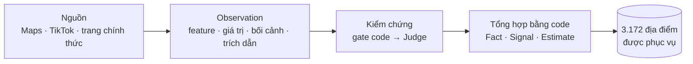
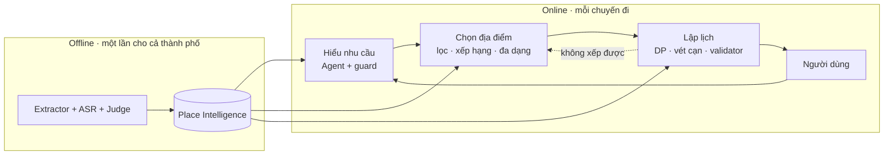

# Pitch deck — nội dung slide 8, 9, 11

> **Mốc đo cũ trong ngày 17/10.** Khi trình bày, dùng [bản pitch hiện tại](../pitch_desk.md) và [bằng chứng chạy lại](PITCH_EVIDENCE_20261017.md): 2.950 pass / 0 fail; số Planning và hội thoại cũng đã cập nhật. Nội dung dưới giữ để đối chiếu, không lấy 22 fail làm hiện trạng.

Mọi số liệu dưới đây được **đo lại ngày 17/10/2026** trên code và dữ liệu hiện tại (nhánh `fix/scoped-trip-requirements`, corpus release `20261016T105302`). Không dùng số của các báo cáo trước. Lệnh chạy lại ở cuối file.

---

## Slide 8 — Đổi mới trong dữ liệu (0:55)

**Câu hỏi:** Dữ liệu đến từ đâu, được kiểm chứng và sử dụng như thế nào?

**Thông điệp một câu:** Mỗi điều TripGuardian nói về một địa điểm đều truy được về một câu review, một tấm ảnh hoặc một đoạn video có thật; thiếu bằng chứng thì hệ thống nói "chưa biết", không đoán.

### Nội dung trên slide

| Bước | Số liệu (17/10/2026) |
|---|---|
| **Nguồn** | Google Maps: quét 31.777 kết quả → giữ **1.779 địa điểm trải nghiệm + 1.524 chỗ ở** (bỏ trùng, bỏ nơi < 50 review) · **713.216 review** đã thu · TikTok: video đã xác minh đúng địa điểm cho **990 nơi** · trang chính thức: 221 nơi |
| **Trích xuất** | **1.360.104** observation từ review · **32.853** từ ảnh · **14.814** từ video TikTok · **15.200** nhận định phong cách ảnh. Mỗi observation có trích dẫn nguyên văn |
| **Kiểm chứng** | Gate code: trích dẫn phải có nguyên văn trong nguồn, feature phải có trong ontology. Judge đã ghi **769.936** nhãn: **482.144 đúng · 240.574 sai (31%) · 47.218 không chắc**. Chỉ nhận định "đúng" được tổng hợp |
| **Phục vụ** | **3.172 địa điểm** · 52.313 thuộc tính: **37.107 VERIFIED (70,9%)** · 10.353 UNCERTAIN · 4.853 OUTDATED · **108 nơi bị loại** (53 đóng tạm, 12 đóng hẳn, 7 do Judge xác định đóng/đổi, 36 chỗ ở ngoài thành phố) |
| **Tìm theo "vibe"** | Chỉ mục ngữ nghĩa: **40.038** vector ảnh (SigLIP2) · **725.071** vector câu trích dẫn (bge-m3) · 2.047 nơi có tag phong cách |

**Điểm đổi mới (3 ý ngắn):**
1. **Lưu bằng chứng, không lưu kết luận:** "đông vào sáng cuối tuần" được lưu thành `crowd × weekend × morning` kèm câu trích, không lưu chung chung là "đông".
2. **`unknown` khác `false`:** không ai nói "có dốc" không có nghĩa là "không dốc". Yêu cầu an toàn thiếu bằng chứng thì bị chặn (fail-closed).
3. **Rủi ro quyết định mức kiểm tra:** giá trị *cho phép* ("hợp người lớn tuổi") nếu sai có thể gây hại, nên phải được kiểm đủ mới được phục vụ. Giá trị *cảnh báo* ("đường dốc") nếu sai chỉ làm mất một gợi ý.

### Lời nói (~55 giây)

> Dữ liệu của TripGuardian đến từ ba nguồn: Google Maps cho danh sách địa điểm và hơn 713 nghìn review; video TikTok đã xác minh đúng địa điểm; và trang chính thức cho giá, giờ mở cửa. Chúng tôi không lưu "nơi này đẹp". Mỗi câu review được tách thành observation: thuộc tính gì, giá trị gì, trong bối cảnh nào, kèm câu trích nguyên văn. Hiện có hơn 1,4 triệu observation. Model chỉ đề xuất. Code kiểm câu trích có thật trong nguồn, sau đó Judge chấm gần 770 nghìn nhận định, và gần một phần ba bị loại vì sai. Sau đó chỉ code mới được tổng hợp thành fact. Kết quả là 3.172 địa điểm, 71% thuộc tính ở mức đã xác minh, phần còn lại được ghi rõ là chưa chắc hoặc đã cũ. Khi không có bằng chứng, hệ thống trả lời "chưa biết" thay vì đoán.

### Câu hỏi phản biện có thể gặp

| Câu hỏi | Trả lời |
|---|---|
| Judge cũng là model, dựa vào đâu để tin? | Judge chỉ gắn nhãn, không bao giờ sửa giá trị. Nhãn của người luôn thắng nhãn Judge. Thuộc tính rủi ro (effort, suitability, an toàn) được Judge đọc toàn bộ, không lấy mẫu. Sai số của chính Judge Gemma đo lần gần nhất ngày 06/10 trên 1.334 nhận định có nhãn mạnh: để lọt 11–16% nhận định sai. Vì vậy nhãn "không chắc" cũng bị bỏ |
| Sao không dùng rating Google? | Rating chỉ dùng để chọn ứng viên lúc quét. Rating không phải bằng chứng về trải nghiệm (một con số không cho biết nơi đó có dốc hay hợp trẻ em không) |
| Dữ liệu cũ thì sao? | Mỗi loại thuộc tính có cửa sổ freshness riêng (giờ 90 ngày, giá 180 ngày, độ đông 12 tháng). Thuộc tính quá hạn được đánh dấu OUTDATED (4.853 thuộc tính) và hiện cảnh báo |
| Ảnh có đáng tin không? | Phần lớn là không, và hệ thống đối xử đúng như vậy: trong 55.961 nhận định từ ảnh, Judge chỉ chấm 5.754 là đúng; phần còn lại không được dùng làm bằng chứng |
| Crawl có hợp pháp không? | Đây là bản demo học tập, phi thương mại. Khi thương mại hóa sẽ chuyển sang Places API và nguồn TikTok có license. Clip luôn ghi @creator và link về bài gốc |

---

## Slide 9 — AI và kiến trúc hệ thống (1:00)

**Câu hỏi:** AI làm gì, thuật toán làm gì, vì sao kiến trúc này phù hợp?

**Thông điệp một câu:** AI hiểu ngôn ngữ, hình ảnh và đề xuất; thuật toán tất định quyết định và kiểm chứng. Model không ghi fact và không tạo địa điểm.

### Nội dung trên slide

| AI làm (theo vai trò, đổi model bằng config) | Thuật toán làm (tất định, có test) |
|---|---|
| **ASR** ChunkFormer + PhoWhisper: nghe giọng tiếng Việt trong video | **Gate**: trích dẫn có thật, feature có trong ontology |
| **Extractor** Gemma 4 26B (tự host): đọc review, ảnh, khung hình → observation | **Tổng hợp** Fact/Signal/Estimate, confidence 4 thành phần |
| **Judge**: chấm đúng/sai từng nhận định, phán nơi đóng cửa hay trùng | **Lọc ràng buộc** `pass / fail / unknown`, fail-closed với yêu cầu an toàn |
| **Embedder** SigLIP2 + bge-m3: tìm theo "vibe", theo ảnh người dùng gửi | **Xếp hạng** có trọng số từng thành phần, **MMR** chống trùng |
| **Agent** (sol 6.1): hiểu câu gõ tự do, ghi fact qua tool `record_fact` | **Chia ngày** bằng quy hoạch động; **thứ tự trong ngày** vét cạn ≤ 7 điểm (≤ 5.040 hoán vị) |
| | **Validator** đọc lại lịch cuối: 8 kiểm tra + thời tiết nguy hiểm; **độ vững** qua 4 kịch bản nhiễu |

**Vì sao kiến trúc này phù hợp:**
1. **Lỗi của model không thành sự thật.** Guard từ chối fact không có trích dẫn từ lời người dùng và từ chối câu trả lời nêu số hoặc tên nơi chưa ai nói. Chỉ validator được kết luận một lịch "đi được".
2. **Nhanh và rẻ khi dùng.** Phần AI nặng chạy offline một lần. Online chỉ đọc snapshot: chọn hoặc bỏ một nơi mất **p50 24–60 ms**, giải thích "vì sao không" mất 0,1 ms, và mọi nút bấm đều không gọi LLM.
3. **Hợp Việt Nam.** ASR tiếng Việt và Gemma tự host nên không phụ thuộc API nước ngoài cho phần khối lượng lớn. Ngân sách được hiểu đúng theo cách người Việt nói ("mỗi người 2 triệu", "5 triệu cả chuyến").
4. **Thay được từng phần.** Mỗi giai đoạn là một module, chỉ giao tiếp qua public API (có test ranh giới). Đổi model chỉ cần đổi config, không chạm thuật toán.

### Lời nói (~60 giây)

> Nguyên tắc của chúng tôi: AI hiểu, thuật toán quyết định. AI làm những việc chỉ AI làm được: nghe tiếng Việt trong video, đọc review và ảnh, chấm nhận định đúng hay sai, hiểu câu người dùng gõ tự do. Nhưng model không bao giờ ghi fact hay tạo địa điểm. Mọi kết luận do code tất định đưa ra: lọc theo ràng buộc, thiếu bằng chứng thì chặn; xếp hạng có giải thích từng thành phần; chia ngày bằng quy hoạch động; vét cạn thứ tự trong ngày; và cuối cùng là một validator độc lập đọc lại cả lịch. Lịch không qua validator thì không chốt được. Kiến trúc này phù hợp vì ba lý do. Một, lỗi của model bị chặn trước khi tới người dùng. Hai, phần AI nặng chạy offline, nên khi dùng mỗi thao tác chỉ mất vài chục mili-giây và không gọi LLM. Ba, mỗi vai trò AI là một cấu hình: đổi model không phải viết lại hệ thống.

### Câu hỏi phản biện có thể gặp

| Câu hỏi | Trả lời |
|---|---|
| Sao không để một LLM làm hết như các trip planner khác? | LLM viết ra một lịch trông hợp lý nhưng không kiểm được giờ mở cửa, thời gian di chuyển và ràng buộc sức khỏe. Ở đây validator kiểm lại từng phút của lịch cuối |
| Agent ghi sai ý người dùng thì sao? | Fact phải trích đúng lời người dùng (guard kiểm). Fact suy luận được Clef kiểm lại. Mọi giá trị đoán được đánh dấu ✎ trong "bản hiểu nhu cầu" để người dùng sửa |
| Agent chậm hoặc lỗi thì sao? | Phần từ khóa (`prepass`) đã ghi vẫn được giữ, người dùng nhận thông báo và có thể gõ lại. Decision dùng `policy.py`, Planning giữ phương án tất định đã kiểm |
| DP và vét cạn có tối ưu toàn cục không? | Không cho cả chuyến: DP tối ưu cách chia cụm vào ngày, vét cạn tối ưu thứ tự trong ngày. Vượt giới hạn (> 7 ngày, > 8 cụm, > 7 điểm/ngày) thì chuyển sang heuristic và gắn cờ |

---

## Slide 11 — Tính khả thi và thực nghiệm (0:55)

**Câu hỏi:** Kết quả kiểm thử, chất lượng, hiệu năng và giới hạn hiện tại.

**Thông điệp một câu:** Hệ thống chạy end-to-end trên dữ liệu thật Đà Lạt. Trên các bộ chuyến ẩn, số vi phạm ràng buộc cứng là 0. Chúng tôi công bố cả những chỗ chưa đạt.

### Nội dung trên slide

| Thực nghiệm (17/10/2026) | Kết quả |
|---|---|
| **Bộ test phần mềm** (unit, bất biến, ranh giới module, Postgres) | **2.865 pass** · 22 fail · 3 skip trên 2.890 test · 7 phút 26 giây |
| **Chọn địa điểm** — 30 chuyến ẩn (người cao tuổi, xe lăn, trẻ em, mưa, ngân sách, leo núi, …) | **0 vi phạm ràng buộc cứng** · 0 nơi `unknown` lọt vào danh sách chính · **29/30** chuyến đủ shortlist · gần trùng 1,2% · p50 72 ms, chậm nhất 358 ms |
| **Lập lịch** — 10 chuyến ẩn, qua Decision → chọn chỗ ở → Planning → chốt | **10/10 lịch qua validator** (lần đo 12/10 chỉ được 1/10) · 0 vi phạm |
| **Độ trễ thao tác** trên 3.172 địa điểm | Mở shortlist p50 69 ms · chọn p50 24 ms · bỏ p50 60 ms · "vì sao không" 0,1 ms · tìm tên p50 11,5 ms · danh sách chỗ ở 0,94 s (lần sau 0,75 s) |
| **Hiểu nhu cầu với Agent thật** — tin nhắn thật của tester (5 ca, 8 lượt) | **0 thông tin bị bỏ sót** · **0 lần hỏi lại điều đã nói** · ca "kể hết trong một tin" ghi đủ 7/7 mục ngay lượt đầu |
| **Hiểu nhu cầu** — 5 người dùng mô phỏng hội thoại tối đa 16 lượt | Ghi được **23/35** mục bắt buộc (0/5 persona đủ 7/7) · lượt p50 7,8 s, p90 12,4 s · 2,15 call model mỗi lượt, 79% token prompt dùng lại từ cache |

**Giới hạn hiện tại (nói thẳng):**
- **Chưa thử với người dùng thật** có đối chứng. Toàn bộ số trên đến từ chuyến ẩn và người dùng mô phỏng.
- **Agent chưa tự dẫn hội thoại về đủ thông tin:** trong 16 lượt, không persona nào được ghi đủ 7 mục. Ví dụ: "nhóm mình 6 đứa" không được ghi thành số người đi; Agent lặp lại câu về nhịp độ thay vì hỏi mục còn thiếu. Ở ca người dùng kể hết trong một tin, hệ thống ghi đủ 7/7.
- **22 test đang fail**, và vẫn fail khi chạy riêng (không phải do chạy song song): 17 ở Place Decision (shortlist theo trang, xếp lại theo mong muốn, tốc độ memo), 4 ở harness (lịch sử chuyến trên Postgres, handoff quá tải), 1 ở landing.
- **Lập lịch còn chậm:** một chuyến mất 3,2–30,7 s ở bản offline (đo hai lần, kết quả như nhau; mục tiêu < 2 s). Tổng di chuyển còn **dài hơn 20,7%** so với baseline nearest-neighbour. Lý do: baseline chỉ tối thiểu quãng đường, không kiểm giờ mở cửa và khung bữa. Như vậy chưa chứng minh được là tiết kiệm di chuyển.
- **Độ vững offline chưa có nghĩa:** khi đo không có OSRM và dự báo thời tiết, nên 10/10 lịch bị xếp mức "Mong manh" (thời gian di chuyển là ước lượng thô).
- **Lượt chat với Agent còn chậm:** p50 7,8 s mỗi lượt. Tin dài đầu tiên của tester mất 16–27 s (đo khi 10 phiên chạy cùng lúc trên một Agent). Thông tin đầu tiên hiện trên bản hiểu nhu cầu sau 0,1–14 s.
- **Độ phủ bằng chứng còn mỏng:** trong 3.280 nơi, nhóm suitability chỉ 27 nơi COMPLETE và 1.023 nơi NONE; nhóm effort chỉ 62 nơi COMPLETE. Vì vậy chuyến có yêu cầu nghiêm (xe lăn, "ăn nhóm") có thể nhận ít gợi ý: hệ thống chọn không đoán.

### Lời nói (~55 giây)

> TripGuardian đang chạy end-to-end trên dữ liệu thật Đà Lạt, và tất cả số liệu trên slide này được đo lại hôm nay. 2.865 trên 2.890 test tự động đang pass. Trên 30 chuyến ẩn có yêu cầu khó như xe lăn, người cao tuổi, trẻ em, ngày mưa, số nơi vi phạm ràng buộc cứng là 0, và không nơi nào chưa rõ thông tin lọt vào danh sách chính. Cả 10 chuyến đi qua toàn bộ luồng đều ra lịch qua validator. Mỗi thao tác chọn hoặc bỏ chỉ mất vài chục mili-giây. Với tin nhắn thật của tester, Agent không bỏ sót thông tin nào và không hỏi lại điều người dùng đã nói. Chúng tôi cũng nói thẳng chỗ chưa đạt: lập lịch còn chậm hơn mục tiêu 2 giây, tổng di chuyển chưa thắng baseline đơn giản, Agent chưa tự dẫn hội thoại về đủ thông tin, và chưa có thử nghiệm với người dùng thật. Đó là việc của giai đoạn tiếp theo.

### Câu hỏi phản biện có thể gặp

| Câu hỏi | Trả lời |
|---|---|
| Vì sao 1 chuyến (`group_food`) không đủ shortlist? | Đó là yêu cầu "hợp đi nhóm đông" mà bằng chứng suitability còn mỏng. Hệ thống trả 7 nơi chắc chắn thay vì bịa thêm cho đủ. Đây là fail-closed đúng thiết kế |
| Lịch dài hơn baseline thì tối ưu ở đâu? | Baseline chỉ nối điểm gần nhất, không biết nơi nào mở lúc mấy giờ, không chừa bữa ăn, không ghim giờ hoàng hôn. Lịch của chúng tôi đổi một phần quãng đường lấy tính đi được. So sánh công bằng cần một baseline cũng phải qua validator: đây là việc chưa làm |
| Người dùng mô phỏng có thay được người thật? | Không. Đó là lý do bước tiếp theo là pilot đo thời gian lập kế hoạch, số lần sửa và số vi phạm, so với việc tự tìm trên TikTok/Google |
| Vì sao vẫn còn test fail? | Code đang thay đổi nhanh trước chung kết (shortlist theo trang, xếp lại theo mong muốn, lịch sử chuyến), và test chưa theo kịp hoặc bắt được lỗi thật. Ví dụ `test_shortlist_is_fail_closed_and_grouped` đỏ vì một nơi cách ~50 km lọt vào shortlist. Nơi đó vẫn thỏa ràng buộc "không dốc", nên đây là lỗi bán kính, không phải lọt nơi vi phạm. Decision evaluate trên dữ liệu thật vẫn cho 0 vi phạm |
| Mở rộng sang thành phố khác tốn gì? | Thêm một mục trong `config/cities.yaml` và chạy lại pipeline. Ledger chỉ chạy lại phần có đầu vào đổi, không cần đổi code |

---

## Phụ lục — nguồn số liệu và cách chạy lại

| Số liệu | Lệnh / file | Ghi chú |
|---|---|---|
| Tập Maps (31.777 → 1.779 + 1.524) | `data/gmaps/list/dalat.json`, `dalat_stay.json` → `stats` | |
| Review, observation, nhãn Judge | Đếm trực tiếp `data/gmaps/places/*/reviews.json`, `data/{gmaps,tiktok,official}/observations`, `data/gmaps/photo_observations`, `data/gmaps/style_observations`, `data/review/judge_labels.jsonl` | Đếm 17/10/2026 00:13 |
| Serving 3.172, trạng thái thuộc tính, nơi bị loại | `data/serving/places.json` → `summary` | Dựng 16/10/2026 18:54 |
| Chỉ mục ngữ nghĩa | `data/index/20261016T105302-54818537/summary.json` | |
| Độ phủ effort/suitability | `data/intel/summary.json` → `coverage` | |
| Chọn địa điểm | `python -m decision evaluate` → `data/decision/eval.json` | 18 s cho 30 chuyến |
| Lập lịch | `python -m planning evaluate` → `data/planning/eval.json` | Không có OSRM, không có thời tiết; chạy cùng lúc với bộ test |
| Độ trễ thao tác | `python -m bench latency` | Bench trong repo lỗi `corpus binding mismatch` vì có trước bước kiểm binding. Lần đo này dùng wrapper gắn binding đã pin, phần còn lại giữ nguyên. Đo khi máy đang chạy song song bộ test |
| Tin nhắn tester | `logs/bench_trip/oneshot.py` với `logs/bench_trip/serve.py` (code hiện tại, Agent `cx/gpt-6.1-sol`, reasoning `low`) | 5 ca, 8 lượt |
| Người dùng mô phỏng | `logs/bench_trip/converse.py` | 5 persona, người dùng mô phỏng cũng chạy trên sol |
| Bộ test | `.venv/bin/python -m pytest --collect-in-virtualenv -q --ignore=tests/crawl --ignore=tests/trip/test_eval_conversations.py`, có `TEST_DATABASE_URL` | Loại test crawler; `test_eval_conversations.py` lỗi từ lúc thu thập test vì `config/eval_trips.yaml` không còn khóa `conversations` |

**Không chạy lại được:** bench offline 40 chuyến ẩn (`python -m bench run`) cần `config/bench.yaml` và `config/bench_trips.yaml`. Hai file này chưa từng được commit và không còn trong repo, nên slide không dùng số từ bench đó.
