# TripGuardian — Proposal & Technical Specification

> Phần II–IV của báo cáo dự thi. Phạm vi kiểm chứng: **Đà Lạt**. Số liệu lấy từ dữ liệu và lần chạy thật trong repo, kèm ngày đo ở Phụ lục G. Chỗ nào chưa đo hoặc chưa chạy được thì ghi rõ là chưa.

---

# PHẦN II. TECHNICAL SPECIFICATION — ĐẶC TẢ KỸ THUẬT

## 8. System Requirements & Scope — Phạm vi và yêu cầu hệ thống

### 8.1. Phạm vi MVP

TripGuardian giúp người tự đi du lịch **chọn đúng địa điểm trước khi tạo lịch trình**, rồi kiểm tra các nơi đã chọn có đi được cùng nhau không. Hệ thống không định vị là "AI tạo lịch trình"; giá trị nằm ở ba câu hỏi:

> Nơi nào hợp chuyến này? · Vì sao chọn nơi này thay vì nơi kia? · Các nơi đã chọn có thực sự đi được cùng nhau không?

| Trong phạm vi MVP | Ngoài phạm vi MVP |
|---|---|
| Đà Lạt; chuyến tự túc 2–4 ngày (hệ thống nhận tới 7 ngày) | Thành phố khác (mở rộng bằng config, chưa kiểm chứng) |
| Hiểu nhu cầu qua hội thoại và chip; nhập nơi đã lưu, nơi bắt buộc đến | Chỉ đường từng bước, đặt chỗ, thanh toán |
| Tìm và kiểm tra địa điểm, shortlist, so sánh, tuyển chọn | Mạng xã hội, cộng tác nhóm lớn |
| Kiểm tra khả thi theo tổ hợp, lịch nhiều ngày, tối ưu tuyến, độ vững, dự phòng | Suy đoán nhân khẩu học (tuổi, giới tính) |
| Gợi ý chỗ ở theo gu (chỉ Planning) | Cam kết dữ liệu thời gian thực (traffic, giá phòng đúng ngày) |
| Chế độ Đang đi: check-in tự nguyện, xuất Google Calendar có xác nhận, thông báo | Bản điện thoại của User Web (điện thoại được mời tải ứng dụng) |
| Admin Web: review dữ liệu, gán nhãn, phiên người dùng, analytics | Phân quyền admin nhiều cấp, billing, CRM |

Người dùng mục tiêu được mô tả theo **hai trục độc lập**, không theo nhóm người: *trạng thái bắt đầu* (chưa có ý tưởng / có nơi đã lưu / có nơi bắt buộc / có lịch sơ bộ; đọc từ input) và *mức dẫn dắt* (`guidance`, `effort_budget`, `control`; suy từ hành vi trong phiên). Hệ thống không hỏi và không suy đoán tuổi, giới tính.

### 8.2. Functional Requirements

| ID | Yêu cầu | Module |
|---|---|---|
| FR-01 | Hiểu nhu cầu chuyến đi từ câu tự do, chip, link/nơi mang theo; tạo Trip State có nguồn và bằng chứng cho từng giá trị | Trip |
| FR-02 | Chỉ hỏi điều làm đổi kết quả; một câu ghi được nhiều trường; ghi chính xác ngày, đêm và mốc giờ đầu/cuối; một câu lưu ý sức khỏe/ăn uống hỏi một lần; mọi câu bỏ qua được và có "Chưa chắc" | Trip |
| FR-03 | Tách physical constraint, user hard constraint và soft preference; hard constraint fail-closed | Trip, Decision, Planning |
| FR-04 | Biên dịch Trip State thành Search Input mà Decision dùng trực tiếp | Trip |
| FR-05 | Truy xuất ứng viên từ serving index, sàng lọc cứng, xếp hạng có giải thích, gom nơi gần trùng | Decision |
| FR-06 | Người dùng tuyển chọn: chọn, bỏ (kèm lý do), khóa, so sánh, hỏi "vì sao không" | Decision |
| FR-07 | Báo khả thi sơ bộ của tổ hợp sau mỗi thao tác, nêu nơi và quy tắc gây xung đột | Decision |
| FR-08 | Gom cụm, chia ngày, xếp thứ tự, mô phỏng giờ mở cửa/bữa ăn/đệm | Planning |
| FR-09 | Validator đọc lại timeline cuối; chỉ lịch `ok` mới được chốt | Planning |
| FR-10 | Chấm độ vững (Vững / Khả thi / Mong manh) và đưa phương án dự phòng | Planning |
| FR-11 | Tra Live Context theo request: thời gian di chuyển, thời tiết, chỗ ở, chuyến xe/bay | Live |
| FR-12 | Sửa lịch bằng thao tác trực tiếp (thêm/bỏ/chuyển/đổi thứ tự), hoàn tác, chỉ tính lại phần bị ảnh hưởng | Planning, Harness |
| FR-13 | Mỗi nhận định về địa điểm truy được về bằng chứng (clip tại timestamp, trích dẫn, trang chính thức) | Corpus, Web |
| FR-14 | Đăng nhập Google, hồ sơ là prior, xóa tài khoản | Accounts |
| FR-15 | Chế độ Đang đi, xuất Google Calendar (xem trước → xác nhận), thông báo có giới hạn | Companion, Notify |
| FR-16 | Admin: hàng đợi review, gán nhãn đo chất lượng, phiên người dùng, analytics | Corpus.review, Analytics |

### 8.3. Non-functional Requirements

| Nhóm | Yêu cầu | Cách đáp ứng |
|---|---|---|
| Tính đúng | Không bịa địa điểm hay fact; thiếu bằng chứng là `unknown`, không phải `false` | Gate tất định ở mọi lần ghi; mỗi observation phải có span |
| An toàn | Hard constraint fail-closed; physical constraint không có đường nới | Một bộ `requirements` dùng chung ba module; `validate` là nơi duy nhất kết luận đạt/không |
| Giải thích được | Mọi gợi ý có "vì sao" và "đánh đổi"; mọi xung đột nêu tên nơi và quy tắc | Điểm xếp hạng lưu từng thành phần; Plan Output có `reasons`, `tradeoffs`, `warnings` |
| Độ tin cậy | Mutation idempotent, không mất trạng thái khi lỗi hoặc restart | `request_id` + receipt, kiểm revision trong Postgres, snapshot atomic, rollback khi save lỗi |
| Hiệu năng | Thao tác trực tiếp không chờ model; model có ngân sách thời gian | Edit/act/router không gọi LLM; `first_token_s` 8 s, `total_s` 30 s; fallback tất định |
| Bảo mật & riêng tư | Token phiên chỉ lưu hash; refresh token mã hóa; dữ liệu người dùng tách khỏi Place Intelligence | §15.5 |
| Bảo trì | Module độc lập, ranh giới được test kiểm | Chỉ giao tiếp qua `__init__.py`; test ranh giới ở `tests/planning`, `tests/live` |
| Tái lập | Dựng lại được toàn hệ thống từ repo + gói dữ liệu | §15.7 |
| Chi phí | Model rẻ cho khối lượng lớn, model mạnh chỉ ở chỗ cần phán đoán | Vai trò model (§14.1), ledger không trả tiền hai lần |

### 8.4. System Constraints

| Ràng buộc | Hệ quả thiết kế |
|---|---|
| Model Gemma 4 26B tự host chỉ truy cập được trong mạng campus UIT, tối đa 40 request đồng thời mỗi key | Hàng đợi và giới hạn call trong tiến trình (`max_parallel 2`, `max_waiting 16` cho Agent); số slot Extractor tự giảm khi gặp 429 |
| Nguồn dữ liệu (Google Maps, TikTok) không có API chính thức cho mục đích này | Thu thập bằng trình duyệt tự động, có captcha do người giải; đây là sai lệch cho bản demo (§18.4) |
| Thời gian di chuyển cần dịch vụ định tuyến | OSRM tự dựng trên OSM Việt Nam; không có OSRM thì dùng ước lượng thô và gắn nhãn |
| OSM không có profile xe máy chuẩn | Dùng profile ô tô nhân hệ số, hiển thị là *ước lượng* |
| Dữ liệu người dùng và crawl chứa nội dung của người khác | Repo public không chứa nội dung crawl; dữ liệu đi qua gói zip riêng |
| Dự án học tập, phi thương mại | Không dùng dữ liệu crawl cho mục đích thương mại |

### 8.5. Assumptions & Limitations

**Giả định.** Người dùng tự di chuyển (xe máy, ô tô, xe công nghệ); chuyến 2–4 ngày; dữ liệu địa điểm đã được dựng offline trước khi người dùng vào; lời người dùng nói trong chuyến hiện tại đáng tin hơn hồ sơ cũ.

**Giới hạn đã biết.**

- Chỉ kiểm chứng ở Đà Lạt. Thêm thành phố là thêm config, nhưng chưa chạy thử.
- Giờ mở cửa và giá có thể cũ; thiếu giá được báo riêng, không coi tổng giá đã biết là tổng chi phí.
- Thời gian di chuyển chưa có traffic thời gian thực.
- Độ phủ bằng chứng về *mức vận động* và *đối tượng phù hợp* còn mỏng (§10.5), nên với yêu cầu cứng nghiêm ngặt (xe lăn, tránh dốc) hệ thống có lúc trả ít hoặc không có gợi ý thay vì đoán.
- Kết quả đánh giá hiện có từ người dùng giả lập và chạy offline, **chưa có thử nghiệm với người dùng thật** (§17.6).

---

## 9. System Architecture — Kiến trúc tổng thể

### 9.1. Architectural Overview

Hệ thống chia thành **bốn giai đoạn**, mỗi giai đoạn một package độc lập, cộng các phần phục vụ người dùng. Nguyên tắc nền:

- **Offline ghi, online đọc.** Place Intelligence chỉ được ghi bởi pipeline offline. Online chỉ ghi lịch trình, user/session profile và sự kiện.
- **Model hiểu và đề xuất; code quyết định.** Mọi fact, điểm, kết luận khả thi do code tất định tạo ra.
- **Chọn trước, xếp lịch sau, và trả ngược khi không khả thi.**

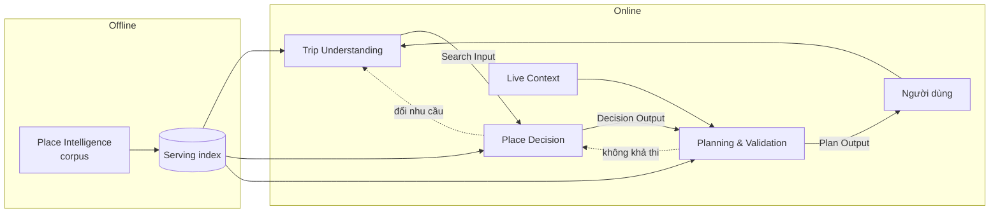

### 9.2. Component Architecture

| Thành phần | Package | Việc |
|---|---|---|
| Place Intelligence | `src/corpus/` | Thu thập, trích xuất, tổng hợp, kiểm tra, phục vụ tri thức địa điểm |
| Trip Understanding | `src/trip/` | Hội thoại → Trip State → Search Input |
| Place Decision | `src/decision/` | Sàng lọc, xếp hạng, đa dạng, tuyển chọn, khả thi tổ hợp |
| Planning & Validation | `src/planning/` | Chia ngày, thứ tự, giờ, chỗ ở, validate, độ vững, dự phòng |
| Live Context | `src/live/` | OSRM, thời tiết, geocode, chỗ ở, chuyến xe/bay, mặt trời, lễ/sự kiện |
| Yêu cầu dùng chung | `src/requirements/` | Kiểm hard/soft constraint theo phạm vi hoạt động |
| Agent runtime | `src/agents/` | Gọi model có schema, deadline, hàng đợi, retry |
| Harness | `src/harness/` | Router, handoff, revision, receipt, HTTP/SSE |
| Tài khoản & dữ liệu người dùng | `src/accounts/`, `src/db/` | Google OAuth, hồ sơ, Postgres |
| Đang đi & thông báo | `src/companion/`, `src/notify/` | Check-in, gợi ý tại chỗ, Calendar, web push |
| Analytics | `src/analytics/` | Event, phễu, chỉ số Admin |
| Bench | `src/bench/` | Người dùng giả lập có Trip State ẩn |
| Web | `web/` | Landing, User Web, Admin Web (React/Vite) |

Quy mô hiện tại: khoảng 28.800 dòng Python trong `src/` (corpus 10.478, planning 5.210, trip 4.598, decision 2.399, harness 1.392), 11.971 dòng TypeScript trong `web/src`, 17.772 dòng test.

### 9.3. Offline & Online Processing

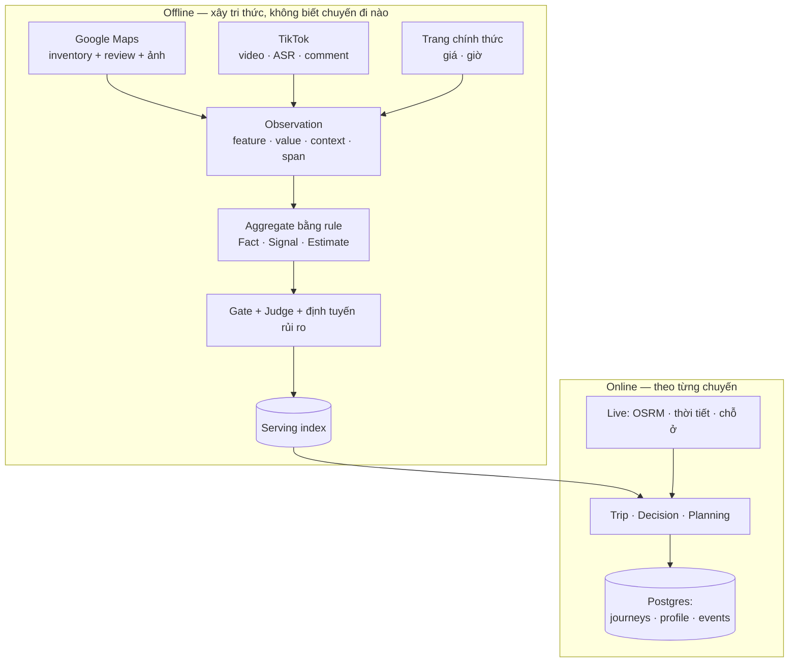

| | Offline | Online |
|---|---|---|
| Ghi | `data/<nguồn>/`, `data/intel/`, `data/serving/` | Postgres: hành trình, hồ sơ, event, check-in, thông báo |
| Đọc | Nguồn ngoài | Serving index (chỉ đọc), Live Context (cache có TTL) |
| Model | Extractor, Judge, ASR (khối lượng lớn) | Agent (câu tự do, đề xuất nội bộ), có ngân sách thời gian |
| Chạy lại | Ledger theo input hash × processor version | Mỗi act sinh `State` mới, `scope` quyết định phần tính lại |

### 9.4. Data Flow & Module Contracts

Ba contract nối các module online:

| Contract | Từ → Tới | Nội dung chính |
|---|---|---|
| **Search Input** | Trip → Decision | Bối cảnh chuyến, hard filter (kèm `unknown_policy`), anchor, soft weight, hoạt động tại từng nơi, ưu tiên giờ, nhịp độ, `unknowns`, `unmapped` |
| **Decision Output** | Decision → Planning | Nơi đã xác nhận (`anchor | locked | selected`), backup pool, wishlist, snapshot Search Input, `decision_log`, khả thi sơ bộ |
| **Plan Output** | Planning → Người dùng | 2–3 phương án, lịch theo ngày, chi phí đã biết, cảnh báo, độ vững, dự phòng, `provenance` của số live |

Phụ thuộc một hướng, test ranh giới kiểm:

```text
corpus   ──► (không phụ thuộc gì)
trip     ──► corpus.serving, corpus.ontology
decision ──► corpus.serving, corpus.ontology
live     ──► corpus.crawl (3 tên: open_sessions, maps_search, LoginRequired)
planning ──► live, decision, trip, corpus.serving, corpus.ontology
harness  ──► trip, decision, planning, agents, accounts, companion, notify, db
```

Ba loại điều kiện dùng xuyên suốt cả ba module:

| Loại | Nới được không | Xử lý khi vi phạm |
|---|---|---|
| Physical constraint | **Không** | Loại, hoặc giữ ở wishlist kèm lý do |
| User hard constraint | Chỉ khi người dùng xác nhận | Hỏi "nới không", luôn kèm cái giá đã tính |
| Soft preference | Có | Chỉ đổi thứ tự, không loại |

Một requirement được kiểm theo thứ tự **phạm vi hoạt động → bằng chứng → chính sách**. Không liên quan trả `not_applicable`; có liên quan trả `pass`, `fail` hoặc `unknown`. Hard constraint thiếu bằng chứng không tự thành đạt: chính sách `exclude` chặn, `flag` giữ kèm cảnh báo.

### 9.5. External Services & Dependencies

| Dịch vụ | Dùng cho | Khi lỗi |
|---|---|---|
| Gemma 4 26B (UIT API, host LAN) | Extractor, Judge | Chuyển endpoint dự phòng; bước lỗi để ledger chạy lại lần sau |
| Model Agent (endpoint tương thích OpenAI) | Trip/Decision/Planning proposal | Trip chỉ giữ phần `prepass` đã đọc; Decision dùng `policy.py`; Planning giữ baseline |
| Cloudflare Workers AI (Clef) | Phân loại lượt gõ trước Agent (timeout 1 s) | Bỏ qua, dùng regex |
| ChunkFormer, PhoWhisper (GPU local) | ASR tiếng Việt | Segment lỗi → `garbled`, không dùng làm bằng chứng |
| OSRM (tự host) | Ma trận thời gian di chuyển, hình tuyến | Ước lượng thô, gắn `travel_source = rough`, độ vững trần "Khả thi" |
| Open-Meteo | Dự báo mưa/gió/dông (tầm 16 ngày) | Ngoài tầm dùng khí hậu theo tháng; không có thì ghi "chưa biết thời tiết" |
| Nominatim, Photon | Geocode, gợi ý địa danh | Hỏi lại người dùng |
| Google Maps (lodging), Google Flights, Vexere | Chỗ ở, chuyến bay, xe khách | `Unavailable`, trả link đặt vé; không bao giờ trả chuyến giả |
| Google OAuth, Google Calendar | Đăng nhập, xuất lịch | Calendar chỉ khi người dùng bấm và xác nhận |
| Postgres 16 | Dữ liệu người dùng | Bắt buộc cho harness |

---

## 10. Place Intelligence & Data Strategy — Dữ liệu và tri thức địa điểm

### 10.1. Data Sources & Collection

Mỗi nguồn có module và thư mục dữ liệu riêng; không gộp. Mỗi nguồn chứng minh một loại điều khác nhau:

| Nguồn | Dùng cho | Không dùng cho |
|---|---|---|
| Google Maps | **Tập địa điểm** (định danh, vị trí, loại, giờ, trạng thái); review, ảnh và giờ cao điểm là bằng chứng trải nghiệm | Rating làm bằng chứng (chỉ để xếp ứng viên) |
| Video TikTok | Trải nghiệm, môi trường, mức vận động của địa điểm *đã có* | Tạo địa điểm mới; fact vận hành nếu đứng một mình |
| Comment TikTok | Tín hiệu lặp lại (độ đông, yên tĩnh) | Fact; hiển thị một comment đơn lẻ như sự thật |
| Trang chính thức | Giá vé, giờ, quy định | — |

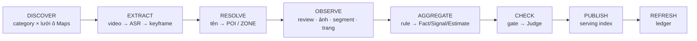

Google Maps quyết định tập địa điểm: mỗi category quét trên lưới ô (zoom tối đa 14), Extractor bỏ nơi không dành cho du khách, giữ nơi có tối thiểu 50 review; trùng được gộp theo tên và khoảng cách. TikTok đi theo từng địa điểm: tìm theo `<tên> <thành phố>`, Extractor lọc video đúng nơi, ASR, kiểm lại bằng hình ảnh, và chỉ cặp (video, địa điểm) được xác minh `yes` mới là bằng chứng.

### 10.2. Extraction & Entity Resolution

- **Extractor** đọc review, ảnh, segment video, trang chính thức và trả observation có cấu trúc. Output đi qua gate (schema, feature trong ontology, quote nguyên văn trong nguồn).
- **ASR hai tầng:** ChunkFormer là chính; segment bị đánh dấu `garbled` được chép lại bằng PhoWhisper. Code hoàn tác mọi chỗ model "sửa" mà không giống âm gốc, hoặc xóa từ phủ định.
- **Resolve:** tên → chuẩn hóa → Google Text Search → chấm điểm bằng code. Rõ ràng → `POI`; khu vực/cảnh quan → `ZONE`; mơ hồ → Judge chọn một phương án có sẵn hoặc bỏ phiếu trắng; còn lại `UNRESOLVED`. Không có Place ID thì không có entity.
- **Cùng được nhắc không có nghĩa ở gần nhau:** xuất hiện chung một video không bao giờ là bằng chứng khoảng cách.
- Thực thể trùng được Judge xử lý: `same_place` chỉ đứng khi Judge mạnh đồng ý; `part_of` và `branch` giữ hai nơi.

### 10.3. Observation-based Knowledge Representation

Mọi nguồn đều thành **Observation**; không gì ghi thẳng vào địa điểm.

```text
Observation
  id · place_fid · feature · value · context{time_of_day, day_type, weather}
  source_type · source_id · author · observed_at
  span{quote, field, start_s, end_s} · extractor · ontology_version
```

- **Feature ontology** (v11, 57 feature) chia thành nhóm `experience | environment | service | effort | suitability`; dùng chung id với User Profile (corpus lưu "có forest_view kèm confidence", profile lưu "thích forest_view kèm affinity").
- **Bối cảnh quan trọng:** "đông vào sáng cuối tuần" lưu là `crowd × weekend × morning`, không phải "đông".
- **Một tác giả một phiếu**, dù viết nhiều review hay đăng nhiều video.
- Địa điểm là `POI` hoặc `ZONE`; zone nối với POI qua quan hệ, nên "khu này hợp săn mây" không bao giờ thành "nông trại này là chỗ săn mây".

### 10.4. Evidence Aggregation & Validation

Chỉ code tổng hợp; không model nào ghi Fact/Signal/Estimate.

| Loại | Ví dụ | Quy tắc | Hiển thị |
|---|---|---|---|
| Fact | giờ, giá, quy định | Chính thức > provider; bất đồng → `uncertain` + giữ xung đột | Một giá trị, hoặc "chưa xác nhận" kèm cả hai |
| Signal | độ đông theo bối cảnh, yên tĩnh, đường dốc | Phân phối trên observation liên quan, kèm xu hướng nửa mới/nửa cũ | Xu hướng kèm cỡ mẫu |
| Estimate | thời gian tham quan | Rule trên observation | Luôn là khoảng |

**Kiểm tra nhiều lớp:**

1. **Gate tất định:** schema, quote tồn tại nguyên văn, feature có trong ontology, timestamp nằm trong media.
2. **Kiểm span:** feature tác động cao (an toàn, tiếp cận, đối tượng phù hợp, effort, vé) được đọc lại bởi một call riêng chỉ thấy đoạn nguồn quanh quote; chỉ `supports` mới được giữ — bắt phủ định, mỉa mai, ngoại lệ.
3. **Judge thay người duyệt:** gán nhãn `correct | wrong | unsure`, lấy mẫu tuần tự 30 → 60 → 100 nhãn đến khi cận dưới Wilson ≥ 0,8; feature rủi ro đọc toàn bộ. Judge khác họ model với Extractor để lỗi độc lập.
4. **Giá trị cảnh báo vs giá trị cho phép:** "đường dốc" chỉ làm mất một gợi ý khi sai; "hợp người lớn tuổi" sai có thể gây hại, nên giá trị cho phép chưa kiểm hết thì không được phục vụ.
5. **Người duyệt** chỉ xử lý một hàng đợi nhỏ xếp theo rủi ro; nhãn của người thắng nhãn của Judge và là bộ regression đo chính Judge.

### 10.5. Confidence, Uncertainty & Provenance

Confidence giữ **bốn thành phần**, không gộp thành một số ẩn:

```text
independent_sources   số tác giả khác nhau (nhiều video của một người = 1)
agreement             tỷ lệ đồng ý; < 0,6 → uncertain, giữ phân phối
freshness             tuổi so với cửa sổ của key (giờ 90 ngày, giá 180 ngày, độ đông 12 tháng)
source_type           official | provider | video | comment
```

Coverage theo khía cạnh là `COMPLETE | PARTIAL | NONE`. Trạng thái dùng chung cho corpus, Admin và User Web: `VERIFIED`, `UNCERTAIN`, `OUTDATED`, `NEEDS_REVIEW` (không hiển thị), `DISABLED` (không hiển thị). Trạng thái giữ theo từng khía cạnh: một nơi có thể có định danh đã xác minh nhưng giờ mở cửa chưa chắc.

**Quy mô dữ liệu hiện có** (Phụ lục G):

| Chỉ số | Giá trị |
|---|---|
| Địa điểm trong tập sau lọc (`gmaps list`) | 1.779 |
| Địa điểm có intel / có serving record | 1.761 / 1.696 |
| Bị vô hiệu hóa | 65 (48 đóng tạm, 12 đóng hẳn, 5 do Judge) |
| Khu vực (area) / nhóm gần trùng | 128 / 138 |
| Observation: review Maps / ảnh Maps / TikTok | 1.157.792 / 32.091 / 14.624 |
| Review Maps đã crawl (6.107 thư mục địa điểm, gồm cả nơi sau đó bị loại khỏi tập) | 615.810 |
| Nhãn Judge / người đã ghi | 561.272 dòng |
| Feature được phục vụ theo trạng thái | 28.466 VERIFIED · 4.081 UNCERTAIN · 2.779 OUTDATED |
| Địa điểm dùng được như trải nghiệm / bữa ăn / anchor / dự phòng | 928 / 949 / 705 / 1.352 |

**Độ phủ còn mỏng ở hai nhóm** (trên 1.761 địa điểm có intel): `effort` chỉ 26 nơi COMPLETE (còn lại PARTIAL), `suitability` chỉ 20 nơi COMPLETE và 400 nơi NONE. Đây là lý do một số chuyến có hard constraint nghiêm (xe lăn, tránh dốc) trả ít gợi ý: hệ thống chọn không đoán.

### 10.6. Serving Index & Data Refresh

- **Serving record** là thứ duy nhất Decision/Planning đọc: Identity, Operation, Experience, Environment, Effort, Suitability, Provenance, cùng `usable_as` (`experience | meal | anchor | backup`), `area`, `near_duplicate_group`. Online không duyệt đồ thị bằng chứng.
- `check(record, feature, forbidden)` là kiểm tra fail-closed chung: `fail` khi giá trị cấm chắc chắn; `pass` khi giá trị khác chắc chắn và không ai nói giá trị cấm; còn lại `unknown`.
- **Refresh:** ledger `PipelineArtifact` (input hash × processor × prompt hash × ontology version) bảo đảm bước chỉ chạy lại khi đầu vào hoặc processor đổi; đổi ontology chạy lại từ observation trở xuống, không chạy lại ASR. Nguồn quá hạn (trang chính thức 90 ngày, Google ID 12 tháng) được tải lại; observation mới được thêm, cũ được giữ.
- **Thành phố mới** là thêm config (`cities.yaml`), không đổi code.
- Lưu trữ hiện tại là **file**; thương mại hóa chuyển sang PostgreSQL + PostGIS (§18.5).

---

## 11. Trip Understanding & Personalization — Hiểu và cá nhân hóa nhu cầu

**Đầu vào:** hội thoại, địa điểm hoặc liên kết người dùng mang theo, và profile khi được phép. **Đầu ra:** Search Input để các module sau tính toán trực tiếp.

### 11.1. Natural Language Understanding

Mỗi lượt gõ đi qua bốn bước:

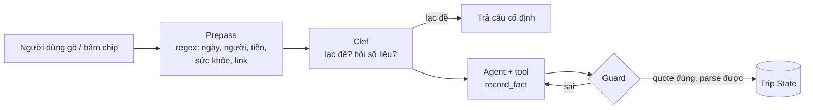

1. **Prepass** chỉ ghi các slot chắc chắn (số ngày, ngày, số người, tiền, tín hiệu sức khỏe, hard filter rõ); phần còn lại là gợi ý cho Agent.
2. **Clef** (classifier zero-shot, timeout 1 s) chặn lạc đề, phá hoại, hỏi số liệu chưa có; lỗi thì bỏ qua.
3. **Agent** gọi tối đa 6 bước tool; chỉ `record_fact` ghi state, và luôn qua `guard`.
4. **Guard** từ chối nếu quote không là nguyên văn lời người dùng, giá trị không parse được, hard constraint còn mơ hồ, hoặc lời `say` nêu số/tên địa điểm chưa ai nói.

Chip, sửa panel, nút "Xem gợi ý" không gọi model. Câu chỉ lặp nhãn chip (`chip_echo`) hoặc chỉ có số ngày/người/phương tiện (`frame`) cũng không gọi model. Hai chế độ do người dùng chọn chia sẻ cùng một Trip State: **chat** (Agent hỏi bằng chữ) và **quiz** (thẻ câu hỏi từ ngân hàng có sẵn); đổi chế độ không mất dữ liệu.

### 11.2. Trip State Representation

```text
Trip State
├── Thông tin cơ bản   ngày/tháng, số ngày, companions, people, mobility, budget_vnd + budget_scope
├── Điểm vào / ra      entry_point, exit_point (bến xe, sân bay, tự lái)
├── Hậu cần            origin, arrival_mode, inbound, outbound, lodging
├── Khung giờ          checkin_at, checkout_at, day_end
├── Hoạt động          activities theo POI; time_preferences có evidence
├── Anchor             nơi bắt buộc / muốn đi, booking, sự kiện giờ cố định
├── Constraint         hard: physical + user hard
├── Sở thích           soft: override của chuyến, session profile, mặc định từ profile
├── Nhịp độ            thong thả | cân bằng | đi nhiều + max_leg_min, crowd_tolerance
├── Novelty            theo gu quen | thử mới | trộn + visited
└── meta               start_with, guidance, effort_budget, control, declined, từ chủ quan chờ làm rõ
```

Mỗi trường là `Field(value, source, confidence, status)`; `source` ∈ {người dùng nói, chip, suy ra, hồ sơ}. `unknown` khác `false`: giá trị chưa biết không lọc, không bị suy thành "không thích".

### 11.3. Adaptive Questioning

Mục tiêu kép: **hiểu đủ để tìm đúng** và **hỏi ít nhất có thể**. Không có biểu mẫu cố định.

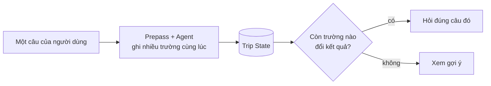

- **Một câu, nhiều trường.** "3 ngày 2 đêm với bồ, đi xe máy" ghi `days`, `nights`, `companions`, `mobility`, mỗi giá trị kèm trích dẫn riêng. Trường đã biết thì quiz bỏ qua.
- **Quỹ thời gian chuyến đi.** "N ngày M đêm" là N ngày lịch: ngày đầu bắt đầu lúc người dùng tới, ngày cuối kết thúc lúc họ về, nên "3 ngày 2 đêm" ít hơn 3 ngày trọn vẹn. `days` và `nights` ghi đúng như người dùng nói: chip "3 ngày 2 đêm" ghi cả hai; "đi về trong ngày" ghi `days = 1`, `nights = 0`; chỉ nói "ở 2 đêm" thì `days = 3` là giá trị *suy ra*. Giờ tới và giờ phải rời (`checkin_at`, `checkout_at`) là mốc thật của ngày đầu và ngày cuối. **Số đêm không còn câu hỏi riêng**: thiếu thì lấy `days − 1` bằng một hàm dùng chung, và Planning dùng đúng hàm này cho tiền phòng và trần giá (trước đây Planning luôn dùng `days − 1`, bỏ qua số đêm người dùng nói, nên "3 ngày 3 đêm" bị tính thiếu một đêm). Plan Output có `time_budget` cho thấy số phút dùng được mỗi ngày.
- **Một câu lưu ý.** Ngay sau "đi cùng ai", hỏi **một lần**, chọn nhiều được: đau chân/khó đi bộ, xe lăn, mang thai, ăn chay, thuần chay, dị ứng hoặc kiêng món, say xe, sợ độ cao, hoặc không có gì. Mỗi chip mang sẵn tín hiệu, giới hạn tương ứng và dấu "đã xử lý", nên chọn xong không còn thẻ hỏi tiếp theo cho từng mục. Dị ứng chưa có feature xác minh trong dữ liệu, nên chỉ là ghi chú nhắc người dùng hỏi quán, **không phải bộ lọc**. Câu này vừa gom việc hỏi sức khỏe về một chỗ, vừa giữ nguyên nguyên tắc fail-closed. Dữ liệu sức khỏe chỉ ở phiên.
- **Tier 1** (an toàn, khung chuyến, anchor trùng tên, ngày) luôn hỏi khi thiếu; các câu mềm (độ đông, nhịp độ, ngân sách, quen hay mới) có thể suy từ mục đích, người đi cùng, hoặc từ chọn và bỏ ở bước Chọn nơi thay vì hỏi trước.
- **Dừng hỏi** khi điểm thấp, hết `turn_budget` (5), hoặc 2 câu liên tiếp không thêm gì (`idle_limit`). **Trường tối thiểu** trước khi "Xem gợi ý": số ngày, người đi cùng, phương tiện, thời điểm.
- Câu lạc đề giữ thẻ đang mở, không tốn ngân sách; chip và chữ cùng lượt thì chữ thắng cho cùng trường.
- Mức dẫn dắt (`guidance`, `effort_budget`, `control`) khởi động từ mặc định "dẫn dắt nhiều" và tự điều chỉnh theo hành vi: trả lời cụt, nhiều "Chưa chắc" → ít câu, chuyển sớm sang đề xuất rồi critique.
- **Cách viết câu hỏi:** mỗi câu có một dòng "vì sao mình hỏi" nói lợi ích cho người dùng ("Ngày đầu tính từ lúc bạn tới… nên 3 ngày 2 đêm là 3 buổi đi chơi và 2 đêm ngủ lại"), chip nói được thành lời đời thường, luôn có "Khác, tự gõ" và "Chưa chắc/Bỏ qua".
- Căn cứ nghiên cứu (§20): giá trị thông tin cao nhất [11][12], làm rõ trước khi lập kế hoạch [13], hỏi cách dùng thay vì thuộc tính [8], có gợi ý kèm nhập tự do [9], "Không chắc" hợp lệ [16].

### 11.4. User Profile & Context Awareness

User Profile là **prior**, không phải fact hay constraint.

```text
Physical Constraint → User Hard Constraint → Override của chuyến này → Recent Interests → Demonstrated Preferences
```

- Lời người dùng trong chuyến hiện tại luôn ghi đè hồ sơ. Ví dụ profile `hiking = high` nhưng chuyến này đi với bố mẹ đau gối → tắt hiking *cho chuyến này*, không sửa profile.
- Giá trị lấy từ hồ sơ mang `source = profile` (hiện nhãn "từ hồ sơ của bạn", sửa một chạm).
- **Session Profile** và **Long-term Profile** tách riêng; một hành động không ghi đè dài hạn. Long-term chỉ đổi khi tín hiệu lặp lại qua nhiều phiên.
- Học mẫu dài hạn mặc định **tắt** và chỉ ghi khi người dùng đồng ý (`remember`). Không bao giờ thành phiếu: trường im lặng/`unknown`/"Bỏ qua" (unknown ≠ không thích), `visited` (đã đến ≠ đã thích), soft do suy luận, tín hiệu sức khỏe/ngày/ngân sách.
- Không suy đoán tuổi, giới tính hay đặc điểm cá nhân.

### 11.5. Constraint Extraction

Mỗi `hard_filter` / `soft_weight` giữ `meaning`, `strength` (mandatory/preference), `scope` (all/eating/drinking/sightseeing/accommodation/travel), `subject` (traveler/group/member), `subject_count`, `evidence`, `ambiguity`. Một runtime skill (`interpret-trip-requirements`) hướng dẫn model diễn giải các trường này.

| Ý định | Contract |
|---|---|
| Một người trong nhóm ăn chay | hard `vegetarian_options=yes`, scope eating, subject member, count 1 |
| Thích đồ chay | soft, không tạo hard |
| Ăn thuần chay | hard `vegan_options=yes`; bằng chứng vegetarian không thay được vegan |
| Không uống rượu | hard `activity != alcohol_consumption`; không cấm venue chỉ vì có rượu |
| Không đi bar/pub | hard `venue_category != bar` |

Ví dụ: café dùng để ăn trưa phải có bằng chứng món chay khi chuyến yêu cầu ăn chay; cùng café đó nếu chỉ uống cà phê thì không cần. Category chỉ xác định hoạt động mặc định, không chứng minh dịch vụ.

Hard constraint còn mơ hồ bị từ chối ghi. Giờ bắt buộc chưa biểu diễn được phải làm rõ, không được chuyển ngầm thành sở thích. Tín hiệu sức khỏe chưa trả lời chặn bước biên dịch.

### 11.6. Search Input Generation

```text
Search Input
├── context          ngày/tháng, số ngày, base, entry/exit, mobility, companions, people, budget_vnd, purpose, hậu cần
├── hard_filters     physical + user hard (kèm unknown_policy exclude|flag)
├── anchors          nơi bắt buộc + độ ưu tiên must|want
├── soft_weights     sở thích đã làm rõ theo feature id
├── activities       {place_id: activity}
├── time_preferences ưu tiên buổi/giờ có evidence
├── pace · novelty · liked_groups
├── unknowns         trường chưa rõ → không lọc, xếp hạng trung tính, gắn cờ
└── unmapped         tên người dùng nêu mà chưa resolve → Decision hỏi lại
```

Từ chủ quan phải biên dịch thành feature trước khi vào `soft_weights` (ví dụ "chill" → `crowd_low↑`, `view↑`, `long_stay↑`). Ví dụ xuyên suốt (người dùng nói "đi hai ngày, một người ăn chay, muốn chụp ảnh ban ngày và uống cà phê giữa trưa; không uống rượu"):

| Module | Kết quả cần giữ |
|---|---|
| Trip | Dietary hard cho eating, tránh alcohol consumption, mục đích photography, ưu tiên giờ có evidence |
| Decision | Điểm tham quan không bị dietary lọc; nơi ăn cần bằng chứng món chay; không tự cấm mọi bar |
| Planning | Photography xếp trong ánh sáng phù hợp khi khả thi; café theo hoạt động coffee; giãn các điểm tranh cùng buổi |

---

## 12. Place Decision Engine — Hỗ trợ lựa chọn địa điểm

**Đầu vào:** Search Input và serving records. **Đầu ra:** tập nơi người dùng xác nhận cùng pool dự phòng. Decision hỗ trợ chọn, không chọn thay.

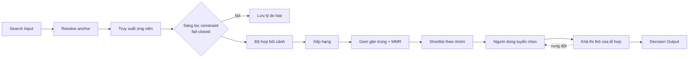

### 12.1. Candidate Retrieval

Resolve tên địa điểm người dùng nêu về serving record (không bao giờ đoán match; nơi chưa xác minh vẫn ở lại, có đánh dấu). Truy xuất ứng viên theo bán kính phụ thuộc phương tiện và base/anchor (`radius_km`), chỉ lấy record `VERIFIED/UNCERTAIN/OUTDATED`. Chỗ ở không bao giờ được gợi ý ở bước này.

### 12.2. Hard & Soft Constraint Filtering

Requirement được kiểm bằng logic dùng chung với Trip và Planning. Mỗi kiểm tra trả `pass | fail | unknown` (hoặc `not_applicable`); `unknown` theo `unknown_policy`: `exclude` loại, `flag` giữ kèm cờ. Lý do loại được lưu để trả lời "vì sao không?". Anchor hoặc nơi đã khóa không bị loại âm thầm: hệ thống báo xung đột; nơi không thể dùng được giữ ở wishlist. Soft preference chỉ đổi thứ tự.

### 12.3. Context-aware Ranking

```text
score = w_ctx·context_fit + w_pref·preference_fit + w_nov·novelty + w_exp·experience_fit
      + w_pop·popularity − w_unc·uncertainty − w_price·price_sensitivity
```

Trọng số trong `config/decision.yaml` (ctx 1,0 · pref 2,0 · nov 1,0 · exp 0,3 · pop 0,2 · unc 0,5 · price 0,5). Quy tắc:

- Địa điểm **không có bằng chứng** cho một feature đóng góp 0, không âm; phần thiếu đi vào `uncertainty`, chỉ tính cho feature người dùng quan tâm.
- Sở thích không liên quan tới hoạt động được bỏ khỏi phép tính.
- Độ phổ biến chỉ là tín hiệu nhỏ; không dùng số sao làm tín hiệu chính.
- `context_fit` thô và rẻ (không gọi route service): khoảng cách tới base/anchor, cùng khu vực, đường vào theo phương tiện, độ đông theo ngày/buổi, nhạy mùa.
- Điểm lưu kèm từng thành phần để giải thích và debug.

### 12.4. Diversity & Duplicate Reduction

Nơi gần trùng (cùng category, trùng phần lớn feature có bằng chứng, cùng vai trò) được gom thành nhóm với một đại diện và các thay thế. Shortlist chọn kiểu **MMR**: mỗi lượt cân bằng điểm phù hợp với mức khác biệt so với các nơi đã chọn. Cỡ shortlist ≈ số chỗ cần × hệ số dư, theo nhịp độ (3/4/6 nơi mỗi ngày cho thong thả/cân bằng/đi nhiều). Danh sách hiển thị theo nhóm (thiên nhiên, tham quan, chill) với cửa sổ cuộn và chuyển cảnh giữ/gỡ/thêm khi xếp hạng đổi.

### 12.5. Explainable Recommendations

Mỗi thẻ ứng viên có: **vì sao phù hợp** (feature khớp, kèm trích dẫn và cỡ mẫu), **đánh đổi** (ví dụ "thêm ~25 phút di chuyển"), **thời gian** (khoảng), **độ tin cậy** (Cao/Trung bình/Thấp, một dòng lý do), và cờ cho phần chưa biết. Công cụ giải thích: **so sánh** 2–3 nơi chỉ hiện thuộc tính khác nhau; **why-not** nêu quy tắc đã loại một nơi. Lời giải thích chỉ dùng dữ liệu trong serving record; địa điểm ngoài màn hình không bị bịa vào lựa chọn.

### 12.6. Interactive Selection & Decision Output

- Thao tác: chọn, bỏ (lý do tùy chọn: quá xa / đông / đắt / không thích / đã đi), khóa, đổi, nới có ghi nhận, hỏi bằng chữ. Không bấm vào một nơi không được coi là không thích; lý do bỏ điều chỉnh Session Profile và xếp lại ứng viên chưa chọn.
- **Khả thi thô sau mỗi thao tác:** tổng thời lượng, tải di chuyển theo cụm, giờ mở cửa, ngân sách, anchor. Kết quả `khả thi | khả thi một phần | không khả thi`, kèm cách sửa cụ thể ("bỏ C tiết kiệm 90 phút"). Xung đột với giới hạn người dùng → đề nghị nới kèm cái giá; xung đột vật lý → chỉ cách dời có thật.
- **Lịch ngầm:** sau mỗi thay đổi (debounce 350 ms), harness dựng thử lịch qua Planning để người dùng thấy hệ quả ngay.
- Câu gõ ở Decision: một Agent call mỗi lượt biến câu thành act có kiểm; lệnh "chọn/bỏ/khóa <tên đầy đủ>" xử lý bằng heuristic, không gọi model.
- **Decision Output:** nơi đã xác nhận, backup pool (kèm lý do), wishlist, snapshot Search Input, `decision_log`, khả thi.

---

## 13. Planning & Validation Engine — Lập và kiểm chứng lịch trình

**Đầu vào:** Decision Output và Live Context. **Đầu ra:** một số phương án lịch đã kiểm, kèm giải thích và đánh đổi.

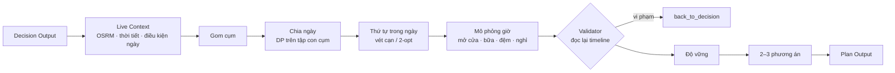

### 13.1. Planning Objectives & Constraints

Các mục tiêu: ít di chuyển, chi phí thấp, vững trước thời tiết, đa dạng, hợp sở thích. **Pace** điều chỉnh cường độ (số nơi/ngày, đệm, nghỉ); **objective** quyết định tiêu chí so sánh phương án. Hai khái niệm tách riêng: "thư thả" là cường độ, "tiết kiệm" là mục tiêu.

Bất biến Planning:

| Bất biến | Cách ép |
|---|---|
| Không xáo lịch âm thầm | Local repair phạt mỗi thay đổi; mọi thay đổi đi qua diff |
| Nơi `locked`/anchor không bị dời | Repair từ chối, báo lỗi rõ |
| Physical không nới | `validate` là nơi duy nhất kết luận; không có act nới physical |
| Không nhận lịch chưa kiểm | `confirm` từ chối khi `validate` chưa `ok` |
| Lịch thô không được "Vững" | `robustness` đọc `travel_source`, trần "Khả thi" |
| Live không thành tri thức lâu dài | `src/live` không có đường ghi vào `data/intel`; test khẳng định |

### 13.2. Live Context Integration

Mọi hàm live trả `None` khi không có dữ liệu; không bịa. Số live mang `source` + `fetched_at`.

| Nguồn | Cung cấp | TTL |
|---|---|---|
| OSRM | Ma trận thời gian di chuyển (một ma trận mỗi lượt cho mọi phương án), hình tuyến | 7 ngày |
| Open-Meteo | Mưa, gió giật, dông theo ngày | 3 giờ |
| Maps lodging | Ứng viên chỗ ở quanh khu, giá tham khảo | 24 giờ |
| Google Flights, Vexere | Chuyến bay, xe khách (câu hỏi hậu cần) | 26 giờ, prewarm hằng ngày |
| `sun.py`, `holidays.yaml`, `events.yaml`, `advisories.yaml` | Bình minh/hoàng hôn, lễ, sự kiện, thông báo thiên tai (nhập tay) | — |

**Điều kiện từng ngày** đổi chính kế hoạch: ngày mưa nặng tăng đệm và phạt nơi ngoài trời; ngày `severe` chặn nơi `weather_exposed`; cuối tuần/lễ làm tăng thời gian ở nơi đông; dịp Tết đệm thêm cho nơi ăn uống. Dữ liệu vắng thì không kết luận: "không có thông báo" không bao giờ được viết thành "an toàn".

### 13.3. Location Clustering & Day Allocation

- **Gom cụm** theo thời gian di chuyển thực (complete-link, đường kính ≤ 25 phút); cụm quá tải (> 80% quỹ ngày) được tách.
- **Chia ngày:** trong giới hạn cấu hình (≤ 7 ngày, ≤ 8 cụm) dùng **quy hoạch động trên tập con các cụm**; hàm phí xét di chuyển, tải ngày, số nơi theo pace, giờ mở cửa, thời tiết, đông khách. Bài toán lớn hơn dùng gán tham lam và gắn nhãn fallback.
- Nơi chỉ phù hợp một số ngày hoặc cùng tranh một cửa sổ ưu tiên có thể được tách để phân bố lại.

### 13.4. Route & Schedule Optimization

- **Thứ tự trong ngày:** ≤ 7 điểm → **vét cạn** mọi hoán vị; nhiều hơn → nearest-neighbour + 2-opt + or-opt. Mỗi thứ tự được mô phỏng với giờ mở cửa, bữa ăn (11:30–13:30, 18:00–20:30), đệm theo pace, nghỉ sau chuỗi hoạt động dài. Ưu tiên tránh vi phạm trước khi cải thiện chi phí mềm.
- **Chấm toàn khoảng ghé thay vì chỉ giờ đến:** độ phù hợp giờ xét hoạt động, mục đích và ưu tiên có bằng chứng. Phí timing tăng theo phần thời lượng nằm ngoài cửa sổ ưu tiên; visit có thể rút trong khoảng ước tính, không thấp hơn mức `short`. Khung giờ mặc định là heuristic cấu hình được, không phải fact địa điểm.
- **Chỗ ở** có thể làm neo đầu/cuối ngày để đo tác động lên lịch; crawl nền, không bắt người dùng chờ.
- DP tối ưu hàm phí chia cụm; vét cạn tối ưu thứ tự trong một ngày. Kiến trúc nhiều bước này **không bảo đảm tối ưu toàn cục cho cả chuyến**.

### 13.5. Feasibility Validation

**Validator đọc lại timeline cuối**, độc lập với kết luận của scheduler: giờ mở cửa, chồng lấn, di chuyển, khung ngày, anchor, hard constraint (qua `requirements`), ngân sách đã biết, trùng địa điểm, hazard (thời tiết nặng, thông báo). Thiếu giá được báo riêng. Chỉ lịch `ok` mới `confirm` được. Nếu một nơi không xếp được vào ngày nào, kết quả `back_to_decision` kèm nguyên nhân để người dùng thay/bỏ/nới.

### 13.6. Robustness & Alternative Plans

- **Độ vững** đo bằng kịch bản nhiễu: xuất phát trễ, visit dài hơn, travel chậm hơn, mưa. Nhãn Vững / Khả thi / Mong manh phản ánh khả năng chịu nhiễu, không phải xác suất bảo đảm thành công.
- **Dự phòng** lấy từ các ứng viên đã bị loại, gắn với điểm nhạy cảm ("Nếu mưa: A → B trong nhà", "Bị trễ: bỏ C trước"); chỉ thay khi người dùng chọn. Backup cho bữa ăn được kiểm ở hoạt động eating.
- **Gợi ý thêm nơi** chỉ dùng ID thật từ pool dự phòng, thử chèn và validate trước khi trả.

### 13.7. Plan Output & Revision

```text
Plan Output
├── variants       2–3 phương án: mục tiêu, lịch, điểm, độ vững, bảng đánh đổi
├── itinerary      theo ngày: nơi, giờ đến/đi, chặng (phút, mode), chờ, đệm, nghỉ, bữa ăn
├── route          hình lộ trình (OSRM /route)
├── lodging        đã chọn + ghi chú giá tham khảo
├── time_budget    quỹ thời gian: số ngày, số đêm, phút dùng được mỗi ngày (ngày đầu mở lúc tới, ngày cuối đóng lúc rời)
├── cost           chi phí ước tính (vé, đồ uống, phòng khi biết giá)
├── time_suitability · recommendations · day_conditions · crowd_tips
├── reasons · tradeoffs · warnings · uncertainty
├── robustness · backups
└── provenance     mỗi số live kèm source + fetched_at
```

**Phạm vi tính lại khi người dùng sửa.** Mỗi thao tác được phân loại: đổi thứ tự ngày 2 chỉ xếp lại ngày 2; chuyển nơi giữa hai ngày ảnh hưởng cả hai; đổi pace có thể ảnh hưởng cả chuyến; đổi nhu cầu/hard constraint quay về Trip/Decision. Nút sửa trực tiếp dùng code tất định; LLM chỉ chạy khi hiểu câu tự do hoặc chạy proposal tối ưu.

**Agent đề xuất nội bộ.** Agent nhận snapshot phương án + diagnostics và chỉ được trả act `move_place`/`reorder` tham chiếu ID có sẵn. Đề xuất chạy trên **nháp**, bị kiểm membership, anchor, slot khóa, validator và điểm mục tiêu không kém baseline; thất bại giữ baseline. Agent không chọn chỗ ở, không đổi pace, không nới constraint, không confirm.

**Tối ưu tính toán khi sửa** (chi tiết và số đo ở §17.5; đề xuất ở [PLANNING_PERFORMANCE_PROPOSAL.md](PLANNING_PERFORMANCE_PROPOSAL.md)):

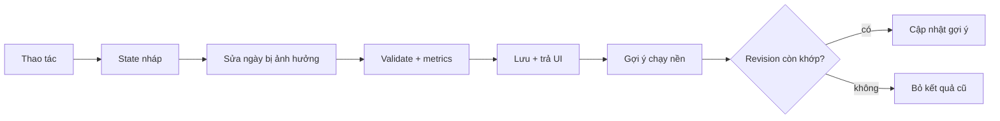

---

## 14. AI Agent Architecture & Orchestration — Kiến trúc tác tử AI

### 14.1. AI Components & Model Roles

Code gọi model theo **vai trò**, không gọi thẳng một model cố định. Model cụ thể nằm trong config, key trong `.env`; đổi model là đổi config và phải qua bộ regression.

| Vai trò | Dùng ở | Model hiện tại | Ghi chú |
|---|---|---|---|
| ASR | Corpus (TikTok) | ChunkFormer (chính), PhoWhisper-medium (ASR2) | Chạy GPU local |
| Extractor | Corpus: observe, filter, qc, kiểm span, kiểm ASR, xác minh video-nơi, chấm ảnh | Gemma 4 26B (host LAN; UIT dự phòng) | Nhận ảnh, output có schema, throughput cao |
| Judge | Corpus: audit, status, dedup | Gemma 4 trên UIT; Judge mạnh cho giá trị cho phép và đóng cửa/gộp nơi | Thiết kế yêu cầu khác họ model với Extractor; hiện cùng họ Gemma nên precision vẫn đo bằng nhãn mạnh có sẵn |
| Agent | Trip (vòng tool), Decision (lượt chữ), Planning (proposal) | Model qua endpoint tương thích OpenAI, cấu hình ở `.env` | Có ngân sách thời gian |
| Clef | Trip: phân loại lượt gõ | Cloudflare Workers AI | Timeout 1 s, lỗi thì bỏ qua |

**Code** giữ mọi việc còn lại: chuẩn hóa, dedup, chấm điểm, tổng hợp, gate, sàng lọc, xếp hạng, xếp lịch, validate. Model không ghi fact, không tạo địa điểm.

### 14.2. Agent Harness Architecture

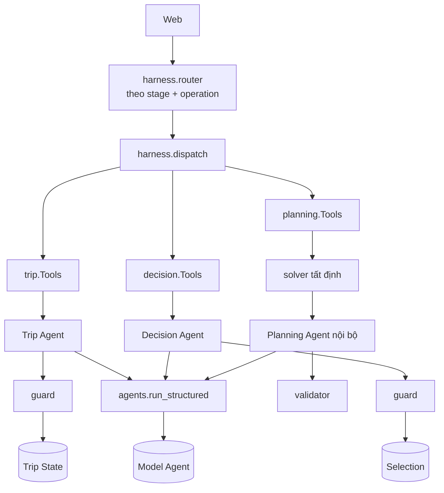

- Mỗi module sở hữu state, tool và guard của mình; harness điều phối bằng Python qua public API. Router **không gọi LLM** và không chọn agent theo lời model.
- Tool và workflow khai báo trong `skills.yaml` (do repo quản lý, không tải từ người dùng); `permit_tool` kiểm quyền tại adapter.
- Runtime chung `agents.run_structured`: stream, deadline, JSON/schema, retry vòng khoảng trắng một lần, giới hạn call trong tiến trình.

### 14.3. Tool Calling & Execution Guards

| Router: stage | Operation được phép | Kết quả |
|---|---|---|
| `trip` | `turn`, `advance` | `advance` → Decision từ Search Input đã compile trên server |
| `decision` | `turn`, `act`, `advance`, `back` | `advance` → Planning; `back` → Trip |
| `planning` | `act`, `recommend`, `confirm`, `back` | `confirm` → Plan Output; `back` → Decision |

Request đến stage không active bị từ chối. `advance`, `back`, `recommend`, `confirm` chỉ nhận payload rỗng: client không gửi output để thay handoff đã kiểm.

Các lớp guard:

| Lớp | Chặn gì |
|---|---|
| Schema | Output sai kiểu |
| Trip `guard` | Quote không có trong lời người dùng; giá trị không parse được; hard mơ hồ; `say` nêu số/tên chưa ai nói |
| Decision | Act ngoài các nơi trên màn; nới constraint không có xác nhận |
| Planning | Proposal ngoài membership/anchor/slot khóa; lịch không qua validator |
| Quyền ghi | Chỉ `record_fact` (Trip) và act đã kiểm mới ghi state |

### 14.4. State Management & Handoff

Một `Journey` giữ ID, `user_id`, stage, revision, ID phiên các module, output, snapshot và receipt.

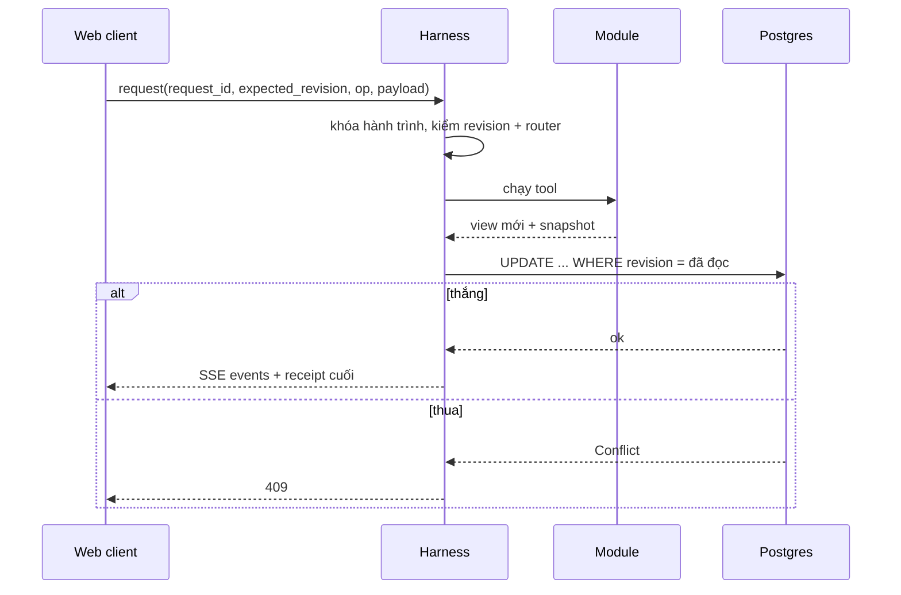

- **Idempotent:** trùng `request_id` + nội dung trả lại receipt đã lưu; dùng lại ID với nội dung khác hoặc revision cũ bị từ chối.
- **Atomic:** save lỗi → khôi phục snapshot trước mutation; restart phục hồi từ snapshot đã commit, không gọi lại LLM để replay.
- **Client** tuần tự mutation, lưu pending request trước khi gửi, replay sau reload; lọc read/SSE cũ theo revision và generation.
- Quay lại giữ ID phiên và lựa chọn; quay lại vô hiệu output ở bước sau.

### 14.5. Reliability, Fallback & Error Handling

| Sự cố | Hành vi |
|---|---|
| Agent timeout / queue đầy / schema sai | Trip giữ phần `prepass` đã đọc và báo phần chưa xử lý; Decision dùng `policy.py`; Planning giữ baseline đã kiểm |
| Clef lỗi | Bỏ qua, dùng regex |
| OSRM không chạy | Ước lượng thô, cảnh báo, độ vững trần "Khả thi" |
| Nguồn live lỗi (captcha, trang rỗng) | `Unavailable`, không bao giờ trả dữ liệu giả; link đặt vé |
| Worker gợi ý nền lỗi | Gợi ý `unavailable`, không ảnh hưởng lịch chính |
| Crawl bị chặn | Dừng, nghỉ, thử lại; captcha do người giải, không tự giải |
| Output corpus trượt gate | Thử lại một lần kèm lý do, sau đó bỏ kèm lý do — không bao giờ vá bằng cách đoán |

Ngân sách model: edit, act, router và nút bấm không gọi LLM. Hạn mức `max_parallel 2`, `max_waiting 16` trong tiến trình; hàng chờ nằm trong deadline tổng.

### 14.6. Explainability & Safety

- Mọi câu trả lời của agent chỉ dùng dữ liệu trong kết quả tool của phiên (Planning: mọi `place_id`, số phút, giá phải có trong kết quả tool; số live phải có `source` + `fetched_at`).
- Model không dựa vào kiến thức sẵn có cho fact cụ thể: luôn đưa văn bản nguồn vào prompt.
- Log ghi đường xử lý mỗi lượt (`agent | fallback | heuristic:*`, `clef_reject:*`), phục vụ Admin phát lại phiên.
- Giới hạn của người dùng chỉ được nới khi họ xác nhận, kèm hệ quả đã tính; không có đường code nào nới physical constraint.

---

## 15. Technical Implementation & Deployment — Triển khai kỹ thuật

### 15.1. Technology Stack

| Lớp | Công nghệ |
|---|---|
| Backend | Python ≥ 3.12 (đang dùng 3.13), pydantic, PyYAML, psycopg 3 (pool), `openai` SDK, Playwright (crawl) |
| Frontend | React 19, TypeScript, Vite, Radix UI (dialog, popover), GSAP, Lenis, Three.js (landing 3D) |
| CSDL | PostgreSQL 16 (dữ liệu người dùng); file JSON/JSONL cho corpus |
| Định tuyến | OSRM trên OSM Việt Nam (Docker) |
| AI | Gemma 4 26B (Extractor/Judge), ChunkFormer + PhoWhisper (ASR), model Agent qua endpoint tương thích OpenAI, Clef |
| Hạ tầng | Cloudflare Tunnel, server Node (`web/server.mjs`) phục vụ bản public |
| Kiểm thử | pytest (1.426 test chạy mặc định, không tính test crawler đã bỏ), Playwright chụp màn hình |

### 15.2. Project Structure

```text
src/
  corpus/      crawl · observe · aggregate · judge · serving · review · llm (Place Intelligence)
  trip/        api · agent · domain · infrastructure (Trip Understanding)
  decision/    Place Decision          planning/  Planning & Validation
  live/        osrm · weather · lodging · geocode · flights · buses · sun
  requirements/ agents/ harness/ accounts/ db/ companion/ notify/ analytics/ bench/
config/        trip · decision · planning · live · ontology · serving · agents · ... (.yaml)
migrations/    SQL đánh số            web/    React (landing · user · admin)
tests/         theo package           docs/   tài liệu theo giai đoạn
```

Mỗi giai đoạn có tài liệu riêng (`docs/CORPUS.md`, `TRIP_UNDERSTANDING.md`, `PLACE_DECISION.md`, `PLANNING.md`). Mọi ngưỡng nằm trong `config/`, không trong code.

### 15.3. Data Storage & Database Design

| Loại | Lưu ở | Ghi bởi |
|---|---|---|
| Dữ liệu thô theo nguồn | `data/gmaps/`, `data/tiktok/`, `data/official/` | `corpus.crawl` |
| Observation | `data/<nguồn>/observations/` | `corpus.observe` |
| Place Intelligence | `data/intel/places/` | `corpus.aggregate` |
| Serving index | `data/serving/places.json` | `corpus.serving` |
| Nhãn review | `data/review/` | Judge, người |
| Cache live | `data/live/` (TTL) | `live` |
| Dữ liệu người dùng | Postgres | Online |

Quy ước file: `.jsonl` chỉ append; file khác ghi `*.tmp` rồi `os.replace` (atomic); không bước nào xóa dữ liệu nguồn. Không lưu tên người comment: `author_hash = sha256(id)[:16]`.

**Postgres (17 bảng, 2 migration):**

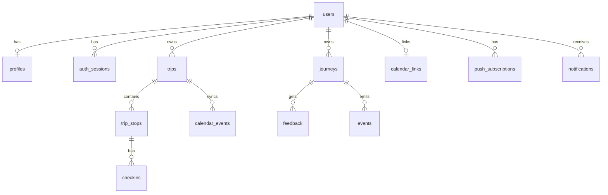

Bảng: `users`, `auth_sessions`, `oauth_states`, `profiles`, `calendar_links`, `journeys`, `feedback`, `events`, `trips`, `trip_stops`, `checkins`, `calendar_events`, `calendar_sync`, `push_subscriptions`, `notification_prefs`, `notifications`, `insight_clusters`. Role `tg_app` ghi; `tg_analytics` chỉ đọc và không đọc bảng chứa bí mật (`auth_sessions`, `oauth_states`, `calendar_links`, `push_subscriptions`).

### 15.4. API & Interface Contracts

Harness HTTP/SSE bind `127.0.0.1:8769`; Vite/`server.mjs` proxy `/api/harness` và `/api/auth`.

| API | Việc |
|---|---|
| `POST /api/harness/sessions` | Tạo hành trình (gắn tài khoản) |
| `POST /api/harness/sessions/<id>/request` | Mutation JSON; `Accept: text/event-stream` để nhận SSE |
| `GET /api/harness/sessions/<id>/read/decision/{compare,why-not,page}` | So sánh, lý do loại, trang tiếp |
| `GET /api/harness/sessions/<id>/read/planning/{variants,lodging,suggestions}` | Phương án, chỗ ở, gợi ý nền |
| `GET /api/harness/sessions/<id>/preview` | Lịch ngầm ở stage `decision` |
| `GET /api/harness/{places,geo,lodging/suggest,transit}` | Tra nơi, địa danh, chỗ ở, chuyến xe/bay |
| `POST …/feedback`, `POST /api/harness/reports` | Phản hồi; báo thông tin sai (không đổi corpus ngay) |
| `…/today`, `…/companion`, `/calendar/{preview,apply,disconnect}` | Đang đi, Calendar |
| `/api/harness/me…`, `/push/…`, `/notifications…`, `POST /events` | Tài khoản, thông báo, event |

Request mẫu và response ở Phụ lục C. Mã trạng thái: 400 input sai · 401 chưa đăng nhập · 403 sai Origin · 404 không có (kể cả hành trình của người khác) · 409 conflict revision/router. Body tối đa 64 KiB (avatar 5 MB).

### 15.5. Security & Privacy

- **Đăng nhập chỉ bằng Google** (code + PKCE S256); `state` dùng một lần, hết hạn 10 phút; cookie `tg_session` `HttpOnly; SameSite=Lax`, `Secure` khi https.
- Token phiên chỉ lưu hash SHA-256; refresh token Google mã hóa Fernet.
- Mutation phải có `Origin` khớp; hành trình của tài khoản khác trả 404.
- **Bản public** (`server.mjs`) chỉ mở `/api/harness/*` và `/api/auth/*`; `/admin`, analytics và mọi `/api/*` khác trả 404.
- Event không chứa email, tên, hay chữ người dùng gõ (trừ ô tìm nơi); client chỉ gửi tên/prop trong allowlist.
- Avatar: cắt vuông 256 px, bỏ EXIF, không giữ file gốc.
- **Xóa tài khoản:** thu hồi token Google, xóa hồ sơ, token, subscription, avatar, mẫu dài hạn; hành trình/event/thông báo còn lại với `user_id = NULL`.
- Hồ sơ là prior, học mẫu dài hạn chỉ khi đồng ý; check-in và thông báo không là bằng chứng về địa điểm và không ghi Place Intelligence.
- Quản lý bí mật: key chỉ trong `.env` (gitignore), không hardcode; không dùng `verify=False` với TLS.

### 15.6. Deployment Architecture

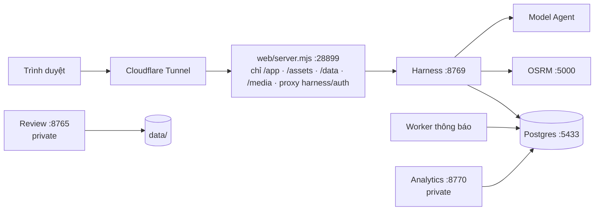

`./run.sh start` chạy harness, analytics, review, Vite dev server và worker thông báo; `./run.sh prod` build web (nén `.br/.gz`, `snapshot.json` cắt từ 27 xuống 16 MB, ETag, cache theo loại) rồi chạy bản public qua tunnel. Prewarm chuyến bay/xe khách bằng cron mỗi đêm.

### 15.7. Reproducibility

1. Clone repo, tạo venv, `pip install -e ".[dev]"`, `npm install` trong `web/`, `cp .env.example .env`.
2. Tải gói dữ liệu `tripguardian-data-<ngày>.zip` từ Drive của nhóm (Phụ lục A), giải nén tại gốc repo (trả về `data/`, snapshot web, fixture test).
3. `bash scripts/osrm_setup.sh` (một lần), `./run.sh db` (Postgres + migration), `./run.sh start`.
4. Kiểm: `python -m pytest -q` (không gọi mạng; test `live` và `pg` tách bằng marker).

Pipeline corpus tái lập bằng CLI (`python -m corpus … all`, `aggregate`, `serving`) và ledger; build lần sau chỉ xử lý phần đổi. Benchmark Trip/Decision/Planning tái lập bằng `python -m bench`, `python -m decision evaluate`, `tests/planning/bench_edits.py`. Mọi số trong báo cáo truy được về lệnh và file ở Phụ lục G.

---

# PHẦN III. PROTOTYPE, EVALUATION & FEASIBILITY — THỬ NGHIỆM VÀ ĐÁNH GIÁ

## 16. Product Prototype & User Experience — Sản phẩm thử nghiệm

Prototype là một ứng dụng web chạy thật trên dữ liệu thật (Đà Lạt), có landing, User Web (`/app`, cần tài khoản hoặc "Dùng thử") và Admin Web (`/admin`, private).

### 16.1. User Interaction Flow

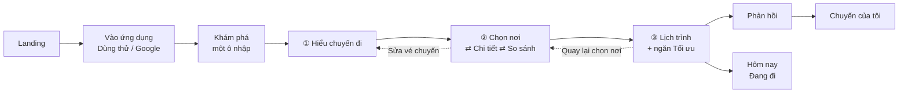

- Ba bước trên stepper (Hiểu chuyến đi → Chọn nơi → Lịch trình) tương ứng ba module; đi lùi giữ ID phiên và lựa chọn.
- Một ô nhập duy nhất ở "Khám phá" nhận câu tự do, link đã lưu hoặc danh sách; hệ thống tự phân loại trạng thái bắt đầu, không hỏi. Có lối tắt khi chưa biết gõ gì (4 thẻ bắt đầu, 3 chủ đề).
- Ngoài luồng (rail trái): Khám phá · Chuyến của tôi · Đã lưu · Hồ sơ.

### 16.2. Main Screens & Functionalities

| Màn | Chức năng chính | File |
|---|---|---|
| Landing | Giải thích vấn đề, một CTA; cảnh 3D sa bàn Đà Lạt, các chương cuộn | `user/screens/Landing.tsx` |
| Vào ứng dụng | "Dùng thử, không cần tài khoản" là lựa chọn chính; Google; đồng ý điều khoản lần đầu | `Auth.tsx` |
| Khám phá | Ô nhập lớn, chip, chuyến đang lập, thẻ bắt đầu và chủ đề | `Discover.tsx` |
| Hiểu chuyến đi | Hội thoại hoặc quiz thẻ; panel "Mình đang hiểu" (sửa được); "Đang hợp với bạn" (số nơi qua giới hạn đổi theo từng lựa chọn); thẻ hậu cần (xuất phát, cách tới Đà Lạt, chọn chuyến xe/bay, chỗ ở) | `Understand.tsx`, `TripChat.tsx` |
| Chọn nơi | Lưới hoặc đĩa xoay theo nhóm; thẻ "vì sao hợp / đánh đổi / độ tin cậy"; Thêm · Bỏ · Khóa; thanh "Đã chọn" với khả thi trực tiếp và dòng chênh lệch; trợ lý bên phải | `Explore.tsx` |
| Chi tiết nơi | Thông tin thực tế (giờ, giá, bản đồ Google) tách khỏi "người đi trước nói gì" (xu hướng + cỡ mẫu, bình luận gốc, clip TikTok phát đúng đoạn); Báo thông tin sai | `PlaceDetail.tsx` |
| So sánh | 2–3 nơi, chỉ hàng khác nhau, ô tốt hơn có dấu; Giữ / Bỏ | `Compare.tsx` |
| Chỗ ở "Bạn ở đâu?" | Gợi ý chỗ ở theo gu trước khi xếp lịch; nhập chỗ đã đặt | `Lodging.tsx` |
| Lịch trình | Tab ngày + timeline + bản đồ Google; độ vững; dự phòng gắn điểm nhạy cảm; điều kiện ngày (mưa, đông); ngăn Tối ưu; Hoàn tác; Chốt kế hoạch | `Plan.tsx` |
| Phản hồi | Điểm 1–5 cho vài khía cạnh, ghi chú tùy chọn | `Done.tsx` |
| Hôm nay | Thẻ điểm dừng, Đã đến tự nguyện, bảng "Ở đây" (chơi gì, lưu ý, gần đây), "Phần còn lại hơi chật", Google Calendar xem trước → xác nhận | `Today.tsx` |
| Hộp thông báo, Hồ sơ | Bật/tắt từng loại, tạm im, xóa tài khoản hai bước | `Inbox.tsx`, `Account.tsx` |
| **Admin** | Dashboard · Review Queue · Labels (đo precision) · Places · Evidence · Phiên chuyến đi · Analytics · System | `admin/screens/` |

### 16.3. Human–AI Interaction

Nguyên tắc: **AI hiểu và giải thích, người quyết định; mọi thứ AI nói đều có thể kiểm.**

| Điểm tương tác | Thiết kế |
|---|---|
| Hỏi nhu cầu | Cảm giác hội thoại ngắn, không phải biểu mẫu; mỗi lượt một câu; luôn có chip gợi ý + ô nhập tự do + "Chưa chắc" + "Bỏ qua / gợi ý trước đi" |
| Hai chế độ | Chat (Agent hỏi bằng chữ) và Quiz (thẻ) do người dùng chọn, cùng một Trip State, đổi qua lại không mất dữ liệu |
| Phản hồi tức thì | Mỗi chip ghi trước nó làm số nơi hợp đổi bao nhiêu ("−N nơi"/"+N nơi"); người dùng thấy hệ quả của câu trả lời |
| Bản hiểu nhu cầu | Panel "Mình đang hiểu": điều đã nói, điều suy luận (đánh dấu ✎ "từ hồ sơ"/"từ lời bạn"), phần chưa chắc; sửa một chạm |
| Trợ lý ở Chọn nơi | Ngăn bên phải; câu gõ thành act có kiểm (chọn/bỏ/khóa); câu thể hiện mong muốn về chuyến được chuyển sang Trip rồi *rebase* danh sách, kèm câu tóm tắt "Giữ 22 nơi, thay 2 nơi hợp hơn" |
| Giải thích hai phía | Mọi gợi ý có "vì sao phù hợp" *và* đánh đổi; mọi xung đột nêu tên nơi, quy tắc, cách sửa |
| Chờ model | Khung xương đúng bố cục thật, chữ nói đúng việc đang làm; không thanh phần trăm giả; agent đang trả lời thì khóa ô chọn và hiện chữ dần |
| Tính tất định | Chip, sửa panel, nút bấm, thao tác lịch không gọi model — phản hồi nhanh và lặp lại được |

### 16.4. Transparency & User Control

**Minh bạch chất lượng dữ liệu** (áp mọi màn):

| Trạng thái dữ liệu | Người dùng thấy |
|---|---|
| Đã xác minh | Giá trị, bình thường |
| Chưa chắc chắn | Giá trị kèm "chưa xác nhận"; chạm xem lý do |
| Quá hạn | "Có thể đã thay đổi — kiểm tra lần cuối <ngày>" |
| Cần duyệt / vô hiệu | Không hiển thị |
| Chưa biết | "Chưa có thông tin" — không bao giờ là giá trị mặc định hay "không" |

| Loại giá trị | Cách trình bày |
|---|---|
| Fact (giờ, giá) | Giá trị chính xác + nguồn + ngày |
| Signal (độ đông, yên tĩnh) | Xu hướng kèm bối cảnh và cỡ mẫu ("sáng cuối tuần: đông · 123 comment, 30 creator") |
| Estimate (thời gian tham quan) | Luôn là khoảng ("60–90 phút") |

- **Bằng chứng một chạm:** nhận định mở ra bình luận và clip phát tại đúng đoạn, ghi @creator và link về clip gốc. Thông tin thực tế (chính thức/Google) và bằng chứng trải nghiệm (TikTok) tách rõ về hình ảnh vì là hai loại sự thật khác nhau.
- **Giới hạn cứng và sở thích mềm trông khác nhau:** quy tắc cứng là *con dấu* viền đậm có khóa; sở thích mềm là chip viền đứt, có × để bỏ và ghi nguồn.
- **Quyền kiểm soát:** không bao giờ bỏ lặng lẽ một nơi người dùng đã chọn; giới hạn người dùng đặt chỉ nới khi họ xác nhận, kèm hệ quả; khóa nơi bắt buộc; Hoàn tác từng thao tác; lịch không tự đổi sau khi trả; Calendar luôn xem trước rồi xác nhận, và nếu kế hoạch đổi chỉ nhắc một dòng, không tự đồng bộ.
- **Riêng tư:** hồ sơ có thể xem/sửa/xóa; học mẫu chỉ khi đồng ý; "Báo thông tin sai" chỉ đưa vào hàng đợi review, không đổi dữ liệu và không là bằng chứng.
- **Đang đi:** check-in tự nguyện, không có trạng thái "lỡ"; thông báo ít, giọng trung tính, tắt/tạm im dễ, tự im sau 3 thông báo không mở.

### 16.5. UX Design Principles

1. **Giúp quyết định, đừng bắt lướt:** một tập nhỏ hữu ích, gom nơi giống nhau và nói nên giữ nơi nào.
2. **Sự không chắc chắn phải hiện ra** ngay tại chỗ ra quyết định.
3. **Mọi nhận định cách bằng chứng một chạm.**
4. **Giải thích cả hai phía:** vì sao hợp *và* đánh đổi.
5. **Người dùng giữ quyền kiểm soát.**
6. **Điều bất khả thi về vật lý là cứng:** không nút nào biến kế hoạch không đi kịp thành khả thi.
7. **Chỉ hỏi điều làm thay đổi kết quả;** mỗi câu bỏ qua được.
8. **Suy đoán từ hồ sơ phải có nhãn** và sửa được một chạm.

**Chuyển cảnh:** đúng năm kiểu, mỗi kiểu có nghĩa. T1 *Sang bước* (mờ + dịch 24 px, 280 ms, thanh trên đứng yên); T2 *Chờ máy* (sang ngay khung xương); T3 *Đào sâu* (ảnh bìa nở thành đầu trang chi tiết, quay lại giữ tab và vị trí cuộn); T4 *Lớp phủ* (panel trượt, 240 ms); T5 *Cập nhật tại chỗ* (nháy nền 600 ms, danh sách tự xếp lại, dòng chênh lệch không chặn thao tác). Tôn trọng `prefers-reduced-motion`.

**Trạng thái dùng chung:** rỗng = minh họa + một câu nói vì sao + **một** nút dẫn tới màn sửa được; lỗi thao tác hiện ngay dưới nút vừa bấm (không toast góc màn); lỗi giữa đường chuyển thì ở lại màn cũ, không sang màn đích rỗng.

**Hình ảnh & nội dung:**

- Nền giấy sáng, editorial dẫn bằng **ảnh thật** của chính nơi đó (Google Maps/khung clip, có ghi nguồn); ảnh sinh chỉ dùng cho không khí landing.
- Màu và chữ lấy từ token (`web/src/user/css/tokens.css`), không hard-code; chữ số/giờ/giá dùng font đơn cách để dễ đọc.
- Nội dung bằng tiếng Việt đời thường, giọng "TripGuardian / bạn", không dùng thuật ngữ hệ thống.
- Dữ liệu từ Google hiển thị cùng bản đồ Google; chỗ ở không nằm trong shortlist.
- **Thiết kế cho máy tính:** điện thoại mở web được mời tải ứng dụng (làm sau); Admin chỉ desktop, dày thông tin, có phím tắt.
- Bố cục khung: `FLOW` (stepper 68 px + thanh dính đáy 76 px), `NAV` (rail trái 76 px), `BARE` (màn đăng nhập); không bao giờ hiện cùng lúc stepper và rail.

---

## 17. Experiments & Evaluation — Thực nghiệm và đánh giá

### 17.1. Evaluation Objectives

| Câu hỏi | Chỉ số |
|---|---|
| Hệ thống có hiểu đúng nhu cầu và hỏi ít không? | Độ chính xác trường, số thẻ/lượt hỏi, trường "bịa" (phải 0) |
| Có vi phạm điều người dùng cấm không? | Hard-constraint violation trong shortlist và lịch (phải 0) |
| Shortlist có hữu ích và đa dạng? | Tỷ lệ chuyến lấp đủ shortlist, tỷ lệ gần trùng |
| Có ra được lịch khả thi? | Tỷ lệ ra lịch, độ vững |
| Sửa lịch có nhanh không? | Độ trễ p50/p95 theo thao tác |
| Dữ liệu có đáng tin? | Precision theo nhãn Judge/người, độ phủ bằng chứng |
| Người dùng thật có thấy hữu ích? | **Chưa đo** (§17.6) |

### 17.2. Experimental Setup & Datasets

- **Dữ liệu:** serving index Đà Lạt 1.696 địa điểm (dựng 08/10/2026) trên dữ liệu thật; Live Context giả lập trong test, OSRM/thời tiết thật trong chạy live.
- **30 Trip State ẩn** (`config/eval_trips.yaml`): dùng chung để đo Decision và Planning (người cao tuổi, xe lăn, gia đình có trẻ, cặp đôi, nhóm ăn uống, ngày mưa, ngân sách, leo núi, làm việc từ xa, đường xấu + xe máy, và các tổ hợp chéo).
- **40 chuyến ẩn của Bench** (`config/bench_trips.yaml`, sinh tất định bằng seed 1): mỗi chuyến có sự thật biết trước (khung, khẩu vị, cơ thể → hard filter, anchor).
- **Kiểu người dùng giả lập:** `tapper` (chỉ bấm chip đúng sự thật), `baseline` (form cố định 14 ô), `brief` (một tin dài rồi trả lời tiếp), `chatter` (Gemma đóng vai, trả lời mọi thẻ bằng văn xuôi). Downstream giống nhau cho mọi kiểu (chọn theo thứ tự hiển thị, xác nhận, lấy phương án đầu).
- **Kiểm thử phần mềm:** unit, golden (lịch mẫu), bất biến, integration qua biên module, replay session; test gọi mạng/model thật nằm sau marker `live`.

### 17.3. Test Scenarios

| Nhóm | Kịch bản |
|---|---|
| Hiểu nhu cầu | Câu chỉ có số ngày/người; câu phủ định ("tránh dốc"); nhiều ý; lạc đề; chip + chữ cùng lượt; câu "bỏ qua/không chắc" |
| An toàn | Đau gối, xe lăn, ăn chay, say xe; hard filter không bị ghi ngược chiều |
| Chọn nơi | Nơi trùng tên; anchor xung đột với hard constraint; why-not; bỏ kèm lý do; đổi nhu cầu giữa chừng (rebase) |
| Lịch | Cụm quá tải; nơi mở cửa muộn; điểm bình minh ở ngày sau; mưa; thiếu OSRM; confirm sau khi sửa |
| Vận hành | Gửi lại cùng request; dùng lại ID với nội dung khác; revision cũ; sai stage; restart giữa phiên |
| Mô phỏng hành vi | `scripts/journey_sim.py`: persona và "world" (calm…), kèm mô phỏng khỉ gõ bậy (monkey) |

### 17.4. Baselines & Metrics

| So sánh | Baseline |
|---|---|
| Trip Understanding | Form cố định 14 ô điền từ sự thật (`baseline`) |
| Thứ tự trong ngày | Nearest-neighbour trên cùng nhóm nơi theo ngày |
| Chỗ ở | Phương án không chọn chỗ ở (neo ở base) |
| Sửa lịch | Bản code lưu trước khi thêm local repair/cache |
| Tìm kiếm của người dùng | TikTok/Google/Maps tự tìm (đề xuất so sánh với người dùng thật, chưa chạy) |

Verdict từng trường: `correct, wrong, missing, invented, ok_unknown, inferred, unreachable`; accuracy = correct / (correct + wrong + missing). `safety_missed` và `hard_violations` là gate bằng 0.

### 17.5. Quantitative & Qualitative Results

**(a) Trip Understanding, Bench offline 07/10/2026 (40 chuyến, dữ liệu thật):**

| Kiểu | Thẻ hỏi | Accuracy | Trường bịa | Safety bỏ sót | Safety chip không diễn đạt được | Nơi vi phạm giới hạn thật | Ra được lịch |
|---|---|---|---|---|---|---|---|
| `tapper` (chỉ chip) | 6 | 0,66 | 0 | 0 | 12 | 18 | 95% |
| `baseline` (form 14 ô) | 14 | 1,00 | 0 | 0 | 0 | 0 | 82,5% |
| `brief` (offline, keyword) | 5,9 | 0,63 | 0 | 6 | 0 | 16 | 80% |

Đọc: hỏi 6 thẻ thay vì 14 giảm hơn một nửa số câu nhưng đổi lấy thiếu trường (pace thiếu ở 31/40 chuyến, ngân sách 31/40, sở thích 24/40). 18 nơi vi phạm đều thuộc 4 chuyến có giới hạn mà chip không diễn đạt được; **hệ thống không vi phạm filter nào nó đã biết**, và không bịa trường nào (`invented` = 0 ở cả ba kiểu).

**Bench live 07/10/2026 (chatter/brief với Gemma, chưa hoàn chỉnh):** chatter 17/40 chuyến chạy xong, accuracy 0,63, 8 trường bịa, 7 safety bỏ sót, 21 nơi vi phạm; brief 6/40, accuracy 0,85, 4 trường bịa. Số này nêu thẳng là **chưa đạt gate** (gate bịa = 0, safety bỏ sót = 0): nó lộ lỗi guard đã ghi vào danh sách việc phải sửa (§17.6).

**(b) Place Decision, `python -m decision evaluate` (30 chuyến ẩn):**

| Chỉ số | Kết quả |
|---|---|
| Vi phạm hard constraint trong shortlist | **0** |
| Nơi `unknown` lọt vào danh sách chính | 0 (1 nơi `UNCERTAIN`) |
| Tỷ lệ nơi gần trùng trong shortlist | 0% |
| Tỷ lệ chuyến lấp đủ shortlist | 26/30 (86,7%) — so với 40% ở lần đo 02/10 khi dữ liệu còn mỏng |
| Thời gian xử lý lớn nhất | 319 ms |
| Chuyến chưa lấp đủ | `wheelchair_cafe`, `group_food`, `cross_18`, `cross_19` |

Bốn chuyến chưa lấp đủ phần lớn do thiếu bằng chứng xác minh (xe lăn, đối tượng phù hợp): đúng thiết kế fail-closed, và là chỉ dẫn cho đợt crawl kế tiếp.

**(c) Planning:**

- *Tỷ lệ ra lịch* trong Bench: 95% (tapper) và 82,5% (baseline) sau khi sửa lỗi xác nhận (trước đó 80% và 75%). Nguyên nhân gốc: ngày sau có điểm bình minh kéo giờ bắt đầu sớm, nhưng bước xác nhận dựng lại ngày với giờ gốc nên báo "bắt đầu trước giờ của ngày". Sửa bằng một hàm `pull_early` dùng chung cho dựng lịch và mọi chỗ kiểm lịch, **không nới kiểm tra**.
- *Còn mở:* `no_valid_variant` ở 2/40 (tapper) và 7/40 (baseline) chưa điều tra; 49/62 lịch "Mong manh" khi chạy offline là do thiếu OSRM và thời tiết, nên số độ vững offline chưa có nghĩa.
- `python -m planning evaluate` cần OSRM đang chạy và không chạy trong CI; **chưa có số mới trong lần soạn này**, nên báo cáo không nêu tỷ lệ tiết kiệm di chuyển so với baseline nearest-neighbour.

**(d) Hiệu năng sửa lịch** (`tests/planning/bench_edits.py --runs 10`, 11/10/2026; cùng máy và cấu hình, ba POI synthetic và một backup coffee, nguồn live giả lập; mỗi phiên thêm backup, bỏ rồi thêm lại; baseline là bản code lưu trước khi sửa; đơn vị **millisecond**, dấu phẩy là dấu thập phân; p95 là mẫu ở vị trí ceil(0,95 × số mẫu)):

| Đường đo | Baseline p50 / p95 | Hiện tại p50 / p95 |
|---|---:|---:|
| Bootstrap: create + chọn variant | 4,497 / 40,804 | 7,823 / 44,849 |
| Thêm nơi, cache chưa có kết quả | 5,296 / 5,606 | 6,295 / 6,577 |
| Thêm lại cùng nơi/ngữ cảnh | 5,321 / 5,396 | 1,110 / 1,152 |
| Load lịch hiện tại | 1,086 / 1,098 | 0,459 / 0,473 |
| Từ thêm nơi cold đến gợi ý ready | 5,299 / 5,609 | 7,482 / 7,806 |
| Từ thêm lại warm đến gợi ý ready | 5,323 / 5,400 | 2,170 / 2,292 |

Kết luận trung thực: warm edit và load nhanh hơn rõ (thêm lại cùng ngữ cảnh 5,3 → 1,1 ms), nhưng cold edit và bootstrap **chậm hơn** vì có thêm kiểm hiện trạng, cache và độ vững hiện tại. Lượt simulate cold/warm/load là 24/24/4 ở baseline và 8/0/0 ở bản hiện tại; cả hai có travel 9 phút, timing penalty 0, không vi phạm trên fixture này. Mười lượt synthetic không chứng minh tốc độ production hay chất lượng tối ưu trên mọi chuyến; "gợi ý ready" còn gồm polling nội bộ của benchmark. Không dùng số này làm cam kết hệ số tăng tốc.

**(e) Pipeline dữ liệu:** quy mô ở §10.5. Chất lượng đo bằng nhãn: `review.label_stats()` tính precision và cận dưới Wilson theo (feature, value); giá trị chưa đủ nhãn (≥ 30 nhãn, cận dưới ≥ 0,8) thì không được phục vụ một mình. Judge trên Gemma (một vòng) đo ngày 06/10 trên 1.334 nhận định có nhãn mạnh: để lọt 11–16% nhận định sai, bỏ nhầm ~30% nhận định đúng, ảnh lọt 35% — vì vậy `wrong` bỏ ngay, `unsure` bị aggregate bỏ, `correct` trên ảnh chỉ giữ như chưa chấm.

**(f) Kiểm thử phần mềm** (chạy 11/10/2026 trên nhánh `fix/scoped-trip-requirements`, có thay đổi chưa commit; đã bật `TEST_DATABASE_URL` để chạy cả 112 test Postgres, mỗi test dùng một schema tạm; đã bỏ thư mục `tests/crawl` vì test crawler không còn nằm trong phạm vi đánh giá): **1.425 pass, 1 skip, 0 fail**, 3 test marker `live` bị loại mặc định, 88 giây (gồm các test mới cho câu hỏi lưu ý, chip số ngày/đêm, prepass và `time_budget`).

Lần chạy trước có 4 test fail, đều do test chưa được cập nhật theo đợt chỉnh chat/quiz của Trip (commit `316eac2`, `5e3a3cc`). Chạy lại riêng cho cùng kết quả nên không phải lỗi ngẫu nhiên. Đã xử lý như sau:

| Test | Nguyên nhân | Xử lý |
|---|---|---|
| `test_ontology` | Cố định `version == 10`, ontology đã lên v11 | Bỏ ràng buộc version cố định; test hợp đồng ontology giữ nguyên |
| `test_fit` | Dùng `mobility = "ride"`, giá trị đã bị bỏ khỏi Trip | Bỏ riêng assertion về "xe công nghệ"; các kiểm tra cờ mưa, đường xấu, khu vực giữ nguyên |
| `test_logistics` | Kiểm `arrive_at/leave_at` đã đổi tên thành `checkin_at/checkout_at`; giờ mở/đóng ngày nay do `compile.day_window` tính | Viết lại test kiểm `day_window` (08:45 / 17:55 = giờ đến + 45 phút / giờ đi − 45 phút); hàm này trước đó chưa có test. Cập nhật `docs/TRIP_UNDERSTANDING.md` |
| `test_patterns` | Mã bỏ phiếu cho `mobility`, `arrival_mode`, `origin`, `budget_vnd`, `checkin_at`, `checkout_at` (có chủ đích, ghi trong `VOTE_SCALARS`), tài liệu còn ghi bản cũ | Giữ mã, sửa test (`{"pace", "mobility"}`) và viết lại `docs/TRIP_UNDERSTANDING.md` §17 |

Ngoài ra `tests/trip/test_eval_conversations.py` (bộ hội thoại, gồm 3 test `live` gọi model thật) **không chạy được**: khóa `conversations` đã bị xóa khỏi `config/eval_trips.yaml` ở commit `5e3a3cc`, nên file lỗi ngay khi thu thập. Báo cáo không có số đo từ bộ này.

Khi rà các test này còn phát hiện `mobility = "ride"` (xe công nghệ) đã bị bỏ khỏi Trip nhưng hồ sơ, vé web, cấu hình và bench vẫn dùng, và giá trị `walk` của Trip thì Decision/Planning không có cấu hình (chọn `walk` gây `KeyError`). Đã dọn: phương tiện nay là xe máy, ô tô, hoặc khác (`walk`, không dùng xe riêng; hệ thống không đặt xe công nghệ); thêm test cho `walk` ở Decision. 

**Định tính:** các lỗi do test mô phỏng bắt được và đã sửa đều là loại *lỗi hợp đồng giữa module* (xác nhận từ chối lịch mà Planning vừa dựng), không phải lỗi thuật toán đơn lẻ. Đây là lý do thiết kế đặt validator độc lập ở cuối và dùng chung một bộ `requirements`.

### 17.6. Error Analysis & Limitations

| Mức | Vấn đề | Trạng thái |
|---|---|---|
| P0 | Agent từng có thể ghi hard filter **ngược chiều** ("tránh dốc" thành `steep_or_stairs = present`) và guard để lọt, khiến Decision chọn nơi vi phạm | Đã nhận diện từ smoke live; các commit sau thu hẹp prepass và thêm requirement có phạm vi; **cần chạy lại Bench live để xác nhận đã hết** |
| P1 | Người dùng gõ chữ bị kẹt ở thẻ tier 1 (`dates`, `policy:*`) hoặc `clarify:*` | Chế độ chat/quiz do người dùng chọn là hướng xử lý; chưa đo lại |
| P1 | Người chỉ bấm chip không báo được đau gối, xe lăn, ăn chay, say xe, sợ độ cao | Đã xử lý bằng câu "lưu ý" hỏi một lần sau "đi cùng ai" (§11.3), có chip cho từng mục; còn thiếu chọn 6–7 ngày, tháng, số người ở dạng chip |
| P2 | Chip ngân sách ghi trần của khoảng; `purpose` mới vào Search Input gần đây | Theo dõi |
| Dữ liệu | Độ phủ effort/suitability mỏng; 26–27% nơi được xác nhận không rõ giờ mở cửa | Cần crawl bổ sung; hệ thống hiện báo "chưa xác nhận" |
| Đánh giá | Chưa có thử nghiệm người dùng thật, chưa đo thời gian lập kế hoạch so với tự tìm | Kế hoạch ở §18.5 |
| Đánh giá | Người dùng giả lập (Gemma) không thay được người thật; số tạm của bench live chưa hoàn chỉnh | Nêu trung thực |
| Planning | Không bảo đảm tối ưu toàn cục; baseline nearest-neighbour chỉ là mốc so sánh | Nêu ở §13.4 |
| Kiểm thử | Bộ hội thoại eval không chạy được vì thiếu khóa `conversations` (§17.5 f) | Hướng xử lý ở §18.5 |

Số test pass chứng minh các hành vi đã kiểm, chưa chứng minh mức hài lòng thực tế.

---

## 18. Feasibility, Risks & Development Roadmap — Tính khả thi và lộ trình phát triển

### 18.1. Current Development Status

| Hạng mục | Trạng thái |
|---|---|
| Place Intelligence Đà Lạt (1.696 địa điểm phục vụ) | Hoàn thành pipeline; đang tinh chỉnh độ phủ |
| Trip Understanding (chat + quiz, guard, Clef, Search Input) | Hoạt động; còn P1 ở §17.6 |
| Place Decision | Hoạt động; eval 0 vi phạm |
| Planning & Validation + Live | Hoạt động; chưa có số `evaluate` mới |
| Harness, tài khoản, Postgres, analytics | Hoạt động |
| User Web (landing, 3 bước, Hôm nay, thông báo, Calendar) | Hoạt động trên bản public thử nghiệm |
| Admin Web (review, labels, analytics, phiên) | Hoạt động (private) |
| Bản điện thoại, import Timeline/TikTok, nhiều thành phố | Chưa |

Dự án có 357 commit từ 28/09/2026 đến 11/10/2026.

### 18.2. Technical Feasibility

- **Đã chứng minh chạy được end-to-end** trên dữ liệu thật: từ lời người dùng đến lịch đã chốt, qua cả ba module, cả bản dev lẫn bản public.
- **Chi phí model thấp:** khối lượng lớn dùng Gemma tự host; Agent chỉ chạy cho câu gõ cần suy luận; thao tác trực tiếp không gọi model.
- **Mở rộng bằng config:** thành phố mới = thêm khung `area` và query; ledger giúp chỉ chạy lại phần đổi.
- **Ranh giới rõ:** đổi model/nguồn dữ liệu không đụng thuật toán Decision/Planning.
- **Khó nhất:** duy trì chất lượng dữ liệu khi nguồn đổi và mở rộng độ phủ bằng chứng cho nhóm effort/suitability.

### 18.3. Data, Model & Operational Risks

| Rủi ro | Mức | Giảm thiểu |
|---|---|---|
| Nguồn dữ liệu đổi giao diện / chặn crawl (captcha, Akamai) | Cao | Phase độc lập, ledger, tab tự giảm khi bị chặn, người giải captcha; hướng dài hạn: nguồn có license |
| Dữ liệu cũ (giờ, giá) | Trung bình | Cửa sổ freshness theo loại; `OUTDATED` hiển thị cảnh báo |
| Model hiểu sai hoặc bịa | Cao | Guard, kiểm quote, Clef, gate, validator; model không ghi fact |
| Hard constraint bị ghi ngược | Cao | Kiểm `requirements` có phạm vi; gate Bench `safety_missed = 0`, `hard_violations = 0`; cần chạy lại live |
| Host model dùng chung quá tải (từng xảy ra 07/10: KV cache 97%, nhiều preemption) | Trung bình | Giảm `EXTRACTOR_PARALLEL`, tự giảm slot khi 429, endpoint dự phòng |
| Live source lỗi / không chạy OSRM | Trung bình | Ước lượng thô có nhãn, độ vững trần, không trả dữ liệu giả |
| Lịch trông hợp lý nhưng không đi được | Cao | Validator độc lập đọc lại timeline; độ vững; dự phòng |
| Người dùng tin quá mức vào AI | Trung bình | Hiện bất định, bằng chứng một chạm, người dùng chốt cuối |
| Hạ tầng một máy chủ, `nohup` không tự khởi động lại | Trung bình | Chưa xử lý; cần supervisor khi triển khai thật |

### 18.4. Privacy & Compliance

- Dự án học tập, phi thương mại; không dùng nội dung crawl cho mục đích thương mại, nội dung thuộc tác giả gốc.
- Repo public không chứa review, bình luận, tên tài khoản người thật; dữ liệu chung đi qua gói zip, và script đóng gói luôn bỏ dữ liệu người dùng của site thật.
- Không lưu tên người bình luận (`author_hash`); event không chứa nội dung người dùng gõ; hồ sơ là prior và học dài hạn chỉ khi đồng ý; xóa tài khoản xóa dữ liệu định danh.
- **Điểm tuân thủ cần nói thẳng:** bản demo thu thập từ Google Maps và TikTok bằng trình duyệt tự động với tài khoản phụ, chưa qua API chính thức. Đây là *sai lệch cho bản demo*; khi thương mại hóa phải chuyển sang Places API theo điều khoản và truy cập TikTok có license (§18.5). Clip TikTok hiển thị luôn ghi @creator và link về bản gốc.

### 18.5. Future Development Roadmap

| Giai đoạn | Việc |
|---|---|
| Ngắn hạn (trước vòng chung kết) | Chạy lại Bench live để xác nhận đã hết lỗi hard filter ngược chiều; thêm chip 6–7 ngày/tháng/số người; đo lại số thẻ hỏi và tỷ lệ giá trị suy ra bị sửa sau khi bỏ câu số đêm và thêm câu lưu ý; khôi phục bộ hội thoại eval và đổi nhãn câu hỏi phương tiện `walk` (chi tiết ngay dưới bảng); chạy `planning evaluate` với OSRM |
| Trung hạn | Thử nghiệm với người dùng thật (đo thời gian lập kế hoạch, số lần sửa, vi phạm constraint, mức tự tin) so với tự tìm trên TikTok/Google; bổ sung crawl cho effort/suitability và giờ mở cửa; đường brief cho người viết dài ("chọn giúp phần còn lại") |
| Dài hạn | Bản điện thoại; chuyển sang Places API và TikTok có license; PostgreSQL + PostGIS cho Place Intelligence; thêm thành phố (Đà Nẵng, Hội An, …); traffic thời gian thực; supervisor/giám sát triển khai |


**Việc tồn đọng sau đợt rà test** (thuộc nhóm Trip/Decision, không ảnh hưởng đường chạy chính):

| Việc | Hướng cải thiện |
|---|---|
| `config/eval_trips.yaml` mất khóa `conversations` | Khôi phục các hội thoại từ commit `316eac2` hoặc viết lại cho chế độ chat/quiz, rồi chạy lại cả ba test `live` |
| Nhãn câu hỏi thuê xe của `walk` còn ghi "Không thuê, chỉ đi bộ quanh khu" trong khi giá trị này nay nghĩa là "khác, không dùng xe riêng"; tốc độ và bán kính của `walk` là ước lượng khởi điểm | Đổi nhãn và hiệu chỉnh số sau pilot |
| Học mẫu dài hạn đang tắt | Bật sau khi có khảo sát người dùng cho ngưỡng `min_sessions`, `agreement` |
| Test crawler | Đã bỏ khỏi bộ test; nếu cần kiểm hồi quy crawler thì dựng riêng với Chromium đầy đủ, không đưa vào CI mặc định |

---

# PHẦN IV. CONCLUSION & APPENDIX — KẾT LUẬN VÀ PHỤ LỤC

## 19. Conclusion — Kết luận

### 19.1. Tổng kết giải pháp và đóng góp

TripGuardian biến bài toán "nhiều gợi ý nhưng khó quyết định" thành ba bước có kiểm chứng: **hiểu** chuyến này cần gì, **chọn** nơi phù hợp có giải thích, **kiểm** tổ hợp đã chọn có đi được cùng nhau không. Đóng góp chính:

1. **Place Intelligence có bằng chứng:** mỗi nhận định truy về một span nguồn; thiếu bằng chứng giữ `unknown`; bất đồng giữ xung đột; confidence bốn thành phần.
2. **Mô hình constraint ba tầng dùng chung** (physical / user hard / soft) với kiểm tra theo phạm vi hoạt động và fail-closed.
3. **Kiến trúc "model đề xuất, code quyết định":** guard, validator độc lập và fallback tất định ở mọi chỗ có model.
4. **Tách chọn nơi khỏi xếp lịch** nhưng nối bằng vòng phản hồi: Planning trả ngược nguyên nhân không khả thi.
5. **Planning kiểm độc lập và đo độ vững**, kèm tính lại cục bộ khi người dùng sửa.
6. **Giao diện minh bạch:** bất định hiện ra, bằng chứng một chạm, người dùng giữ quyền chốt.

### 19.2. Kết quả đạt được

- Hệ thống chạy end-to-end trên dữ liệu thật Đà Lạt: 1.696 địa điểm được phục vụ từ hơn 1,2 triệu observation, ba module online, harness có idempotency/revision/rollback, web đầy đủ cho người dùng và admin.
- Decision: 0 vi phạm hard constraint trên 30 chuyến ẩn, lấp đủ shortlist 26/30.
- Bench Trip: 0 trường bịa, 0 safety bỏ sót ở các kiểu offline; hỏi 6 thẻ thay vì 14.
- Planning: tỷ lệ ra lịch 95% (tapper) sau khi sửa lỗi xác nhận; sửa lại cùng ngữ cảnh nhanh hơn rõ (5,3 → 1,1 ms trên fixture synthetic).
- 1.425 test pass, 0 fail (gồm 112 test Postgres); bộ hội thoại eval chưa chạy được và được ghi rõ nguyên nhân cùng hướng xử lý.

### 19.3. Hạn chế và định hướng phát triển

Hạn chế lớn nhất là *bằng chứng đánh giá*: chưa có thử nghiệm người dùng thật, Bench live chưa hoàn chỉnh, độ phủ bằng chứng cho yêu cầu cứng còn mỏng, và nguồn dữ liệu chưa có license. Định hướng ở §18.5: hoàn thiện đánh giá, mở rộng độ phủ, chuyển sang nguồn có license và thêm thành phố.

---

## 20. References — Tài liệu tham khảo

Các tài liệu dưới đây là danh sách đang dùng trong `docs/IDEA.md`; trích dẫn trong báo cáo theo số thứ tự này.

[1] J.-Y. Park, S. Jang, "Confused by too many choices? Choice overload in tourism," *Tourism Management*, 35, 2013.
[8] I. Kostric, K. Balog, F. Radlinski, "Soliciting User Preferences in Conversational Recommender Systems via Usage-related Questions," RecSys 2021.
[9] L. Ziegfeld, D. Di Scala, A. H. M. Cremers, "The effect of preference elicitation methods on the user experience in conversational recommender systems," *Computer Speech & Language*, 2025.
[10] F. Radlinski et al., "Subjective Attributes in Conversational Recommendation Systems," AAAI 2022.
[11] K. Christakopoulou, F. Radlinski, K. Hofmann, "Towards Conversational Recommender Systems," KDD 2016.
[12] M. Aliannejadi et al., "Asking Clarifying Questions in Open-Domain Information-Seeking Conversations," SIGIR 2019.
[13] X. Zhang et al., "Ask-before-Plan: Proactive Language Agents for Real-World Planning," Findings of EMNLP 2024.
[14] J. Xie et al., "TravelPlanner: A Benchmark for Real-World Planning with Language Agents," ICML 2024.
[15] B. Z. Li et al., "Eliciting Human Preferences with Language Models," ICLR 2025.
[16] J. A. Krosnick et al., "The Impact of 'No Opinion' Response Options on Data Quality," *Public Opinion Quarterly*, 66(3), 2002.
[17] L. Chen, P. Pu, "Critiquing-based recommenders: survey and emerging trends," *UMUAI*, 22, 2012.
[18] T. J. Reynolds, J. Gutman, "Laddering Theory, Method, Analysis, and Interpretation," *J. Advertising Research*, 28(1), 1988.
[21] J. Neidhardt et al., "Eliciting the users' unknown preferences," RecSys 2014.
[24] D. Jannach et al., "A Survey on Conversational Recommender Systems," *ACM Computing Surveys*, 54(5), 2021.

Ghi chú: danh sách này chưa được đối chiếu lại bằng Crossref trong lần soạn này; cần kiểm trước khi nộp bản PDF cuối.

---

## 21. Appendices — Phụ lục

### A. GitHub Repository & Demo

- Mã nguồn: https://github.com/hohoangluan/tripguardian
- Demo: https://tripguardianfinal.visioncare-host.uk/app (nút "Dùng thử" vào được không cần tài khoản)
- Gói dữ liệu cho người chấm: Drive của nhóm, liên kết ở `README.md` §Thiết lập (zip giải nén tại gốc repo)
- Bằng chứng cho giám khảo: thư mục `submission/` của repo

### B. Hướng dẫn cài đặt và khởi chạy

```sh
git clone https://github.com/hohoangluan/tripguardian && cd tripguardian
python -m venv .venv && source .venv/bin/activate
pip install -e ".[dev]"
python -m playwright install chromium
cd web && npm install && cd ..
cp .env.example .env                      # điền key theo docs/LLM_PROVIDER.md
python -m zipfile -e tripguardian-data-<ngày>.zip .    # gói dữ liệu từ Drive
bash scripts/osrm_setup.sh                # một lần mỗi máy; thiếu thì Planning ước lượng thô
./run.sh db                               # Postgres + migration
./run.sh start                            # harness :8769, web :5173, review :8765, analytics, worker
```

Yêu cầu: Python ≥ 3.12, Node ≥ 20.19, Docker (OSRM, Postgres). Model cần mạng UIT hoặc endpoint tương thích OpenAI cấu hình ở `.env`. Chạy từng giai đoạn: `python -m decision evaluate`, `python -m planning build <decision_output.json>`, `python -m bench run`, `python scripts/journey_sim.py`. Bản public: `./run.sh prod`. Lệnh đầy đủ ở `README.md`.

### C. API & Data Schemas

**Request mutation (harness):**

```json
{"request_id":"unique-request-id","stage":"decision","operation":"act","expected_revision":3,
 "payload":{"type":"select","place_id":"existing-place-id"}}
```

**Response** `JourneyView`: `id`, `stage`, `revision`, `sessions`, `outputs`, `result`. SSE bọc `request_id, stage, revision, event, data`; event `say`/`preview` có `provisional: true`; event `journey` cuối stream là receipt hoàn tất.

**Observation:**

```text
id · place_fid · feature · value · context{time_of_day, day_type, weather}
source_type · source_id · author · observed_at
span{quote, field, start_s, end_s} · extractor · ontology_version
```

**Serving record:** `id, status, identity, operation, experience, environment, service, effort, suitability, effort_hint, usable_as, provenance, near_duplicate_group`.

**Search Input / Decision Output / Plan Output:** cây trường ở §11.6, §9.4 và §13.7. **Bảng Postgres:** §15.3. **Cấu hình:** `config/*.yaml` (ngưỡng, trọng số, TTL, giờ mặc định).

### D. Test Cases & Evaluation Results

| Lệnh | Đo gì | Kết quả |
|---|---|---|
| `TEST_DATABASE_URL=… python -m pytest -q --ignore=tests/trip/test_eval_conversations.py` (đã bỏ `tests/crawl`) | Toàn bộ test không mạng, kèm Postgres | 1.425 pass · 1 skip · 0 fail · 88 s (11/10/2026) |
| `python -m decision evaluate` | 30 chuyến ẩn → shortlist | 0 vi phạm · 26/30 lấp đủ · ≤ 319 ms |
| `python -m bench run` | 40 chuyến ẩn × tapper/baseline/brief | §17.5 (a) |
| `python -m bench run --live` | chatter/brief với Gemma | §17.5 (a), chưa hoàn chỉnh |
| `tests/planning/bench_edits.py --runs 10` | Độ trễ sửa lịch | §17.5 (d) |
| `python scripts/journey_sim.py` | Mô phỏng hành vi, idempotency, stale revision | Có ghi nhận 1 check chưa đạt ("an old card gets a friendly message"); script đã ghi có hai check luôn-đúng cần sửa |

Test bất biến tiêu biểu: không observation nào thiếu span; không fact/signal/estimate do model ghi; xung đột không bị làm phẳng; `unknown` không thành `false`; `NEEDS_REVIEW`/`DISABLED` không bao giờ được phục vụ; `src/live` không ghi `data/intel`; physical không có đường nới; `confirm` chặn khi chưa `ok`; `travel_source = rough` không được "Vững".

### E. System Diagrams

Các sơ đồ trong tài liệu này (mermaid): kiến trúc tổng (§9.1), offline/online (§9.3), pipeline corpus (§10.1), lượt Trip (§11.1), pipeline Decision (§12), pipeline Planning (§13), tính lại khi sửa (§13.7), harness (§14.2), sequence mutation (§14.4), ERD (§15.3), triển khai (§15.6), luồng người dùng (§16.1). Sơ đồ chi tiết hơn: `docs/ARCHITECTURE.md`, `docs/AGENT_HARNESS.md`.

### F. Prototype Screenshots

Ảnh chụp tự động toàn luồng bằng `node web/scripts/shots_app.mjs`, lưu ở `web/shots/app/` (không nằm trong git): `01-landing`, `02-auth`, `03-discover`, `04-understand-chat`, `05–10-understand*` (bản hiểu, hậu cần xuất phát/đến/về/chỗ ở), `11–14-explore*`, `15–19-disc*` (đĩa xoay), `20-explore-selected`, `21-selected-panel`, `22-place-sheet`, `23-compare`, `24-assistant`, `25-plan-choose`, `26-plan-day`. Cần chèn các ảnh này vào bản PDF.

### G. Nguồn số liệu

| Số liệu | Nguồn | Ngày |
|---|---|---|
| 1.779 địa điểm trong tập; 1.761 intel | `data/gmaps/list/dalat.json` (`stats.places`), `data/intel/summary.json` | 08/10/2026 |
| 1.696 serving; 65 vô hiệu; 128 area; 138 nhóm gần trùng; trạng thái feature; `usable_as` | `data/serving/places.json` → `summary` | 08/10/2026 |
| Observation 1.157.792 / 32.091 / 14.624; 615.810 review; 561.272 nhãn | Đếm trực tiếp `data/gmaps/observations`, `photo_observations`, `tiktok/observations`, `gmaps/places/*/reviews.json`, `data/review/judge_labels.jsonl` | 11/10/2026 |
| Ontology v11, 57 feature | `config/ontology.yaml` | 11/10/2026 |
| Coverage effort/suitability | `data/intel/summary.json` | 08/10/2026 |
| Decision evaluate | `data/decision/eval.json` | — |
| Bench offline/live | `data/bench/offline-20261007/summary.csv`, `data/bench/live-20261007/summary.csv`; `docs/plans/TRIP_DECISION_PLANNING_SUMMARY.md` | 07/10/2026 |
| Độ trễ sửa lịch | `tests/planning/bench_edits.py --runs 10`; bảng ở bản trước của file này | 11/10/2026 |
| Số dòng code, số test | Đếm trực tiếp `src/`, `web/src`, `tests/`; `pytest --collect-only` | 11/10/2026 |
| Kết quả pytest | Chạy toàn bộ, log trong scratchpad của phiên | 11/10/2026 |
