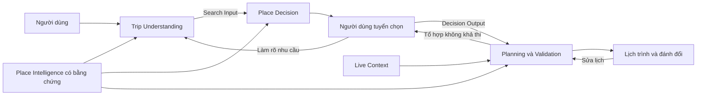

# TripGuardian — Kiến trúc thuật toán hiểu nhu cầu, chọn nơi và lập lịch

> Báo cáo kỹ thuật. Phạm vi kiểm chứng ban đầu: Đà Lạt. Mục 1–6 mô tả kiến trúc hiện tại; mục 7 trình bày hướng tăng tốc dự kiến.

## 1. Bài toán và cách tiếp cận

Một địa điểm hợp sở thích chưa chắc phù hợp với giới hạn của người dùng; nhiều địa điểm tốt riêng lẻ chưa chắc ghép được thành một chuyến đi khả thi. TripGuardian giải quyết lần lượt ba câu hỏi: **người dùng cần gì, nên chọn nơi nào, và có thể ghé chúng vào lúc nào**.

Hệ thống kết hợp mô hình ngôn ngữ để hiểu lời nói với thuật toán tất định để lọc, xếp hạng, lập lịch và kiểm tra. Dữ liệu địa điểm được chuẩn bị offline thành Place Intelligence có bằng chứng. Ba module online chỉ đọc dữ liệu này; thời tiết, thời gian di chuyển và chỗ ở được bổ sung theo từng chuyến. Một thao tác sửa lịch trực tiếp không cần chạy lại toàn bộ ba module: phạm vi phụ thuộc vào điều người dùng thực sự thay đổi.



Việc tách chọn nơi khỏi xếp lịch giúp người dùng kiểm soát nội dung chuyến đi. Đồng thời, Planning có thể trả ngược nguyên nhân không khả thi để người dùng thay đổi lựa chọn.

## 2. Contract chung giữa ba module

**Search Input** mô tả bối cảnh chuyến đi, yêu cầu bắt buộc, sở thích, địa điểm ưu tiên, hoạt động tại từng nơi và ưu tiên thời gian. **Decision Output** giữ tập nơi đã xác nhận, ứng viên dự phòng, nhu cầu tại thời điểm xác nhận và lý do lựa chọn. **Plan Output** biểu diễn lịch theo ngày, chi phí đã biết, cảnh báo, độ vững và phương án thay thế.

Ba loại điều kiện có cách xử lý khác nhau:

| Loại | Vai trò | Cách xử lý |
|---|---|---|
| Physical constraint | Điều không thể hoặc không được thực hiện theo giới hạn thể chất | Không có thao tác nới |
| User hard constraint | Yêu cầu bắt buộc của chuyến đi | Chỉ nới khi người dùng xác nhận, kèm hệ quả |
| Soft preference | Điều người dùng thích hoặc ưu tiên | Dùng để xếp hạng và đánh đổi |

Một requirement được kiểm theo thứ tự **phạm vi hoạt động → bằng chứng → chính sách xử lý**. Không liên quan trả `not_applicable`; có liên quan trả `pass`, `fail` hoặc `unknown`. Hard constraint thiếu bằng chứng không tự thành đạt; chính sách `exclude` chặn, còn `flag` giữ kèm cảnh báo cần kiểm tra.

Ví dụ, café dùng để ăn trưa phải có bằng chứng món chay khi chuyến đi yêu cầu ăn chay. Cùng café đó, nếu chỉ uống cà phê, không cần chứng minh món chay. Bằng chứng vegetarian không chứng minh vegan; “không uống rượu” cũng khác “không đi bar”. Category giúp xác định hoạt động mặc định, không chứng minh dịch vụ của địa điểm.

User Profile chỉ là prior: lời người dùng về chuyến hiện tại có quyền ghi đè. Chưa biết không đồng nghĩa không thích; đã đến không đồng nghĩa đã thích.

## 3. Trip Understanding — chuyển lời nói thành nhu cầu có cấu trúc

**Đầu vào:** hội thoại, địa điểm hoặc liên kết người dùng mang theo, và profile khi được phép sử dụng. **Đầu ra:** Search Input để các module sau tính toán trực tiếp.

Mỗi lượt gồm bốn bước:

1. Rule đọc các tín hiệu rõ ràng như ngày, số ngày, liên kết và giới hạn thể chất.
2. Agent hiểu phần ngôn ngữ còn lại, ghi dữ kiện qua tool và chọn câu hỏi làm rõ.
3. Guard kiểm schema, giá trị và câu trích dẫn trước khi ghi Trip State; yêu cầu bắt buộc còn mơ hồ bị từ chối.
4. Khi người dùng bấm chuyển bước và đủ thông tin tối thiểu, Trip State được biên dịch thành Search Input.

Trip State giữ giá trị cùng nguồn và bằng chứng, giúp người dùng nhận biết điều đã nói, điều suy luận và phần chưa rõ. Agent hỏi theo ngữ cảnh thay vì một form cố định; điều kiện chuyển bước do code kiểm. Tín hiệu thể chất chưa được xử lý có thể chặn chuyển bước.

Các kiểm tra Judge/Clef hỗ trợ phát hiện lời không liên quan, câu hỏi lặp hoặc suy luận không được câu trích hỗ trợ. Khi model lỗi, hệ thống giữ dữ kiện đã ghi hợp lệ và báo phần chưa xử lý; schema và guard vẫn là biên kiểm soát bắt buộc.

Ưu tiên giờ có bằng chứng được truyền xuống Planning như một sở thích mềm. Giờ bắt buộc chưa biểu diễn được phải làm rõ, không được chuyển ngầm thành sở thích.

## 4. Place Decision — chọn nơi phù hợp trước khi xếp lịch

**Đầu vào:** Search Input và serving records của Place Intelligence. **Đầu ra:** tập nơi người dùng xác nhận cùng pool dự phòng.

Pipeline gồm resolve tên địa điểm, truy xuất ứng viên, lọc constraint, tính độ hợp bối cảnh, xếp hạng, đa dạng hóa và kiểm tra tổ hợp đã chọn.

**Sàng lọc trước xếp hạng.** Requirement được kiểm bằng logic dùng chung với Trip và Planning. Anchor hoặc nơi đã khóa không bị loại âm thầm: hệ thống báo xung đột; nơi không thể dùng được giữ ở wishlist thay vì đưa vào tập xác nhận.

**Xếp hạng có thể giải thích.** Điểm kết hợp độ hợp bối cảnh, mức khớp sở thích có bằng chứng, tính mới, kinh nghiệm và một tín hiệu phổ biến nhỏ; bất định và mức nhạy giá có thể làm giảm điểm. Các thành phần được lưu để giải thích vì sao một nơi đứng cao hơn. Sở thích không liên quan đến hoạt động được bỏ khỏi phép tính, tránh làm giảm điểm một cách vô nghĩa.

**Đa dạng hóa bằng MMR.** Mỗi lượt chọn cân bằng điểm phù hợp với mức khác biệt so với những nơi đã có. Các nơi gần trùng được gom để người dùng dễ so sánh lựa chọn thay thế.

**Kiểm tra khả thi thô sau mỗi thao tác.** Tổng thời lượng, tải di chuyển theo cụm, giờ mở cửa, ngân sách và anchor giúp phát hiện tổ hợp quá tải sớm. Đây là ước lượng phục vụ tuyển chọn; Planning mới kiểm tra trên dòng thời gian cụ thể.

Phản hồi có lý do như “xa quá” hoặc “đông quá” có thể điều chỉnh Session Profile và xếp lại ứng viên chưa chọn. Không bấm vào một nơi không được coi là không thích.

## 5. Planning — tối ưu lịch và kiểm tra độc lập

**Đầu vào:** Decision Output và Live Context. **Đầu ra:** một số phương án lịch đã kiểm, kèm giải thích và đánh đổi.

### 5.1. Gom cụm, chia ngày và chọn thứ tự

Các nơi được gom theo khu vực và thời gian di chuyển. Cụm quá tải được tách; nơi chỉ phù hợp một số ngày hoặc cùng tranh một cửa sổ ưu tiên có thể được tách để phân bố lại.

Trong giới hạn cấu hình, chia ngày dùng **quy hoạch động trên tập con các cụm**. Hàm phí xét di chuyển, tải ngày, số nơi theo pace, khả năng mở cửa và các thành phần như thời tiết hoặc độ phù hợp giờ. Bài toán lớn hơn dùng gán tham lam và gắn nhãn fallback.

Trong mỗi ngày, số điểm nhỏ được **vét cạn thứ tự ghé**; số điểm lớn dùng nearest-neighbour kết hợp 2-opt và or-opt. Mỗi thứ tự được mô phỏng với giờ mở cửa, bữa ăn, đệm và nghỉ. Ưu tiên là tránh vi phạm trước khi cải thiện chi phí mềm.

DP tối ưu hàm phí chia cụm; vét cạn tìm thứ tự tốt nhất trong phạm vi một ngày theo bộ mô phỏng. Kiến trúc nhiều bước này **không bảo đảm tối ưu toàn cục cho toàn chuyến**.

### 5.2. Chấm toàn khoảng ghé thay vì chỉ thời điểm đến

Độ phù hợp giờ xét hoạt động, mục đích chuyến đi và ưu tiên có bằng chứng. Ưu tiên riêng cho một nơi thắng ưu tiên chung; hoạt động đã chỉ định không bị đổi chỉ vì category.

Phí timing tăng theo phần thời lượng nằm ngoài cửa sổ ưu tiên và phần visit bị rút. Scheduler thử giờ đến sớm nhất và cửa sổ ưu tiên; nếu chờ giờ đẹp gây vi phạm hoặc lỡ bữa thì thử lịch sớm hơn. Visit có thể rút trong khoảng ước tính, không thấp hơn mức `short`.

Khung giờ mặc định là heuristic có thể cấu hình, không phải fact địa điểm hay kết luận sinh lý đã được chứng minh. Popularity, mức đông và độ phù hợp giờ là ba tín hiệu riêng.

### 5.3. Phương án, validation và độ vững

Các mục tiêu gồm ít di chuyển, chi phí thấp, vững trước thời tiết, đa dạng và hợp sở thích. Pace điều chỉnh cường độ chuyến đi; objective quyết định tiêu chí so sánh. Hiện điểm phương án ưu tiên mục tiêu chính, rồi dùng di chuyển cộng timing penalty để phân biệt phương án cùng điểm chính.

Chỗ ở có thể làm neo đầu/cuối ngày để đánh giá tác động lên lịch. Ma trận di chuyển dùng chung cho các lần thử; route cache tránh tính lại cùng ngữ cảnh. Thiếu OSRM thì dùng ước lượng thô có nhãn.

**Validator đọc lại timeline cuối**, kiểm giờ mở, chồng lấn, di chuyển, khung ngày, anchor, hard constraint, ngân sách đã biết, trùng địa điểm và hazard. Nó không chỉ tin kết luận của scheduler. Thiếu giá được báo riêng, không được coi tổng giá đã biết là tổng chi phí đầy đủ.

**Độ vững** được đo bằng các kịch bản nhiễu như xuất phát trễ, visit dài hơn, travel chậm hơn và mưa. Kết quả Vững / Khả thi / Mong manh phản ánh khả năng chịu nhiễu, không phải xác suất bảo đảm chuyến đi thành công.

Gợi ý thêm nơi chỉ dùng ID thật từ pool dự phòng, thử chèn và validate trước khi trả. Chỉ thao tác của người dùng mới thêm nơi. Proposal của Agent chạy trên nháp, bị kiểm membership, địa điểm bảo vệ, khả thi và điểm mục tiêu trước khi được áp dụng; thất bại giữ baseline.

### 5.4. Phạm vi tính lại khi người dùng sửa

Planning đã phân loại thao tác: sửa state, xếp lại ngày liên quan, dựng lại phương án hoặc cập nhật chỗ ở. Ví dụ đổi thứ tự ngày 2 chỉ cần xếp lại ngày 2; chuyển nơi giữa hai ngày ảnh hưởng cả hai; đổi pace có thể ảnh hưởng cả chuyến. Đổi nhu cầu hoặc hard constraint mới cần biên dịch và sàng lọc lại ở Trip/Decision.

Các nút sửa trực tiếp dùng code tất định. LLM tham gia khi cần hiểu câu tự do hoặc chạy proposal tối ưu; không bắt buộc gọi model sau mỗi thao tác. Chi phí UI là đại lượng suy ra từ lịch đang hoạt động, không phải một bài toán tìm kiếm lịch mới.

Route cache, local repair và cache kết quả ngày giảm tính lại phần không đổi. Gợi ý thử chèn chạy nền trên snapshot, ngoài đường dựng view; chi phí, độ vững và dự phòng lấy từ lịch hiện tại. Benchmark synthetic và giới hạn của số đo ở §7.

## 6. Ví dụ xuyên suốt và kiểm chứng

Người dùng nói: “Đi hai ngày, có một người ăn chay, muốn chụp ảnh ban ngày và uống cà phê giữa trưa; không uống rượu.”

| Module | Kết quả cần giữ |
|---|---|
| Trip Understanding | Dietary hard cho eating, tránh alcohol consumption, mục đích photography và ưu tiên giờ có evidence |
| Place Decision | Điểm tham quan không bị dietary lọc; nơi ăn cần evidence món chay; không tự cấm mọi bar |
| Planning | Xếp photography trong ánh sáng phù hợp khi khả thi, café theo hoạt động coffee; giãn các điểm tranh cùng buổi |
| Sửa và khôi phục phiên | Thêm café vẫn là coffee; thay một bữa ăn vẫn kiểm dietary; chi phí và hoạt động giữ nhất quán |

Các unit test dùng dữ liệu tổng hợp và nguồn live giả lập để kiểm hành vi mà không gọi mạng. Golden test kiểm lịch mẫu; integration test kiểm dữ liệu qua biên module, thao tác sửa và replay session. Kiểm thử nguồn live thật là một lớp riêng.

Đánh giá thuật toán cần dùng cùng tập chuyến cho baseline và phương án cải tiến. Các chỉ số chính là lỗi trích xuất nhu cầu, vi phạm hard constraint, tỷ lệ lịch khả thi, phút di chuyển, timing penalty, số nơi mất khi có nhiễu và độ trễ. Với Planning, baseline nearest-neighbour giúp đo hiệu quả so với cách xếp đơn giản.

Số test pass chứng minh các hành vi đã kiểm, chưa chứng minh mức hài lòng thực tế. Hiệu quả cá nhân hóa cần thêm đánh giá người dùng; lợi ích timing cần thí nghiệm bật/tắt trên cùng bộ tình huống.

## 7. Tính toán khi sửa lịch và kết quả đo

Planning dùng local repair, cache hữu hạn trong RAM và gợi ý nền; không đổi dữ liệu lưu, dependency hay objective weights. Chi tiết runtime nằm ở `docs/PLANNING.md` §Tính lại và cache; contract read/revision ở `docs/AGENT_HARNESS.md`.

```text
Thao tác → state nháp → sửa ngày bị ảnh hưởng → validate → metrics → lưu và trả UI
                                                                      │
                                                                      └→ gợi ý chạy nền
                                                                         → kiểm revision
                                                                         → cập nhật phần gợi ý
```

| Thành phần | Hành vi | Điều kiện giữ |
|---|---|---|
| Sửa lịch | Giữ thứ tự cũ, thử chèn nơi mới hoặc mô phỏng sau khi bỏ; mở rộng tìm kiếm khi sửa nhỏ không đủ | Lịch sửa phải qua validator; không di chuyển nơi đã bảo vệ |
| Phạm vi | Tính lại ngày bị ảnh hưởng, tổng hợp metrics và kiểm constraint toàn chuyến | Đổi pace, chỗ ở hoặc constraint có thể vô hiệu hóa nhiều ngày |
| Cache trong RAM | Dùng lại kết quả ngày và gợi ý khi ngữ cảnh tính toán không đổi | Key phải xét activity, pace, khung giờ, constraint, config và live context liên quan |
| Gợi ý tùy chọn | Thử backup và phân tích bổ sung ngoài đường trả lịch chính | Hiện trạng thái đang tính; kết quả cũ không được ghi đè revision mới |
| UI | Dùng metrics/độ vững/dự phòng của lịch hiện tại; lọc read/SSE cũ theo revision, generation và token | Thêm/bỏ/chuyển nơi vẫn giữ thứ tự thao tác và undo; màn hiện không có control liên tục |
| LLM | Giữ thao tác trực tiếp tất định, chỉ chạy proposal khi được yêu cầu | Proposal vẫn kiểm membership, slot bảo vệ, validation và objective |

Sửa từ lịch hiện tại đổi một phần chất lượng tối ưu lấy thời gian phản hồi. Người dùng có thể yêu cầu tối ưu rộng hơn; hệ thống không tự áp một lịch khác sau khi đã trả kết quả sửa.

Timeline, validator, metrics và proposal dùng cùng tập nơi/activity hiện tại, kể cả backup đã thêm. View được dựng trên nháp trước khi lưu. Thiếu giá tiếp tục là `unknown`; worker lỗi chỉ làm gợi ý `unavailable`. Confirm kiểm lại toàn lịch.

Đo ngày 11/10/2026 bằng `tests/planning/bench_edits.py --runs 10`: cùng máy, cấu hình, ba POI synthetic và một backup coffee, nguồn live giả lập; mỗi phiên thêm backup, bỏ rồi thêm lại. Baseline là bản code lưu trước sửa. Đơn vị milliseconds; p95 là mẫu ở vị trí ceil(0,95 × số mẫu).

| Đường đo | Baseline p50 / p95 | Hiện tại p50 / p95 |
|---|---:|---:|
| Bootstrap: create + chọn variant | 4,497 / 40,804 | 7,823 / 44,849 |
| Thêm nơi, cache chưa có kết quả | 5,296 / 5,606 | 6,295 / 6,577 |
| Thêm lại cùng nơi/ngữ cảnh | 5,321 / 5,396 | 1,110 / 1,152 |
| Load lịch hiện tại | 1,086 / 1,098 | 0,459 / 0,473 |
| Từ thêm nơi cold đến gợi ý ready | 5,299 / 5,609 | 7,482 / 7,806 |
| Từ thêm lại warm đến gợi ý ready | 5,323 / 5,400 | 2,170 / 2,292 |

Lượt simulate trong cold/warm/load là 24/24/4 ở baseline và 8/0/0 ở bản hiện tại; cold gồm bốn vị trí chèn và bốn kịch bản độ vững. Cả hai có travel 9 phút, timing penalty 0 và không có vi phạm trên fixture này. Cache ngày có hit ở các lượt warm; số đo từng operation nằm trong `Engine.timings`.

Fixture nhỏ cho thấy warm edit/load nhanh hơn nhưng cold edit và bootstrap chậm hơn vì có thêm kiểm hiện trạng, cache và độ vững hiện tại. Mười lượt synthetic không chứng minh tốc độ production hoặc chất lượng tối ưu trên mọi chuyến; suggestions-ready còn gồm polling nội bộ của benchmark. Không dùng số đo này làm cam kết hệ số tăng tốc. Phạm vi yêu cầu ở [Đề xuất tối ưu tính toán](PLANNING_PERFORMANCE_PROPOSAL.md).

Giới hạn thực tế gồm dữ liệu địa điểm chưa đầy đủ, giờ mở hoặc giá có thể cũ, travel chưa có traffic thời gian thực và giá chỗ ở chỉ tham khảo. Việc chứng minh hiệu quả cần tách chất lượng dữ liệu, độ đúng thuật toán và trải nghiệm người dùng.

## Tài liệu kỹ thuật đối chiếu

Chi tiết hiện trạng nằm tại [Kiến trúc](../docs/ARCHITECTURE.md), [Trip Understanding](../docs/TRIP_UNDERSTANDING.md), [Place Decision](../docs/PLACE_DECISION.md) và [Planning](../docs/PLANNING.md). Báo cáo này là bản tổng hợp cho cuộc thi; contract runtime được xác định bởi public API, schema và tests.
